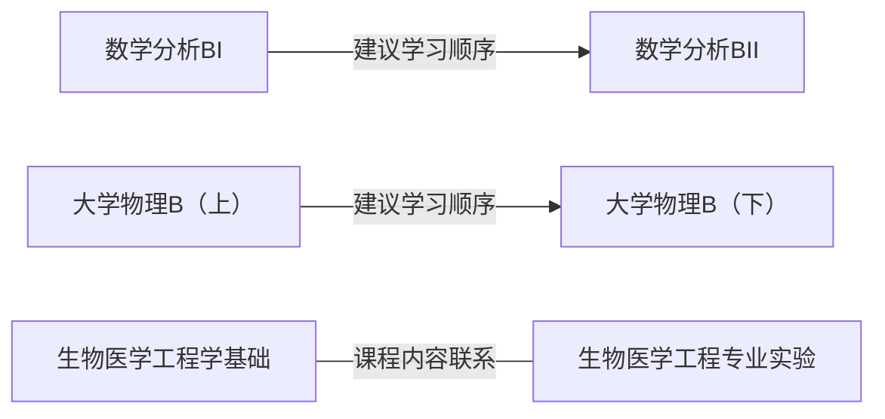

# 生物医学工程（智慧医药与芯片领军人才班）专业修读建议（香农计划适用）

2024 年汇编印刷页 801–802。原表记录 28 个可配对的课程代码。

[本节原页](plan-798.pdf#page=4) · [逐行数据](plan-798.json) · [院系目录](README.md)

## 课程导读

想了解生物医学与工程的课程安排，可以在原表中找到《生物医学工程学基础》（`INFO130020`）、《生物芯片导论》（`INFO130426`）、《生物医学工程专业实验》（`INFO130390`）。 [原书 PDF 第 816 页](plan-798.pdf#page=5)

图中连接《生物医学工程学基础》（`INFO130020`）和《生物医学工程专业实验》（`INFO130390`），两门课都从课程题名标出的“生物医学工程”切入，可沿这一主题对照阅读。 [原书 PDF 第 816 页](plan-798.pdf#page=5)

## 课程关系图

图中展示最多 20 条关系。下表列出本节全部关系。建议学习顺序供规划课程使用，正式选课资格以教务规定为准。

| 课程 | 关联课程 | 关系 | 依据 |
| --- | --- | --- | --- |
| 数学分析BI（MATH120016） | 数学分析BII（MATH120017） | 建议学习顺序 | 同节课程题名标明连续分册或序号。 |
| 大学物理B（上）（PHYS120013） | 大学物理B（下）（PHYS120014） | 建议学习顺序 | 同节课程题名标明连续分册或序号。 |
| 生物医学工程学基础（INFO130020） | 生物医学工程专业实验（INFO130390） | 课程内容联系 | 本方案两门课程的题名均含“生物医学工程”，可据此对照这一主题。 |

## 课程

| 课程代码 | 名称 | 开课学期原文 | 来源（PDF 页） |
| --- | --- | --- | --- |
| BIOL120002 | 现代生物科学导论A |  | 815 |
| BIOL130008 | 细胞生物学 |  | 816 |
| CHEM130073 | 药物化学 |  | 816 |
| COMP120004 | 线性代数 |  | 815 |
| COMP120006 | 程序设计 |  | 815 |
| INFO120011 | 电子系统导论 |  | 816 |
| INFO130001 | 概率、数理统计与随机过程 |  | 816 |
| INFO130010 | 数字信号处理A |  | 816 |
| INFO130016 | 毕业论文 |  | 816 |
| INFO130020 | 生物医学工程学基础 |  | 816 |
| INFO130236 | 前沿讲座 |  | 816 |
| INFO130306 | 信号与系统 |  | 816 |
| INFO130331 | 数字逻辑基础 |  | 816 |
| INFO130347 | 模拟电子学基础 |  | 816 |
| INFO130348 | 模拟与数字电路实验 |  | 816 |
| INFO130390 | 生物医学工程专业实验 |  | 816 |
| INFO130426 | 生物芯片导论 |  | 816 |
| MATH120016 | 数学分析BI |  | 815 |
| MATH120017 | 数学分析BII |  | 815 |
| MICR120001 | 电路基础 |  | 816 |
| PHYS120013 | 大学物理B（上） |  | 815 |
| PHYS120014 | 大学物理B（下） |  | 815 |
| PHYS120015 | 基础物理实验 |  | 815 |
| PTSS110082 | 毛泽东思想和中国特色社会主义理论体系概论 |  | 815 |
| PTSS110087 | 马克思主义基本原理 |  | 815 |
| PTSS110088 | 中国近现代史纲要 |  | 815 |
| PTSS110089 | 思想道德与法治 |  | 815 |
| PTSS110090 | 习近平新时代中国特色社会主义思想概论 |  | 815 |
