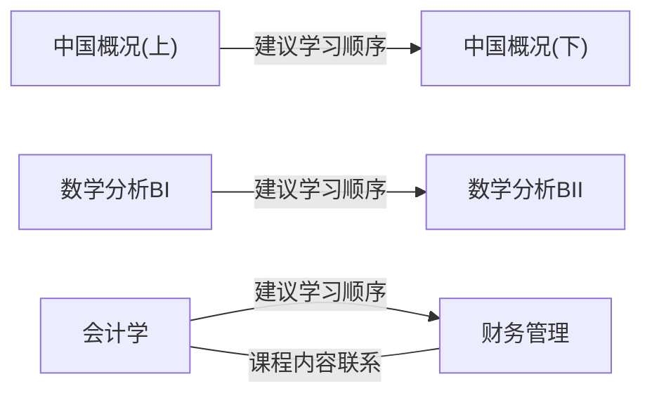

# 管理科学（人工智能、大数据、供应链管理）专业“2+X”修读建议（留学生适用）

2024 年汇编印刷页 486–487。原表记录 29 个可配对的课程代码。

[本节原页](plan-478.pdf#page=9) · [逐行数据](plan-478.json) · [院系目录](README.md)

## 课程导读

想了解运营管理与数量分析的课程安排，可以在原表中找到《运筹学》（`MANA130005`）、《供应链管理》（`MANA130073`）、《最优化方法及应用》（`MANA130326`）。 [原书 PDF 第 500 页](plan-478.pdf#page=9)

图中把《财务管理》（`MANA130004`）和《会计学》（`SOSC120006`）列作内容联系。会计信息与企业融资、投资决策存在应用联系。 [原书 PDF 第 500 页](plan-478.pdf#page=9)

## 课程关系图

图中展示最多 20 条关系。下表列出本节全部关系。建议学习顺序供规划课程使用，正式选课资格以教务规定为准。

| 课程 | 关联课程 | 关系 | 依据 |
| --- | --- | --- | --- |
| 中国概况(上)（ICES110012） | 中国概况(下)（ICES110013） | 建议学习顺序 | 同节课程题名标明连续分册或序号。 |
| 数学分析BI（MATH120016） | 数学分析BII（MATH120017） | 建议学习顺序 | 同节课程题名标明连续分册或序号。 |
| 会计学（SOSC120006） | 财务管理（MANA130004） | 建议学习顺序 | 会计报表和核算概念可用于理解财务决策。 |
| 财务管理（MANA130004） | 会计学（SOSC120006） | 课程内容联系 | 会计信息与企业融资、投资决策存在应用联系。 |

## 课程

| 课程代码 | 名称 | 开课学期原文 | 来源（PDF 页） |
| --- | --- | --- | --- |
| ICES110012 | 中国概况(上) |  | 500 |
| ICES110013 | 中国概况(下) |  | 500 |
| MANA130001 | 概率论与数理统计 |  | 500 |
| MANA130004 | 财务管理 |  | 500 |
| MANA130005 | 运筹学 |  | 500 |
| MANA130006 | 营销管理 |  | 500 |
| MANA130007 | 管理信息系统 |  | 500 |
| MANA130010 | 随机运筹学 |  | 500 |
| MANA130017 | 毕业论文 |  | 501 |
| MANA130046 | 组织行为学 |  | 500 |
| MANA130073 | 供应链管理 |  | 500 |
| MANA130076 | 统计软件 |  | 500 |
| MANA130085 | 金融工程 |  | 500 |
| MANA130121 | 计量经济学 |  | 500 |
| MANA130320 | 商业伦理学 |  | 500 |
| MANA130326 | 最优化方法及应用 |  | 500 |
| MANA130360 | 毕业实习 |  | 501 |
| MANA130399 | 社会调查 |  | 500 |
| MANA130401 | 经济学原理 |  | 500 |
| MANA130410 | 职业规划与发展 |  | 501 |
| MANA130416 | Python编程基础与数 据分析入门 |  | 500 |
| MATH120016 | 数学分析BI |  | 500 |
| MATH120017 | 数学分析BII |  | 500 |
| MATH120044 | 线性代数 |  | 500 |
| SOSC120004 | 微观经济学 |  | 500 |
| SOSC120005 | 宏观经济学 |  | 500 |
| SOSC120006 | 会计学 |  | 500 |
| SOSC120010 | 社会研究方法B |  | 500 |
| SOSC120014 | 管理学导论 |  | 500 |
