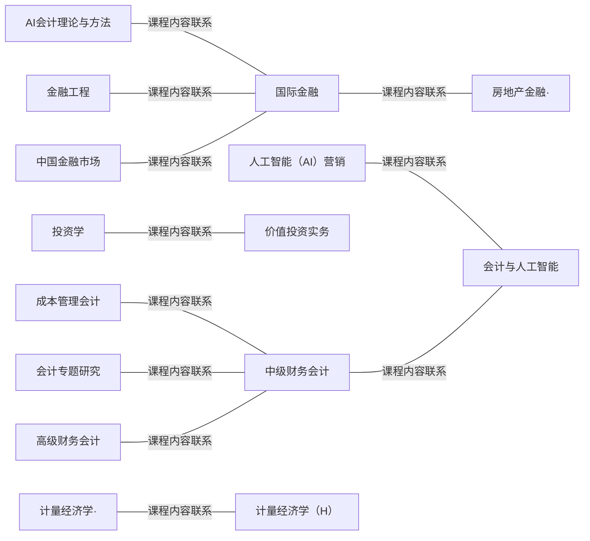

# 会计学专业“2+X”教学培养方案

2024 年汇编印刷页 506–510。原表记录 97 个可配对的课程代码。

[本节原页](plan-506.pdf#page=1) · [逐行数据](plan-506.json) · [院系目录](README.md)

## 课程导读

想了解会计与审计的课程安排，可以在原表中找到《中级财务会计》（`MANA130406`）、《财务报告》（`MANA130405`）、《审计学\*》（`MANA130038`）。 [原书 PDF 第 521 页](plan-506.pdf#page=2)

图中连接《成本管理会计》（`MANA130036`）和《中级财务会计》（`MANA130406`），两门课都从课程题名标出的“会计”切入，可沿这一主题对照阅读。 [原书 PDF 第 521 页](plan-506.pdf#page=2)

## 课程关系图

图中展示最多 20 条关系。下表列出本节全部关系。建议学习顺序供规划课程使用，正式选课资格以教务规定为准。

| 课程 | 关联课程 | 关系 | 依据 |
| --- | --- | --- | --- |
| AI会计理论与方法（AIS210009） | 国际金融（MANA130382） | 课程内容联系 | 本方案两门课程的题名均含“金融”，可据此对照这一主题。 |
| 人工智能（AI）营销（AIT310026） | 会计与人工智能（MANA130407） | 课程内容联系 | 本方案两门课程的题名均含“人工智能”，可据此对照这一主题。 |
| 投资学（MANA130029） | 价值投资实务（MANA130396） | 课程内容联系 | 本方案两门课程的题名均含“投资”，可据此对照这一主题。 |
| 成本管理会计（MANA130036） | 中级财务会计（MANA130406） | 课程内容联系 | 本方案两门课程的题名均含“会计”，可据此对照这一主题。 |
| 金融工程（MANA130085） | 国际金融（MANA130382） | 课程内容联系 | 本方案两门课程的题名均含“金融”，可据此对照这一主题。 |
| 中国金融市场（MANA130114） | 国际金融（MANA130382） | 课程内容联系 | 本方案两门课程的题名均含“金融”，可据此对照这一主题。 |
| 计量经济学*（MANA130121） | 计量经济学（H）（MANA130121h） | 课程内容联系 | 本方案两门课程的题名均含“计量经济”，可据此对照这一主题。 |
| 会计专题研究（MANA130358） | 中级财务会计（MANA130406） | 课程内容联系 | 本方案两门课程的题名均含“会计”，可据此对照这一主题。 |
| 高级财务会计（MANA130366） | 中级财务会计（MANA130406） | 课程内容联系 | 本方案两门课程的题名均含“会计”，可据此对照这一主题。 |
| 国际金融（MANA130382） | 房地产金融*（MANA130402） | 课程内容联系 | 本方案两门课程的题名均含“金融”，可据此对照这一主题。 |
| 中级财务会计（MANA130406） | 会计与人工智能（MANA130407） | 课程内容联系 | 本方案两门课程的题名均含“会计”，可据此对照这一主题。 |

## 课程

| 课程代码 | 名称 | 开课学期原文 | 来源（PDF 页） |
| --- | --- | --- | --- |
| AIS210009 | AI会计理论与方法、行为金融学 | 6、5,6 | 522, 523 |
| AIT310026 | 人工智能（AI）营销 | 5,6 | 524 |
| MANA130001 | 概率论与数理统计 | 3 | 520 |
| MANA130004 | 财务管理* | 3 | 520 |
| MANA130005 | 运筹学* | 3 | 520 |
| MANA130006 | 营销管理* | 4 | 521 |
| MANA130007 | 管理信息系统* | 3 | 520 |
| MANA130008 | 运营管理* | 5,6 | 523 |
| MANA130010 | 随机运筹学 | 5 | 522 |
| MANA130013 | 物流管理 | 5,6 | 523 |
| MANA130017 | 毕业论文 | 8 | 521 |
| MANA130021 | 回归分析* | 5、5,6 | 522, 523 |
| MANA130022 | 时间序列分析 | 5、5,6 | 522, 523 |
| MANA130023 | 多元分析 | 6 | 522 |
| MANA130024 | 随机过程 | 6、5,6 | 522, 523 |
| MANA130029 | 投资学 | 5 | 522 |
| MANA130031 | 国际财务管理 | 5,6 | 523 |
| MANA130036 | 成本管理会计 | 5 | 521 |
| MANA130037 | 税法 | 5 | 521 |
| MANA130038 | 审计学* | 6 | 521 |
| MANA130042 | 国际商务管理* | 5 | 523 |
| MANA130046 | 组织行为学* | 4 | 521 |
| MANA130055 | 消费者行为学 | 5 | 522 |
| MANA130056 | 营销研究 | 5 | 522 |
| MANA130062 | 服务营销* | 5 | 522 |
| MANA130073 | 供应链管理 | 4 | 522 |
| MANA130076 | 统计软件 | 4 | 521 |
| MANA130083 | 非参数统计 | 7 | 523 |
| MANA130085 | 金融工程 | 6 | 522 |
| MANA130097 | 属性数据分析 | 7 | 522 |
| MANA130114 | 中国金融市场 | 5,6 | 523 |
| MANA130121 | 计量经济学* | 5 | 521 |
| MANA130121h | 计量经济学（H） | 5,6 | 523 |
| MANA130153 | 人力资源管理 | 5 | 522 |
| MANA130283 | 战略管理* | 5 | 523 |
| MANA130306 | 东方管理 | 6 | 522 |
| MANA130310 | 抽样调查 | 6 | 522 |
| MANA130311 | 最优化方法及应用* | 5 | 522 |
| MANA130313 | 衍生证券 | 6 | 522 |
| MANA130314 | 公司财务理论与实务 | 6 | 522 |
| MANA130315 | 公司治理 | 6 | 522 |
| MANA130320 | 商业伦理学* | 1 | 520 |
| MANA130323 | 法律、商业与社会 | 7 | 523 |
| MANA130324 | 组织沟通与社会环境* | 6 | 523 |
| MANA130325 | 职业责任与领导力* | 6 | 523 |
| MANA130327 | 金融市场与金融机构* | 5 | 522 |
| MANA130328h | 高级微观经济学（H） | 5,6 | 523 |
| MANA130331 | 仿真与模拟 | 5,6 | 523 |
| MANA130341 | 信息技术创新应用 | 5,6 | 523 |
| MANA130343 | 博弈论* | 5,6 | 523 |
| MANA130344 | 产业经济学 | 5,6 | 523 |
| MANA130345 | 规制经济学 | 5,6 | 523 |
| MANA130346 | 产业组织与企业战略 | 5,6 | 523 |
| MANA130349 | 基金管理* | 5,6 | 523 |
| MANA130350 | 经济与金融中的统计方法 | 5,6 | 523 |
| MANA130353 | 统计推断* | 5 | 522 |
| MANA130357 | 财务报表分析 | 5 | 521 |
| MANA130358 | 会计专题研究 | 6 | 521 |
| MANA130360 | 毕业实习 | 8 | 521 |
| MANA130362 | 数字化营销 | 6 | 522 |
| MANA130366 | 高级财务会计 | 6 | 521 |
| MANA130367 | 财务报表与资本市场 | 6 | 521 |
| MANA130368 | 统计计算 | 5,6 | 523 |
| MANA130369 | 高等概率论 | 5,6 | 523 |
| MANA130370 | 高等数理统计（一） | 5,6 | 523 |
| MANA130371 | 企业应用系统与管理决策 | 5,6 | 523 |
| MANA130372 | 电子商务与移动商务 | 5,6 | 523 |
| MANA130373 | 数据库与企业数据管理 | 5 | 522 |
| MANA130374 | 数据挖掘原理与技术 | 5 | 522 |
| MANA130375 | 互联网应用分析与设计 | 6 | 522 |
| MANA130376 | 大数据商务分析与应用* | 6 | 522 |
| MANA130377 | 程序设计与数据可视化 | 5,6 | 523 |
| MANA130378 | 社会化媒体分析 | 5,6 | 523 |
| MANA130380 | 互联网经济学 | 5,6 | 523 |
| MANA130382 | 国际金融 | 5,6 | 523 |
| MANA130383 | 金融科技导论 | 5,6 | 524 |
| MANA130384 | 产品创新管理 | 5,6 | 524 |
| MANA130393 | 品牌传播管理 | 5,6 | 524 |
| MANA130394 | 营销工程 | 5,6 | 524 |
| MANA130396 | 价值投资实务 | 5,6 | 524 |
| MANA130397 | 资本资产定价 | 5,6 | 524 |
| MANA130398 | 数据科学编程基础 | 5,6 | 524 |
| MANA130399 | 社会调查 | 5 | 521 |
| MANA130401 | 经济学原理* | 1 | 520 |
| MANA130402 | 房地产金融* | 5,6 | 524 |
| MANA130404 | 数据结构与算法导论 | 5,6 | 524 |
| MANA130405 | 财务报告 | 5 | 521 |
| MANA130406 | 中级财务会计 | 4 | 521 |
| MANA130407 | 会计与人工智能 | 5/6 | 521 |
| MANA130408 | 营销科技与决策系统 | 5,6 | 524 |
| MANA130410 | 职业规划与发展 | 4 | 521 |
| MANA130411h | 现代企业理论（H） | 5,6 | 523 |
| MANA130412 | 营销创意思维 | 5,6 | 524 |
| MANA130413 | 数字平台经济学* | 5,6 | 524 |
| MANA130414 | 机器学习导论 | 6 | 522 |
| MANA130415 | 国际创业* | 5 | 522 |
| MANA130416 | Python编程基础与数 据分析入门 | 2 | 520 |
