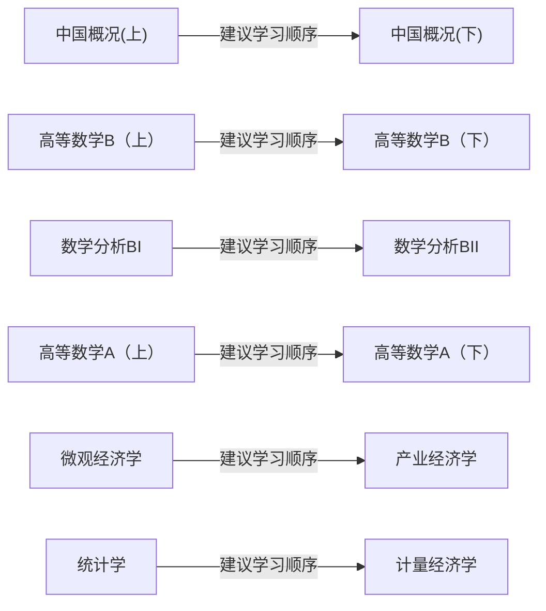

# 经济学专业“2+X”修读建议（留学生适用）

2024 年汇编印刷页 403–404。原表记录 32 个可配对的课程代码。

[本节原页](plan-398.pdf#page=6) · [逐行数据](plan-398.json) · [院系目录](README.md)

## 课程导读

想了解经济理论与分析方法的课程安排，可以在原表中找到《计量经济学》（`ECON130213`）、《经济史》（`ECON130212`）、《微观经济学》（`SOSC120004`）。 [原书 PDF 第 417 页](plan-398.pdf#page=6)

图谱建议先读《微观经济学》（`SOSC120004`）再读《产业经济学》（`ECON130011`）。企业和市场结构是产业经济分析的基础。 [原书 PDF 第 417 页](plan-398.pdf#page=6)

## 课程关系图

图中展示最多 20 条关系。下表列出本节全部关系。建议学习顺序供规划课程使用，正式选课资格以教务规定为准。

| 课程 | 关联课程 | 关系 | 依据 |
| --- | --- | --- | --- |
| 中国概况(上)（ICES110012） | 中国概况(下)（ICES110013） | 建议学习顺序 | 同节课程题名标明连续分册或序号。 |
| 高等数学B（上）（MATH120003） | 高等数学B（下）（MATH120004） | 建议学习顺序 | 同节课程题名标明连续分册或序号。 |
| 数学分析BI（MATH120016） | 数学分析BII（MATH120017） | 建议学习顺序 | 同节课程题名标明连续分册或序号。 |
| 高等数学A（上）（MATH120021） | 高等数学A（下）（MATH120022） | 建议学习顺序 | 同节课程题名标明连续分册或序号。 |
| 微观经济学（SOSC120004） | 产业经济学（ECON130011） | 建议学习顺序 | 企业和市场结构是产业经济分析的基础。 |
| 统计学（SOSC120017） | 计量经济学（ECON130213） | 建议学习顺序 | 统计推断为计量模型的估计与检验提供基础。 |

## 课程

| 课程代码 | 名称 | 开课学期原文 | 来源（PDF 页） |
| --- | --- | --- | --- |
| ECON130001 | 概率论与数理统计 |  | 417 |
| ECON130005 | 财政学 |  | 417 |
| ECON130009 | 资本论 |  | 417 |
| ECON130010 | 当代中国经济 |  | 417 |
| ECON130011 | 产业经济学 |  | 417 |
| ECON130016 | 社会实践 |  | 418 |
| ECON130017 | 毕业论文 |  | 418 |
| ECON130019 | 国际经济学 |  | 417 |
| ECON130064 | 博弈论 |  | 417 |
| ECON130128 | 制度经济学 |  | 417 |
| ECON130131 | 外国经济思想史 |  | 417 |
| ECON130212 | 经济史 |  | 417 |
| ECON130213 | 计量经济学 |  | 417 |
| ECON130215 | 经济学经典文献选读与写作 |  | 418 |
| ECON130217 | 公司金融 |  | 417 |
| ECON130239 | 资源环境经济学 |  | 417 |
| ECON130261 | 社会实习 |  | 418 |
| ICES110012 | 中国概况(上) |  | 417 |
| ICES110013 | 中国概况(下) |  | 417 |
| MATH120003 | 高等数学B（上） |  | 417 |
| MATH120004 | 高等数学B（下） |  | 417 |
| MATH120016 | 数学分析BI |  | 417 |
| MATH120017 | 数学分析BII |  | 417 |
| MATH120021 | 高等数学A（上） |  | 417 |
| MATH120022 | 高等数学A（下） |  | 417 |
| MATH120044 | 线性代数 |  | 417 |
| SOSC120004 | 微观经济学 |  | 417 |
| SOSC120005 | 宏观经济学 |  | 417 |
| SOSC120006 | 会计学 |  | 417 |
| SOSC120007 | 经济学原理 |  | 417 |
| SOSC120008 | 政治经济学 |  | 417 |
| SOSC120017 | 统计学 |  | 417 |
