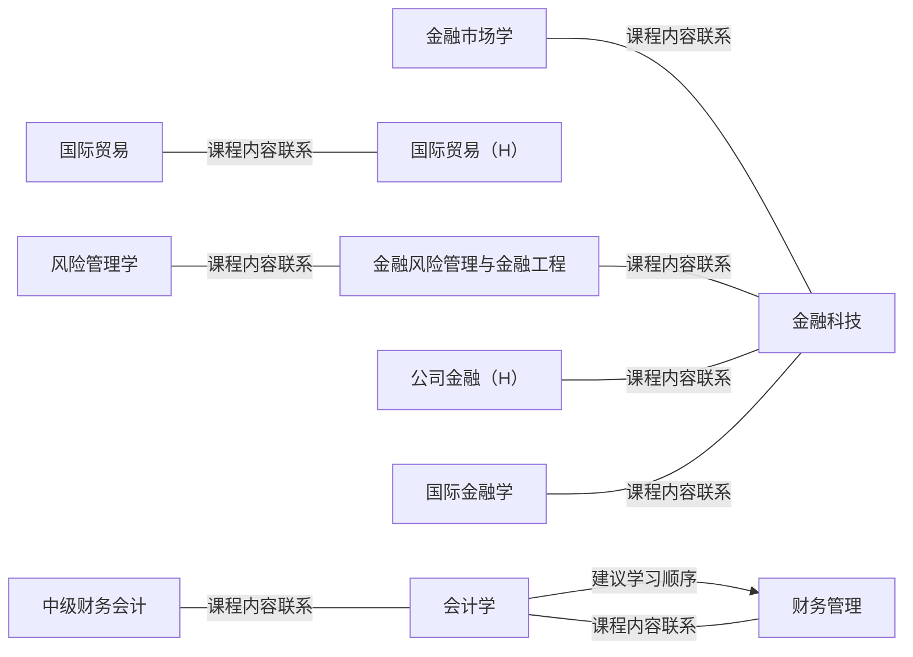

# 经济学（国际项目）专业“2+X”教学培养方案（港澳台侨生适用）

2024 年汇编印刷页 414–417。原表记录 47 个可配对的课程代码。

[本节原页](plan-414.pdf#page=1) · [逐行数据](plan-414.json) · [院系目录](README.md)

## 课程导读

想了解经济理论与分析方法的课程安排，可以在原表中找到《计量经济学（H）》（`ECON130240h`）、《经济史》（`ECON130249`）、《中级微观经济学》（`ECON130244`）。 [原书 PDF 第 428 页](plan-414.pdf#page=1)

图中连接《国际贸易》（`ECON130004`）和《国际贸易（H）》（`ECON130267h`），两门课都从课程题名标出的“国际贸易”切入，可沿这一主题对照阅读。 [原书 PDF 第 429 页](plan-414.pdf#page=2) · [原书 PDF 第 430 页](plan-414.pdf#page=3)

## 课程关系图

图中展示最多 20 条关系。下表列出本节全部关系。建议学习顺序供规划课程使用，正式选课资格以教务规定为准。

| 课程 | 关联课程 | 关系 | 依据 |
| --- | --- | --- | --- |
| 会计学（SOSC120006） | 财务管理（ECON130046） | 建议学习顺序 | 会计报表和核算概念可用于理解财务决策。 |
| 国际贸易（ECON130004） | 国际贸易（H）（ECON130267h） | 课程内容联系 | 本方案两门课程的题名均含“国际贸易”，可据此对照这一主题。 |
| 金融市场学（ECON130030） | 金融科技（ECON130280） | 课程内容联系 | 本方案两门课程的题名均含“金融”，可据此对照这一主题。 |
| 风险管理学（ECON130037） | 金融风险管理与金融工程（ECON130221） | 课程内容联系 | 本方案两门课程的题名均含“风险管理”，可据此对照这一主题。 |
| 财务管理（ECON130046） | 会计学（SOSC120006） | 课程内容联系 | 会计信息与企业融资、投资决策存在应用联系。 |
| 中级财务会计（ECON130139） | 会计学（SOSC120006） | 课程内容联系 | 本方案两门课程的题名均含“会计”，可据此对照这一主题。 |
| 金融风险管理与金融工程（ECON130221） | 金融科技（ECON130280） | 课程内容联系 | 本方案两门课程的题名均含“金融”，可据此对照这一主题。 |
| 公司金融（H）（ECON130248h） | 金融科技（ECON130280） | 课程内容联系 | 本方案两门课程的题名均含“金融”，可据此对照这一主题。 |
| 国际金融学（ECON130254） | 金融科技（ECON130280） | 课程内容联系 | 本方案两门课程的题名均含“金融”，可据此对照这一主题。 |

## 课程

| 课程代码 | 名称 | 开课学期原文 | 来源（PDF 页） |
| --- | --- | --- | --- |
| DATA130008 | 人工智能 |  | 430 |
| DATA130049 | 图像处理与可视化 |  | 430 |
| ECON130004 | 国际贸易 |  | 430 |
| ECON130005 | 财政学 |  | 430 |
| ECON130012 | 发展经济学 |  | 430 |
| ECON130030 | 金融市场学 |  | 430 |
| ECON130037 | 风险管理学 |  | 430 |
| ECON130046 | 财务管理 |  | 430 |
| ECON130063 | 国际营销学 |  | 430 |
| ECON130064 | 博弈论 | 4 | 429 |
| ECON130083 | 时间序列分析的方法 | 5 | 429 |
| ECON130105 | 微分方程 |  | 430 |
| ECON130115 | 国际商务 |  | 430 |
| ECON130123 | 随机过程 |  | 430 |
| ECON130139 | 中级财务会计 |  | 430 |
| ECON130170 | 动态优化 |  | 430 |
| ECON130189 | 数量分析软件应用 | 6 | 429 |
| ECON130199 | 劳动经济学 |  | 430 |
| ECON130207 | 应用微观经济学 | 6 | 429 |
| ECON130211 | 毕业论文② | 8 | 429 |
| ECON130215 | 经济学经典文献选读与写作 | 7 | 429 |
| ECON130218h | 经济学前沿专题（H） | 6 | 429 |
| ECON130219 | 资产定价 | 6 | 429 |
| ECON130221 | 金融风险管理与金融工程 |  | 430 |
| ECON130226 | 投资学 |  | 430 |
| ECON130230 | 公共财政政策分析 |  | 430 |
| ECON130240h | 计量经济学（H） | 3 | 428 |
| ECON130242 | 产业组织 | 6 | 429 |
| ECON130243 | 国际经济学 | 4 | 428 |
| ECON130244 | 中级微观经济学 | 3 | 428 |
| ECON130245 | 中级宏观经济学 | 3 | 428 |
| ECON130246 | 当代中国经济 | 6 | 428 |
| ECON130248h | 公司金融（H） | 4 | 428 |
| ECON130249 | 经济史 | 3 | 428 |
| ECON130253h | 发展经济学（H） | 5 | 429 |
| ECON130254 | 国际金融学 | 6 | 429 |
| ECON130255 | 城市经济学 | 5 | 429 |
| ECON130256 | 货币银行学 | 4 | 429 |
| ECON130257h | 劳动经济学（H） | 5 | 429 |
| ECON130258 | 经济全球化与中国 | 5 | 429 |
| ECON130261 | 社会实习 | 7 | 429 |
| ECON130267h | 国际贸易（H） | 6 | 429 |
| ECON130277h | 截面与面板数据分析（H） | 4 | 428 |
| ECON130280 | 金融科技 |  | 430 |
| ECON130283 | 海外学者专题 | 4 | 429 |
| ECON130286 | 学术实习 | 4 | 429 |
| SOSC120006 | 会计学 | 2 | 429 |
