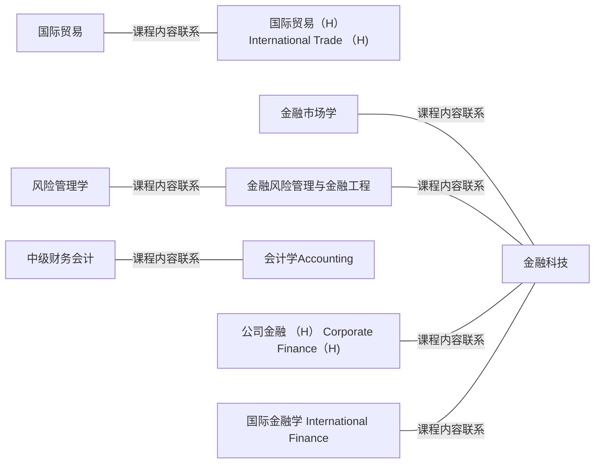

# 经济学（国际项目）专业“2+X”修读建议

2024 年汇编印刷页 422–425。原表记录 59 个可配对的课程代码。

[本节原页](plan-418.pdf#page=5) · [逐行数据](plan-418.json) · [院系目录](README.md)

## 课程关系图

图中展示最多 20 条关系。下表列出本节全部关系。建议学习顺序供规划课程使用，正式选课资格以教务规定为准。

| 课程 | 关联课程 | 关系 | 依据 |
| --- | --- | --- | --- |
| 国际贸易（ECON130004） | 国际贸易（H） International Trade （H)（ECON130267h） | 课程内容联系 | 本方案两门课程的题名均含“国际贸易”，可据此对照这一主题。 |
| 金融市场学（ECON130030） | 金融科技（ECON130280） | 课程内容联系 | 本方案两门课程的题名均含“金融”，可据此对照这一主题。 |
| 风险管理学（ECON130037） | 金融风险管理与金融工程（ECON130221） | 课程内容联系 | 本方案两门课程的题名均含“风险管理”，可据此对照这一主题。 |
| 中级财务会计（ECON130139） | 会计学Accounting（SOSC120006） | 课程内容联系 | 本方案两门课程的题名均含“会计”，可据此对照这一主题。 |
| 金融风险管理与金融工程（ECON130221） | 金融科技（ECON130280） | 课程内容联系 | 本方案两门课程的题名均含“金融”，可据此对照这一主题。 |
| 公司金融 （H） Corporate Finance（H)（ECON130248h） | 金融科技（ECON130280） | 课程内容联系 | 本方案两门课程的题名均含“金融”，可据此对照这一主题。 |
| 国际金融学 International Finance（ECON130254） | 金融科技（ECON130280） | 课程内容联系 | 本方案两门课程的题名均含“金融”，可据此对照这一主题。 |

## 课程

| 课程代码 | 名称 | 开课学期原文 | 来源（PDF 页） |
| --- | --- | --- | --- |
| DATA130008 | 人工智能 |  | 438 |
| DATA130049 | 图像处理与可视化 |  | 438 |
| ECON130004 | 国际贸易 |  | 438 |
| ECON130005 | 财政学 |  | 438 |
| ECON130012 | 发展经济学 |  | 438 |
| ECON130030 | 金融市场学 |  | 438 |
| ECON130037 | 风险管理学 |  | 438 |
| ECON130046 | 财务管理 |  | 438 |
| ECON130063 | 国际营销学 |  | 438 |
| ECON130064 | 博弈论 Game Theory |  | 437 |
| ECON130083 | 时间序列分析的方法 Approach to Time Series Analysis |  | 437 |
| ECON130105 | 微分方程 |  | 438 |
| ECON130115 | 国际商务 |  | 438 |
| ECON130123 | 随机过程 |  | 438 |
| ECON130139 | 中级财务会计 |  | 438 |
| ECON130170 | 动态优化 |  | 438 |
| ECON130189 | 数量分析软件应用 Application of Statistical and Econometric Software |  | 438 |
| ECON130199 | 劳动经济学 |  | 438 |
| ECON130207 | 应用微观经济学 Applied Microeconomics |  | 438 |
| ECON130211 | 毕业论文 Graduation Thesis |  | 437 |
| ECON130215 | 经济学经典文献选读与 写作Classic Literature Reading and Academic Writing of Economics |  | 438 |
| ECON130218h | 经济学前沿专题（H） Advanced Topics in Economics （H) |  | 438 |
| ECON130219 | 资产定价 Asset Pricing |  | 437 |
| ECON130221 | 金融风险管理与金融工程 |  | 438 |
| ECON130226 | 投资学 |  | 438 |
| ECON130230 | 公共财政政策分析 |  | 438 |
| ECON130240h | 计量经济学（H） Econometrics (H) |  | 437 |
| ECON130242 | 产业组织 Industrial Organization |  | 437 |
| ECON130243 | 国际经济学 International Economics |  | 437 |
| ECON130244 | 中级微观经济学 Intermediate Microeconomics |  | 437 |
| ECON130245 | 中级宏观经济学 Intermediate Macroeconomics |  | 437 |
| ECON130246 | 当代中国经济 Chinese Economy |  | 437 |
| ECON130248h | 公司金融 （H） Corporate Finance（H) |  | 437 |
| ECON130249 | 经济史 Economic History |  | 437 |
| ECON130253h | 发展经济学 （H） Development Economics （H) |  | 437 |
| ECON130254 | 国际金融学 International Finance |  | 437 |
| ECON130255 | 城市经济学 Urban Economics |  | 437 |
| ECON130256 | 货币银行学 Money and Banking |  | 437 |
| ECON130257h | 劳动经济学 （H） Labor Economics （H) |  | 437 |
| ECON130258 | 经济全球化与中国 China and Globalization |  | 437 |
| ECON130261 | 社会实习 Industrial Practice |  | 437 |
| ECON130264 | 概率论和数理统计 Probability Theory and Mathematical Statistics |  | 437 |
| ECON130267h | 国际贸易（H） International Trade （H) |  | 437 |
| ECON130277h | 截面与面板数据分析（H） Econometric Analysis of Cross Section and Panel Data (H) |  | 437 |
| ECON130280 | 金融科技 |  | 438 |
| ECON130283 | 海外学者专题 Overseas Lecturers' Short Courses |  | 437 |
| ECON130286 | 学术实习 Undergraduate Research |  | 437 |
| ENGL110036 | 英语公共演说 |  | 436 |
| MATH120016 | 数学分析BI Mathematical Analysis BI |  | 436 |
| MATH120017 | 数学分析BII Mathematical Analysis BII |  | 436 |
| MATH120044 | 线性代数 Linear Algebra |  | 437 |
| PTSS110082 | 毛泽东思想和中国特色社会主义理论体系概论 |  | 436 |
| PTSS110087 | 马克思主义基本原理 |  | 436 |
| PTSS110088 | 中国近现代史纲要 |  | 436 |
| PTSS110089 | 思想道德与法治 |  | 436 |
| PTSS110090 | 习近平新时代中国特色社会主义思想概论 |  | 436 |
| SOSC120006 | 会计学Accounting |  | 437 |
| SOSC120020 | 微观经济学原理 Principles of Microeconomics |  | 436 |
| SOSC120021 | 宏观经济学原理 Principles of Macroeconomics |  | 437 |
