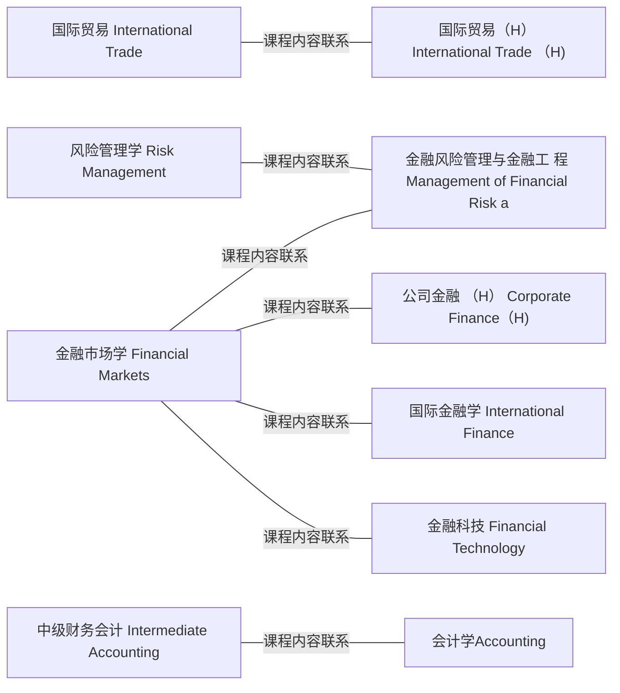

# 经济学（国际项目）专业“2+X”修读建议（留学生）

2024 年汇编印刷页 429–433。原表记录 60 个可配对的课程代码。

[本节原页](plan-418.pdf#page=12) · [逐行数据](plan-418.json) · [院系目录](README.md)

## 课程导读

想了解经济理论与计量方法的课程安排，可以在原表中找到《中级微观经济学 Intermediate Microeconomics》（`ECON130244`）、《中级宏观经济学 Intermediate Macroeconomics》（`ECON130245`）、《计量经济学（H） Econometrics (H)》（`ECON130240h`）。 [原书 PDF 第 444 页](plan-418.pdf#page=13)

图中连接《国际贸易 International Trade》（`ECON130004`）和《国际贸易（H） International Trade （H)》（`ECON130267h`），两门课都从课程题名标出的“国际贸易”切入，可沿这一主题对照阅读。 [原书 PDF 第 445 页](plan-418.pdf#page=14)

## 课程关系图

图中展示最多 20 条关系。下表列出本节全部关系。建议学习顺序供规划课程使用，正式选课资格以教务规定为准。

| 课程 | 关联课程 | 关系 | 依据 |
| --- | --- | --- | --- |
| 国际贸易 International Trade（ECON130004） | 国际贸易（H） International Trade （H)（ECON130267h） | 课程内容联系 | 本方案两门课程的题名均含“国际贸易”，可据此对照这一主题。 |
| 金融市场学 Financial Markets（ECON130030） | 金融风险管理与金融工 程 Management of Financial Risk and Financial Engineering（ECON130221） | 课程内容联系 | 本方案两门课程的题名均含“金融”，可据此对照这一主题。 |
| 金融市场学 Financial Markets（ECON130030） | 公司金融 （H） Corporate Finance（H)（ECON130248h） | 课程内容联系 | 本方案两门课程的题名均含“金融”，可据此对照这一主题。 |
| 金融市场学 Financial Markets（ECON130030） | 国际金融学 International Finance（ECON130254） | 课程内容联系 | 本方案两门课程的题名均含“金融”，可据此对照这一主题。 |
| 金融市场学 Financial Markets（ECON130030） | 金融科技 Financial Technology（ECON130280） | 课程内容联系 | 本方案两门课程的题名均含“金融”，可据此对照这一主题。 |
| 风险管理学 Risk Management（ECON130037） | 金融风险管理与金融工 程 Management of Financial Risk and Financial Engineering（ECON130221） | 课程内容联系 | 本方案两门课程的题名均含“风险管理”，可据此对照这一主题。 |
| 中级财务会计 Intermediate Accounting（ECON130139） | 会计学Accounting（SOSC120006） | 课程内容联系 | 本方案两门课程的题名均含“会计”，可据此对照这一主题。 |

## 课程

| 课程代码 | 名称 | 开课学期原文 | 来源（PDF 页） |
| --- | --- | --- | --- |
| DATA130008 | 人工智能 Introduction to Artificial Intelligence |  | 446 |
| DATA130049 | 图像处理与可视化 Image Processing and Visualization |  | 445 |
| ECON130004 | 国际贸易 International Trade |  | 445 |
| ECON130005 | 财政学 Public Finance |  | 445 |
| ECON130012 | 发展经济学 Development Economics |  | 445 |
| ECON130030 | 金融市场学 Financial Markets |  | 445 |
| ECON130037 | 风险管理学 Risk Management |  | 445 |
| ECON130046 | 财务管理 Financial Management |  | 445 |
| ECON130063 | 国际营销学 International Marketing |  | 446 |
| ECON130064 | 博弈论 Game Theory |  | 444 |
| ECON130083 | 时间序列分析的方法 Approach to Time Series Analysis |  | 444 |
| ECON130105 | 微分方程 Differential Equations |  | 445 |
| ECON130115 | 国际商务 International Business |  | 445 |
| ECON130123 | 随机过程 Stochastic Processes |  | 446 |
| ECON130139 | 中级财务会计 Intermediate Accounting |  | 446 |
| ECON130170 | 动态优化 Dynamic Optimization |  | 446 |
| ECON130189 | 数量分析软件应用 Application of Statistical and Econometric Software |  | 445 |
| ECON130199 | 劳动经济学 Labor Economics |  | 445 |
| ECON130207 | 应用微观经济学 Applied Microeconomics |  | 445 |
| ECON130211 | 毕业论文 Graduation Thesis |  | 444 |
| ECON130215 | 经济学经典文献选读与 写作Classic Literature Reading and Academic Writing of Economics |  | 445 |
| ECON130218h | 经济学前沿专题（H） Advanced Topics in Economics （H) |  | 445 |
| ECON130219 | 资产定价 Asset Pricing |  | 445 |
| ECON130221 | 金融风险管理与金融工 程 Management of Financial Risk and Financial Engineering |  | 445 |
| ECON130226 | 投资学 Investment |  | 445 |
| ECON130230 | 公共财政政策分析 Analysis of Public Finance Policy |  | 446 |
| ECON130240h | 计量经济学（H） Econometrics (H) |  | 444 |
| ECON130242 | 产业组织 Industrial Organization |  | 445 |
| ECON130243 | 国际经济学 International Economics |  | 444 |
| ECON130244 | 中级微观经济学 Intermediate Microeconomics |  | 444 |
| ECON130245 | 中级宏观经济学 Intermediate Macroeconomics |  | 444 |
| ECON130246 | 当代中国经济 Chinese Economy |  | 444 |
| ECON130248h | 公司金融 （H） Corporate Finance（H) |  | 444 |
| ECON130249 | 经济史 Economic History |  | 444 |
| ECON130253h | 发展经济学 （H） Development Economics （H) |  | 445 |
| ECON130254 | 国际金融学 International Finance |  | 445 |
| ECON130255 | 城市经济学 Urban Economics |  | 444 |
| ECON130256 | 货币银行学 Money and Banking |  | 444 |
| ECON130257h | 劳动经济学 （H） Labor Economics （H) |  | 444 |
| ECON130258 | 经济全球化与中国 China and Globalization |  | 444 |
| ECON130261 | 社会实习 Industrial Practice |  | 444 |
| ECON130264 | 概率论和数理统计 Probability Theory and Mathematical Statistics |  | 444 |
| ECON130267h | 国际贸易（H） International Trade （H) |  | 445 |
| ECON130277h | 截面与面板数据分析 （H） Econometric Analysis of Cross Section and Panel Data (H) |  | 444 |
| ECON130280 | 金融科技 Financial Technology |  | 446 |
| ECON130283 | 海外学者专题 Overseas Lecturers' Short Courses |  | 444 |
| ECON130286 | 学术实习 Undergraduate Research |  | 444 |
| ENGL110036 | 英语公共演说 English Public Speaking |  | 443 |
| ICES110001 | 留学生高级汉语I Advanced Chinese for Foreign Students I |  | 443 |
| ICES110002 | 留学生高级汉语II Advanced Chinese for Foreign Students II |  | 443 |
| ICES110010 | 初级汉语 Elementary Chinese |  | 443 |
| ICES110011 | 中级汉语 Intermediate Chinese |  | 443 |
| ICES110012 | 中国概况（上） China: A General Survey I |  | 443 |
| ICES110013 | 中国概况（下） China: A General Survey II |  | 443 |
| MATH120016 | 数学分析BI Mathematical Analysis BI |  | 444 |
| MATH120017 | 数学分析BII Mathematical Analysis BII |  | 444 |
| MATH120044 | 线性代数 Linear Algebra |  | 444 |
| SOSC120006 | 会计学Accounting |  | 444 |
| SOSC120020 | 微观经济学原理 Principles of Microeconomics |  | 444 |
| SOSC120021 | 宏观经济学原理 Principles of Macroeconomics |  | 444 |
