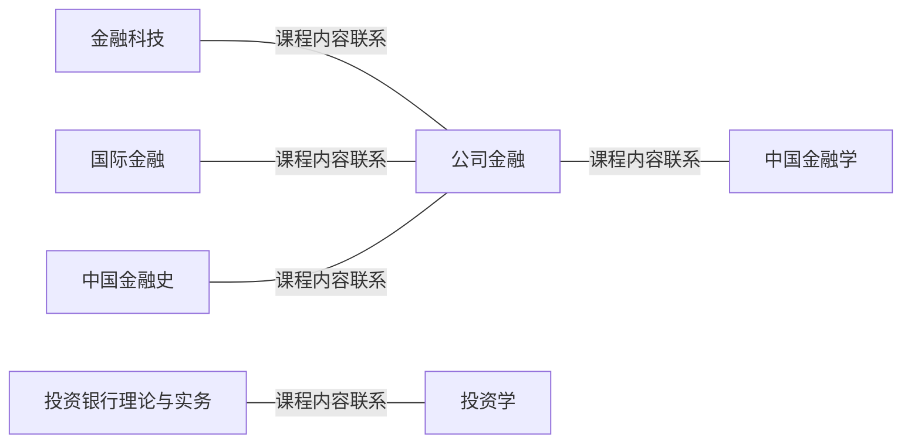

# 金融学专业“2+X”教学培养方案

2024 年汇编印刷页 441–443。原表记录 37 个可配对的课程代码。

[本节原页](plan-441.pdf#page=1) · [逐行数据](plan-441.json) · [院系目录](README.md)

## 课程关系图

图中展示最多 20 条关系。下表列出本节全部关系。建议学习顺序供规划课程使用，正式选课资格以教务规定为准。

| 课程 | 关联课程 | 关系 | 依据 |
| --- | --- | --- | --- |
| 金融科技（AIS531008） | 公司金融（ECON130217） | 课程内容联系 | 本方案两门课程的题名均含“金融”，可据此对照这一主题。 |
| 国际金融（ECON130003） | 公司金融（ECON130217） | 课程内容联系 | 本方案两门课程的题名均含“金融”，可据此对照这一主题。 |
| 投资银行理论与实务（ECON130080） | 投资学（ECON130226） | 课程内容联系 | 本方案两门课程的题名均含“投资”，可据此对照这一主题。 |
| 中国金融史（ECON130140） | 公司金融（ECON130217） | 课程内容联系 | 本方案两门课程的题名均含“金融”，可据此对照这一主题。 |
| 公司金融（ECON130217） | 中国金融学（ECON130284） | 课程内容联系 | 本方案两门课程的题名均含“金融”，可据此对照这一主题。 |

## 课程

| 课程代码 | 名称 | 开课学期原文 | 来源（PDF 页） |
| --- | --- | --- | --- |
| AIS410005 | 人工智能与应用经济学 | 春，秋 | 457 |
| AIS531008 | 金融科技 | 8 | 456 |
| ECON130001 | 概率论与数理统计 | 3 | 455 |
| ECON130003 | 国际金融 | 5 | 456 |
| ECON130005 | 财政学 | 4 | 455 |
| ECON130007 | 货币银行学 | 3 | 456 |
| ECON130010 | 当代中国经济 | 5 | 455 |
| ECON130011 | 产业经济学 | 6 | 455 |
| ECON130016 | 社会实践 | 6 | 456 |
| ECON130017 | 毕业论文 | 8 | 456 |
| ECON130019 | 国际经济学 | 4 | 455 |
| ECON130029 | 商业银行业务与管理 | 7 | 456 |
| ECON130030 | 金融市场学 | 3 | 456 |
| ECON130073 | 公司财务分析 | 4 | 456 |
| ECON130074 | 欧美金融史 | 6 | 456 |
| ECON130077 | 项目评估 | 6 | 456 |
| ECON130080 | 投资银行理论与实务 | 7 | 456 |
| ECON130083 | 时间序列分析方法 | 春，秋 | 457 |
| ECON130090 | 金融经济学 | 5 | 456 |
| ECON130140 | 中国金融史 | 3 | 456 |
| ECON130143 | 公司治理 | 7 | 456 |
| ECON130144 | 行为金融学 | 6 | 456 |
| ECON130146 | 中国货币政策 | 5 | 456 |
| ECON130176 | 国际金融管理 | 7 | 456 |
| ECON130177 | 供应链金融 | 7 | 456 |
| ECON130184 | 兼并与收购 | 5 | 456 |
| ECON130188 | 截面与面板数据分析 | 春，秋 | 457 |
| ECON130189 | 数量分析软件应用 | 春，秋 | 457 |
| ECON130212 | 经济史 | 3 | 455 |
| ECON130213 | 计量经济学 | 4 | 455 |
| ECON130217 | 公司金融 | 3 | 455 |
| ECON130220 | 经济金融中的随机分析方法 | 7 | 456 |
| ECON130221 | 金融风险管理与金融工程 | 6 | 456 |
| ECON130222 | 金融学经典文献选读与写作 | 6 | 456 |
| ECON130226 | 投资学 | 4 | 456 |
| ECON130261 | 社会实习 | 6 | 456 |
| ECON130284 | 中国金融学 | 6 | 456 |
