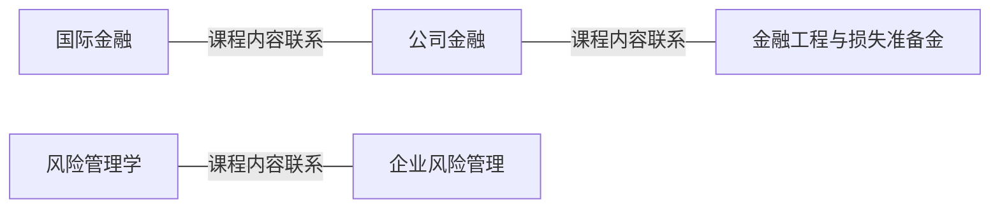

# 保险学专业“2+X”教学培养方案

2024 年汇编印刷页 448–450。原表记录 34 个可配对的课程代码。

[本节原页](plan-448.pdf#page=1) · [逐行数据](plan-448.json) · [院系目录](README.md)

## 课程关系图

图中展示最多 20 条关系。下表列出本节全部关系。建议学习顺序供规划课程使用，正式选课资格以教务规定为准。

| 课程 | 关联课程 | 关系 | 依据 |
| --- | --- | --- | --- |
| 国际金融（ECON130003） | 公司金融（ECON130217） | 课程内容联系 | 本方案两门课程的题名均含“金融”，可据此对照这一主题。 |
| 风险管理学（ECON130037） | 企业风险管理（ECON130236） | 课程内容联系 | 本方案两门课程的题名均含“风险管理”，可据此对照这一主题。 |
| 公司金融（ECON130217） | 金融工程与损失准备金（ECON130238） | 课程内容联系 | 本方案两门课程的题名均含“金融”，可据此对照这一主题。 |

## 课程

| 课程代码 | 名称 | 开课学期原文 | 来源（PDF 页） |
| --- | --- | --- | --- |
| AIS410005 | 人工智能与应用经济学 | 春，秋 | 463 |
| AIT531021 | 保险科技 | 3 | 463 |
| ECON130001 | 概率论与数理统计 | 3 | 462 |
| ECON130003 | 国际金融 | 5 | 463 |
| ECON130005 | 财政学 | 4 | 462 |
| ECON130010 | 当代中国经济 | 5 | 462 |
| ECON130011 | 产业经济学 | 6 | 462 |
| ECON130016 | 社会实践 | 6 | 463 |
| ECON130017 | 毕业论文 | 8 | 463 |
| ECON130019 | 国际经济学 | 4 | 462 |
| ECON130037 | 风险管理学 | 4 | 463 |
| ECON130083 | 时间序列分析方法 | 春，秋 | 463 |
| ECON130091 | 海上保险 | 3 | 463 |
| ECON130092 | 再保险 | 6 | 463 |
| ECON130094 | 保险法 | 5 | 463 |
| ECON130122 | 人寿与健康保险 | 5 | 463 |
| ECON130167 | 保险公司财务管理 | 5 | 463 |
| ECON130188 | 截面与面板数据分析 | 春，秋 | 463 |
| ECON130189 | 数量分析软件应用 | 春，秋 | 463 |
| ECON130208 | 保险经济学 | 6 | 463 |
| ECON130212 | 经济史 | 3 | 462 |
| ECON130213 | 计量经济学 | 4 | 462 |
| ECON130217 | 公司金融 | 3 | 462 |
| ECON130231 | 保险学 | 3 | 463 |
| ECON130232 | 保险学经典文献选读与写作 | 6 | 463 |
| ECON130233 | 风险理论与精算建模 | 6 | 463 |
| ECON130234 | 财产与责任保险 | 5 | 463 |
| ECON130235 | 精算数学 | 5 | 463 |
| ECON130236 | 企业风险管理 | 7 | 463 |
| ECON130237 | 国际风险与保险研究 | 7 | 463 |
| ECON130238 | 金融工程与损失准备金 | 7 | 463 |
| ECON130261 | 社会实习 | 6 | 463 |
| ECON130278 | 精算统计学 | 4 | 463 |
| ECON130281 | 社会保险比较研究 | 6 | 463 |
