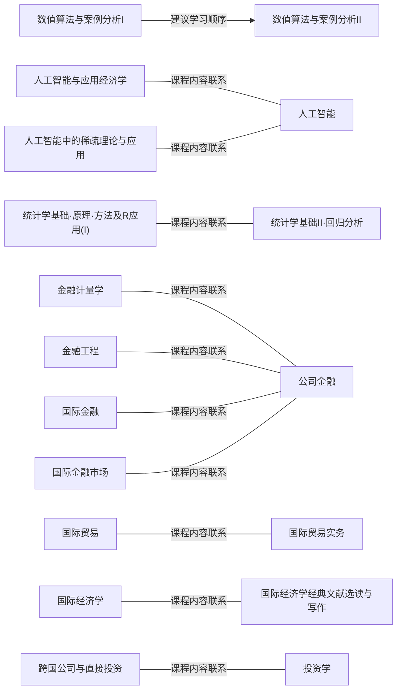

# 国际经济与贸易-数据科学与大数据技术双学士学位项目“2+X”教学培养方案

2024 年汇编印刷页 458–461。原表记录 60 个可配对的课程代码。

[本节原页](plan-458.pdf#page=1) · [逐行数据](plan-458.json) · [院系目录](README.md)

## 课程关系图

图中展示最多 20 条关系。下表列出本节全部关系。建议学习顺序供规划课程使用，正式选课资格以教务规定为准。

| 课程 | 关联课程 | 关系 | 依据 |
| --- | --- | --- | --- |
| 数值算法与案例分析I（DATA130002） | 数值算法与案例分析II（DATA130010） | 建议学习顺序 | 同节课程题名标明连续分册或序号。 |
| 人工智能与应用经济学（AIS410005） | 人工智能（DATA130008） | 课程内容联系 | 本方案两门课程的题名均含“人工智能”，可据此对照这一主题。 |
| 人工智能中的稀疏理论与应用（AIS631010） | 人工智能（DATA130008） | 课程内容联系 | 本方案两门课程的题名均含“人工智能”，可据此对照这一主题。 |
| 统计学基础：原理、方法及R应用(I)（DATA130005） | 统计学基础II：回归分析（DATA130046） | 课程内容联系 | 本方案两门课程的题名均含“统计学”，可据此对照这一主题。 |
| 金融计量学（DATA130021） | 公司金融（ECON130217） | 课程内容联系 | 本方案两门课程的题名均含“金融”，可据此对照这一主题。 |
| 金融工程（DATA130041） | 公司金融（ECON130217） | 课程内容联系 | 本方案两门课程的题名均含“金融”，可据此对照这一主题。 |
| 国际金融（ECON130003） | 公司金融（ECON130217） | 课程内容联系 | 本方案两门课程的题名均含“金融”，可据此对照这一主题。 |
| 国际贸易（ECON130004） | 国际贸易实务（ECON130062） | 课程内容联系 | 本方案两门课程的题名均含“国际贸易”，可据此对照这一主题。 |
| 国际经济学（ECON130019） | 国际经济学经典文献选读与写作（ECON130224） | 课程内容联系 | 本方案两门课程的题名均含“国际经济”，可据此对照这一主题。 |
| 跨国公司与直接投资（ECON130027） | 投资学（ECON130226） | 课程内容联系 | 本方案两门课程的题名均含“投资”，可据此对照这一主题。 |
| 国际金融市场（ECON130205） | 公司金融（ECON130217） | 课程内容联系 | 本方案两门课程的题名均含“金融”，可据此对照这一主题。 |

## 课程

| 课程代码 | 名称 | 开课学期原文 | 来源（PDF 页） |
| --- | --- | --- | --- |
| AIS410005 | 人工智能与应用经济学 | 春，秋 | 474 |
| AIS410010 | 多模态数据同化 | 春 | 474 |
| AIS631010 | 人工智能中的稀疏理论与应用 | 春 | 474 |
| AIT531023 | 认知智能前沿技术与实践 | 春，秋 | 474 |
| DATA130002 | 数值算法与案例分析I | 3 | 473 |
| DATA130003 | 统计（机器）学习概论 | 5 | 473 |
| DATA130005 | 统计学基础：原理、方法及R应用(I) | 4 | 473 |
| DATA130007 | 社交网络挖掘 | 春 | 474 |
| DATA130008 | 人工智能 | 7 | 473 |
| DATA130010 | 数值算法与案例分析II | 春 | 474 |
| DATA130011 | 神经网络与深度学习 | 8 | 473 |
| DATA130013 | 时间序列与空间统计 | 春 | 474 |
| DATA130015 | 大规模分布式系统 | 春 | 474 |
| DATA130019 | 随机过程导论 | 春 | 474 |
| DATA130021 | 金融计量学 | 秋 | 474 |
| DATA130023 | 数据结构 | 3 | 473 |
| DATA130024 | 概率论基础 | 3 | 472 |
| DATA130025 | 计算机原理 | 秋 | 474 |
| DATA130026 | 最优化方法 | 4 | 473 |
| DATA130030 | 社会科学数据挖掘 | 春 | 474 |
| DATA130039 | 数据库及实现 | 4 | 473 |
| DATA130041 | 金融工程 | 春 | 474 |
| DATA130042 | 高等线性代数 | 3 | 473 |
| DATA130044 | 多元统计分析 | 春 | 474 |
| DATA130046 | 统计学基础II：回归分析 | 秋 | 474 |
| DATA130049 | 图像处理与可视化 | 5 | 473 |
| DATA130051 | 计算机视觉 | 春，秋 | 474 |
| DATA130059 | 因果推断与因果学习 | 春 | 474 |
| DATA130062 | 统计计算 | 5 | 473 |
| ECON130003 | 国际金融 | 5 | 473 |
| ECON130004 | 国际贸易 | 5 | 473 |
| ECON130005 | 财政学 | 4 | 472 |
| ECON130010 | 当代中国经济 | 5 | 472 |
| ECON130011 | 产业经济学 | 6 | 472 |
| ECON130012 | 发展经济学 | 7 | 474 |
| ECON130016 | 社会实践 | 6 | 473 |
| ECON130017 | 毕业论文 | 8 | 473 |
| ECON130019 | 国际经济学 | 4 | 472 |
| ECON130021 | 比较经济学 | 5 | 473 |
| ECON130022 | 货币经济学 | 5 | 473 |
| ECON130027 | 跨国公司与直接投资 | 6 | 474 |
| ECON130060 | 国际政治经济学 | 7 | 474 |
| ECON130061 | 国别和地区经济 | 4 | 474 |
| ECON130062 | 国际贸易实务 | 6 | 474 |
| ECON130063 | 国际营销学 | 5 | 474 |
| ECON130064 | 博弈论 | 4 | 473 |
| ECON130083 | 时间序列分析方法 | 春，秋 | 474 |
| ECON130115 | 国际商务 | 6 | 473 |
| ECON130188 | 截面与面板数据分析 | 春，秋 | 474 |
| ECON130189 | 数量分析软件应用 | 春，秋 | 474 |
| ECON130203 | 企业国际化 | 6 | 473 |
| ECON130205 | 国际金融市场 | 8 | 474 |
| ECON130206 | 国际货币经济学 | 6 | 474 |
| ECON130212 | 经济史 | 3 | 472 |
| ECON130213 | 计量经济学 | 4 | 472 |
| ECON130217 | 公司金融 | 3 | 472 |
| ECON130223 | 世界经济 | 1 | 473 |
| ECON130224 | 国际经济学经典文献选读与写作 | 6 | 473 |
| ECON130226 | 投资学 | 4 | 474 |
| ECON130261 | 社会实习 | 6 | 473 |
