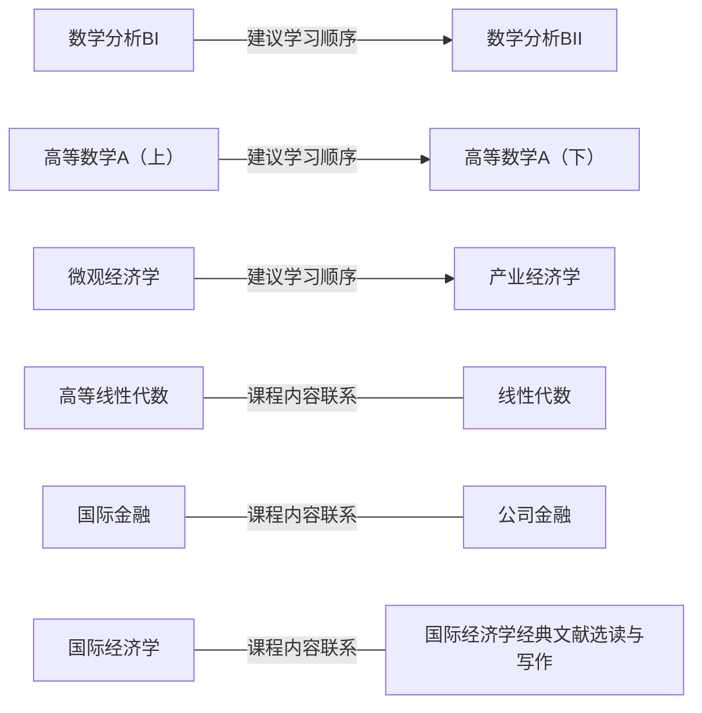

# 国际经济与贸易-数据科学与大数据技术双学士学位项目“2+X”修读建议

2024 年汇编印刷页 462–463。原表记录 43 个可配对的课程代码。

[本节原页](plan-458.pdf#page=5) · [逐行数据](plan-458.json) · [院系目录](README.md)

## 课程关系图

图中展示最多 20 条关系。下表列出本节全部关系。建议学习顺序供规划课程使用，正式选课资格以教务规定为准。

| 课程 | 关联课程 | 关系 | 依据 |
| --- | --- | --- | --- |
| 数学分析BI（MATH120016） | 数学分析BII（MATH120017） | 建议学习顺序 | 同节课程题名标明连续分册或序号。 |
| 高等数学A（上）（MATH120021） | 高等数学A（下）（MATH120022） | 建议学习顺序 | 同节课程题名标明连续分册或序号。 |
| 微观经济学（SOSC120004） | 产业经济学（ECON130011） | 建议学习顺序 | 企业和市场结构是产业经济分析的基础。 |
| 高等线性代数（DATA130042） | 线性代数（MATH120044） | 课程内容联系 | 本方案两门课程的题名均含“线性代数”，可据此对照这一主题。 |
| 国际金融（ECON130003） | 公司金融（ECON130217） | 课程内容联系 | 本方案两门课程的题名均含“金融”，可据此对照这一主题。 |
| 国际经济学（ECON130019） | 国际经济学经典文献选读与写作（ECON130224） | 课程内容联系 | 本方案两门课程的题名均含“国际经济”，可据此对照这一主题。 |

## 课程

| 课程代码 | 名称 | 开课学期原文 | 来源（PDF 页） |
| --- | --- | --- | --- |
| COMP120006 | 程序设计 |  | 476 |
| DATA130002 | 数值算法与案例分析I |  | 477 |
| DATA130003 | 统计（机器）学习概论 |  | 477 |
| DATA130005 | 统计学基础：原理、方法及R应用(I) |  | 477 |
| DATA130008 | 人工智能 |  | 477 |
| DATA130011 | 神经网络与深度学习 |  | 477 |
| DATA130023 | 数据结构 |  | 477 |
| DATA130024 | 概率论基础 |  | 476 |
| DATA130026 | 最优化方法 |  | 477 |
| DATA130039 | 数据库及实现 |  | 477 |
| DATA130042 | 高等线性代数 |  | 477 |
| DATA130049 | 图像处理与可视化 |  | 477 |
| DATA130062 | 统计计算 |  | 477 |
| ECON130003 | 国际金融 |  | 477 |
| ECON130004 | 国际贸易 |  | 477 |
| ECON130005 | 财政学 |  | 476 |
| ECON130010 | 当代中国经济 |  | 476 |
| ECON130011 | 产业经济学 |  | 476 |
| ECON130016 | 社会实践 |  | 477 |
| ECON130017 | 毕业论文 |  | 477 |
| ECON130019 | 国际经济学 |  | 476 |
| ECON130115 | 国际商务 |  | 477 |
| ECON130203 | 企业国际化 |  | 477 |
| ECON130212 | 经济史 |  | 476 |
| ECON130213 | 计量经济学 |  | 476 |
| ECON130217 | 公司金融 |  | 476 |
| ECON130223 | 世界经济 |  | 477 |
| ECON130224 | 国际经济学经典文献选读与写作 |  | 477 |
| ECON130261 | 社会实习 |  | 477 |
| MATH120016 | 数学分析BI |  | 476 |
| MATH120017 | 数学分析BII |  | 476 |
| MATH120021 | 高等数学A（上） |  | 476 |
| MATH120022 | 高等数学A（下） |  | 476 |
| MATH120044 | 线性代数 |  | 476 |
| PTSS110082 | 毛泽东思想和中国特色社会主义理论体系概论 |  | 476 |
| PTSS110087 | 马克思主义基本原理 |  | 476 |
| PTSS110088 | 中国近现代史纲要 |  | 476 |
| PTSS110089 | 思想道德与法治 |  | 476 |
| PTSS110090 | 习近平新时代中国特色社会主义思想概论 |  | 476 |
| SOSC120004 | 微观经济学 |  | 476 |
| SOSC120005 | 宏观经济学 |  | 476 |
| SOSC120006 | 会计学 |  | 476 |
| SOSC120008 | 政治经济学 |  | 476 |
