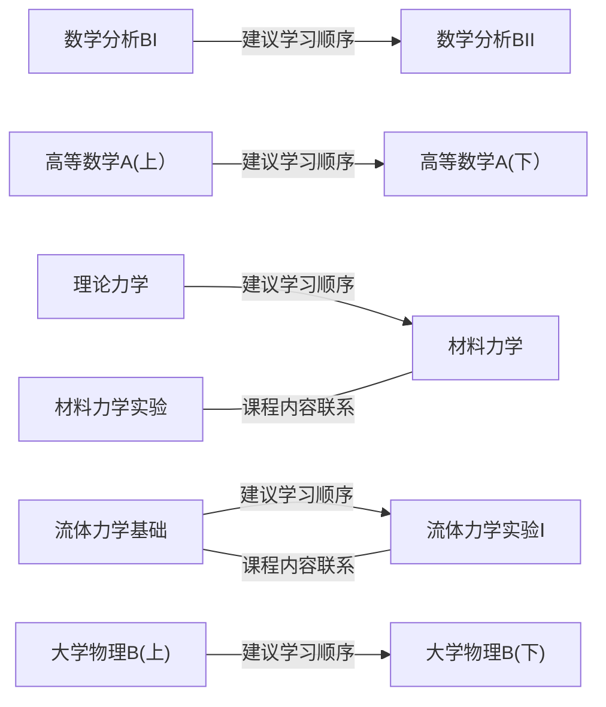

# 理论与应用力学专业“2+X”修读建议

2024 年汇编印刷页 702–703。原表记录 31 个可配对的课程代码。

[本节原页](plan-698.pdf#page=5) · [逐行数据](plan-698.json) · [院系目录](README.md)

## 课程关系图

图中展示最多 20 条关系。下表列出本节全部关系。建议学习顺序供规划课程使用，正式选课资格以教务规定为准。

| 课程 | 关联课程 | 关系 | 依据 |
| --- | --- | --- | --- |
| 数学分析BI（MATH120016） | 数学分析BII（MATH120017） | 建议学习顺序 | 同节课程题名标明连续分册或序号。 |
| 高等数学A(上）（MATH120021） | 高等数学A(下）（MATH120022） | 建议学习顺序 | 同节课程题名标明连续分册或序号。 |
| 理论力学（MECH130139） | 材料力学（MECH130088） | 建议学习顺序 | 静力学分析有助于理解构件受力。 |
| 流体力学基础（MECH130141） | 流体力学实验Ⅰ（MECH130012） | 建议学习顺序 | “流体力学基础”题名标明基础层次，前置阅读可帮助了解“流体力学实验Ⅰ”中的流体力学主题。 |
| 大学物理B(上)（PHYS120013） | 大学物理B(下)（PHYS120014） | 建议学习顺序 | 同节课程题名标明连续分册或序号。 |
| 材料力学实验（MECH130011） | 材料力学（MECH130088） | 课程内容联系 | 同节同题名的课程与实验、实习或实践。 |
| 流体力学实验Ⅰ（MECH130012） | 流体力学基础（MECH130141） | 课程内容联系 | 本方案两门课程的题名均含“流体力学”，可据此对照这一主题。 |

## 课程

| 课程代码 | 名称 | 开课学期原文 | 来源（PDF 页） |
| --- | --- | --- | --- |
| COMP120004 | 线性代数 |  | 716 |
| COMP120006 | 程序设计 |  | 716 |
| MATH120016 | 数学分析BI |  | 716 |
| MATH120017 | 数学分析BII |  | 716 |
| MATH120021 | 高等数学A(上） |  | 716 |
| MATH120022 | 高等数学A(下） |  | 716 |
| MECH130001 | 工程数学 |  | 716 |
| MECH130004 | 数理方程 |  | 716 |
| MECH130011 | 材料力学实验 |  | 717 |
| MECH130012 | 流体力学实验Ⅰ |  | 717 |
| MECH130013 | 振动实验 |  | 717 |
| MECH130017 | 计算方法与软件 |  | 716 |
| MECH130019 | 生产实习、实践 |  | 717 |
| MECH130020 | 毕业论文 |  | 717 |
| MECH130031 | CAD与工程图学基础A |  | 717 |
| MECH130088 | 材料力学 |  | 717 |
| MECH130107 | 常微分方程 |  | 716 |
| MECH130115 | 概率论与数理统计 |  | 717 |
| MECH130125 | 航空航天与力学导论 |  | 716 |
| MECH130139 | 理论力学 |  | 716 |
| MECH130140 | 弹性力学 |  | 717 |
| MECH130141 | 流体力学基础 |  | 717 |
| MECH130142 | 振动基础 |  | 717 |
| PHYS120013 | 大学物理B(上) |  | 716 |
| PHYS120014 | 大学物理B(下) |  | 716 |
| PHYS120015 | 基础物理实验 |  | 716 |
| PTSS110082 | 毛泽东思想和中国特色社会主义理论体系概论 |  | 716 |
| PTSS110087 | 马克思主义基本原理 |  | 716 |
| PTSS110088 | 中国近现代史纲要 |  | 716 |
| PTSS110089 | 思想道德与法治 |  | 716 |
| PTSS110090 | 习近平新时代中国特色社会主义思想概论 |  | 716 |
