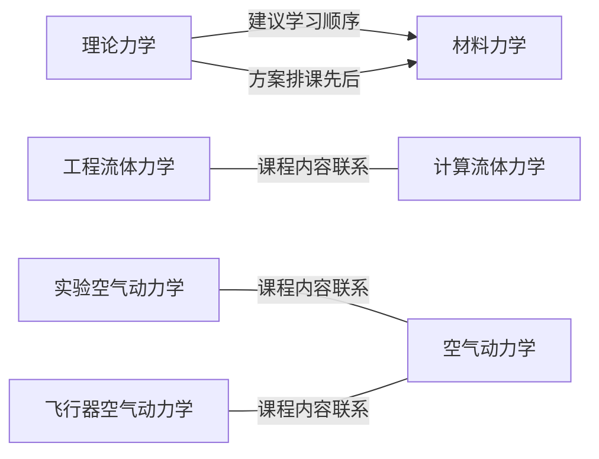

# 飞行器设计与工程专业“2+X”教学培养方案

2024 年汇编印刷页 704–707。原表记录 59 个可配对的课程代码。

[本节原页](plan-704.pdf#page=1) · [逐行数据](plan-704.json) · [院系目录](README.md)

## 课程导读

想了解飞行器与力学的课程安排，可以在原表中找到《飞行器总体设计》（`MECH130065`）、《飞行力学与飞行控制》（`MECH130028`）、《实验空气动力学》（`MECH130027`）。 [原书 PDF 第 718 页](plan-704.pdf#page=1) · [原书 PDF 第 719 页](plan-704.pdf#page=2)

图中连接《实验空气动力学》（`MECH130027`）和《空气动力学》（`MECH130111`），两门课都从课程题名标出的“空气动力学”切入，可沿这一主题对照阅读。 [原书 PDF 第 718 页](plan-704.pdf#page=1) · [原书 PDF 第 719 页](plan-704.pdf#page=2)

## 课程关系图

图中展示最多 20 条关系。下表列出本节全部关系。建议学习顺序供规划课程使用，正式选课资格以教务规定为准。

| 课程 | 关联课程 | 关系 | 依据 |
| --- | --- | --- | --- |
| 理论力学（MECH130139） | 材料力学（MECH130088） | 建议学习顺序 | 静力学分析有助于理解构件受力。 |
| 工程流体力学（MECH130024） | 计算流体力学（MECH130094） | 课程内容联系 | 本方案两门课程的题名均含“流体力学”，可据此对照这一主题。 |
| 实验空气动力学（MECH130027） | 空气动力学（MECH130111） | 课程内容联系 | 本方案两门课程的题名均含“空气动力学”，可据此对照这一主题。 |
| 飞行器空气动力学（MECH130109） | 空气动力学（MECH130111） | 课程内容联系 | 本方案两门课程的题名均含“空气动力学”，可据此对照这一主题。 |
| 理论力学（MECH130139） | 材料力学（MECH130088） | 方案排课先后 | 本节原表所列全部明确学期均早于后者。 |

## 课程

| 课程代码 | 名称 | 开课学期原文 | 来源（PDF 页） |
| --- | --- | --- | --- |
| AIT310028 | 基于人工智能方法的航空航天领域典型问题研究 | 春，秋 | 720 |
| MECH110013 | 设计与制造 | 5 | 719 |
| MECH130013 | 振动实验 | 6 | 719 |
| MECH130017 | 计算方法与软件 | 3 | 718 |
| MECH130019 | 生产实习、实践 | 7 | 719 |
| MECH130020 | 毕业论文 | 8 | 719 |
| MECH130021 | 数学物理方法 | 4 | 718 |
| MECH130022 | 微分方程 | 3 | 718 |
| MECH130024 | 工程流体力学 | 4 | 718 |
| MECH130026 | 结构强度试验 | 6 | 719 |
| MECH130027 | 实验空气动力学 | 5 | 718 |
| MECH130028 | 飞行力学与飞行控制 | 6 | 719 |
| MECH130030 | 自动控制原理 | 5 | 718 |
| MECH130031 | CAD与工程图学基础A | 4 | 718 |
| MECH130032 | 机械设计基础 | 春，秋 | 719 |
| MECH130033 | 工程材料 | 春，秋 | 719 |
| MECH130045 | 生物医学工程概论 | 春，秋 | 720 |
| MECH130046 | 优化设计 | 春，秋 | 719 |
| MECH130060 | 数字信号处理 | 春，秋 | 720 |
| MECH130061 | 水动力学 | 春，秋 | 720 |
| MECH130064 | 粘弹性力学 | 春，秋 | 720 |
| MECH130065 | 飞行器总体设计 | 6 | 719 |
| MECH130066 | 飞行器结构分析与设计 | 7 | 719 |
| MECH130080 | 飞行器主动控制技术 | 春，秋 | 720 |
| MECH130085 | 涡量与涡动力学基础 | 春，秋 | 720 |
| MECH130088 | 材料力学 | 4 | 718 |
| MECH130091 | 工程系统建模与控制 | 春，秋 | 720 |
| MECH130092 | 工程热力学 | 春，秋 | 720 |
| MECH130093 | 张量分析与微分几何基础 | 春，秋 | 720 |
| MECH130094 | 计算流体力学 | 春，秋 | 720 |
| MECH130095 | 基于Matlab的工程分析 | 春，秋 | 720 |
| MECH130098 | 飞行器的操稳特性 | 春，秋 | 719 |
| MECH130104 | 工程中的数学方法 | 春，秋 | 720 |
| MECH130105 | 连续介质力学基础 | 春，秋 | 719, 720 |
| MECH130106 | 应用实变函数与泛函分析基础 | 春，秋 | 720 |
| MECH130109 | 飞行器空气动力学 | 春，秋 | 720 |
| MECH130110 | 流形上的微积分 | 春，秋 | 720 |
| MECH130111 | 空气动力学 | 5 | 719 |
| MECH130115 | 概率论与数理统计 | 4 | 718 |
| MECH130117 | 板壳理论 | 春，秋 | 720 |
| MECH130119 | 空天智能方法与实践 | 春，秋 | 720 |
| MECH130120 | 航空发动机原理 | 6 | 719 |
| MECH130123 | 现代飞机先进空气动力设计技术 | 春，秋 | 720 |
| MECH130125 | 航空航天与力学导论 | 3 | 718 |
| MECH130126 | 复杂动力学系统建模与仿真 | 春，秋 | 720 |
| MECH130128 | 机电系统原理及实践 | 春，秋 | 719 |
| MECH130129 | 弹性结构的力学基础 | 春，秋 | 719 |
| MECH130130 | 航空发动机结构分析 | 春，秋 | 719 |
| MECH130131 | 流体物理概论 | 春，秋 | 720 |
| MECH130132 | 智柔微纳结构与器件力学 | 春，秋 | 719 |
| MECH130133 | 智柔体导论 | 春，秋 | 719 |
| MECH130134 | 几何力学 | 春，秋 | 720 |
| MECH130135 | 飞行仿真技术 | 春，秋 | 719 |
| MECH130136 | 光流控技术概论 | 春，秋 | 720 |
| MECH130137 | 医疗器械建模仿真与应用 | 春，秋 | 720 |
| MECH130138 | 增材制造导论 | 春，秋 | 720 |
| MECH130139 | 理论力学 | 3 | 718 |
| MECH130140 | 弹性力学 | 5 | 719 |
| MECH130142 | 振动基础 | 5 | 719 |
