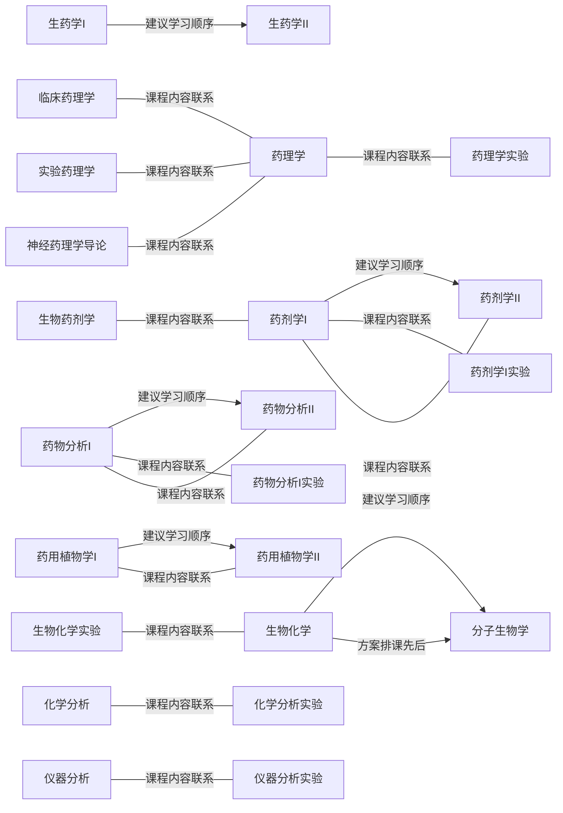

# 药学专业“2+X”教学培养方案

2024 年汇编印刷页 1012–1016。原表记录 69 个可配对的课程代码。

[本节原页](plan-1012.pdf#page=1) · [逐行数据](plan-1012.json) · [院系目录](README.md)

## 课程关系图

图中展示最多 20 条关系。下表列出本节全部关系。建议学习顺序供规划课程使用，正式选课资格以教务规定为准。

| 课程 | 关联课程 | 关系 | 依据 |
| --- | --- | --- | --- |
| 生药学I（PHAR130013） | 生药学II（PHAR130035） | 建议学习顺序 | 同节课程题名标明连续分册或序号。 |
| 药剂学I（PHAR130149） | 药剂学II（PHAR130039） | 建议学习顺序 | 同节课程题名标明连续分册或序号。 |
| 药物分析I（PHAR130151） | 药物分析II（PHAR130033） | 建议学习顺序 | 同节课程题名标明连续分册或序号。 |
| 生物化学（PHAR130168） | 分子生物学（PHAR130138） | 建议学习顺序 | 生物分子的结构与功能支持分子生物学学习。 |
| 药用植物学I（PHAR130169） | 药用植物学II（PHAR130034） | 建议学习顺序 | 同节课程题名标明连续分册或序号。 |
| 药物分析II（PHAR130033） | 药物分析I（PHAR130151） | 课程内容联系 | 本方案两门课程的题名均含“药物分析”，可据此对照这一主题。 |
| 药用植物学II（PHAR130034） | 药用植物学I（PHAR130169） | 课程内容联系 | 本方案两门课程的题名均含“植物学”，可据此对照这一主题。 |
| 药剂学II（PHAR130039） | 药剂学I（PHAR130149） | 课程内容联系 | 本方案两门课程的题名均含“药剂”，可据此对照这一主题。 |
| 临床药理学（PHAR130056） | 药理学（PHAR130147） | 课程内容联系 | 本方案两门课程的题名均含“药理”，可据此对照这一主题。 |
| 实验药理学（PHAR130064） | 药理学（PHAR130147） | 课程内容联系 | 本方案两门课程的题名均含“药理”，可据此对照这一主题。 |
| 神经药理学导论（PHAR130076） | 药理学（PHAR130147） | 课程内容联系 | 本方案两门课程的题名均含“药理”，可据此对照这一主题。 |
| 生物药剂学（PHAR130139） | 药剂学I（PHAR130149） | 课程内容联系 | 本方案两门课程的题名均含“药剂”，可据此对照这一主题。 |
| 生物化学实验（PHAR130146） | 生物化学（PHAR130168） | 课程内容联系 | 同节同题名的课程与实验、实习或实践。 |
| 药理学（PHAR130147） | 药理学实验（PHAR130148） | 课程内容联系 | 同节同题名的课程与实验、实习或实践。 |
| 药剂学I（PHAR130149） | 药剂学I实验（PHAR130150） | 课程内容联系 | 同节同题名的课程与实验、实习或实践。 |
| 药物分析I（PHAR130151） | 药物分析I实验（PHAR130152） | 课程内容联系 | 同节同题名的课程与实验、实习或实践。 |
| 化学分析（PHAR130156） | 化学分析实验（PHAR130157） | 课程内容联系 | 同节同题名的课程与实验、实习或实践。 |
| 仪器分析（PHAR130158） | 仪器分析实验（PHAR130159） | 课程内容联系 | 同节同题名的课程与实验、实习或实践。 |
| 生物化学（PHAR130168） | 分子生物学（PHAR130138） | 方案排课先后 | 本节原表所列全部明确学期均早于后者。 |

## 课程

| 课程代码 | 名称 | 开课学期原文 | 来源（PDF 页） |
| --- | --- | --- | --- |
| BIOL130192 | 细胞生物学导论 | 1 | 1026 |
| MED130459 | 感染与免疫 | 4 | 1027 |
| MED130460 | 医学基础 | 4 | 1027 |
| PHAR130004 | 有机合成 | 春，秋 | 1027 |
| PHAR130008 | 生物制药技术 | 5 | 1027 |
| PHAR130009 | 核药学概论 | 3 | 1026 |
| PHAR130013 | 生药学I | 5 | 1027 |
| PHAR130014 | 实验药物化学I | 6 | 1027 |
| PHAR130016 | 天然药物化学I | 5 | 1027 |
| PHAR130019 | 药事管理学 | 7 | 1027 |
| PHAR130020 | 专业实习 | 暑期 | 1027 |
| PHAR130021 | 毕业论文 | 8 | 1027 |
| PHAR130023 | 药学文献检索 | 春，秋 | 1027 |
| PHAR130024 | 食品化学 | 春，秋 | 1028 |
| PHAR130027 | 药学专业英语 | 春，秋 | 1027 |
| PHAR130028 | 生物药物学 | 春，秋 | 1028 |
| PHAR130029 | 药用微生物学 | 春，秋 | 1027 |
| PHAR130030 | 中药新药的研究与开发 | 春，秋 | 1028 |
| PHAR130032 | 医药元素化学 | 春，秋 | 1027 |
| PHAR130033 | 药物分析II | 春，秋 | 1028 |
| PHAR130034 | 药用植物学II | 春，秋 | 1028 |
| PHAR130035 | 生药学II | 春，秋 | 1028 |
| PHAR130036 | Pharmacology）医院药学 | 春，秋 | 1028 |
| PHAR130039 | 药剂学II | 春，秋 | 1028 |
| PHAR130042 | 药物动力学 | 春，秋 | 1028 |
| PHAR130043 | 物理药学 | 春，秋 | 1028 |
| PHAR130044 | 药物合成反应 | 春，秋 | 1028 |
| PHAR130049 | 数理统计 | 3 | 1026 |
| PHAR130052 | 有机光谱 | 春，秋 | 1028 |
| PHAR130056 | 临床药理学 | 春，秋 | 1029 |
| PHAR130064 | 实验药理学 | 春，秋 | 1029 |
| PHAR130069 | 新药研发与上市管理 | 春，秋 | 1027 |
| PHAR130073 | 生物技术药物给药系统 |  | 1029 |
| PHAR130075 | 药理学专题讨论 | 春，秋 | 1029 |
| PHAR130076 | 神经药理学导论 | 春，秋 | 1029 |
| PHAR130077 | 国际医药贸易 | 春，秋 | 1028 |
| PHAR130082 | 药物靶向传释系统 |  | 1029 |
| PHAR130084 | 临床药学概论 | 春，秋 | 1028 |
| PHAR130085 | 天然药物研究前沿技术 | 春，秋 | 1028 |
| PHAR130086 | 基于问题的药理学 | 春，秋 | 1029 |
| PHAR130088 | 临床医学概论 | 春，秋 | 1028 |
| PHAR130092 | 影像中的药物开发 | 春，秋 | 1028 |
| PHAR130121 | 生物合成药物化学 | 春，秋 | 1028 |
| PHAR130129 | 化学生物学导论 | 春，秋 | 1028 |
| PHAR130130 | 综合性药学实验 | 7 | 1027 |
| PHAR130131 | 有机化学实验II | 3 | 1026 |
| PHAR130132 | 学术前沿专题 | 春，秋 | 1029 |
| PHAR130133 | 药物设计学 | 7 | 1027 |
| PHAR130134 | 药物化学I | 6 | 1027 |
| PHAR130138 | 分子生物学 | 5 | 1027 |
| PHAR130139 | 生物药剂学 | 春，秋 | 1028 |
| PHAR130146 | 生物化学实验 | 4 | 1026 |
| PHAR130147 | 药理学 | 4 | 1027 |
| PHAR130148 | 药理学实验 | 4 | 1027 |
| PHAR130149 | 药剂学I | 5 | 1027 |
| PHAR130150 | 药剂学I实验 | 5 | 1027 |
| PHAR130151 | 药物分析I | 6 | 1027 |
| PHAR130152 | 药物分析I实验 | 6 | 1027 |
| PHAR130155 | 药学研究热 | 春，秋 | 1027 |
| PHAR130156 | 化学分析 | 3 | 1026 |
| PHAR130157 | 化学分析实验 | 3 | 1026 |
| PHAR130158 | 仪器分析 | 4 | 1026 |
| PHAR130159 | 仪器分析实验 | 4 | 1026 |
| PHAR130163 | 新药研发案例 | 春，秋 | 1028 |
| PHAR130165 | 临床药理学概论（EssentialsofClinical | 春，秋 | 1028 |
| PHAR130166 | 药物递送 | 春，秋 | 1028 |
| PHAR130167 | 物理化学 | 3 | 1026 |
| PHAR130168 | 生物化学 | 4 | 1027 |
| PHAR130169 | 药用植物学I | 4 | 1026 |
