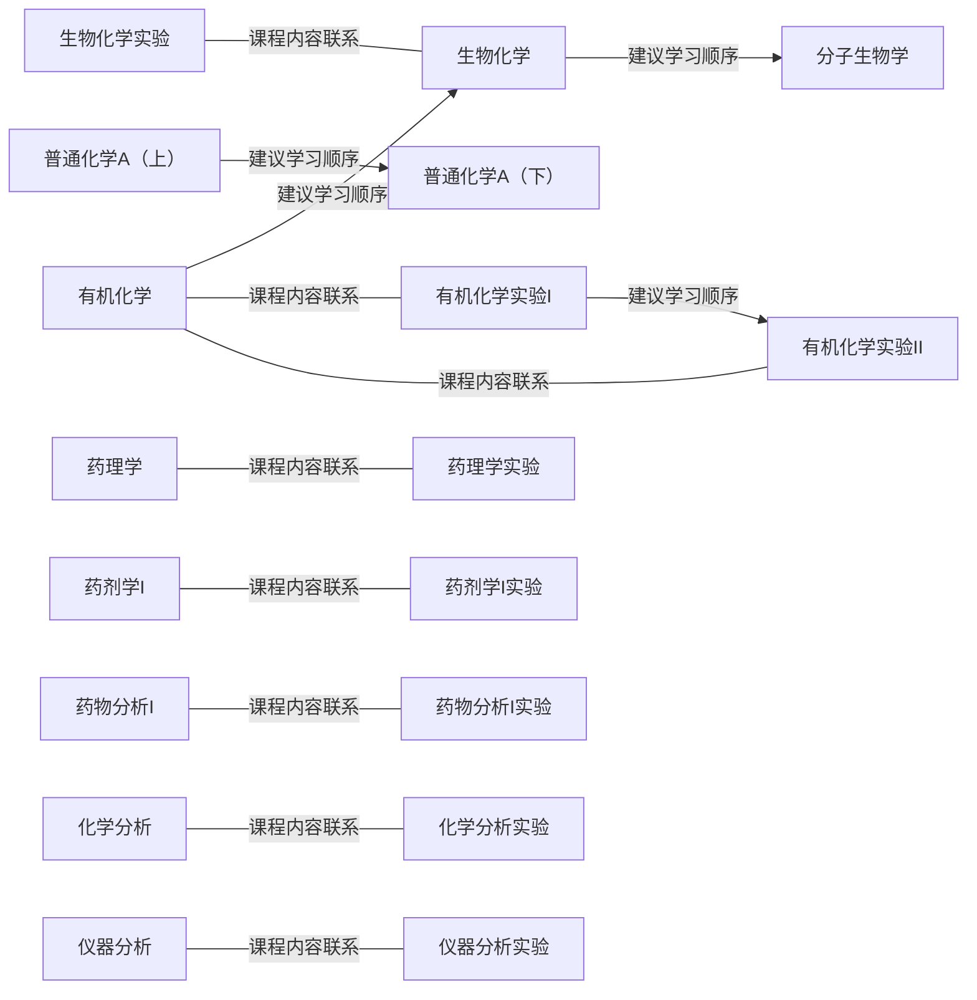

# 药学专业“2+X”修读建议

2024 年汇编印刷页 1017–1018。原表记录 44 个可配对的课程代码。

[本节原页](plan-1012.pdf#page=6) · [逐行数据](plan-1012.json) · [院系目录](README.md)

## 课程导读

想了解药物研究与临床应用的课程安排，可以在原表中找到《药理学》（`PHAR130147`）、《天然药物化学I》（`PHAR130016`）、《药剂学I》（`PHAR130149`）。 [原书 PDF 第 1032 页](plan-1012.pdf#page=7)

图中把《药理学》（`PHAR130147`）和《药理学实验》（`PHAR130148`）列作内容联系。同节同题名的课程与实验、实习或实践。 [原书 PDF 第 1032 页](plan-1012.pdf#page=7)

## 课程关系图

图中展示最多 20 条关系。下表列出本节全部关系。建议学习顺序供规划课程使用，正式选课资格以教务规定为准。

| 课程 | 关联课程 | 关系 | 依据 |
| --- | --- | --- | --- |
| 有机化学（CHEM120003） | 生物化学（PHAR130168） | 建议学习顺序 | 官能团与有机反应是理解生物分子性质的基础。 |
| 有机化学实验I（CHEM120004） | 有机化学实验II（PHAR130131） | 建议学习顺序 | 同节课程题名标明连续分册或序号。 |
| 普通化学A（上）（CHEM120005） | 普通化学A（下）（CHEM120006） | 建议学习顺序 | 同节课程题名标明连续分册或序号。 |
| 生物化学（PHAR130168） | 分子生物学（PHAR130138） | 建议学习顺序 | 生物分子的结构与功能支持分子生物学学习。 |
| 有机化学（CHEM120003） | 有机化学实验I（CHEM120004） | 课程内容联系 | 本方案两门课程的题名均含“有机化学”，可据此对照这一主题。 |
| 有机化学（CHEM120003） | 有机化学实验II（PHAR130131） | 课程内容联系 | 本方案两门课程的题名均含“有机化学”，可据此对照这一主题。 |
| 生物化学实验（PHAR130146） | 生物化学（PHAR130168） | 课程内容联系 | 同节同题名的课程与实验、实习或实践。 |
| 药理学（PHAR130147） | 药理学实验（PHAR130148） | 课程内容联系 | 同节同题名的课程与实验、实习或实践。 |
| 药剂学I（PHAR130149） | 药剂学I实验（PHAR130150） | 课程内容联系 | 同节同题名的课程与实验、实习或实践。 |
| 药物分析I（PHAR130151） | 药物分析I实验（PHAR130152） | 课程内容联系 | 同节同题名的课程与实验、实习或实践。 |
| 化学分析（PHAR130156） | 化学分析实验（PHAR130157） | 课程内容联系 | 同节同题名的课程与实验、实习或实践。 |
| 仪器分析（PHAR130158） | 仪器分析实验（PHAR130159） | 课程内容联系 | 同节同题名的课程与实验、实习或实践。 |

## 课程

| 课程代码 | 名称 | 开课学期原文 | 来源（PDF 页） |
| --- | --- | --- | --- |
| BIOL130192 | 细胞生物学导论 |  | 1031 |
| CHEM120003 | 有机化学 |  | 1031 |
| CHEM120004 | 有机化学实验I |  | 1031 |
| CHEM120005 | 普通化学A（上） |  | 1031 |
| CHEM120006 | 普通化学A（下） |  | 1031 |
| CHEM120009 | 普通化学实验I |  | 1031 |
| MATH120045 | 高等数学CI |  | 1031 |
| MED130459 | 感染与免疫 |  | 1032 |
| MED130460 | 医学基础 |  | 1032 |
| PHAR130008 | 生物制药技术 |  | 1032 |
| PHAR130009 | 核药学概论 |  | 1031 |
| PHAR130013 | 生药学I |  | 1032 |
| PHAR130014 | 实验药物化学I |  | 1032 |
| PHAR130016 | 天然药物化学I |  | 1032 |
| PHAR130019 | 药事管理学 |  | 1032 |
| PHAR130020 | 专业实习 |  | 1032 |
| PHAR130021 | 毕业论文 |  | 1032 |
| PHAR130049 | 数理统计 |  | 1032 |
| PHAR130130 | 综合性药学实验 |  | 1032 |
| PHAR130131 | 有机化学实验II |  | 1031 |
| PHAR130133 | 药物设计学 |  | 1032 |
| PHAR130134 | 药物化学I |  | 1032 |
| PHAR130138 | 分子生物学 |  | 1032 |
| PHAR130146 | 生物化学实验 |  | 1032 |
| PHAR130147 | 药理学 |  | 1032 |
| PHAR130148 | 药理学实验 |  | 1032 |
| PHAR130149 | 药剂学I |  | 1032 |
| PHAR130150 | 药剂学I实验 |  | 1032 |
| PHAR130151 | 药物分析I |  | 1032 |
| PHAR130152 | 药物分析I实验 |  | 1032 |
| PHAR130156 | 化学分析 |  | 1031 |
| PHAR130157 | 化学分析实验 |  | 1031 |
| PHAR130158 | 仪器分析 |  | 1032 |
| PHAR130159 | 仪器分析实验 |  | 1032 |
| PHAR130167 | 物理化学 |  | 1032 |
| PHAR130168 | 生物化学 |  | 1032 |
| PHAR130169 | 药用植物学I |  | 1032 |
| PHYS120003 | 普通物理B |  | 1031 |
| PHYS120015 | 基础物理实验 |  | 1031 |
| PTSS110082 | 毛泽东思想和中国特色社会主义理论体系概论 |  | 1031 |
| PTSS110087 | 马克思主义基本原理 |  | 1031 |
| PTSS110088 | 中国近现代史纲要 |  | 1031 |
| PTSS110089 | 思想道德与法治 |  | 1031 |
| PTSS110090 | 习近平新时代中国特色社会主义思想概论 |  | 1031 |
