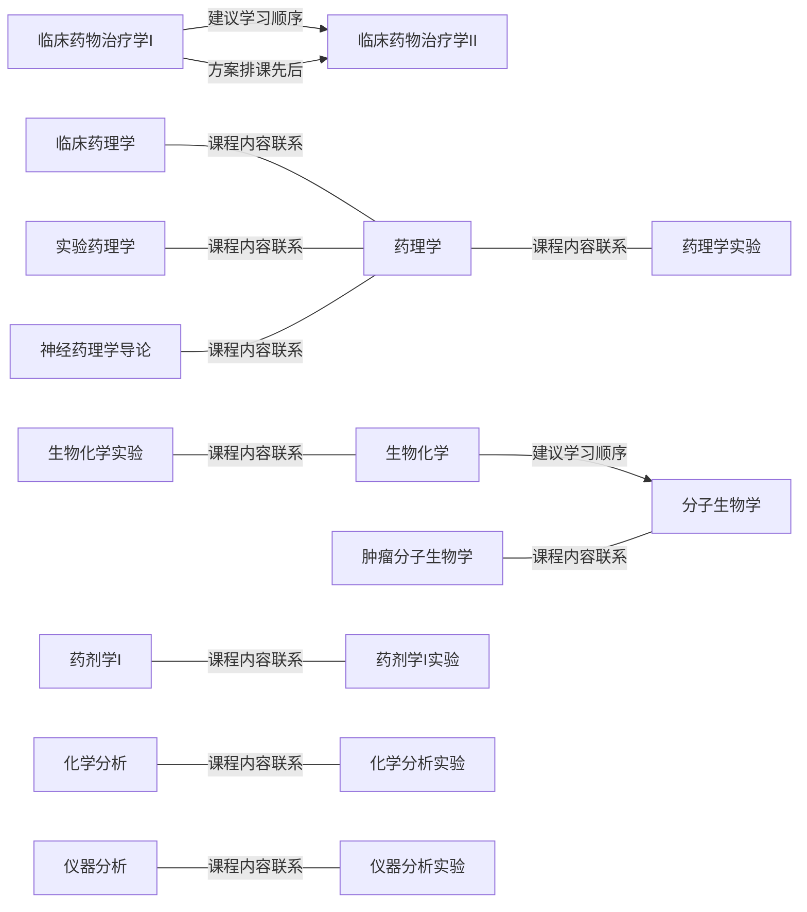

# 药学专业（临床药学方向）“2+X”教学培养方案

2024 年汇编印刷页 1021–1026。原表记录 61 个可配对的课程代码。

[本节原页](plan-1021.pdf#page=1) · [逐行数据](plan-1021.json) · [院系目录](README.md)

## 课程关系图

图中展示最多 20 条关系。下表列出本节全部关系。建议学习顺序供规划课程使用，正式选课资格以教务规定为准。

| 课程 | 关联课程 | 关系 | 依据 |
| --- | --- | --- | --- |
| 临床药物治疗学I（PHAR130136） | 临床药物治疗学II（PHAR130137） | 建议学习顺序 | 同节课程题名标明连续分册或序号。 |
| 生物化学（PHAR130168） | 分子生物学（PHAR130138） | 建议学习顺序 | 生物分子的结构与功能支持分子生物学学习。 |
| 肿瘤分子生物学（MED130265） | 分子生物学（PHAR130138） | 课程内容联系 | 本方案两门课程的题名均含“分子生物学”，可据此对照这一主题。 |
| 临床药理学（PHAR130056） | 药理学（PHAR130147） | 课程内容联系 | 本方案两门课程的题名均含“药理”，可据此对照这一主题。 |
| 实验药理学（PHAR130064） | 药理学（PHAR130147） | 课程内容联系 | 本方案两门课程的题名均含“药理”，可据此对照这一主题。 |
| 神经药理学导论（PHAR130076） | 药理学（PHAR130147） | 课程内容联系 | 本方案两门课程的题名均含“药理”，可据此对照这一主题。 |
| 生物化学实验（PHAR130146） | 生物化学（PHAR130168） | 课程内容联系 | 同节同题名的课程与实验、实习或实践。 |
| 药理学（PHAR130147） | 药理学实验（PHAR130148） | 课程内容联系 | 同节同题名的课程与实验、实习或实践。 |
| 药剂学I（PHAR130149） | 药剂学I实验（PHAR130150） | 课程内容联系 | 同节同题名的课程与实验、实习或实践。 |
| 化学分析（PHAR130156） | 化学分析实验（PHAR130157） | 课程内容联系 | 同节同题名的课程与实验、实习或实践。 |
| 仪器分析（PHAR130158） | 仪器分析实验（PHAR130159） | 课程内容联系 | 同节同题名的课程与实验、实习或实践。 |
| 临床药物治疗学I（PHAR130136） | 临床药物治疗学II（PHAR130137） | 方案排课先后 | 本节原表所列全部明确学期均早于后者。 |

## 课程

| 课程代码 | 名称 | 开课学期原文 | 来源（PDF 页） |
| --- | --- | --- | --- |
| MED130013 | 病理生理学B | 5、春，秋 | 1035, 1038 |
| MED130049 | 诊断学B | 5 | 1036 |
| MED130056 | 内科学C | 6 | 1036 |
| MED130057 | 外科学C | 6 | 1036 |
| MED130058 | 妇产科学C | 6 | 1036 |
| MED130059 | 儿科学C | 6 | 1036 |
| MED130087 | 医学文献检索与利用B | 春，秋 | 1038 |
| MED130097 | 中西医结合基础概论 | 春，秋 | 1038 |
| MED130099 | 免疫工程 | 春，秋 | 1039 |
| MED130175 | 病原生物学研究进展 | 春，秋 | 1039 |
| MED130185 | 医患交流技巧 | 秋 | 1039 |
| MED130191 | 医疗保险经济学 | 秋 | 1039 |
| MED130196 | 急诊医学 | 春，秋 | 1039 |
| MED130197 | 医学与生物安全 | 春，秋 | 1039 |
| MED130264 | 艾滋病基础和临床 | 春，秋 | 1039 |
| MED130265 | 肿瘤分子生物学 | 春，秋 | 1039 |
| MED130270 | 生物医学科研论文的撰写 | 春，秋 | 1039 |
| MED130337 | 现代医院质量评价及管理工具应用 | 春，秋 | 1039 |
| MED130459 | 感染与免疫 | 4 | 1035 |
| MED130460 | 医学基础 | 4 | 1035 |
| PHAR130008 | 生物制药技术 |  | 1036 |
| PHAR130009 | 核药学概论 |  | 1036 |
| PHAR130016 | 天然药物化学I |  | 1036 |
| PHAR130019 | 药事管理学 | 7 | 1036 |
| PHAR130020 | 专业实习 | 暑期 | 1036 |
| PHAR130021 | 毕业论文 | 8 | 1036 |
| PHAR130049 | 数理统计 | 3 | 1035 |
| PHAR130056 | 临床药理学 | 春，秋 | 1038 |
| PHAR130064 | 实验药理学 | 春，秋 | 1038 |
| PHAR130073 | 生物技术药物给药系统 |  | 1037 |
| PHAR130075 | 药理学专题讨论 | 春，秋 | 1038 |
| PHAR130076 | 神经药理学导论 | 春，秋 | 1038 |
| PHAR130082 | 药物靶向传释系统 |  | 1037 |
| PHAR130086 | 基于问题的药理学 | 春，秋 | 1038 |
| PHAR130090 | 临床药物化学 | 5 | 1036 |
| PHAR130091 | 临床药物动力学 | 7 | 1036 |
| PHAR130094 | 药物流行病学 | 5 | 1035 |
| PHAR130130 | 综合性药学实验 | 7 | 1037 |
| PHAR130131 | 有机化学实验II |  | 1036 |
| PHAR130132 | 学术前沿专题 | 春，秋 | 1038 |
| PHAR130133 | 药物设计学 | 7 | 1037 |
| PHAR130136 | 临床药物治疗学I | 5 | 1036 |
| PHAR130137 | 临床药物治疗学II | 7 | 1036 |
| PHAR130138 | 分子生物学 |  | 1036 |
| PHAR130140 | 临床药学技能与实践 | 7 | 1036 |
| PHAR130146 | 生物化学实验 | 4 | 1035 |
| PHAR130147 | 药理学 | 4 | 1035 |
| PHAR130148 | 药理学实验 | 4 | 1035 |
| PHAR130149 | 药剂学I | 7 | 1036 |
| PHAR130150 | 药剂学I实验 | 7 | 1036 |
| PHAR130152 | 药物分析I实验 |  | 1036 |
| PHAR130156 | 化学分析 | 3 | 1035 |
| PHAR130157 | 化学分析实验 | 3 | 1035 |
| PHAR130158 | 仪器分析 | 4 | 1035 |
| PHAR130159 | 仪器分析实验 | 4 | 1035 |
| PHAR130167 | 物理化学 |  | 1036 |
| PHAR130168 | 生物化学 | 4 | 1035 |
| PHAR130169 | 药用植物学I |  | 1036 |
| PHPM130021 | 医院获得性感染 | 春，秋 | 1039 |
| PHPM130022 | 管理与沟通技巧 | 春 | 1039 |
| PHPM130085 | 卫生经济评价方法 | 秋 | 1039 |
