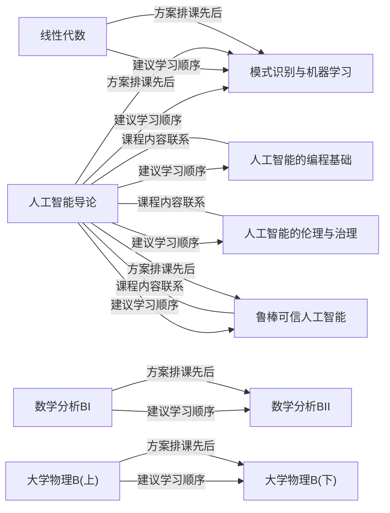

# 人工智能（计算与智能领军人才班）专业教学培养方案（香农计划适用）

2024 年汇编印刷页 813–815。原表记录 40 个可配对的课程代码。

[本节原页](plan-813.pdf#page=1) · [逐行数据](plan-813.json) · [院系目录](README.md)

## 课程关系图

图中展示最多 20 条关系。下表列出本节全部关系。建议学习顺序供规划课程使用，正式选课资格以教务规定为准。

| 课程 | 关联课程 | 关系 | 依据 |
| --- | --- | --- | --- |
| 人工智能导论（AIE310005） | 人工智能的编程基础（AIE310006） | 建议学习顺序 | “人工智能导论”题名标明基础层次，前置阅读可帮助了解“人工智能的编程基础”中的人工智能主题。 |
| 人工智能导论（AIE310005） | 模式识别与机器学习（COMP130137） | 建议学习顺序 | 人工智能问题与模型类别可为学习模式识别作准备。 |
| 人工智能导论（AIE310005） | 鲁棒可信人工智能（COMP130221） | 建议学习顺序 | “人工智能导论”题名标明基础层次，前置阅读可帮助了解“鲁棒可信人工智能”中的人工智能主题。 |
| 人工智能导论（AIE310005） | 人工智能的伦理与治理（DATA130055） | 建议学习顺序 | “人工智能导论”题名标明基础层次，前置阅读可帮助了解“人工智能的伦理与治理”中的人工智能主题。 |
| 线性代数（COMP120004） | 模式识别与机器学习（COMP130137） | 建议学习顺序 | 向量表示和矩阵运算支持理解分类、回归等模型。 |
| 数学分析BI（MATH120016） | 数学分析BII（MATH120017） | 建议学习顺序 | 同节课程题名标明连续分册或序号。 |
| 大学物理B(上)（PHYS120013） | 大学物理B(下)（PHYS120014） | 建议学习顺序 | 同节课程题名标明连续分册或序号。 |
| 人工智能导论（AIE310005） | 人工智能的编程基础（AIE310006） | 课程内容联系 | 本方案两门课程的题名均含“人工智能”，可据此对照这一主题。 |
| 人工智能导论（AIE310005） | 鲁棒可信人工智能（COMP130221） | 课程内容联系 | 本方案两门课程的题名均含“人工智能”，可据此对照这一主题。 |
| 人工智能导论（AIE310005） | 人工智能的伦理与治理（DATA130055） | 课程内容联系 | 本方案两门课程的题名均含“人工智能”，可据此对照这一主题。 |
| 人工智能导论（AIE310005） | 模式识别与机器学习（COMP130137） | 方案排课先后 | 本节原表所列全部明确学期均早于后者。 |
| 人工智能导论（AIE310005） | 鲁棒可信人工智能（COMP130221） | 方案排课先后 | 本节原表所列全部明确学期均早于后者。 |
| 线性代数（COMP120004） | 模式识别与机器学习（COMP130137） | 方案排课先后 | 本节原表所列全部明确学期均早于后者。 |
| 数学分析BI（MATH120016） | 数学分析BII（MATH120017） | 方案排课先后 | 本节原表所列全部明确学期均早于后者。 |
| 大学物理B(上)（PHYS120013） | 大学物理B(下)（PHYS120014） | 方案排课先后 | 本节原表所列全部明确学期均早于后者。 |

## 课程

| 课程代码 | 名称 | 开课学期原文 | 来源（PDF 页） |
| --- | --- | --- | --- |
| AIE310005 | 人工智能导论 | 4 | 828 |
| AIE310006 | 人工智能的编程基础 | 2 | 827 |
| AIE410002 | 自然语言处理与大语言模型 | 5 | 828 |
| AIE631001 | 信息论、控制论、系统论基础 | 2 | 827 |
| COMP120004 | 线性代数 | 1 | 827 |
| COMP120006 | 程序设计 | 1 | 827 |
| COMP130004 | 数据结构 | 3 | 828 |
| COMP130006 | 概率论与数理统计 | 3 | 828 |
| COMP130010 | 数据库引论 | 4 | 828 |
| COMP130018 | 计算机图形学A | 6 | 828 |
| COMP130020 | 毕业论文 | 8 | 828 |
| COMP130110 | 操作系统 | 5 | 828 |
| COMP130124 | 计算机视觉 | 5 | 828 |
| COMP130137 | 模式识别与机器学习 | 5 | 828 |
| COMP130139 | 数字信号处理 | 6 | 828 |
| COMP130148 | 数据挖掘技术 | 5 | 828 |
| COMP130149 | 集合与图论 | 3 | 828 |
| COMP130191 | 计算机组成与体系结构 | 4 | 828 |
| COMP130192 | 并行分布式计算 | 7 | 828 |
| COMP130194 | 本科生科研实践 | 4-7 | 828 |
| COMP130210 | 信息物理融合系统 | 7 | 829 |
| COMP130216 | 内生安全概论 | 7 | 829 |
| COMP130217 | 智能系统与多智能体 | 6 | 828 |
| COMP130218 | 模型安全对抗演练 | 7 | 829 |
| COMP130219 | 面向大模型的编程与并行学习算法 | 4 | 828 |
| COMP130220 | 多模态大模型设计与实现 | 7 | 829 |
| COMP130221 | 鲁棒可信人工智能 | 6 | 829 |
| COMP130222 | 可编程控制系统设计 | 4 | 828 |
| COMP130223 | 移动智能体编程实验 | 7 | 828 |
| COMP130224 | 嵌入式操作系统 | 5 | 828 |
| DATA130026 | 最优化方法 | 4 | 828 |
| DATA130055 | 人工智能的伦理与治理 | 4或6 | 828 |
| DATA130060 | 强化学习算法与理论基础 | 6 | 828 |
| INFO130360 | 智能系统设计 | 7 | 828 |
| MATH120016 | 数学分析BI | 1 | 827 |
| MATH120017 | 数学分析BII | 2 | 827 |
| MICR120001 | 电路基础 | 2 | 827 |
| PHYS120013 | 大学物理B(上) | 1 | 827 |
| PHYS120014 | 大学物理B(下) | 2 | 827 |
| PHYS120015 | 基础物理实验 | 2 | 827 |
