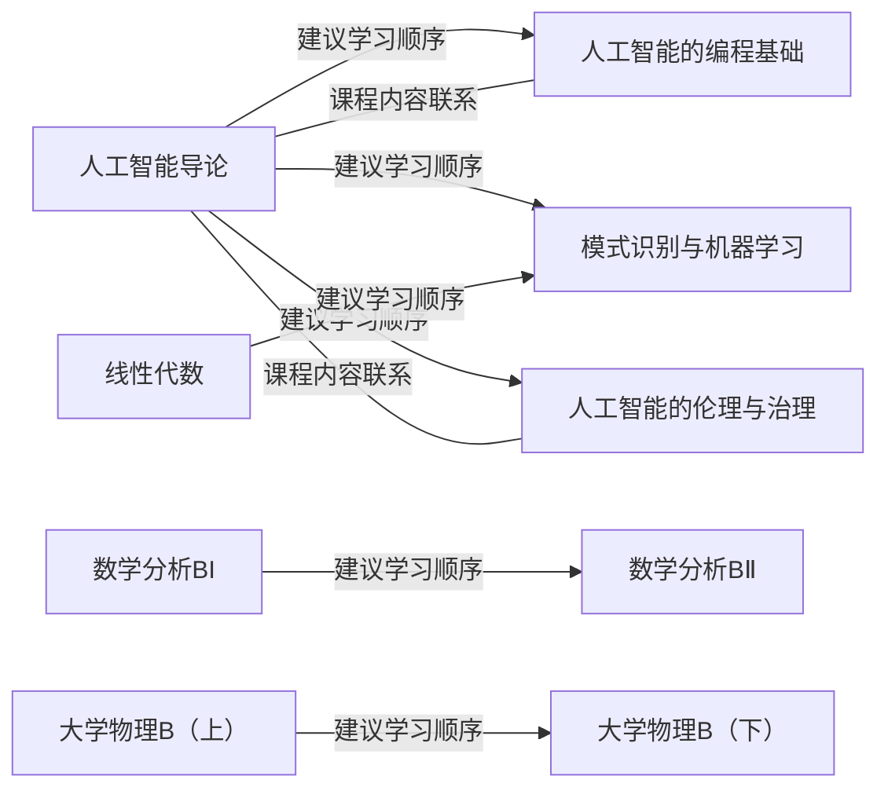

# 人工智能（计算与智能领军人才班）专业“2+X”修读建议

2024 年汇编印刷页 826–827。原表记录 28 个可配对的课程代码。

[本节原页](plan-823.pdf#page=4) · [逐行数据](plan-823.json) · [院系目录](README.md)

## 课程关系图

图中展示最多 20 条关系。下表列出本节全部关系。建议学习顺序供规划课程使用，正式选课资格以教务规定为准。

| 课程 | 关联课程 | 关系 | 依据 |
| --- | --- | --- | --- |
| 人工智能导论（AIE310005） | 人工智能的编程基础（AIE310006） | 建议学习顺序 | “人工智能导论”题名标明基础层次，前置阅读可帮助了解“人工智能的编程基础”中的人工智能主题。 |
| 人工智能导论（AIE310005） | 模式识别与机器学习（COMP130137） | 建议学习顺序 | 人工智能问题与模型类别可为学习模式识别作准备。 |
| 人工智能导论（AIE310005） | 人工智能的伦理与治理（DATA130055） | 建议学习顺序 | “人工智能导论”题名标明基础层次，前置阅读可帮助了解“人工智能的伦理与治理”中的人工智能主题。 |
| 线性代数（COMP120004） | 模式识别与机器学习（COMP130137） | 建议学习顺序 | 向量表示和矩阵运算支持理解分类、回归等模型。 |
| 数学分析BI（MATH120016） | 数学分析BⅡ（MATH120017） | 建议学习顺序 | 同节课程题名标明连续分册或序号。 |
| 大学物理B（上）（PHYS120013） | 大学物理B（下）（PHYS120014） | 建议学习顺序 | 同节课程题名标明连续分册或序号。 |
| 人工智能导论（AIE310005） | 人工智能的编程基础（AIE310006） | 课程内容联系 | 本方案两门课程的题名均含“人工智能”，可据此对照这一主题。 |
| 人工智能导论（AIE310005） | 人工智能的伦理与治理（DATA130055） | 课程内容联系 | 本方案两门课程的题名均含“人工智能”，可据此对照这一主题。 |

## 课程

| 课程代码 | 名称 | 开课学期原文 | 来源（PDF 页） |
| --- | --- | --- | --- |
| AIE310005 | 人工智能导论 |  | 841 |
| AIE310006 | 人工智能的编程基础 |  | 840 |
| AIE631001 | 信息论、控制论、系统论基础 |  | 840 |
| COMP120004 | 线性代数 |  | 840 |
| COMP120006 | 程序设计 |  | 840 |
| COMP130004 | 数据结构 |  | 841 |
| COMP130006 | 概率论与数理统计 |  | 840 |
| COMP130010 | 数据库引论 |  | 841 |
| COMP130020 | 毕业论文 |  | 841 |
| COMP130110 | 操作系统 |  | 841 |
| COMP130137 | 模式识别与机器学习 |  | 841 |
| COMP130149 | 集合与图论 |  | 841 |
| COMP130191 | 计算机组成与体系结构 |  | 841 |
| COMP130192 | 并行分布式计算 |  | 841 |
| COMP130194 | 本科生科研实践 |  | 841 |
| DATA130026 | 最优化方法 |  | 840 |
| DATA130055 | 人工智能的伦理与治理 |  | 841 |
| MATH120016 | 数学分析BI |  | 840 |
| MATH120017 | 数学分析BⅡ |  | 840 |
| MICR120001 | 电路基础 |  | 840 |
| PHYS120013 | 大学物理B（上） |  | 840 |
| PHYS120014 | 大学物理B（下） |  | 840 |
| PHYS120015 | 基础物理实验 |  | 840 |
| PTSS110082 | 毛泽东思想和中国特色社会主义理论体系概论 |  | 840 |
| PTSS110087 | 马克思主义基本原理 |  | 840 |
| PTSS110088 | 中国近现代史纲要 |  | 840 |
| PTSS110089 | 思想道德与法治 |  | 840 |
| PTSS110090 | 习近平新时代中国特色社会主义思想概论 |  | 840 |
