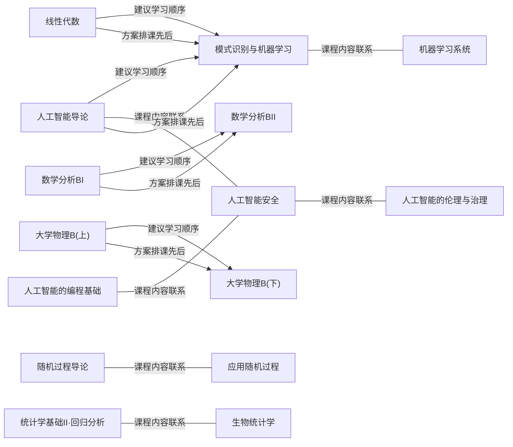

# 人工智能专业“2+X”教学培养方案（新工科本研贯通适用）

2024 年汇编印刷页 846–849。原表记录 59 个可配对的课程代码。

[本节原页](plan-846.pdf#page=1) · [逐行数据](plan-846.json) · [院系目录](README.md)

## 课程导读

想了解机器学习与智能计算的课程安排，可以在原表中找到《人工智能的伦理与治理》（`DATA130055`）、《模式识别与机器学习》（`COMP130137`）、《神经网络与深度学习》（`DATA130011`）。 [原书 PDF 第 861 页](plan-846.pdf#page=2) · [原书 PDF 第 862 页](plan-846.pdf#page=3)

图中连接《人工智能导论》（`AIE310005`）和《人工智能安全》（`AIE831001`），两门课都从课程题名标出的“人工智能”切入，可沿这一主题对照阅读。 [原书 PDF 第 861 页](plan-846.pdf#page=2) · [原书 PDF 第 862 页](plan-846.pdf#page=3)

## 课程关系图

图中展示最多 20 条关系。下表列出本节全部关系。建议学习顺序供规划课程使用，正式选课资格以教务规定为准。

| 课程 | 关联课程 | 关系 | 依据 |
| --- | --- | --- | --- |
| 人工智能导论（AIE310005） | 模式识别与机器学习（COMP130137） | 建议学习顺序 | 人工智能问题与模型类别可为学习模式识别作准备。 |
| 线性代数（COMP120004） | 模式识别与机器学习（COMP130137） | 建议学习顺序 | 向量表示和矩阵运算支持理解分类、回归等模型。 |
| 数学分析BI（MATH120016） | 数学分析BII（MATH120017） | 建议学习顺序 | 同节课程题名标明连续分册或序号。 |
| 大学物理B(上)（PHYS120013） | 大学物理B(下)（PHYS120014） | 建议学习顺序 | 同节课程题名标明连续分册或序号。 |
| 人工智能导论（AIE310005） | 人工智能安全（AIE831001） | 课程内容联系 | 本方案两门课程的题名均含“人工智能”，可据此对照这一主题。 |
| 人工智能的编程基础（AIE310006） | 人工智能安全（AIE831001） | 课程内容联系 | 本方案两门课程的题名均含“人工智能”，可据此对照这一主题。 |
| 人工智能安全（AIE831001） | 人工智能的伦理与治理（DATA130055） | 课程内容联系 | 本方案两门课程的题名均含“人工智能”，可据此对照这一主题。 |
| 模式识别与机器学习（COMP130137） | 机器学习系统（COMP130209） | 课程内容联系 | 本方案两门课程的题名均含“机器学习”，可据此对照这一主题。 |
| 随机过程导论（DATA130019） | 应用随机过程（MATH130110） | 课程内容联系 | 本方案两门课程的题名均含“随机过程”，可据此对照这一主题。 |
| 统计学基础II：回归分析（DATA130046） | 生物统计学（DATA130048） | 课程内容联系 | 本方案两门课程的题名均含“统计学”，可据此对照这一主题。 |
| 人工智能导论（AIE310005） | 模式识别与机器学习（COMP130137） | 方案排课先后 | 本节原表所列全部明确学期均早于后者。 |
| 线性代数（COMP120004） | 模式识别与机器学习（COMP130137） | 方案排课先后 | 本节原表所列全部明确学期均早于后者。 |
| 数学分析BI（MATH120016） | 数学分析BII（MATH120017） | 方案排课先后 | 本节原表所列全部明确学期均早于后者。 |
| 大学物理B(上)（PHYS120013） | 大学物理B(下)（PHYS120014） | 方案排课先后 | 本节原表所列全部明确学期均早于后者。 |

## 课程

| 课程代码 | 名称 | 开课学期原文 | 来源（PDF 页） |
| --- | --- | --- | --- |
| AIE310005 | 人工智能导论 | 4 | 861 |
| AIE310006 | 人工智能的编程基础 | 2 | 861 |
| AIE410002 | 自然语言处理与大语言模型 | 5 | 862 |
| AIE631001 | 信息论、控制论、系统论基础 | 2 | 861 |
| AIE831001 | 人工智能安全 | 5 | 862 |
| AIT531023 | 认知智能前沿技术与实践 | 6 | 862 |
| COMP120004 | 线性代数 | 1 | 860 |
| COMP120006 | 程序设计 | 1 | 860 |
| COMP130004 | 数据结构 | 3 | 861 |
| COMP130005 | 代数结构与数理逻辑 | 4 | 862 |
| COMP130006 | 概率论与数理统计 | 3 | 861 |
| COMP130010 | 数据库引论 | 4 | 861 |
| COMP130014 | 编译 | 6 | 862 |
| COMP130015 | 软件工程 | 6 | 862 |
| COMP130018 | 计算机图形学A | 6 | 862 |
| COMP130020 | 毕业论文 | 8 | 861 |
| COMP130023 | 计算理论基础 | 5 | 862 |
| COMP130032 | 数字图象处理 | 6 | 862 |
| COMP130110 | 操作系统 | 5 | 861 |
| COMP130124 | 计算机视觉 | 5 | 862 |
| COMP130126 | 信息检索导论 | 7 | 862 |
| COMP130136 | 计算机网络 | 5 | 862 |
| COMP130137 | 模式识别与机器学习 | 5 | 861 |
| COMP130148 | 数据挖掘技术 | 6 | 862 |
| COMP130149 | 集合与图论 | 3 | 861 |
| COMP130191 | 计算机组成与体系结构 | 4 | 861 |
| COMP130192 | 并行分布式计算 | 7 | 861 |
| COMP130194 | 本科生科研实践 | 4-7 | 861 |
| COMP130195 | 大数据分析技术 | 6 | 862 |
| COMP130197 | 人机交互 | 6 | 862 |
| COMP130198 | 社会计算导论 | 4或6 | 862 |
| COMP130209 | 机器学习系统 | 6 | 862 |
| COMP130211 | 虚拟现实技术导引 | 6 | 862 |
| COMP130213 | 类脑智能与人工通用智能 | 5 | 862 |
| DATA130002 | 数值算法与案例分析I | 5 | 861 |
| DATA130007 | 社交网络挖掘 | 6或7 | 862 |
| DATA130011 | 神经网络与深度学习 | 6 | 862 |
| DATA130019 | 随机过程导论 | 4 | 861 |
| DATA130026 | 最优化方法 | 4 | 861 |
| DATA130028 | 数据融合与同化 | 6 | 861 |
| DATA130046 | 统计学基础II：回归分析 | 5 | 861 |
| DATA130048 | 生物统计学 | 6 | 861 |
| DATA130049 | 图像处理与可视化 | 5 | 861 |
| DATA130050 | 复杂系统理论与仿真 | 7 | 862 |
| DATA130051 | 计算机视觉 | 6 | 862 |
| DATA130053 | 计算系统生物学 | 4 | 861 |
| DATA130054 | 脑科学与类脑系统 | 6 | 862 |
| DATA130055 | 人工智能的伦理与治理 | 4或6 | 861 |
| DATA130056 | 应用泛函分析 | 7 | 862 |
| DATA130063 | 高等微积分 | 3 | 861 |
| INFO130317 | 生物医学工程学基础 | 4 | 862 |
| MATH120016 | 数学分析BI | 1 | 860 |
| MATH120017 | 数学分析BII | 2 | 860 |
| MATH130004 | 常微分方程 | 3 | 861 |
| MATH130110 | 应用随机过程 | 4 | 861 |
| MICR120001 | 电路基础 | 2 | 860 |
| PHYS120013 | 大学物理B(上) | 1 | 860 |
| PHYS120014 | 大学物理B(下) | 2 | 860 |
| PHYS120015 | 基础物理实验 | 2 | 860 |
