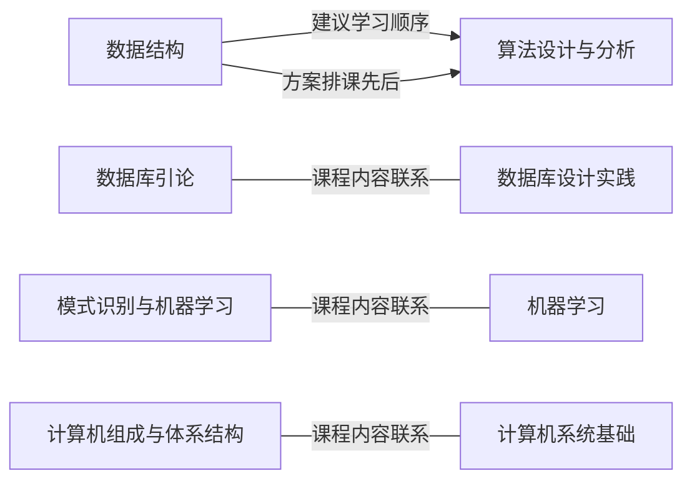

# 计算机科学与技术专业“2+X”教学培养方案

2024 年汇编印刷页 887–890。原表记录 61 个可配对的课程代码。

[本节原页](plan-887.pdf#page=1) · [逐行数据](plan-887.json) · [院系目录](README.md)

## 课程导读

想了解算法与计算机系统的课程安排，可以在原表中找到《数据结构》（`COMP130004`）、《计算机系统基础》（`COMP130201`）、《算法设计与分析》（`COMP130011`）。 [原书 PDF 第 901 页](plan-887.pdf#page=1)

图谱建议先读《数据结构》（`COMP130004`）再读《算法设计与分析》（`COMP130011`）。数据组织与基本操作为算法设计提供基础。 [原书 PDF 第 901 页](plan-887.pdf#page=1)

## 课程关系图

图中展示最多 20 条关系。下表列出本节全部关系。建议学习顺序供规划课程使用，正式选课资格以教务规定为准。

| 课程 | 关联课程 | 关系 | 依据 |
| --- | --- | --- | --- |
| 数据结构（COMP130004） | 算法设计与分析（COMP130011） | 建议学习顺序 | 数据组织与基本操作为算法设计提供基础。 |
| 数据库引论（COMP130010） | 数据库设计实践（COMP130027） | 课程内容联系 | 本方案两门课程的题名均含“数据库”，可据此对照这一主题。 |
| 模式识别与机器学习（COMP130137） | 机器学习（COMP130172） | 课程内容联系 | 本方案两门课程的题名均含“机器学习”，可据此对照这一主题。 |
| 计算机组成与体系结构（COMP130191） | 计算机系统基础（COMP130201） | 课程内容联系 | 处理器、存储与系统执行模型具有共同内容。 |
| 数据结构（COMP130004） | 算法设计与分析（COMP130011） | 方案排课先后 | 本节原表所列全部明确学期均早于后者。 |

## 课程

| 课程代码 | 名称 | 开课学期原文 | 来源（PDF 页） |
| --- | --- | --- | --- |
| COMP130002 | 数字逻辑与部件设计 | 3 | 901 |
| COMP130004 | 数据结构 | 3 | 901 |
| COMP130005 | 代数结构与数理逻辑 | 4 | 902 |
| COMP130006 | 概率论与数理统计 | 5 | 902 |
| COMP130010 | 数据库引论 | 4 | 901 |
| COMP130011 | 算法设计与分析 | 4 | 901 |
| COMP130014 | 编译 | 6 | 901 |
| COMP130015 | 软件工程 | 6 | 902 |
| COMP130018 | 计算机图形学A | 6 | 902 |
| COMP130020 | 毕业论文 | 8 | 902 |
| COMP130021 | 信息安全原理 | 6 | 903 |
| COMP130022 | 程序设计语言原理 | 6 | 903 |
| COMP130023 | 计算理论基础 | 5 | 902 |
| COMP130024 | 面向对象技术 | 6 | 903 |
| COMP130025 | 软件体系结构 | 5 | 902 |
| COMP130027 | 数据库设计实践 | 7 | 903 |
| COMP130029 | 信息论基础 | 6 | 903 |
| COMP130030 | 模式识别 | 5 | 902 |
| COMP130032 | 数字图像处理 | 6 | 903 |
| COMP130062 | 机器人学导论 | 7 | 903 |
| COMP130075 | 数学建模 | 6 | 903 |
| COMP130105 | 网络存储导论 | 4 | 902 |
| COMP130110 | 操作系统 | 5 | 901 |
| COMP130112 | 软件工程化开发 | 5 | 902 |
| COMP130124 | 计算机视觉 | 5 | 902 |
| COMP130125 | 大数据分析技术 | 7 | 903 |
| COMP130135 | 面向对象程序设计 | 2 | 901 |
| COMP130136 | 计算机网络 | 5 | 901 |
| COMP130137 | 模式识别与机器学习 | 5 | 902 |
| COMP130138 | 人机交互 | 6 | 903 |
| COMP130139 | 数字信号处理 | 6 | 903 |
| COMP130140 | 移动互联网 | 6 | 903 |
| COMP130145 | 计算复杂性与密码学 | 5 | 902 |
| COMP130146 | 并发理论 | 7 | 903 |
| COMP130148 | 数据挖掘技术 | 6 | 903 |
| COMP130149 | 集合与图论 | 3 | 901 |
| COMP130150 | 算法竞赛导论 | 7 | 903 |
| COMP130151 | 算法竞赛进阶 | 8 | 903 |
| COMP130163 | 信息安全导论 | 3 | 902 |
| COMP130166 | 信息系统安全 | 5 | 902 |
| COMP130172 | 机器学习 | 5 | 902 |
| COMP130174 | 计算机可视化 | 6 | 903 |
| COMP130175 | 计算机可视化-进阶实践 | 7 | 903 |
| COMP130176 | 编程方法与技术 | 5 | 902 |
| COMP130177 | 互联网体系结构 | 6 | 903 |
| COMP130178 | 互联网：协议与应用 | 5 | 902 |
| COMP130179 | 物联网与边缘计算 | 5 | 902 |
| COMP130180 | 领域数据学 | 6 | 903 |
| COMP130191 | 计算机组成与体系结构 | 4 | 901 |
| COMP130192 | 并行分布式计算 | 7 | 902 |
| COMP130199 | 自然语言处理和知识表示 | 5 | 902 |
| COMP130201 | 计算机系统基础 | 3 | 901 |
| COMP130203 | 专业实践与生产实习 | 7 | 902 |
| COMP130205 | 云计算与虚拟化技术 | 6 | 903 |
| COMP130207 | 人工智能 | 6 | 902 |
| COMP130210 | 信息物理融合系统 | 7 | 903 |
| COMP130211 | 虚拟现实技术导引 | 6 | 903 |
| COMP130212 | 卫星互联网 | 6 | 903 |
| COMP130213 | 类脑智能与人工通用智能 | 5 | 902 |
| INFO120011 | 电子系统导论 | 2 | 902 |
| SOFT130070 | 并行计算与性能优化 | 6或7 | 903 |
