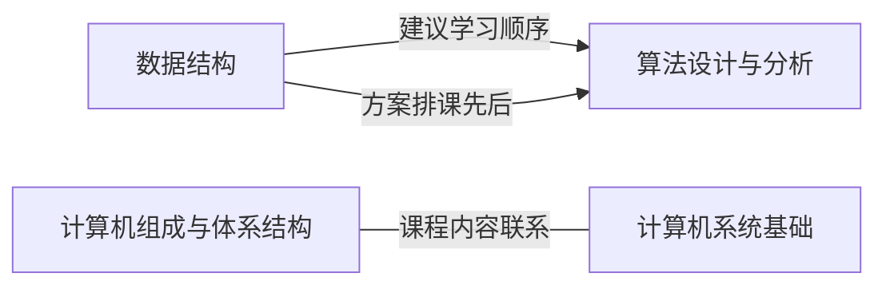

# 信息安全专业“2+X”教学培养方案

2024 年汇编印刷页 893–895。原表记录 45 个可配对的课程代码。

[本节原页](plan-893.pdf#page=1) · [逐行数据](plan-893.json) · [院系目录](README.md)

## 课程导读

想了解信息安全的课程安排，可以在原表中找到《信息安全导论》（`COMP130163`）、《密码学基础》（`COMP130069`）、《计算机网络》（`COMP130136`）。 [原书 PDF 第 907 页](plan-893.pdf#page=1) · [原书 PDF 第 908 页](plan-893.pdf#page=2)

图中把《计算机组成与体系结构》（`COMP130191`）和《计算机系统基础》（`COMP130201`）列作内容联系。处理器、存储与系统执行模型具有共同内容。 [原书 PDF 第 907 页](plan-893.pdf#page=1)

## 课程关系图

图中展示最多 20 条关系。下表列出本节全部关系。建议学习顺序供规划课程使用，正式选课资格以教务规定为准。

| 课程 | 关联课程 | 关系 | 依据 |
| --- | --- | --- | --- |
| 数据结构（COMP130004） | 算法设计与分析（COMP130011） | 建议学习顺序 | 数据组织与基本操作为算法设计提供基础。 |
| 计算机组成与体系结构（COMP130191） | 计算机系统基础（COMP130201） | 课程内容联系 | 处理器、存储与系统执行模型具有共同内容。 |
| 数据结构（COMP130004） | 算法设计与分析（COMP130011） | 方案排课先后 | 本节原表所列全部明确学期均早于后者。 |

## 课程

| 课程代码 | 名称 | 开课学期原文 | 来源（PDF 页） |
| --- | --- | --- | --- |
| COMP130002 | 数字逻辑与部件设计 | 3 | 907 |
| COMP130004 | 数据结构 | 3 | 907 |
| COMP130005 | 代数结构与数理逻辑 | 4 | 907 |
| COMP130006 | 概率论与数理统计 | 5 | 908 |
| COMP130010 | 数据库引论 | 4 | 908 |
| COMP130011 | 算法设计与分析 | 4 | 908 |
| COMP130014 | 编译 | 6 | 908 |
| COMP130020 | 毕业论文 | 8 | 908 |
| COMP130023 | 计算理论基础 | 5 | 908 |
| COMP130043 | 嵌入式系统 | 6 | 908 |
| COMP130068 | 信息论与编码 | 6 | 908 |
| COMP130069 | 密码学基础 | 6 | 908 |
| COMP130070 | 网络程序设计 | 5 | 908 |
| COMP130075 | 数学建模 | 6 | 908 |
| COMP130079 | 多媒体信息技术 | 6 | 908 |
| COMP130093 | 数字水印技术 | 6 | 908 |
| COMP130095 | 电子商务结构和安全 | 7 | 909 |
| COMP130096 | 计算机病毒及其防治 | 7 | 909 |
| COMP130101 | 防火墙技术 | 5 | 908 |
| COMP130108 | 信息内容安全 | 5 | 908 |
| COMP130110 | 操作系统 | 5 | 908 |
| COMP130125 | 大数据分析技术 | 7 | 909 |
| COMP130127 | 无线网络及安全 | 5 | 908 |
| COMP130133 | 信息系统分析与设计 | 6 | 908 |
| COMP130135 | 面向对象程序设计 | 2 | 907 |
| COMP130136 | 计算机网络 | 4 | 908 |
| COMP130149 | 集合与图论 | 3 | 907 |
| COMP130155 | 安全攻防综合实验 | 7 | 908 |
| COMP130158 | 逆向工程原理 | 4 | 907 |
| COMP130159 | 软件安全 | 6 | 908 |
| COMP130160 | 数据安全与隐私保护 | 7 | 909 |
| COMP130162 | 泄密取证技术 | 6 | 909 |
| COMP130163 | 信息安全导论 | 3 | 907 |
| COMP130166 | 信息系统安全 | 5 | 908 |
| COMP130191 | 计算机组成与体系结构 | 4 | 907 |
| COMP130192 | 并行分布式计算 | 7 | 909 |
| COMP130193 | 信息隐藏与多媒体信息安全 | 7 | 909 |
| COMP130200 | 区块链技术 | 7 | 909 |
| COMP130201 | 计算机系统基础 | 3 | 907 |
| COMP130202 | 智能系统安全实践 | 6 | 909 |
| COMP130203 | 专业实践与生产实习 | 7 | 908 |
| COMP130207 | 人工智能 | 6 | 909 |
| COMP130212 | 卫星互联网 | 6 | 909 |
| COMP130214 | 代码安全审计和分析 | 5 | 908 |
| INFO120011 | 电子系统导论 | 2 | 908 |
