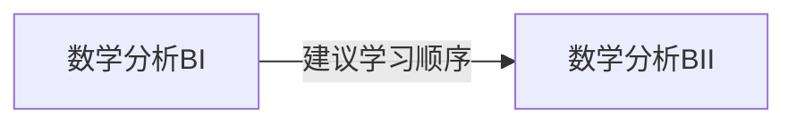

# 信息安全专业“2+X”修读建议

2024 年汇编印刷页 896–897。原表记录 24 个可配对的课程代码。

[本节原页](plan-893.pdf#page=4) · [逐行数据](plan-893.json) · [院系目录](README.md)

## 课程导读

想了解信息安全的课程安排，可以在原表中找到《信息安全导论》（`COMP130163`）、《密码学基础》（`COMP130069`）、《计算机网络》（`COMP130136`）。 [原书 PDF 第 910 页](plan-893.pdf#page=4)

《数学分析BI》（`MATH120016`）和《数学分析BII》（`MATH120017`）是同一系列，图中的箭头按题名标出的分册顺序排列。 [原书 PDF 第 910 页](plan-893.pdf#page=4)

## 课程关系图

图中展示最多 20 条关系。下表列出本节全部关系。建议学习顺序供规划课程使用，正式选课资格以教务规定为准。

| 课程 | 关联课程 | 关系 | 依据 |
| --- | --- | --- | --- |
| 数学分析BI（MATH120016） | 数学分析BII（MATH120017） | 建议学习顺序 | 同节课程题名标明连续分册或序号。 |

## 课程

| 课程代码 | 名称 | 开课学期原文 | 来源（PDF 页） |
| --- | --- | --- | --- |
| COMP120004 | 线性代数 |  | 910 |
| COMP120006 | 程序设计 |  | 910 |
| COMP130002 | 数字逻辑与部件设计 |  | 910 |
| COMP130004 | 数据结构 |  | 910 |
| COMP130005 | 代数结构与数理逻辑 |  | 910 |
| COMP130006 | 概率论与数理统计 |  | 910 |
| COMP130020 | 毕业论文 |  | 911 |
| COMP130069 | 密码学基础 |  | 910 |
| COMP130110 | 操作系统 |  | 910 |
| COMP130135 | 面向对象程序设计 |  | 910 |
| COMP130136 | 计算机网络 |  | 910 |
| COMP130149 | 集合与图论 |  | 910 |
| COMP130158 | 逆向工程原理 |  | 910 |
| COMP130163 | 信息安全导论 |  | 910 |
| COMP130201 | 计算机组成与体系结构 |  | 910 |
| COMP130203 | 专业实践与生产实习 |  | 911 |
| MATH120016 | 数学分析BI |  | 910 |
| MATH120017 | 数学分析BII |  | 910 |
| PHYS120003 | 普通物理B |  | 910 |
| PTSS110082 | 毛泽东思想和中国特色社会主义理论体系概论 |  | 910 |
| PTSS110087 | 马克思主义基本原理 |  | 910 |
| PTSS110088 | 中国近现代史纲要 |  | 910 |
| PTSS110089 | 思想道德与法治 |  | 910 |
| PTSS110090 | 习近平新时代中国特色社会主义思想概论 |  | 910 |
