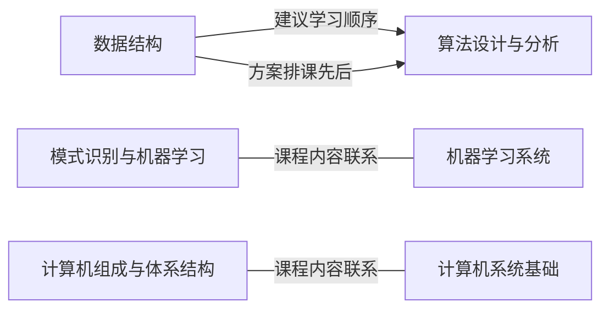

# 信息与计算科学（计算机科学方向）专业培养方案（强基班适用）

2024 年汇编印刷页 903–905。原表记录 36 个可配对的课程代码。

[本节原页](plan-903.pdf#page=1) · [逐行数据](plan-903.json) · [院系目录](README.md)

## 课程关系图

图中展示最多 20 条关系。下表列出本节全部关系。建议学习顺序供规划课程使用，正式选课资格以教务规定为准。

| 课程 | 关联课程 | 关系 | 依据 |
| --- | --- | --- | --- |
| 数据结构（COMP130004） | 算法设计与分析（COMP130011） | 建议学习顺序 | 数据组织与基本操作为算法设计提供基础。 |
| 模式识别与机器学习（COMP130137） | 机器学习系统（COMP130209） | 课程内容联系 | 本方案两门课程的题名均含“机器学习”，可据此对照这一主题。 |
| 计算机组成与体系结构（COMP130191） | 计算机系统基础（COMP130201） | 课程内容联系 | 处理器、存储与系统执行模型具有共同内容。 |
| 数据结构（COMP130004） | 算法设计与分析（COMP130011） | 方案排课先后 | 本节原表所列全部明确学期均早于后者。 |

## 课程

| 课程代码 | 名称 | 开课学期原文 | 来源（PDF 页） |
| --- | --- | --- | --- |
| COMP130002 | 数字逻辑与部件设计 | 3 | 917 |
| COMP130004 | 数据结构 | 2 | 917 |
| COMP130005 | 代数结构与数理逻辑 | 4 | 918 |
| COMP130006 | 概率论与数理统计 | 5 | 918 |
| COMP130010 | 数据库引论 | 4 | 917 |
| COMP130011 | 算法设计与分析 | 4 | 917 |
| COMP130014 | 编译 | 6 | 917 |
| COMP130015 | 软件工程 | 6 | 917 |
| COMP130018 | 计算机图形学A | 6 | 918 |
| COMP130020 | 毕业论文 | 8 | 918 |
| COMP130022 | 程序设计语言原理 | 春，秋 | 918 |
| COMP130023 | 计算理论基础 | 5 | 918 |
| COMP130029 | 信息论基础 | 春，秋 | 918 |
| COMP130110 | 操作系统 | 5 | 917 |
| COMP130123 | 分布式系统 | 春，秋 | 918 |
| COMP130124 | 计算机视觉 | 春，秋 | 918 |
| COMP130125 | 大数据分析技术 | 春，秋 | 918 |
| COMP130136 | 计算机网络 | 4 | 917 |
| COMP130137 | 模式识别与机器学习 | 春，秋 | 918 |
| COMP130138 | 人机交互 | 春，秋 | 918 |
| COMP130148 | 数据挖掘技术 | 春，秋 | 918 |
| COMP130149 | 集合与图论 | 3 | 917 |
| COMP130150 | 算法竞赛导论 | 春，秋 | 918 |
| COMP130151 | 算法竞赛进阶 | 春，秋 | 918 |
| COMP130163 | 信息安全导论 | 3 | 918 |
| COMP130191 | 计算机组成与体系结构 | 4 | 917 |
| COMP130192 | 并行分布式计算 | 7 | 918 |
| COMP130199 | 自然语言处理和知识表示 | 春，秋 | 918 |
| COMP130201 | 计算机系统基础 | 3 | 917 |
| COMP130203 | 专业实践与生产实习 | 7 | 918 |
| COMP130205 | 云计算与虚拟化技术 | 春，秋 | 918 |
| COMP130207 | 人工智能 | 6 | 918 |
| COMP130209 | 机器学习系统 | 春，秋 | 918 |
| COMP130212 | 卫星互联网 | 春，秋 | 918 |
| MATH130138 | 最优化方法 | 春，秋 | 918 |
| SOFT130091 | 云原生软件技术 | 春，秋 | 918 |
