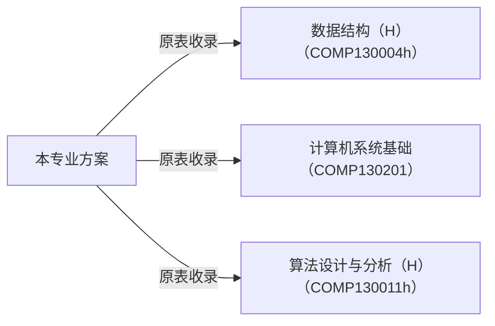

# 计算机科学与技术专业教学培养方案（计算机科学与技术拔尖人才试验班适用）

2024 年汇编印刷页 920–922。原表记录 42 个可配对的课程代码。

[本节原页](plan-920.pdf#page=1) · [逐行数据](plan-920.json) · [院系目录](README.md)

## 课程导读

想了解算法与计算机系统的课程安排，可以在原表中找到《数据结构（H）》（`COMP130004h`）、《计算机系统基础》（`COMP130201`）、《算法设计与分析（H）》（`COMP130011h`）。 [原书 PDF 第 934 页](plan-920.pdf#page=1)

原表把 `COMP130004h` 列在第 3 学期，把 `COMP130011h` 列在第 4 学期。图中箭头表示本节原表收录该课，图上各课之间没有先修连线。

本节未核实可定位到课程对的关系。

## 课程

| 课程代码 | 名称 | 开课学期原文 | 来源（PDF 页） |
| --- | --- | --- | --- |
| COMP130002 | 数字逻辑与部件设计 | 3 | 934 |
| COMP130004h | 数据结构（H） | 3 | 934 |
| COMP130005 | 代数结构与数理逻辑 | 4 | 934 |
| COMP130006 | 概率论与数理统计 | 5 | 934 |
| COMP130010h | 数据库引论（H） | 4 | 934 |
| COMP130011h | 算法设计与分析（H） | 4 | 934 |
| COMP130014h | 编译（H） | 6 | 935 |
| COMP130015h | 软件工程（H） | 6 | 935 |
| COMP130018 | 计算机图形学A | 6 | 935 |
| COMP130020 | 毕业论文 | 8 | 935 |
| COMP130023 | 计算理论基础 | 5 | 935 |
| COMP130032 | 数字图像处理 | 6 | 935 |
| COMP130110h | 操作系统（H） | 5 | 934 |
| COMP130124 | 计算机视觉 | 5 | 935 |
| COMP130125 | 大数据分析技术 | 7 | 935 |
| COMP130135 | 面向对象程序设计 | 2 | 935 |
| COMP130136h | 计算机网络（H） | 5 | 934 |
| COMP130137 | 模式识别与机器学习 | 5 | 935 |
| COMP130138 | 人机交互 | 6 | 935 |
| COMP130139 | 数字信号处理 | 6 | 935 |
| COMP130140 | 移动互联网 | 6 | 935 |
| COMP130145 | 计算复杂性与密码学 | 5 | 935 |
| COMP130146 | 并发理论 | 7 | 935 |
| COMP130148 | 数据挖掘技术 | 6 | 935 |
| COMP130149h | 集合与图论（H） | 3 | 934 |
| COMP130150 | 算法竞赛导论 | 7 | 935 |
| COMP130151 | 算法竞赛进阶 | 8 | 935 |
| COMP130163 | 信息安全导论 | 3 | 934 |
| COMP130176 | 编程方法与技术 | 5 | 935 |
| COMP130177 | 互联网体系结构 | 6 | 935 |
| COMP130191h | 计算机组成与体系结构（H） | 4 | 934 |
| COMP130192 | 并行分布式计算 | 7 | 935 |
| COMP130199 | 自然语言处理和知识表示 | 5 | 935 |
| COMP130201 | 计算机系统基础 | 3 | 934 |
| COMP130203 | 专业实践与生产实习 | 7 | 935 |
| COMP130207h | 人工智能（H） | 6 | 935 |
| COMP130210 | 信息物理融合系统 | 7 | 935 |
| COMP130211 | 虚拟现实技术导引 | 6 | 935 |
| COMP130212 | 卫星互联网 | 6 | 935 |
| COMP130213 | 类脑智能与人工通用智能 | 5 | 935 |
| SOFT130070 | 并行计算与性能优化 | 6或7 | 935 |
| SOFT130080 | 软件质量保障与测试 | 6 | 935 |
