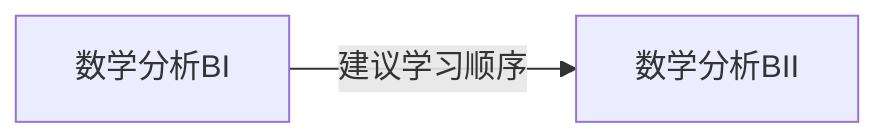

# 计算机科学与技术专业修读建议（计算机科学与技术拔尖人才试验班适用）

2024 年汇编印刷页 923–924。原表记录 30 个可配对的课程代码。

[本节原页](plan-920.pdf#page=4) · [逐行数据](plan-920.json) · [院系目录](README.md)

## 课程关系图

图中展示最多 20 条关系。下表列出本节全部关系。建议学习顺序供规划课程使用，正式选课资格以教务规定为准。

| 课程 | 关联课程 | 关系 | 依据 |
| --- | --- | --- | --- |
| 数学分析BI（MATH120016） | 数学分析BII（MATH120017） | 建议学习顺序 | 同节课程题名标明连续分册或序号。 |

## 课程

| 课程代码 | 名称 | 开课学期原文 | 来源（PDF 页） |
| --- | --- | --- | --- |
| COMP120004 | 线性代数 |  | 937 |
| COMP120006 | 程序设计 |  | 937 |
| COMP130002 | 数字逻辑与部件设计 |  | 937 |
| COMP130004h | 数据结构h |  | 937 |
| COMP130005 | 代数结构与数理逻辑 |  | 937 |
| COMP130006 | 概率论与数理统计 |  | 938 |
| COMP130010h | 数据库引论（H） |  | 937 |
| COMP130011 | 算法设计与分析（H） |  | 937 |
| COMP130014h | 编译（H） |  | 938 |
| COMP130015h | 软件工程（H） |  | 938 |
| COMP130018 | 计算机图形学A |  | 938 |
| COMP130020 | 毕业论文 |  | 938 |
| COMP130023 | 计算理论基础 |  | 937 |
| COMP130110h | 操作系统（H） |  | 938 |
| COMP130136h | 计算机网络（H） |  | 938 |
| COMP130149h | 集合与图论（H） |  | 937 |
| COMP130163 | 信息安全导论 |  | 937 |
| COMP130191h | 计算机组成与体系结构（H） |  | 937 |
| COMP130192 | 并行分布计算 |  | 938 |
| COMP130201 | 计算机系统基础 |  | 937 |
| COMP130203 | 专业实践与生产实习 |  | 938 |
| COMP130207h | 人工智能（H） |  | 938 |
| MATH120016 | 数学分析BI |  | 937 |
| MATH120017 | 数学分析BII |  | 937 |
| PHYS120003 | 普通物理B |  | 937 |
| PTSS110082 | 毛泽东思想和中国特色社会主义理论体系概论 |  | 937 |
| PTSS110087 | 马克思主义基本原理 |  | 937 |
| PTSS110088 | 中国近现代史纲要 |  | 937 |
| PTSS110089 | 思想道德与法治 |  | 937 |
| PTSS110090 | 习近平新时代中国特色社会主义思想概论 |  | 937 |
