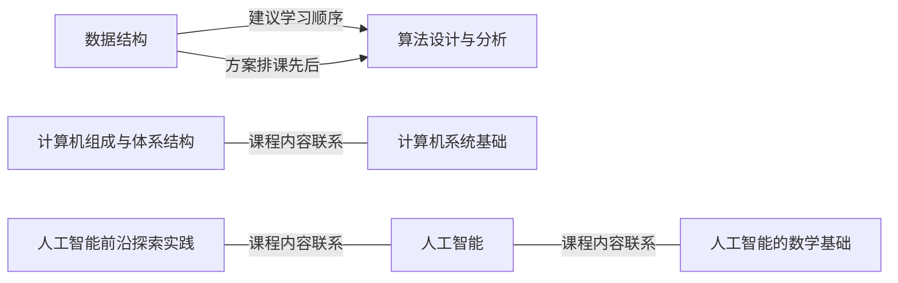

# 软件工程专业“2+X”教学培养方案

2024 年汇编印刷页 943–945。原表记录 43 个可配对的课程代码。

[本节原页](plan-943.pdf#page=1) · [逐行数据](plan-943.json) · [院系目录](README.md)

## 课程关系图

图中展示最多 20 条关系。下表列出本节全部关系。建议学习顺序供规划课程使用，正式选课资格以教务规定为准。

| 课程 | 关联课程 | 关系 | 依据 |
| --- | --- | --- | --- |
| 数据结构（COMP130004） | 算法设计与分析（COMP130011） | 建议学习顺序 | 数据组织与基本操作为算法设计提供基础。 |
| 计算机组成与体系结构（COMP130191） | 计算机系统基础（COMP130201） | 课程内容联系 | 处理器、存储与系统执行模型具有共同内容。 |
| 人工智能前沿探索实践（COMP130204） | 人工智能（COMP130207） | 课程内容联系 | 本方案两门课程的题名均含“人工智能”，可据此对照这一主题。 |
| 人工智能（COMP130207） | 人工智能的数学基础（COMP130208） | 课程内容联系 | 本方案两门课程的题名均含“人工智能”，可据此对照这一主题。 |
| 数据结构（COMP130004） | 算法设计与分析（COMP130011） | 方案排课先后 | 本节原表所列全部明确学期均早于后者。 |

## 课程

| 课程代码 | 名称 | 开课学期原文 | 来源（PDF 页） |
| --- | --- | --- | --- |
| COMP130002 | 数字逻辑与部件设计 | 3 | 957 |
| COMP130004 | 数据结构 | 3 | 957 |
| COMP130011 | 算法设计与分析 | 5 | 957 |
| COMP130014 | 编译 | 6 | 958 |
| COMP130022 | 程序设计语言原理 | 6 | 958 |
| COMP130110 | 操作系统 | 5 | 958 |
| COMP130123 | 分布式系统 | 6或7 | 959 |
| COMP130124 | 计算机视觉 | 5 | 958 |
| COMP130125 | 大数据分析技术 | 6 | 958 |
| COMP130146 | 并发理论 | 7 | 959 |
| COMP130148 | 数据挖掘技术 | 6 | 958 |
| COMP130149 | 集合与图论 | 3 | 957 |
| COMP130191 | 计算机组成与体系结构 | 4 | 957 |
| COMP130199 | 自然语言处理和知识表示 | 5 | 958 |
| COMP130201 | 计算机系统基础 | 2 | 957 |
| COMP130204 | 人工智能前沿探索实践 | 7 | 959 |
| COMP130205 | 云计算与虚拟化技术 | 5 | 958 |
| COMP130206 | 大数据平台技术 | 6 | 958 |
| COMP130207 | 人工智能 | 4 | 957 |
| COMP130208 | 人工智能的数学基础 | 3 | 957 |
| COMP130209 | 机器学习系统 | 6 | 958 |
| COMP130210 | 信息物理融合系统 | 7 | 958 |
| COMP130211 | 虚拟现实技术导引 | 6 | 958 |
| SOFT130006 | 软件工程 | 4 | 957 |
| SOFT130014 | 毕业论文 | 8 | 958 |
| SOFT130015 | 数据库设计 | 4 | 957 |
| SOFT130018 | 信息安全 | 6 | 958 |
| SOFT130023 | 计算机网络 | 5 | 958 |
| SOFT130058 | 计算机系统工程 | 6 | 958 |
| SOFT130059 | 面向对象程序设计 | 2 | 957 |
| SOFT130062 | 计算机图形学 | 6 | 958 |
| SOFT130063 | 人机交互 | 7 | 959 |
| SOFT130070 | 并行计算与性能优化 | 6或7 | 959 |
| SOFT130077 | 系统安全攻防技术 | 6或7 | 959 |
| SOFT130080 | 软件质量保障与测试 | 6 | 958 |
| SOFT130085 | 深度学习及其应用 | 7 | 959 |
| SOFT130087 | 系统程序设计 | 6 | 958 |
| SOFT130088 | 工业互联网软件技术 | 5 | 958 |
| SOFT130089 | 机器人编程导论 | 5 | 958 |
| SOFT130091 | 云原生软件技术 | 6 | 958 |
| SOFT130092 | 专业实践与生产实习 | 7 | 958 |
| SOFT130093 | 软件设计 | 5 | 958 |
| SOFT130095 | 数据与智能安全 | 6 | 958 |
