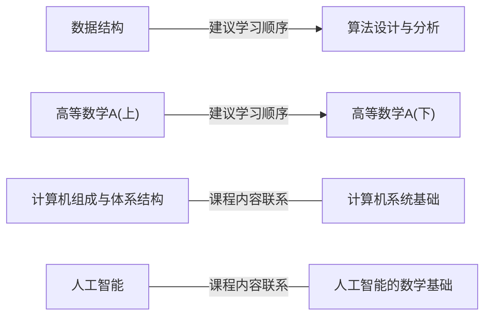

# 软件工程专业“2+X”修读建议

2024 年汇编印刷页 946–947。原表记录 27 个可配对的课程代码。

[本节原页](plan-943.pdf#page=4) · [逐行数据](plan-943.json) · [院系目录](README.md)

## 课程导读

想了解软件设计与实现的课程安排，可以在原表中找到《软件工程》（`SOFT130006`）、《面向对象程序设计》（`SOFT130059`）、《操作系统》（`COMP130110`）。 [原书 PDF 第 960 页](plan-943.pdf#page=4)

图中把《计算机组成与体系结构》（`COMP130191`）和《计算机系统基础》（`COMP130201`）列作内容联系。处理器、存储与系统执行模型具有共同内容。 [原书 PDF 第 960 页](plan-943.pdf#page=4)

## 课程关系图

图中展示最多 20 条关系。下表列出本节全部关系。建议学习顺序供规划课程使用，正式选课资格以教务规定为准。

| 课程 | 关联课程 | 关系 | 依据 |
| --- | --- | --- | --- |
| 数据结构（COMP130004） | 算法设计与分析（COMP130011） | 建议学习顺序 | 数据组织与基本操作为算法设计提供基础。 |
| 高等数学A(上)（MATH120021） | 高等数学A(下)（MATH120022） | 建议学习顺序 | 同节课程题名标明连续分册或序号。 |
| 计算机组成与体系结构（COMP130191） | 计算机系统基础（COMP130201） | 课程内容联系 | 处理器、存储与系统执行模型具有共同内容。 |
| 人工智能（COMP130207） | 人工智能的数学基础（COMP130208） | 课程内容联系 | 本方案两门课程的题名均含“人工智能”，可据此对照这一主题。 |

## 课程

| 课程代码 | 名称 | 开课学期原文 | 来源（PDF 页） |
| --- | --- | --- | --- |
| COMP120004 | 线性代数 |  | 960 |
| COMP120006 | 程序设计 |  | 960 |
| COMP130002 | 数字逻辑与部件设计 |  | 960 |
| COMP130004 | 数据结构 |  | 960 |
| COMP130011 | 算法设计与分析 |  | 960 |
| COMP130014 | 编译 |  | 960 |
| COMP130110 | 操作系统 |  | 960 |
| COMP130149 | 集合与图论 |  | 960 |
| COMP130191 | 计算机组成与体系结构 |  | 960 |
| COMP130201 | 计算机系统基础 |  | 960 |
| COMP130207 | 人工智能 |  | 960 |
| COMP130208 | 人工智能的数学基础 |  | 960 |
| MATH120021 | 高等数学A(上) |  | 960 |
| MATH120022 | 高等数学A(下) |  | 960 |
| PHYS120003 | 普通物理B |  | 960 |
| PTSS110082 | 毛泽东思想和中国特色社会主义理论体系概论 |  | 960 |
| PTSS110087 | 马克思主义基本原理 |  | 960 |
| PTSS110088 | 中国近现代史纲要 |  | 960 |
| PTSS110089 | 思想道德与法治 |  | 960 |
| PTSS110090 | 习近平新时代中国特色社会主义思想概论 |  | 960 |
| SOFT130006 | 软件工程 |  | 960 |
| SOFT130014 | 毕业论文 |  | 961 |
| SOFT130015 | 数据库设计 |  | 960 |
| SOFT130023 | 计算机网络 |  | 961 |
| SOFT130059 | 面向对象程序设计 |  | 960 |
| SOFT130080 | 软件质量保障与测试 |  | 961 |
| SOFT130092 | 专业实践与生产实习 |  | 961 |
