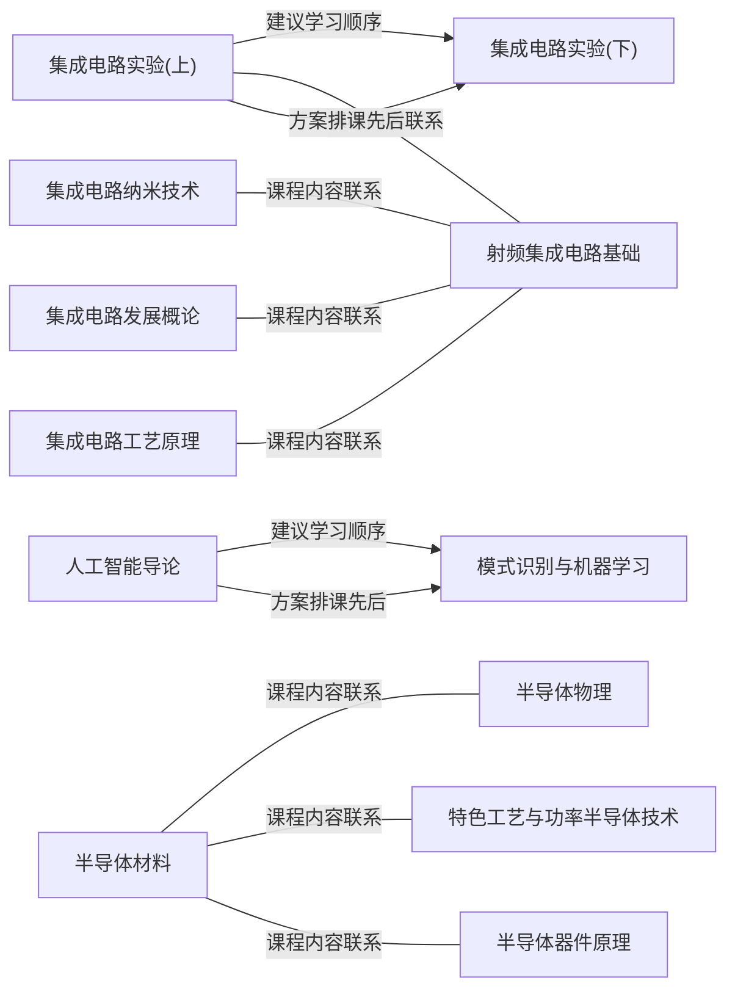

# 微电子科学与工程（集成电路领军人才班）专业教学培养方案（香农计划适用）

2024 年汇编印刷页 808–810。原表记录 48 个可配对的课程代码。

[本节原页](plan-808.pdf#page=1) · [逐行数据](plan-808.json) · [院系目录](README.md)

## 课程关系图

图中展示最多 20 条关系。下表列出本节全部关系。建议学习顺序供规划课程使用，正式选课资格以教务规定为准。

| 课程 | 关联课程 | 关系 | 依据 |
| --- | --- | --- | --- |
| 集成电路实验(上)（INFO130027） | 集成电路实验(下)（INFO130028） | 建议学习顺序 | 同节课程题名标明连续分册或序号。 |
| 人工智能导论（INFO130358） | 模式识别与机器学习（COMP130137） | 建议学习顺序 | 人工智能问题与模型类别可为学习模式识别作准备。 |
| 集成电路纳米技术（CICE130002） | 射频集成电路基础（MICR130023） | 课程内容联系 | 本方案两门课程的题名均含“集成电路”，可据此对照这一主题。 |
| 集成电路发展概论（CICE130010） | 射频集成电路基础（MICR130023） | 课程内容联系 | 本方案两门课程的题名均含“集成电路”，可据此对照这一主题。 |
| 集成电路实验(上)（INFO130027） | 射频集成电路基础（MICR130023） | 课程内容联系 | 本方案两门课程的题名均含“集成电路”，可据此对照这一主题。 |
| 半导体材料（INFO130103） | 半导体物理（MICR130005） | 课程内容联系 | 本方案两门课程的题名均含“半导体”，可据此对照这一主题。 |
| 半导体材料（INFO130103） | 特色工艺与功率半导体技术（MICR130016） | 课程内容联系 | 本方案两门课程的题名均含“半导体”，可据此对照这一主题。 |
| 半导体材料（INFO130103） | 半导体器件原理（MICR130028） | 课程内容联系 | 本方案两门课程的题名均含“半导体”，可据此对照这一主题。 |
| 集成电路工艺原理（MICR130007） | 射频集成电路基础（MICR130023） | 课程内容联系 | 本方案两门课程的题名均含“集成电路”，可据此对照这一主题。 |
| 集成电路实验(上)（INFO130027） | 集成电路实验(下)（INFO130028） | 方案排课先后 | 本节原表所列全部明确学期均早于后者。 |
| 人工智能导论（INFO130358） | 模式识别与机器学习（COMP130137） | 方案排课先后 | 本节原表所列全部明确学期均早于后者。 |

## 课程

| 课程代码 | 名称 | 开课学期原文 | 来源（PDF 页） |
| --- | --- | --- | --- |
| AIS410014 | AI在生物分子结构中的研究及应用 | 秋 | 824 |
| BIOL130014 | 生理学 | 4 | 824 |
| CICE130001 | 器件模型与SPICE仿真 | 7 | 823 |
| CICE130002 | 集成电路纳米技术 | 7 | 823 |
| CICE130003 | 集成电路封装与测试 | 7 | 823 |
| CICE130004 | 超低功耗集成电路设计 | 7 | 823 |
| CICE130005 | 模拟电路测试原理 | 5 | 823 |
| CICE130006 | 光电子器件与集成 | 5 | 823 |
| CICE130007 | 先进封装 | 7 | 823 |
| CICE130008 | 存储器技术 | 5 | 823 |
| CICE130009 | 新型计算范式概论 | 6 | 823 |
| CICE130010 | 集成电路发展概论 | 5 | 823 |
| COMP130004 | 数据结构 | 3 | 824 |
| COMP130137 | 模式识别与机器学习 | 5 | 824 |
| COMP130191 | 计算机组成与体系结构 | 4 | 824 |
| DATA130054 | 脑科学与类脑系统 | 5 | 824 |
| INFO130016 | 毕业论文 | 8 | 823 |
| INFO130027 | 集成电路实验(上) | 7 | 823 |
| INFO130028 | 集成电路实验(下) | 8 | 823 |
| INFO130103 | 半导体材料 | 5 | 823 |
| INFO130131 | 光通信网络基础 | 春，秋 | 824 |
| INFO130232 | 电磁场与电磁波 | 6 | 824 |
| INFO130236 | 前沿讲座 | 3 | 823 |
| INFO130358 | 人工智能导论 | 4 | 824 |
| MATE130017 | 电子材料分析 | 5 | 823 |
| MATE130022 | 薄膜技术 | 6 | 824 |
| MATE130034 | 材料科学导论 | 3 | 824 |
| MATE130062 | 材料分析 | 6 | 824 |
| MATH130008 | 数学模型 | 4 | 824 |
| MICR130002 | 模拟电子线路 | 3 | 822 |
| MICR130003 | 数字逻辑基础 | 3 | 822 |
| MICR130004 | 信号与系统概论 | 4 | 822 |
| MICR130005 | 半导体物理 | 4 | 822 |
| MICR130006 | 嵌入式处理器与芯片系统设计 | 4 | 823 |
| MICR130007 | 集成电路工艺原理 | 6 | 823 |
| MICR130014 | 器件可靠性原理与测试 | 6 | 823 |
| MICR130016 | 特色工艺与功率半导体技术 | 4 | 823 |
| MICR130023 | 射频集成电路基础 | 5 | 823 |
| MICR130028 | 半导体器件原理 | 5 | 822 |
| MICR130029 | 数字集成电路设计原理 | 5 | 822 |
| MICR130030 | 模拟集成电路设计原理 | 6 | 822 |
| MICR130037 | EDA系统软件分析和 设计方法学 | 6 | 823 |
| MICR130043 | 现代集成电路光刻技术导论 | 5 | 823 |
| PHYS130006 | 数学物理方法A | 4 | 824 |
| PHYS130008 | 量子力学I | 3 | 824 |
| PHYS130010 | 固体物理 | 4 | 824 |
| PHYS130075 | 计算物理基础 | 5 | 824 |
| PHYS130113 | 热力学与统计物理I | 4 | 824 |
