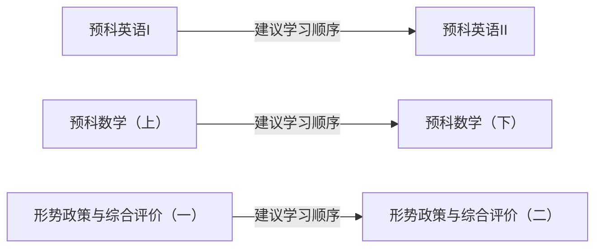

# 复旦大学预科生培养方案（2024年）

2024 年汇编印刷页 1096–1097。原表记录 10 个可配对的课程代码。

[本节原页](plan-1096.pdf#page=1) · [逐行数据](plan-1096.json) · [院系目录](README.md)

## 课程导读

想了解预科学习的课程安排，可以在原表中找到《预科数学（上）》（`MATH010001`）、《汉语写作》（`CHIN110013`）、《大学语文》（`CHIN110008`）。 [原书 PDF 第 1110 页](plan-1096.pdf#page=1) · [原书 PDF 第 1111 页](plan-1096.pdf#page=2)

《预科英语I》（`ENGL010001`）和《预科英语II》（`ENGL010002`）是同一系列，图中的箭头按题名标出的分册顺序排列。原表分别排在秋季学期和春季学期。 [原书 PDF 第 1111 页](plan-1096.pdf#page=2)

## 课程关系图

图中展示最多 20 条关系。下表列出本节全部关系。建议学习顺序供规划课程使用，正式选课资格以教务规定为准。

| 课程 | 关联课程 | 关系 | 依据 |
| --- | --- | --- | --- |
| 预科英语I（ENGL010001） | 预科英语II（ENGL010002） | 建议学习顺序 | 同节课程题名标明连续分册或序号。 |
| 预科数学（上）（MATH010001） | 预科数学（下）（MATH010002） | 建议学习顺序 | 同节课程题名标明连续分册或序号。 |
| 形势政策与综合评价（一）（PTSS010003） | 形势政策与综合评价（二）（PTSS010004） | 建议学习顺序 | 同节课程题名标明连续分册或序号。 |

## 含先修字样的原文

- 面，选修先修层次和通识层次应用软件类中的任意2 门课（PDF 第 1111 页）

## 课程

| 课程代码 | 名称 | 开课学期原文 | 来源（PDF 页） |
| --- | --- | --- | --- |
| CHIN110008 | 大学语文 | 秋 | 1110 |
| CHIN110013 | 汉语写作 | 春 | 1110 |
| ENGL010001 | 预科英语I | 秋 | 1111 |
| ENGL010002 | 预科英语II | 春 | 1111 |
| MATH010001 | 预科数学（上） | 秋 | 1111 |
| MATH010002 | 预科数学（下） | 春 | 1111 |
| PTSS010003 | 形势政策与综合评价（一） | 秋 | 1111 |
| PTSS010004 | 形势政策与综合评价（二） | 春 | 1111 |
| PTSS110088 | 中国近现代史纲要 | 春，秋 | 1110 |
| PTSS110089 | 思想道德与法治 | 春，秋 | 1110 |
