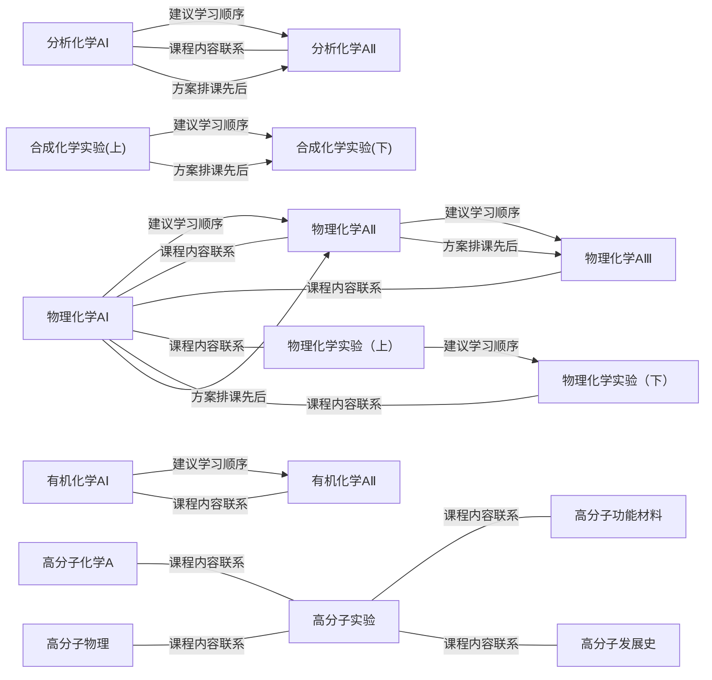

# 化学（高分子化学方向）专业教学培养方案（强基班适用）

2024 年汇编印刷页 663–665。原表记录 35 个可配对的课程代码。

[本节原页](plan-663.pdf#page=1) · [逐行数据](plan-663.json) · [院系目录](README.md)

## 课程导读

想了解高分子材料与表征的课程安排，可以在原表中找到《高分子化学A》（`MACR130001`）、《聚合物拓扑结构概论》（`MACR130017`）、《材料科学导论》（`MACR130044`）。 [原书 PDF 第 678 页](plan-663.pdf#page=2) · [原书 PDF 第 679 页](plan-663.pdf#page=3)

图中连接《高分子化学A》（`MACR130001`）和《高分子实验》（`MACR130004`），两门课都从课程题名标出的“高分子”切入，可沿这一主题对照阅读。 [原书 PDF 第 678 页](plan-663.pdf#page=2)

## 课程关系图

图中展示最多 20 条关系。下表列出本节全部关系。建议学习顺序供规划课程使用，正式选课资格以教务规定为准。

| 课程 | 关联课程 | 关系 | 依据 |
| --- | --- | --- | --- |
| 分析化学AⅠ（CHEM130001） | 分析化学AⅡ（CHEM130002） | 建议学习顺序 | 同节课程题名标明连续分册或序号。 |
| 合成化学实验(上)（CHEM130010） | 合成化学实验(下)（CHEM130011） | 建议学习顺序 | 同节课程题名标明连续分册或序号。 |
| 物理化学AⅠ（CHEM130012） | 物理化学AⅡ（CHEM130013） | 建议学习顺序 | 同节课程题名标明连续分册或序号。 |
| 物理化学AⅡ（CHEM130013） | 物理化学AⅢ（CHEM130014） | 建议学习顺序 | 同节课程题名标明连续分册或序号。 |
| 有机化学AⅠ（CHEM130067） | 有机化学AⅡ（CHEM130068） | 建议学习顺序 | 同节课程题名标明连续分册或序号。 |
| 物理化学实验（上）（CHEM130104） | 物理化学实验（下）（CHEM130105） | 建议学习顺序 | 同节课程题名标明连续分册或序号。 |
| 分析化学AⅠ（CHEM130001） | 分析化学AⅡ（CHEM130002） | 课程内容联系 | 本方案两门课程的题名均含“分析化学”，可据此对照这一主题。 |
| 物理化学AⅠ（CHEM130012） | 物理化学AⅡ（CHEM130013） | 课程内容联系 | 本方案两门课程的题名均含“物理化学”，可据此对照这一主题。 |
| 物理化学AⅠ（CHEM130012） | 物理化学AⅢ（CHEM130014） | 课程内容联系 | 本方案两门课程的题名均含“物理化学”，可据此对照这一主题。 |
| 物理化学AⅠ（CHEM130012） | 物理化学实验（上）（CHEM130104） | 课程内容联系 | 本方案两门课程的题名均含“物理化学”，可据此对照这一主题。 |
| 物理化学AⅠ（CHEM130012） | 物理化学实验（下）（CHEM130105） | 课程内容联系 | 本方案两门课程的题名均含“物理化学”，可据此对照这一主题。 |
| 有机化学AⅠ（CHEM130067） | 有机化学AⅡ（CHEM130068） | 课程内容联系 | 本方案两门课程的题名均含“有机化学”，可据此对照这一主题。 |
| 高分子化学A（MACR130001） | 高分子实验（MACR130004） | 课程内容联系 | 本方案两门课程的题名均含“高分子”，可据此对照这一主题。 |
| 高分子物理（MACR130002） | 高分子实验（MACR130004） | 课程内容联系 | 本方案两门课程的题名均含“高分子”，可据此对照这一主题。 |
| 高分子实验（MACR130004） | 高分子功能材料（MACR130036） | 课程内容联系 | 本方案两门课程的题名均含“高分子”，可据此对照这一主题。 |
| 高分子实验（MACR130004） | 高分子发展史（MACR130037） | 课程内容联系 | 本方案两门课程的题名均含“高分子”，可据此对照这一主题。 |
| 分析化学AⅠ（CHEM130001） | 分析化学AⅡ（CHEM130002） | 方案排课先后 | 本节原表所列全部明确学期均早于后者。 |
| 合成化学实验(上)（CHEM130010） | 合成化学实验(下)（CHEM130011） | 方案排课先后 | 本节原表所列全部明确学期均早于后者。 |
| 物理化学AⅠ（CHEM130012） | 物理化学AⅡ（CHEM130013） | 方案排课先后 | 本节原表所列全部明确学期均早于后者。 |
| 物理化学AⅡ（CHEM130013） | 物理化学AⅢ（CHEM130014） | 方案排课先后 | 本节原表所列全部明确学期均早于后者。 |
| 有机化学AⅠ（CHEM130067） | 有机化学AⅡ（CHEM130068） | 方案排课先后 | 本节原表所列全部明确学期均早于后者。 |
| 物理化学实验（上）（CHEM130104） | 物理化学实验（下）（CHEM130105） | 方案排课先后 | 本节原表所列全部明确学期均早于后者。 |

## 课程

| 课程代码 | 名称 | 开课学期原文 | 来源（PDF 页） |
| --- | --- | --- | --- |
| CHEM130001 | 分析化学AⅠ | 3 | 678 |
| CHEM130002 | 分析化学AⅡ | 4 | 679 |
| CHEM130005 | 仪器分析和物理化学实验A上 | 4 | 679 |
| CHEM130010 | 合成化学实验(上) | 4 | 678 |
| CHEM130011 | 合成化学实验(下) | 5 | 678 |
| CHEM130012 | 物理化学AⅠ | 3 | 678 |
| CHEM130013 | 物理化学AⅡ | 4 | 678 |
| CHEM130014 | 物理化学AⅢ | 5 | 678 |
| CHEM130015 | 谱学导论 | 4 | 679 |
| CHEM130045 | 化工原理 | 4 | 678 |
| CHEM130067 | 有机化学AⅠ | 3 | 678 |
| CHEM130068 | 有机化学AⅡ | 4 | 678 |
| CHEM130104 | 物理化学实验（上） | 5 | 678 |
| CHEM130105 | 物理化学实验（下） | 6 | 678 |
| MACR130001 | 高分子化学A | 5 | 678 |
| MACR130002 | 高分子物理 | 6 | 678 |
| MACR130004 | 高分子实验 | 6 | 678 |
| MACR130006 | 毕业论文 | 8 | 678 |
| MACR130017 | 聚合物拓扑结构概论 | 7 | 679 |
| MACR130024 | 高分子学术前沿讲座 | 7 | 679 |
| MACR130031 | 高分子反应工程 | 6 | 678 |
| MACR130032 | 高分子加工原理 | 7 | 678 |
| MACR130033 | 高分子建模与设计人工智能赋能高分子科学 | 77 | 679 |
| MACR130034 | 学术伦理、科技写作与科技沟通 | 5 | 678 |
| MACR130035 | 高分子结构材料 | 6 | 678 |
| MACR130036 | 高分子功能材料 | 6 | 678 |
| MACR130037 | 高分子发展史 | 5 | 679 |
| MACR130038 | 生物大分子 | 6 | 679 |
| MACR130039 | 高等高分子化学 | 6 | 679 |
| MACR130040 | 高分子凝聚态物理 | 7 | 679 |
| MACR130041 | SynthesisofPolymersforABetterWorld | 4 | 679 |
| MACR130042 | 生产实习 | 6 | 678 |
| MACR130043 | 高分子流变学与加工 | 8 | 679 |
| MACR130044 | 材料科学导论 | 3 | 678 |
| MACR130045 | 普通化学 | 3 | 678 |
