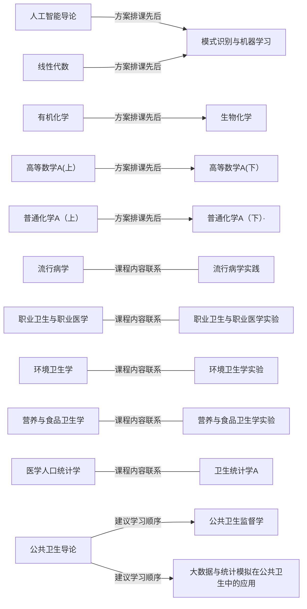

# 2024预防医学-人工智能双学士学位项目“2+X”教学培养方案

公共卫生学院 · 预防医学-人工智能(双学士学位项目) · 方案 72993 · 111 个不同课程或科研条目。

[官方 Word](../originals/plan-72993.docx) · [教务详情](https://fdjwgl.fudan.edu.cn/manager/bizType/2/major-program-search/info/72993?skipAuth=1) · [方案快照](../raw/plan-72993.json.gz) · [年级目录](../README.md)

## 课程关系图

图中展示部分关系。下表保留全部已建立的课程对，来源位置使用本方案 JSON Pointer。

## 先修与内容联系

| 类型 | 起点 | 终点 | 依据 | 原表定位 |
| --- | --- | --- | --- | --- |
| 建议学习顺序 | 人工智能导论 (AIE310005) | 模式识别与机器学习 (AIE410001) | 人工智能问题与模型类别可为学习模式识别作准备。  | `/courseModules/6/planCourses/40`、`/courseModules/6/planCourses/42` |
| 建议学习顺序 | 有机化学 (CHEM10002) | 生物化学 (MED20048) | 官能团与有机反应是理解生物分子性质的基础。  | `/courseModules/5/planCourses/8`、`/courseModules/6/planCourses/3` |
| 建议学习顺序 | 普通化学A（上） (CHEM10003) | 普通化学A（下） (CHEM10004) | 同方案的课程题名具有连续分册或序号。  | `/courseModules/5/planCourses/5`、`/courseModules/5/planCourses/6` |
| 建议学习顺序 | 线性代数 (CS10003) | 模式识别与机器学习 (AIE410001) | 向量表示和矩阵运算支持理解分类、回归等模型。  | `/courseModules/5/planCourses/11`、`/courseModules/6/planCourses/42` |
| 建议学习顺序 | 高等数学A(上） (MATH10015) | 高等数学A(下） (MATH10016) | 同方案的课程题名具有连续分册或序号。  | `/courseModules/5/planCourses/0`、`/courseModules/5/planCourses/1` |
| 建议学习顺序 | 公共卫生导论 (PHPM10002) | 大数据与统计模拟在公共卫生中的应用 (AIS410011) | “公共卫生导论”题名标明基础层次，前置阅读可帮助了解“大数据与统计模拟在公共卫生中的应用”中的公共卫生主题。  | `/courseModules/6/planCourses/17`、`/courseModules/10/planCourses/8` |
| 建议学习顺序 | 公共卫生导论 (PHPM10002) | 公共卫生监督学 (PHPM30007) | “公共卫生导论”题名标明基础层次，前置阅读可帮助了解“公共卫生监督学”中的公共卫生主题。  | `/courseModules/6/planCourses/17`、`/courseModules/11/planCourses/6` |
| 方案排课先后 | 人工智能导论 (AIE310005) | 模式识别与机器学习 (AIE410001) | 同方案该课程全部明确数字学期均早于后者。  | `/courseModules/6/planCourses/40`、`/courseModules/6/planCourses/42` |
| 方案排课先后 | 有机化学 (CHEM10002) | 生物化学 (MED20048) | 同方案该课程全部明确数字学期均早于后者。  | `/courseModules/5/planCourses/8`、`/courseModules/6/planCourses/3` |
| 方案排课先后 | 普通化学A（上） (CHEM10003) | 普通化学A（下） (CHEM10004) | 同方案该课程全部明确数字学期均早于后者。  | `/courseModules/5/planCourses/5`、`/courseModules/5/planCourses/6` |
| 方案排课先后 | 线性代数 (CS10003) | 模式识别与机器学习 (AIE410001) | 同方案该课程全部明确数字学期均早于后者。  | `/courseModules/5/planCourses/11`、`/courseModules/6/planCourses/42` |
| 方案排课先后 | 高等数学A(上） (MATH10015) | 高等数学A(下） (MATH10016) | 同方案该课程全部明确数字学期均早于后者。  | `/courseModules/5/planCourses/0`、`/courseModules/5/planCourses/1` |
| 课程内容联系 | 计算机系统基础 (AIE210006) | 计算机组成与体系结构 (CS30052) | 处理器、存储与系统执行模型具有共同内容。  | `/courseModules/6/planCourses/39`、`/courseModules/10/planCourses/1` |
| 课程内容联系 | 人工智能导论 (AIE310005) | 人工智能安全 (AIE831001) | 本方案两门课程的题名均含“人工智能”，可据此对照这一主题。  | `/courseModules/6/planCourses/40`、`/courseModules/6/planCourses/43` |
| 课程内容联系 | 人工智能的编程基础 (AIE310006) | 人工智能安全 (AIE831001) | 本方案两门课程的题名均含“人工智能”，可据此对照这一主题。  | `/courseModules/6/planCourses/36`、`/courseModules/6/planCourses/43` |
| 课程内容联系 | 人工智能的软件基础 (AIE310008) | 人工智能安全 (AIE831001) | 本方案两门课程的题名均含“人工智能”，可据此对照这一主题。  | `/courseModules/6/planCourses/41`、`/courseModules/6/planCourses/43` |
| 课程内容联系 | 人工智能的数学基础 (AIE310009) | 模式识别与机器学习 (AIE410001) | 数学表达与学习模型的统计、优化工具可对照。  | `/courseModules/6/planCourses/38`、`/courseModules/6/planCourses/42` |
| 课程内容联系 | 人工智能的数学基础 (AIE310009) | 人工智能安全 (AIE831001) | 本方案两门课程的题名均含“人工智能”，可据此对照这一主题。  | `/courseModules/6/planCourses/38`、`/courseModules/6/planCourses/43` |
| 课程内容联系 | 模式识别与机器学习 (AIE410001) | 机器学习系统 (CS30058) | 本方案两门课程的题名均含“机器学习”，可据此对照这一主题。  | `/courseModules/6/planCourses/42`、`/courseModules/10/planCourses/5` |
| 课程内容联系 | 大数据与统计模拟在公共卫生中的应用 (AIS410011) | 公共卫生导论 (PHPM10002) | 本方案两门课程的题名均含“公共卫生”，可据此对照这一主题。  | `/courseModules/10/planCourses/8`、`/courseModules/6/planCourses/17` |
| 课程内容联系 | 有机化学 (CHEM10002) | 有机化学实验I (CHEM10006) | 本方案两门课程的题名均含“有机化学”，可据此对照这一主题。  | `/courseModules/5/planCourses/8`、`/courseModules/5/planCourses/9` |
| 课程内容联系 | 生理学B (MED20008) | 病理生理学B (MED30009) | 本方案两门课程的题名均含“生理学”，可据此对照这一主题。  | `/courseModules/6/planCourses/4`、`/courseModules/6/planCourses/8` |
| 课程内容联系 | 病理生理学B (MED30009) | 病理学 (MED30063) | 本方案两门课程的题名均含“病理”，可据此对照这一主题。  | `/courseModules/6/planCourses/8`、`/courseModules/6/planCourses/11` |
| 课程内容联系 | 公共卫生导论 (PHPM10002) | 公共卫生监督学 (PHPM30007) | 本方案两门课程的题名均含“公共卫生”，可据此对照这一主题。  | `/courseModules/6/planCourses/17`、`/courseModules/11/planCourses/6` |
| 课程内容联系 | 医学人口统计学 (PHPM30006) | 卫生统计学A (PHPM40014) | 本方案两门课程的题名均含“统计学”，可据此对照这一主题。  | `/courseModules/11/planCourses/5`、`/courseModules/6/planCourses/21` |
| 课程内容联系 | 流行病学 (PHPM30015) | 流行病学（H） (PHPM30015h) | 本方案两门课程的题名均含“流行病学”，可据此对照这一主题。  | `/courseModules/6/planCourses/26`、`/courseModules/12/planCourses/6` |
| 课程内容联系 | 流行病学 (PHPM30015) | 流行病学实践 (PHPM30016) | 题名显示相同主题的课程与实验、实践或实习。  | `/courseModules/6/planCourses/26`、`/courseModules/6/planCourses/27` |
| 课程内容联系 | 健康教育学 (PHPM40002) | 健康教育学（H） (PHPM40002h) | 本方案两门课程的题名均含“健康教育”，可据此对照这一主题。  | `/courseModules/6/planCourses/24`、`/courseModules/12/planCourses/3` |
| 课程内容联系 | 卫生统计学实践 (PHPM40013) | 卫生统计学A (PHPM40014) | 本方案两门课程的题名均含“统计学”，可据此对照这一主题。  | `/courseModules/8/planCourses/0`、`/courseModules/6/planCourses/21` |
| 课程内容联系 | 卫生统计学实践（H） (PHPM40013h) | 卫生统计学A (PHPM40014) | 本方案两门课程的题名均含“卫生统计”，可据此对照这一主题。  | `/courseModules/12/planCourses/5`、`/courseModules/6/planCourses/21` |
| 课程内容联系 | 卫生统计学A (PHPM40014) | 卫生统计学（H） (PHPM40014h) | 本方案两门课程的题名均含“统计学”，可据此对照这一主题。  | `/courseModules/6/planCourses/21`、`/courseModules/12/planCourses/4` |
| 课程内容联系 | 卫生统计学A (PHPM40014) | 医疗大数据统计学 (STAT50020) | 本方案两门课程的题名均含“统计学”，可据此对照这一主题。  | `/courseModules/6/planCourses/21`、`/courseModules/12/planCourses/0` |
| 课程内容联系 | 职业卫生与职业医学 (PHPM40015) | 职业卫生与职业医学（H） (PHPM40015h) | 本方案两门课程的题名均含“职业卫生”，可据此对照这一主题。  | `/courseModules/6/planCourses/28`、`/courseModules/13/planCourses/1` |
| 课程内容联系 | 职业卫生与职业医学 (PHPM40015) | 职业卫生与职业医学实验 (PHPM40016) | 题名显示相同主题的课程与实验、实践或实习。  | `/courseModules/6/planCourses/28`、`/courseModules/6/planCourses/31` |
| 课程内容联系 | 环境卫生学 (PHPM40017) | 环境卫生学（H） (PHPM40017h) | 本方案两门课程的题名均含“环境卫生”，可据此对照这一主题。  | `/courseModules/6/planCourses/29`、`/courseModules/13/planCourses/2` |
| 课程内容联系 | 环境卫生学 (PHPM40017) | 环境卫生学实验 (PHPM40018) | 题名显示相同主题的课程与实验、实践或实习。  | `/courseModules/6/planCourses/29`、`/courseModules/6/planCourses/32` |
| 课程内容联系 | 营养与食品卫生学 (PHPM40019) | 营养与食品卫生学实验 (PHPM40020) | 题名显示相同主题的课程与实验、实践或实习。  | `/courseModules/6/planCourses/30`、`/courseModules/6/planCourses/33` |

本次未从可定位的明确表述中确认课程对课程预修。学期安排、系列分册与编辑建议均保留各自的依据。

## 按原方案模块阅读

同一模块展示原表中的课程归属。模块内课程之间的先后仍须逐项查阅。

- **人工智能模块**　现代技术与营养科学、大数据与统计模拟在公共卫生中的应用、数据库引论、软件工程、计算机图形学A、计算机网络、集合与图论、计算机组成与体系结构、机器学习系统（原表模块 10）
- **预防模块**　医学文献检索与利用B、人体的社交网络：共生微生物、妇幼卫生学概论、医学生职业生涯规划、行为经济学与公众健康、医院获得性感染、管理与沟通技巧、仪器分析的应用、全球卫生导论、卫生经济学概论、健康公平、疫苗与传染病防控、健康心理学、医学人口统计学、公共卫生监督学、卫生人力规划、食品免疫学、卫生管理预测与决策分析等24项（原表模块 11）
- **荣誉项目**　核心实验技术I、卫生经济学、流行病学（H）、基础毒理（H）、健康教育学（H）、卫生统计学实践（H）、卫生统计学（H）、医疗大数据统计学（原表模块 12）

## 课程表

同一课程在不同模块分别出现时，按原表逐行列出。季节字段保留原值。

| 课程 | 代码 | 学分 | 学期 | 模块 |
| --- | --- | ---: | --- | --- |
| 高等数学A(上） | MATH10015 | 5.0 | 第1学期 | 培养方案 / 专业培养课程 / 大类基础课程 |
| 高等数学A(下） | MATH10016 | 5.0 | 第2学期 | 培养方案 / 专业培养课程 / 大类基础课程 |
| 普通物理B | PHYS10002 | 3.0 | 第1学期 | 培养方案 / 专业培养课程 / 大类基础课程 |
| 基础物理实验 | PHYS10005 | 2.0 | 第1学期 | 培养方案 / 专业培养课程 / 大类基础课程 |
| 现代生物科学导论C | BIOL10002 | 2.0 | 第1学期 | 培养方案 / 专业培养课程 / 大类基础课程 |
| 普通化学A（上） | CHEM10003 | 2.0 | 第1学期 | 培养方案 / 专业培养课程 / 大类基础课程 |
| 普通化学A（下） | CHEM10004 | 2.0 | 第2学期 | 培养方案 / 专业培养课程 / 大类基础课程 |
| 普通化学实验I | CHEM10005 | 1.0 | 第2学期 | 培养方案 / 专业培养课程 / 大类基础课程 |
| 有机化学 | CHEM10002 | 4.0 | 第2学期 | 培养方案 / 专业培养课程 / 大类基础课程 |
| 有机化学实验I | CHEM10006 | 1.0 | 第2学期 | 培养方案 / 专业培养课程 / 大类基础课程 |
| 程序设计 | CS10004 | 4.0 | 第1学期 | 培养方案 / 专业培养课程 / 大类基础课程 |
| 线性代数 | CS10003 | 3.0 | 第1学期 | 培养方案 / 专业培养课程 / 大类基础课程 |
| 系统解剖学B | MED20006 | 3.5 | 第3学期 | 培养方案 / 专业培养课程 / 专业核心教育课程 |
| 组织胚胎学B | MED20007 | 3.5 | 第3学期 | 培养方案 / 专业培养课程 / 专业核心教育课程 |
| 医学细胞与遗传学 | MED20031 | 2.0 | 第3学期 | 培养方案 / 专业培养课程 / 专业核心教育课程 |
| 生物化学 | MED20048 | 4.0 | 第3学期 | 培养方案 / 专业培养课程 / 专业核心教育课程 |
| 生理学B | MED20008 | 4.0 | 第4学期 | 培养方案 / 专业培养课程 / 专业核心教育课程 |
| 免疫学C | MED20009 | 2.5 | 第4学期 | 培养方案 / 专业培养课程 / 专业核心教育课程 |
| 医学微生物学C | MED20060 | 3.5 | 第4学期 | 培养方案 / 专业培养课程 / 专业核心教育课程 |
| 寄生虫学C | MED30008 | 2.0 | 第5学期 | 培养方案 / 专业培养课程 / 专业核心教育课程 |
| 病理生理学B | MED30009 | 3.0 | 第5学期 | 培养方案 / 专业培养课程 / 专业核心教育课程 |
| 药理学C | MED20011 | 4.0 | 第5学期 | 培养方案 / 专业培养课程 / 专业核心教育课程 |
| 功能学科综合实验 | MED30010 | 2.5 | 第5学期 | 培养方案 / 专业培养课程 / 专业核心教育课程 |
| 病理学 | MED30063 | 2.0 | 第5学期 | 培养方案 / 专业培养课程 / 专业核心教育课程 |
| 诊断学B | MED30019 | 3.5 | 第5学期 | 培养方案 / 专业培养课程 / 专业核心教育课程 |
| 影像诊断学C | MED30020 | 2.5 | 第6学期 | 培养方案 / 专业培养课程 / 专业核心教育课程 |
| 内科学C | MED30021 | 6.0 | 第6学期 | 培养方案 / 专业培养课程 / 专业核心教育课程 |
| 外科学C | MED30022 | 3.0 | 第6学期 | 培养方案 / 专业培养课程 / 专业核心教育课程 |
| 传染病学B | MED30029 | 2.5 | 第6学期 | 培养方案 / 专业培养课程 / 专业核心教育课程 |
| 公共卫生导论 | PHPM10002 | 1.0 | 第2学期 | 培养方案 / 专业培养课程 / 专业核心教育课程 |
| 社会医学 | PHPM20001 | 2.0 | 第3学期 | 培养方案 / 专业培养课程 / 专业核心教育课程 |
| 卫生化学 | PHPM20002 | 2.5 | 第4学期 | 培养方案 / 专业培养课程 / 专业核心教育课程 |
| 卫生法学 | PHPM20003 | 2.0 | 第4学期 | 培养方案 / 专业培养课程 / 专业核心教育课程 |
| 卫生统计学A | PHPM40014 | 3.0 | 第5学期 | 培养方案 / 专业培养课程 / 专业核心教育课程 |
| 基础毒理 | PHPM40001 | 2.0 | 第8学期 | 培养方案 / 专业培养课程 / 专业核心教育课程 |
| 卫生事业管理学 | PHPM30003 | 2.0 | 第8学期 | 培养方案 / 专业培养课程 / 专业核心教育课程 |
| 健康教育学 | PHPM40002 | 2.0 | 第8学期 | 培养方案 / 专业培养课程 / 专业核心教育课程 |
| 儿少卫生学 | PHPM40003 | 2.5 | 第8学期 | 培养方案 / 专业培养课程 / 专业核心教育课程 |
| 流行病学 | PHPM30015 | 2.5 | 第8学期 | 培养方案 / 专业培养课程 / 专业核心教育课程 |
| 流行病学实践 | PHPM30016 | 2.0 | 第8学期 | 培养方案 / 专业培养课程 / 专业核心教育课程 |
| 职业卫生与职业医学 | PHPM40015 | 2.5 | 第8学期 | 培养方案 / 专业培养课程 / 专业核心教育课程 |
| 环境卫生学 | PHPM40017 | 2.5 | 第8学期 | 培养方案 / 专业培养课程 / 专业核心教育课程 |
| 营养与食品卫生学 | PHPM40019 | 2.5 | 第8学期 | 培养方案 / 专业培养课程 / 专业核心教育课程 |
| 职业卫生与职业医学实验 | PHPM40016 | 1.0 | 第9学期 | 培养方案 / 专业培养课程 / 专业核心教育课程 |
| 环境卫生学实验 | PHPM40018 | 1.0 | 第9学期 | 培养方案 / 专业培养课程 / 专业核心教育课程 |
| 营养与食品卫生学实验 | PHPM40020 | 1.0 | 第9学期 | 培养方案 / 专业培养课程 / 专业核心教育课程 |
| 生产实习 | PHPM40027 | 3.0 | 第9学期 | 培养方案 / 专业培养课程 / 专业核心教育课程 |
| 毕业论文 | PHPM40032 | 4.0 | 第4学期 | 培养方案 / 专业培养课程 / 专业核心教育课程 |
| 人工智能的编程基础 | AIE310006 | 2.0 | 第2学期 | 培养方案 / 专业培养课程 / 专业核心教育课程 |
| 数据结构 | AIE310007 | 4.0 | 第3学期 | 培养方案 / 专业培养课程 / 专业核心教育课程 |
| 人工智能的数学基础 | AIE310009 | 3.0 | 第3学期 | 培养方案 / 专业培养课程 / 专业核心教育课程 |
| 计算机系统基础 | AIE210006 | 3.0 | 第3学期 | 培养方案 / 专业培养课程 / 专业核心教育课程 |
| 人工智能导论 | AIE310005 | 3.0 | 第4学期 | 培养方案 / 专业培养课程 / 专业核心教育课程 |
| 人工智能的软件基础 | AIE310008 | 3.0 | 第4学期 | 培养方案 / 专业培养课程 / 专业核心教育课程 |
| 模式识别与机器学习 | AIE410001 | 3.0 | 第5学期 | 培养方案 / 专业培养课程 / 专业核心教育课程 |
| 人工智能安全 | AIE831001 | 3.0 | 第5学期 | 培养方案 / 专业培养课程 / 专业核心教育课程 |
| 人工智能的伦理与治理 | PHIL50006 | 2.0 | SPRING | 培养方案 / 专业培养课程 / 专业核心教育课程 |
| 自然语言处理与大语言模型 | AIE410002 | 3.0 | 第6学期 | 培养方案 / 专业培养课程 / 专业核心教育课程 |
| 计算机视觉 | AIE310004 | 3.0 | 第7学期 | 培养方案 / 专业培养课程 / 专业核心教育课程 |
| 人工智能前沿探索实践 | AIE531001 | 3.0 | 第7学期 | 培养方案 / 专业培养课程 / 专业核心教育课程 |
| 卫生统计学实践 | PHPM40013 | 1.0 | 第5学期 | 培养方案 / 专业进阶模块I |
| 妇产科学C | MED30023 | 2.5 | 第6学期 | 培养方案 / 专业进阶模块I |
| 儿科学C | MED30024 | 2.5 | 第6学期 | 培养方案 / 专业进阶模块I |
| 临床实习 | PHPM40026 | 6.0 | 第7学期 | 培养方案 / 专业进阶模块I |
| 卫生微生物 | PHPM30004 | 2.0 | 第8学期 | 培养方案 / 专业进阶模块I |
| 环境医学综合实验 | PHPM40004 | 1.5 | 第9学期 | 培养方案 / 专业进阶模块I |
| 集合与图论 | CS30043 | 3.0 | 第3学期 | 培养方案 / 专业进阶模块II / 人工智能模块 |
| 计算机组成与体系结构 | CS30052 | 4.0 | 第4学期 | 培养方案 / 专业进阶模块II / 人工智能模块 |
| 数据库引论 | CS20010 | 3.0 | 第4学期 | 培养方案 / 专业进阶模块II / 人工智能模块 |
| 计算机网络 | CS30036 | 3.0 | 第5学期 | 培养方案 / 专业进阶模块II / 人工智能模块 |
| 软件工程 | CS30018 | 3.0 | 第6学期 | 培养方案 / 专业进阶模块II / 人工智能模块 |
| 机器学习系统 | CS30058 | 3.0 | 第6学期 | 培养方案 / 专业进阶模块II / 人工智能模块 |
| 计算机图形学A | CS30019 | 3.0 | 第6学期 | 培养方案 / 专业进阶模块II / 人工智能模块 |
| 现代技术与营养科学 | AIS110005 | 2.0 | SPRING | 培养方案 / 专业进阶模块II / 人工智能模块 |
| 大数据与统计模拟在公共卫生中的应用 | AIS410011 | 2.0 | SPRING | 培养方案 / 专业进阶模块II / 人工智能模块 |
| 医学文献检索与利用B | MED20016 | 2.0 | AUTUMN | 培养方案 / 专业进阶模块II / 预防模块 |
| 健康心理学 | PHPM30005 | 1.0 | AUTUMN | 培养方案 / 专业进阶模块II / 预防模块 |
| 医院获得性感染 | PHPM20004 | 2.0 | AUTUMN | 培养方案 / 专业进阶模块II / 预防模块 |
| 管理与沟通技巧 | PHPM20005 | 1.0 | AUTUMN | 培养方案 / 专业进阶模块II / 预防模块 |
| 妇幼卫生学概论 | PHPM10001 | 1.0 | AUTUMN | 培养方案 / 专业进阶模块II / 预防模块 |
| 医学人口统计学 | PHPM30006 | 2.0 | AUTUMN | 培养方案 / 专业进阶模块II / 预防模块 |
| 公共卫生监督学 | PHPM30007 | 2.0 | AUTUMN | 培养方案 / 专业进阶模块II / 预防模块 |
| 卫生人力规划 | PHPM30008 | 2.0 | AUTUMN | 培养方案 / 专业进阶模块II / 预防模块 |
| 仪器分析的应用 | PHPM20006 | 2.0 | AUTUMN | 培养方案 / 专业进阶模块II / 预防模块 |
| 全球卫生导论 | PHPM20013 | 2.0 | AUTUMN | 培养方案 / 专业进阶模块II / 预防模块 |
| 放射卫生学与放射防护 | PHPM50002 | 2.0 | AUTUMN | 培养方案 / 专业进阶模块II / 预防模块 |
| 卫生经济评价方法 | PHPM50003 | 2.0 | AUTUMN | 培养方案 / 专业进阶模块II / 预防模块 |
| 色谱分析新技术 | PHPM40023 | 2.0 | AUTUMN | 培养方案 / 专业进阶模块II / 预防模块 |
| 医学生职业生涯规划 | PHPM10003 | 1.0 | AUTUMN | 培养方案 / 专业进阶模块II / 预防模块 |
| 卫生经济学概论 | PHPM20016 | 2.0 | AUTUMN | 培养方案 / 专业进阶模块II / 预防模块 |
| 人体的社交网络：共生微生物 | MED30064 | 2.0 | AUTUMN | 培养方案 / 专业进阶模块II / 预防模块 |
| 食品免疫学 | PHPM30024 | 2.0 | AUTUMN | 培养方案 / 专业进阶模块II / 预防模块 |
| 卫生管理预测与决策分析 | PHPM30025 | 2.0 | AUTUMN | 培养方案 / 专业进阶模块II / 预防模块 |
| 科学写作：聚焦群医学 | PHPM40029 | 2.0 | AUTUMN | 培养方案 / 专业进阶模块II / 预防模块 |
| 行为经济学与公众健康 | PHPM130116 | 2.0 | AUTUMN | 培养方案 / 专业进阶模块II / 预防模块 |
| 健康公平 | PHPM20018 | 2.0 | AUTUMN | 培养方案 / 专业进阶模块II / 预防模块 |
| 卫生学评价 | PHPM40008 | 1.0 | SPRING、AUTUMN | 培养方案 / 专业进阶模块II / 预防模块 |
| 疫苗与传染病防控 | PHPM30002 | 2.0 | SPRING、AUTUMN | 培养方案 / 专业进阶模块II / 预防模块 |
| 心理与饮食行为 | PHPM50001 | 2.0 | SPRING、AUTUMN | 培养方案 / 专业进阶模块II / 预防模块 |
| 医疗大数据统计学 | STAT50020 | 3.0 | 第6学期 | 培养方案 / 荣誉项目 |
| 卫生经济学 | PHPM20007 | 4.0 | 第4学期 | 培养方案 / 荣誉项目 |
| 核心实验技术I | MED20078 | 4.0 | 第3学期 | 培养方案 / 荣誉项目 |
| 健康教育学（H） | PHPM40002h | 3.0 | 第8学期 | 培养方案 / 荣誉项目 |
| 卫生统计学（H） | PHPM40014h | 4.0 | 第5学期 | 培养方案 / 荣誉项目 |
| 卫生统计学实践（H） | PHPM40013h | 2.0 | 第5学期 | 培养方案 / 荣誉项目 |
| 流行病学（H） | PHPM30015h | 6.0 | 第8学期 | 培养方案 / 荣誉项目 |
| 基础毒理（H） | PHPM40001h | 4.0 | 第8学期 | 培养方案 / 荣誉项目 |
| 营养与食品卫生学（H） | PHPM40019h | 3.5 | 第8学期 | 培养方案 / 荣誉项目 / X组 |
| 职业卫生与职业医学（H） | PHPM40015h | 3.5 | 第8学期 | 培养方案 / 荣誉项目 / X组 |
| 环境卫生学（H） | PHPM40017h | 3.5 | 第8学期 | 培养方案 / 荣誉项目 / X组 |
| 儿少卫生学（H） | PHPM40003h | 3.5 | 第8学期 | 培养方案 / 荣誉项目 / X组 |
