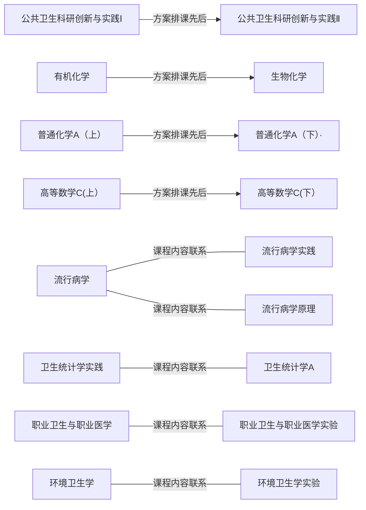

# 2025预防医学-公共卫生与预防医学本博融通培养方案

公共卫生学院 · 预防医学 · 方案 96687 · 189 个不同课程或科研条目。

[官方 Word](../originals/plan-96687.docx) · [教务详情](https://fdjwgl.fudan.edu.cn/manager/bizType/2/major-program-search/info/96687?skipAuth=1) · [方案快照](../raw/plan-96687.json.gz) · [年级目录](../README.md)

## 修读导读

- **建议先学**　《有机化学》（`CHEM10002`） → 《生物化学》（`MED20048`）。官能团与有机反应是理解生物分子性质的基础。方案分别列在第2、3学期。

- **可以对照着读**　《流行病学》（`PHPM30015`）与《流行病学实践》（`PHPM30016`）。可在实验或实践课中记录用到了哪些课堂概念，再回到相应章节复习。

- **查模块选课**　《公共卫生导论》（`PHPM10002`）、《社会医学》（`PHPM20001`）列在“专业核心教育课程”中。模块说明写明“要求修读94学分”。原表见 `/courseModules/7`。

## 课程关系图

图中展示部分关系。下表保留全部已建立的课程对，来源位置使用本方案 JSON Pointer。

## 先修与内容联系

| 类型 | 起点 | 终点 | 依据 | 原表定位 |
| --- | --- | --- | --- | --- |
| 建议学习顺序 | 有机化学 (CHEM10002) | 生物化学 (MED20048) | 官能团与有机反应是理解生物分子性质的基础。  | `/courseModules/6/planCourses/1`、`/courseModules/7/planCourses/3` |
| 建议学习顺序 | 普通化学A（上） (CHEM10003) | 普通化学A（下） (CHEM10004) | 同方案的课程题名具有连续分册或序号。  | `/courseModules/6/planCourses/2`、`/courseModules/6/planCourses/3` |
| 建议学习顺序 | 高等数学C(上） (MATH10006) | 高等数学C(下） (MATH10007) | 同方案的课程题名具有连续分册或序号。  | `/courseModules/6/planCourses/6`、`/courseModules/6/planCourses/7` |
| 建议学习顺序 | 公共卫生科研创新与实践Ⅰ (PHPM30031) | 公共卫生科研创新与实践Ⅱ (PHPM30032) | 同方案的课程题名具有连续分册或序号。  | `/courseModules/26/planCourses/19`、`/courseModules/26/planCourses/20` |
| 方案排课先后 | 有机化学 (CHEM10002) | 生物化学 (MED20048) | 同方案该课程全部明确数字学期均早于后者。  | `/courseModules/6/planCourses/1`、`/courseModules/7/planCourses/3` |
| 方案排课先后 | 普通化学A（上） (CHEM10003) | 普通化学A（下） (CHEM10004) | 同方案该课程全部明确数字学期均早于后者。  | `/courseModules/6/planCourses/2`、`/courseModules/6/planCourses/3` |
| 方案排课先后 | 高等数学C(上） (MATH10006) | 高等数学C(下） (MATH10007) | 同方案该课程全部明确数字学期均早于后者。  | `/courseModules/6/planCourses/6`、`/courseModules/6/planCourses/7` |
| 方案排课先后 | 公共卫生科研创新与实践Ⅰ (PHPM30031) | 公共卫生科研创新与实践Ⅱ (PHPM30032) | 同方案该课程全部明确数字学期均早于后者。  | `/courseModules/26/planCourses/19`、`/courseModules/26/planCourses/20` |
| 课程内容联系 | 有机化学 (CHEM10002) | 有机化学实验I (CHEM10006) | 本方案两门课程的题名均含“有机化学”，可据此对照这一主题。  | `/courseModules/6/planCourses/1`、`/courseModules/6/planCourses/5` |
| 课程内容联系 | 生理学B (MED20008) | 病理生理学B (MED30009) | 本方案两门课程的题名均含“生理学”，可据此对照这一主题。  | `/courseModules/7/planCourses/4`、`/courseModules/7/planCourses/8` |
| 课程内容联系 | 病理生理学B (MED30009) | 病理学 (MED30063) | 本方案两门课程的题名均含“病理”，可据此对照这一主题。  | `/courseModules/7/planCourses/8`、`/courseModules/7/planCourses/11` |
| 课程内容联系 | 公共卫生导论 (PHPM10002) | 公共卫生实践 (SPH60017) | 本方案两门课程的题名均含“公共卫生”，可据此对照这一主题。  | `/courseModules/7/planCourses/17`、`/courseModules/20/planCourses/69` |
| 课程内容联系 | 医学人口统计学 (PHPM30006) | 卫生统计学A (PHPM40014) | 本方案两门课程的题名均含“统计学”，可据此对照这一主题。  | `/courseModules/19/planCourses/4`、`/courseModules/7/planCourses/20` |
| 课程内容联系 | 公共卫生监督学 (PHPM30007) | 公共卫生实践 (SPH60017) | 本方案两门课程的题名均含“公共卫生”，可据此对照这一主题。  | `/courseModules/19/planCourses/5`、`/courseModules/20/planCourses/69` |
| 课程内容联系 | 流行病学 (PHPM30015) | 流行病学实践 (PHPM30016) | 题名显示相同主题的课程与实验、实践或实习。  | `/courseModules/7/planCourses/26`、`/courseModules/7/planCourses/27` |
| 课程内容联系 | 流行病学 (PHPM30015) | 流行病学原理 (PHPM60008) | 本方案两门课程的题名均含“流行病学”，可据此对照这一主题。  | `/courseModules/7/planCourses/26`、`/courseModules/7/planCourses/31` |
| 课程内容联系 | 流行病学 (PHPM30015) | 分子流行病学 (PHPM60024) | 本方案两门课程的题名均含“流行病学”，可据此对照这一主题。  | `/courseModules/7/planCourses/26`、`/courseModules/20/planCourses/73` |
| 课程内容联系 | 流行病学 (PHPM30015) | 围产流行病学 (PHPM60052) | 本方案两门课程的题名均含“流行病学”，可据此对照这一主题。  | `/courseModules/7/planCourses/26`、`/courseModules/20/planCourses/41` |
| 课程内容联系 | 卫生统计学实践 (PHPM40013) | 卫生统计学A (PHPM40014) | 本方案两门课程的题名均含“统计学”，可据此对照这一主题。  | `/courseModules/7/planCourses/21`、`/courseModules/7/planCourses/20` |
| 课程内容联系 | 职业卫生与职业医学 (PHPM40015) | 职业卫生与职业医学实验 (PHPM40016) | 题名显示相同主题的课程与实验、实践或实习。  | `/courseModules/7/planCourses/28`、`/courseModules/26/planCourses/0` |
| 课程内容联系 | 职业卫生与职业医学 (PHPM40015) | 职业卫生评价与危险度评估 (PHPM60027) | 本方案两门课程的题名均含“职业卫生”，可据此对照这一主题。  | `/courseModules/7/planCourses/28`、`/courseModules/20/planCourses/23` |
| 课程内容联系 | 职业卫生与职业医学 (PHPM40015) | 职业卫生与职业医学进展 (PHPM60084) | 本方案两门课程的题名均含“职业卫生”，可据此对照这一主题。  | `/courseModules/7/planCourses/28`、`/courseModules/13/planCourses/2` |
| 课程内容联系 | 环境卫生学 (PHPM40017) | 环境卫生学实验 (PHPM40018) | 题名显示相同主题的课程与实验、实践或实习。  | `/courseModules/7/planCourses/29`、`/courseModules/26/planCourses/12` |
| 课程内容联系 | 环境卫生学 (PHPM40017) | 高级环境卫生学 (PHPM60017) | 本方案两门课程的题名均含“环境卫生”，可据此对照这一主题。  | `/courseModules/7/planCourses/29`、`/courseModules/13/planCourses/1` |
| 课程内容联系 | 营养与食品卫生学 (PHPM40019) | 营养与食品卫生学实验 (PHPM40020) | 题名显示相同主题的课程与实验、实践或实习。  | `/courseModules/7/planCourses/30`、`/courseModules/26/planCourses/14` |
| 课程内容联系 | 科学写作：聚焦群医学 (PHPM40029) | 公共卫生科研写作 (SPH60027) | 本方案两门课程的题名均含“写作”，可据此对照这一主题。  | `/courseModules/19/planCourses/17`、`/courseModules/20/planCourses/71` |
| 课程内容联系 | 医学文献评阅与论文写作 (PHPM60070) | 公共卫生科研写作 (SPH60027) | 本方案两门课程的题名均含“写作”，可据此对照这一主题。  | `/courseModules/20/planCourses/30`、`/courseModules/20/planCourses/71` |
| 课程内容联系 | 公共卫生实践 (SPH60017) | 公共卫生实践技能 (SPH60023) | 本方案两门课程的题名均含“公共卫生”，可据此对照这一主题。  | `/courseModules/20/planCourses/69`、`/courseModules/20/planCourses/68` |
| 课程内容联系 | 公共卫生实践 (SPH60017) | 公共卫生科研写作 (SPH60027) | 本方案两门课程的题名均含“公共卫生”，可据此对照这一主题。  | `/courseModules/20/planCourses/69`、`/courseModules/20/planCourses/71` |

本次未从可定位的明确表述中确认课程对课程预修。学期安排、系列分册与编辑建议均保留各自的依据。

## 按原方案模块阅读

同一模块展示原表中的课程归属。模块内课程之间的先后仍须逐项查阅。

- **医学基础课程**　现代生物科学导论C、有机化学、普通化学A（上）、普通化学A（下）、普通化学实验I、有机化学实验I、高等数学C(上）、高等数学C(下）、普通物理B、基础物理实验（原表模块 6）
- **本科课程**　大数据与统计模拟在公共卫生中的应用、妇产科学C、儿科学C、卫生微生物（原表模块 11）
- **学位专业课（劳动卫生与环境卫生学方向必修）**　环境与职业流行病学、高级环境卫生学、职业卫生与职业医学进展（原表模块 13）
- **学位专业课（儿少卫生与妇幼保健学方向必修）**　循证卫生服务导论、人群健康干预的实施研究：从理论到实践（原表模块 14）
- **学位专业课（流行病与卫生统计学方向必修）**　应用统计线性模型、流行病学方法、重大疾病流行病学与控制（原表模块 15）
- **学位专业课（营养与食品卫生学方向必修）**　现代食品卫生学、营养流行病学、微量营养素（原表模块 16）
- **学位专业课（卫生毒理学方向必修）**　分子毒理学、毒理学方法（原表模块 17）
- **本科选修课程**　现代技术与营养科学、人体的社交网络：共生微生物、妇幼卫生学概论、医学生职业生涯规划、行为经济学与公众健康、医院获得性感染、管理与沟通技巧、仪器分析的应用、全球卫生导论、卫生经济学概论、健康公平、疫苗与传染病防控、健康心理学、医学人口统计学、公共卫生监督学、卫生人力规划、食品免疫学、卫生管理预测与决策分析等24项（原表模块 19）
- **研究生选修课程**　循证卫生服务导论、社会科学研究方法在健康领域的应用、卫生体系研究、医院信息管理、社会学视角下健康问题的研究实践、社会医学研究方法与应用、实施科学导论、卫生政策研究、卫生改革与发展、卫生经济学研究、现代医院管理理论与研究、人群健康干预的实施研究：从理论到实践、实施性研究的理论与方法、行为科学与健康促进、遗传流行病学、流行病学数据分析、环境与生物监测、高级环境卫生学等90项（原表模块 20）

## 课程表

同一课程在不同模块分别出现时，按原表逐行列出。季节字段保留原值。

| 课程 | 代码 | 学分 | 学期 | 模块 |
| --- | --- | ---: | --- | --- |
| 现代生物科学导论C | BIOL10002 | 2.0 | 第1学期 | 培养方案 / 专业培养课程 / 学科基础课程 / 医学基础课程 |
| 有机化学 | CHEM10002 | 4.0 | 第2学期 | 培养方案 / 专业培养课程 / 学科基础课程 / 医学基础课程 |
| 普通化学A（上） | CHEM10003 | 2.0 | 第1学期 | 培养方案 / 专业培养课程 / 学科基础课程 / 医学基础课程 |
| 普通化学A（下） | CHEM10004 | 2.0 | 第2学期 | 培养方案 / 专业培养课程 / 学科基础课程 / 医学基础课程 |
| 普通化学实验I | CHEM10005 | 1.0 | 第2学期 | 培养方案 / 专业培养课程 / 学科基础课程 / 医学基础课程 |
| 有机化学实验I | CHEM10006 | 1.0 | 第2学期 | 培养方案 / 专业培养课程 / 学科基础课程 / 医学基础课程 |
| 高等数学C(上） | MATH10006 | 4.0 | 第1学期 | 培养方案 / 专业培养课程 / 学科基础课程 / 医学基础课程 |
| 高等数学C(下） | MATH10007 | 4.0 | 第2学期 | 培养方案 / 专业培养课程 / 学科基础课程 / 医学基础课程 |
| 普通物理B | PHYS10002 | 3.0 | 第1学期 | 培养方案 / 专业培养课程 / 学科基础课程 / 医学基础课程 |
| 基础物理实验 | PHYS10005 | 2.0 | 第1学期 | 培养方案 / 专业培养课程 / 学科基础课程 / 医学基础课程 |
| 系统解剖学B | MED20006 | 3.5 | 第3学期 | 培养方案 / 专业培养课程 / 专业核心教育课程 |
| 组织胚胎学B | MED20007 | 3.5 | 第3学期 | 培养方案 / 专业培养课程 / 专业核心教育课程 |
| 医学细胞与遗传学 | MED20031 | 2.0 | 第3学期 | 培养方案 / 专业培养课程 / 专业核心教育课程 |
| 生物化学 | MED20048 | 4.0 | 第3学期 | 培养方案 / 专业培养课程 / 专业核心教育课程 |
| 生理学B | MED20008 | 4.0 | 第4学期 | 培养方案 / 专业培养课程 / 专业核心教育课程 |
| 免疫学C | MED20009 | 2.5 | 第4学期 | 培养方案 / 专业培养课程 / 专业核心教育课程 |
| 医学微生物学C | MED20060 | 3.5 | 第4学期 | 培养方案 / 专业培养课程 / 专业核心教育课程 |
| 寄生虫学C | MED30008 | 2.0 | 第5学期 | 培养方案 / 专业培养课程 / 专业核心教育课程 |
| 病理生理学B | MED30009 | 3.0 | 第5学期 | 培养方案 / 专业培养课程 / 专业核心教育课程 |
| 药理学C | MED20011 | 4.0 | 第5学期 | 培养方案 / 专业培养课程 / 专业核心教育课程 |
| 功能学科综合实验 | MED30010 | 2.5 | 第5学期 | 培养方案 / 专业培养课程 / 专业核心教育课程 |
| 病理学 | MED30063 | 2.0 | 第5学期 | 培养方案 / 专业培养课程 / 专业核心教育课程 |
| 诊断学B | MED30019 | 3.5 | 第5学期 | 培养方案 / 专业培养课程 / 专业核心教育课程 |
| 影像诊断学C | MED30020 | 2.5 | 第6学期 | 培养方案 / 专业培养课程 / 专业核心教育课程 |
| 内科学C | MED30021 | 6.0 | 第6学期 | 培养方案 / 专业培养课程 / 专业核心教育课程 |
| 外科学C | MED30022 | 3.0 | 第6学期 | 培养方案 / 专业培养课程 / 专业核心教育课程 |
| 传染病学B | MED30029 | 2.5 | 第6学期 | 培养方案 / 专业培养课程 / 专业核心教育课程 |
| 公共卫生导论 | PHPM10002 | 1.0 | 第2学期 | 培养方案 / 专业培养课程 / 专业核心教育课程 |
| 社会医学 | PHPM20001 | 2.0 | 第3学期 | 培养方案 / 专业培养课程 / 专业核心教育课程 |
| 卫生化学 | PHPM20002 | 2.5 | 第4学期 | 培养方案 / 专业培养课程 / 专业核心教育课程 |
| 卫生统计学A | PHPM40014 | 3.0 | 第5学期 | 培养方案 / 专业培养课程 / 专业核心教育课程 |
| 卫生统计学实践 | PHPM40013 | 1.0 | 第5学期 | 培养方案 / 专业培养课程 / 专业核心教育课程 |
| 基础毒理 | PHPM40001 | 2.0 | 第8学期 | 培养方案 / 专业培养课程 / 专业核心教育课程 |
| 卫生事业管理学 | PHPM30003 | 2.0 | 第8学期 | 培养方案 / 专业培养课程 / 专业核心教育课程 |
| 健康教育学 | PHPM40002 | 2.0 | 第8学期 | 培养方案 / 专业培养课程 / 专业核心教育课程 |
| 儿少卫生学 | PHPM40003 | 2.5 | 第8学期 | 培养方案 / 专业培养课程 / 专业核心教育课程 |
| 流行病学 | PHPM30015 | 2.5 | 第8学期 | 培养方案 / 专业培养课程 / 专业核心教育课程 |
| 流行病学实践 | PHPM30016 | 2.0 | 第8学期 | 培养方案 / 专业培养课程 / 专业核心教育课程 |
| 职业卫生与职业医学 | PHPM40015 | 2.5 | 第8学期 | 培养方案 / 专业培养课程 / 专业核心教育课程 |
| 环境卫生学 | PHPM40017 | 2.5 | 第8学期 | 培养方案 / 专业培养课程 / 专业核心教育课程 |
| 营养与食品卫生学 | PHPM40019 | 2.5 | 第8学期 | 培养方案 / 专业培养课程 / 专业核心教育课程 |
| 流行病学原理 | PHPM60008 | 3.0 | 第9学期 | 培养方案 / 专业培养课程 / 专业核心教育课程 |
| 医用多元统计方法 | PHPM60009 | 3.0 | 第9学期 | 培养方案 / 专业培养课程 / 专业核心教育课程 |
| 毒理学原理 | PHPM60010 | 2.0 | 第10学期 | 培养方案 / 专业培养课程 / 专业核心教育课程 |
| 卫生经济学 | MANA60030 | 2.0 | 第10学期 | 培养方案 / 专业培养课程 / 专业核心教育课程 |
| 妇产科学C | MED30023 | 2.5 | 第6学期 | 培养方案 / 专业进阶模块I / 本科课程 |
| 儿科学C | MED30024 | 2.5 | 第6学期 | 培养方案 / 专业进阶模块I / 本科课程 |
| 卫生微生物 | PHPM30004 | 2.0 | 第8学期 | 培养方案 / 专业进阶模块I / 本科课程 |
| 大数据与统计模拟在公共卫生中的应用 | AIS410011 | 2.0 | 第9学期 | 培养方案 / 专业进阶模块I / 本科课程 |
| 环境与职业流行病学 | PHPM60015 | 2.0 | 第11学期、第12学期 | 培养方案 / 专业进阶模块I / 研究生学位专业课 / 学位专业课（劳动卫生与环境卫生学方向必修） |
| 高级环境卫生学 | PHPM60017 | 3.0 | 第11学期、第12学期 | 培养方案 / 专业进阶模块I / 研究生学位专业课 / 学位专业课（劳动卫生与环境卫生学方向必修） |
| 职业卫生与职业医学进展 | PHPM60084 | 2.0 | 第11学期、第12学期 | 培养方案 / 专业进阶模块I / 研究生学位专业课 / 学位专业课（劳动卫生与环境卫生学方向必修） |
| 循证卫生服务导论 | MANA60027 | 2.0 | 第11学期、第12学期 | 培养方案 / 专业进阶模块I / 研究生学位专业课 / 学位专业课（儿少卫生与妇幼保健学方向必修） |
| 人群健康干预的实施研究：从理论到实践 | MANA60057 | 2.0 | 第11学期、第12学期 | 培养方案 / 专业进阶模块I / 研究生学位专业课 / 学位专业课（儿少卫生与妇幼保健学方向必修） |
| 流行病学方法 | PHPM60083 | 2.0 | 第11学期、第12学期 | 培养方案 / 专业进阶模块I / 研究生学位专业课 / 学位专业课（流行病与卫生统计学方向必修） |
| 重大疾病流行病学与控制 | PHPM60092 | 2.0 | 第11学期、第12学期 | 培养方案 / 专业进阶模块I / 研究生学位专业课 / 学位专业课（流行病与卫生统计学方向必修） |
| 应用统计线性模型 | PHPM60025 | 2.0 | 第11学期、第12学期 | 培养方案 / 专业进阶模块I / 研究生学位专业课 / 学位专业课（流行病与卫生统计学方向必修） |
| 营养流行病学 | PHPM60019 | 2.0 | 第11学期、第12学期 | 培养方案 / 专业进阶模块I / 研究生学位专业课 / 学位专业课（营养与食品卫生学方向必修） |
| 微量营养素 | PHPM60020 | 2.0 | 第11学期、第12学期 | 培养方案 / 专业进阶模块I / 研究生学位专业课 / 学位专业课（营养与食品卫生学方向必修） |
| 现代食品卫生学 | PHPM60018 | 2.0 | 第11学期、第12学期 | 培养方案 / 专业进阶模块I / 研究生学位专业课 / 学位专业课（营养与食品卫生学方向必修） |
| 分子毒理学 | PHPM60013 | 2.0 | 第11学期、第12学期 | 培养方案 / 专业进阶模块I / 研究生学位专业课 / 学位专业课（卫生毒理学方向必修） |
| 毒理学方法 | PHPM60091 | 2.0 | 第11学期、第12学期 | 培养方案 / 专业进阶模块I / 研究生学位专业课 / 学位专业课（卫生毒理学方向必修） |
| 健康心理学 | PHPM30005 | 1.0 | SPRING、AUTUMN | 培养方案 / 专业进阶模块II / 本科选修课程 |
| 医院获得性感染 | PHPM20004 | 2.0 | SPRING、AUTUMN | 培养方案 / 专业进阶模块II / 本科选修课程 |
| 管理与沟通技巧 | PHPM20005 | 1.0 | SPRING、AUTUMN | 培养方案 / 专业进阶模块II / 本科选修课程 |
| 妇幼卫生学概论 | PHPM10001 | 1.0 | SPRING、AUTUMN | 培养方案 / 专业进阶模块II / 本科选修课程 |
| 医学人口统计学 | PHPM30006 | 2.0 | SPRING、AUTUMN | 培养方案 / 专业进阶模块II / 本科选修课程 |
| 公共卫生监督学 | PHPM30007 | 2.0 | SPRING、AUTUMN | 培养方案 / 专业进阶模块II / 本科选修课程 |
| 卫生人力规划 | PHPM30008 | 2.0 | SPRING、AUTUMN | 培养方案 / 专业进阶模块II / 本科选修课程 |
| 仪器分析的应用 | PHPM20006 | 2.0 | SPRING、AUTUMN | 培养方案 / 专业进阶模块II / 本科选修课程 |
| 全球卫生导论 | PHPM20013 | 2.0 | SPRING、AUTUMN | 培养方案 / 专业进阶模块II / 本科选修课程 |
| 放射卫生学与放射防护 | PHPM50002 | 2.0 | SPRING、AUTUMN | 培养方案 / 专业进阶模块II / 本科选修课程 |
| 卫生经济评价方法 | PHPM50003 | 2.0 | SPRING、AUTUMN | 培养方案 / 专业进阶模块II / 本科选修课程 |
| 色谱分析新技术 | PHPM40023 | 2.0 | SPRING、AUTUMN | 培养方案 / 专业进阶模块II / 本科选修课程 |
| 医学生职业生涯规划 | PHPM10003 | 1.0 | SPRING、AUTUMN | 培养方案 / 专业进阶模块II / 本科选修课程 |
| 卫生经济学概论 | PHPM20016 | 2.0 | SPRING、AUTUMN | 培养方案 / 专业进阶模块II / 本科选修课程 |
| 人体的社交网络：共生微生物 | MED30064 | 2.0 | SPRING、AUTUMN | 培养方案 / 专业进阶模块II / 本科选修课程 |
| 食品免疫学 | PHPM30024 | 2.0 | SPRING、AUTUMN | 培养方案 / 专业进阶模块II / 本科选修课程 |
| 卫生管理预测与决策分析 | PHPM30025 | 2.0 | SPRING、AUTUMN | 培养方案 / 专业进阶模块II / 本科选修课程 |
| 科学写作：聚焦群医学 | PHPM40029 | 2.0 | SPRING、AUTUMN | 培养方案 / 专业进阶模块II / 本科选修课程 |
| 行为经济学与公众健康 | PHPM130116 | 2.0 | SPRING、AUTUMN | 培养方案 / 专业进阶模块II / 本科选修课程 |
| 健康公平 | PHPM20018 | 2.0 | SPRING、AUTUMN | 培养方案 / 专业进阶模块II / 本科选修课程 |
| 现代技术与营养科学 | AIS110005 | 2.0 | SPRING、AUTUMN | 培养方案 / 专业进阶模块II / 本科选修课程 |
| 疫苗与传染病防控 | PHPM30002 | 2.0 | SPRING、AUTUMN | 培养方案 / 专业进阶模块II / 本科选修课程 |
| 心理与饮食行为 | PHPM50001 | 2.0 | SPRING、AUTUMN | 培养方案 / 专业进阶模块II / 本科选修课程 |
| 卫生学评价 | PHPM40008 | 1.0 | SPRING、AUTUMN | 培养方案 / 专业进阶模块II / 本科选修课程 |
| 循证卫生服务导论 | MANA60027 | 2.0 | 第11学期、第12学期 | 培养方案 / 专业进阶模块II / 研究生选修课程 |
| 高级环境卫生学 | PHPM60017 | 3.0 | 第11学期、第12学期 | 培养方案 / 专业进阶模块II / 研究生选修课程 |
| 儿童心理发展与心理卫生 | PHPM60021 | 3.0 | 第11学期、第12学期 | 培养方案 / 专业进阶模块II / 研究生选修课程 |
| 生殖保健进展 | PHPM60022 | 2.0 | 第11学期、第12学期 | 培养方案 / 专业进阶模块II / 研究生选修课程 |
| 应用统计线性模型 | PHPM60025 | 2.0 | 第11学期、第12学期 | 培养方案 / 专业进阶模块II / 研究生选修课程 |
| 性健康社会科学 | PHPM60029 | 2.0 | 第11学期、第12学期 | 培养方案 / 专业进阶模块II / 研究生选修课程 |
| 干预规划制定技术 | PHPM60040 | 1.0 | 第11学期、第12学期 | 培养方案 / 专业进阶模块II / 研究生选修课程 |
| 实施科学导论 | MANA60052 | 2.0 | 第11学期、第12学期 | 培养方案 / 专业进阶模块II / 研究生选修课程 |
| 流行病学方法 | PHPM60083 | 2.0 | 第11学期、第12学期 | 培养方案 / 专业进阶模块II / 研究生选修课程 |
| 职业卫生与职业医学进展 | PHPM60084 | 2.0 | 第11学期、第12学期 | 培养方案 / 专业进阶模块II / 研究生选修课程 |
| SPSS高级统计分析 | PHPM60085 | 4.0 | 第11学期、第12学期 | 培养方案 / 专业进阶模块II / 研究生选修课程 |
| 高级SAS统计分析 | PHPM60086 | 2.0 | 第11学期、第12学期 | 培养方案 / 专业进阶模块II / 研究生选修课程 |
| 生殖健康研究方法学 | PHPM60087 | 2.0 | 第11学期、第12学期 | 培养方案 / 专业进阶模块II / 研究生选修课程 |
| 常用多水平统计模型 | PHPM60088 | 2.0 | 第11学期、第12学期 | 培养方案 / 专业进阶模块II / 研究生选修课程 |
| 卫生政策研究 | MANA60053 | 3.0 | 第11学期、第12学期 | 培养方案 / 专业进阶模块II / 研究生选修课程 |
| 卫生改革与发展 | MANA60054 | 2.0 | 第11学期、第12学期 | 培养方案 / 专业进阶模块II / 研究生选修课程 |
| 卫生经济学研究 | MANA60055 | 2.0 | 第11学期、第12学期 | 培养方案 / 专业进阶模块II / 研究生选修课程 |
| 现代医院管理理论与研究 | MANA60056 | 2.0 | 第11学期、第12学期 | 培养方案 / 专业进阶模块II / 研究生选修课程 |
| 人群健康干预的实施研究：从理论到实践 | MANA60057 | 2.0 | 第11学期、第12学期 | 培养方案 / 专业进阶模块II / 研究生选修课程 |
| 实施性研究的理论与方法 | MANA60058 | 2.0 | 第11学期、第12学期 | 培养方案 / 专业进阶模块II / 研究生选修课程 |
| 毒理学方法 | PHPM60091 | 2.0 | 第11学期、第12学期 | 培养方案 / 专业进阶模块II / 研究生选修课程 |
| 重大疾病流行病学与控制 | PHPM60092 | 2.0 | 第11学期、第12学期 | 培养方案 / 专业进阶模块II / 研究生选修课程 |
| 肿瘤流行病学 | PHPM60041 | 2.0 | 第11学期、第12学期 | 培养方案 / 专业进阶模块II / 研究生选修课程 |
| 职业卫生评价与危险度评估 | PHPM60027 | 2.0 | 第11学期、第12学期 | 培养方案 / 专业进阶模块II / 研究生选修课程 |
| 营养组学 | PHPM60077 | 1.0 | 第11学期、第12学期 | 培养方案 / 专业进阶模块II / 研究生选修课程 |
| 营养与肿瘤 | PHPM60079 | 2.0 | 第11学期、第12学期 | 培养方案 / 专业进阶模块II / 研究生选修课程 |
| 疫苗研究设计与数据分析 | PHPM60068 | 2.0 | 第11学期、第12学期 | 培养方案 / 专业进阶模块II / 研究生选修课程 |
| 遗传流行病学 | PHPM60012 | 2.0 | 第11学期、第12学期 | 培养方案 / 专业进阶模块II / 研究生选修课程 |
| 医院信息管理 | MANA60049 | 2.0 | 第11学期、第12学期 | 培养方案 / 专业进阶模块II / 研究生选修课程 |
| 医学研究生学术规范和执业伦理 | PHPM60062 | 2.0 | 第11学期、第12学期 | 培养方案 / 专业进阶模块II / 研究生选修课程 |
| 医学文献评阅与论文写作 | PHPM60070 | 2.0 | 第11学期、第12学期 | 培养方案 / 专业进阶模块II / 研究生选修课程 |
| 医学文献评阅方法 | PHPM60023 | 2.0 | 第11学期、第12学期 | 培养方案 / 专业进阶模块II / 研究生选修课程 |
| 研究生职业发展与职业规范 | PHPM60061 | 2.0 | 第11学期、第12学期 | 培养方案 / 专业进阶模块II / 研究生选修课程 |
| 行为科学与健康促进 | PHPM60011 | 3.0 | 第11学期、第12学期 | 培养方案 / 专业进阶模块II / 研究生选修课程 |
| 新现化学品安全与健康 | PHPM60049 | 2.0 | 第11学期、第12学期 | 培养方案 / 专业进阶模块II / 研究生选修课程 |
| 现代卫生微生物学 | PHPM60034 | 3.0 | 第11学期、第12学期 | 培养方案 / 专业进阶模块II / 研究生选修课程 |
| 现代卫生分析化学 | PHPM60056 | 1.0 | 第11学期、第12学期 | 培养方案 / 专业进阶模块II / 研究生选修课程 |
| 现场流行病学 | PHPM60059 | 2.0 | 第11学期、第12学期 | 培养方案 / 专业进阶模块II / 研究生选修课程 |
| 现场调查技术 | SPH60022 | 2.0 | 第11学期、第12学期 | 培养方案 / 专业进阶模块II / 研究生选修课程 |
| 系统思维 | SPH60024 | 2.0 | 第11学期、第12学期 | 培养方案 / 专业进阶模块II / 研究生选修课程 |
| 卫生体系研究 | MANA60048 | 2.0 | 第11学期、第12学期 | 培养方案 / 专业进阶模块II / 研究生选修课程 |
| 围产流行病学 | PHPM60052 | 2.0 | 第11学期、第12学期 | 培养方案 / 专业进阶模块II / 研究生选修课程 |
| 生殖毒理学 | PHPM60035 | 1.0 | 第11学期、第12学期 | 培养方案 / 专业进阶模块II / 研究生选修课程 |
| 社会医学研究方法与应用 | MANA60051 | 2.0 | 第11学期、第12学期 | 培养方案 / 专业进阶模块II / 研究生选修课程 |
| 社会学视角下健康问题的研究实践 | MANA60050 | 2.0 | 第11学期、第12学期 | 培养方案 / 专业进阶模块II / 研究生选修课程 |
| 社会科学研究方法在健康领域的应用 | MANA60047 | 2.0 | 第11学期、第12学期 | 培养方案 / 专业进阶模块II / 研究生选修课程 |
| 伤害预防与干预研究：理论与实践 | PHPM60053 | 2.0 | 第11学期、第12学期 | 培养方案 / 专业进阶模块II / 研究生选修课程 |
| 全球卫生研究-理论与实践 | PHPM60067 | 2.0 | 第11学期、第12学期 | 培养方案 / 专业进阶模块II / 研究生选修课程 |
| 全球健康领导力 | PHPM60071 | 3.0 | 第11学期、第12学期 | 培养方案 / 专业进阶模块II / 研究生选修课程 |
| 流行病学数据分析 | PHPM60014 | 3.0 | 第11学期、第12学期 | 培养方案 / 专业进阶模块II / 研究生选修课程 |
| 流行病学偏倚分析技术 | PHPM60030 | 2.0 | 第11学期、第12学期 | 培养方案 / 专业进阶模块II / 研究生选修课程 |
| 临床科研设计与数据分析 | PHPM60057 | 2.0 | 第11学期、第12学期 | 培养方案 / 专业进阶模块II / 研究生选修课程 |
| 跨学科理论在健康促进干预设计中的应用 | PHPM60078 | 2.0 | 第11学期、第12学期 | 培养方案 / 专业进阶模块II / 研究生选修课程 |
| 空气污染气候变化与健康 | PHPM60093 | 2.0 | 第11学期、第12学期 | 培养方案 / 专业进阶模块II / 研究生选修课程 |
| 健康行为与健康心理学 | PHPM60039 | 1.0 | 第11学期、第12学期 | 培养方案 / 专业进阶模块II / 研究生选修课程 |
| 健康老龄化策略与长期护理保障体系 | SPH60025 | 2.0 | 第11学期、第12学期 | 培养方案 / 专业进阶模块II / 研究生选修课程 |
| 健康管理技术与方法 | SPH60026 | 3.0 | 第11学期、第12学期 | 培养方案 / 专业进阶模块II / 研究生选修课程 |
| 计算毒理学方法导论 | PHPM60075 | 2.0 | 第11学期、第12学期 | 培养方案 / 专业进阶模块II / 研究生选修课程 |
| 积极心理学 | PHPM60074 | 2.0 | 第11学期、第12学期 | 培养方案 / 专业进阶模块II / 研究生选修课程 |
| 环境与生殖 | PHPM60037 | 2.0 | 第11学期、第12学期 | 培养方案 / 专业进阶模块II / 研究生选修课程 |
| 环境与生物监测 | PHPM60016 | 2.0 | 第11学期、第12学期 | 培养方案 / 专业进阶模块II / 研究生选修课程 |
| 环境与儿童健康 | PHPM60044 | 2.0 | 第11学期、第12学期 | 培养方案 / 专业进阶模块II / 研究生选修课程 |
| 环境污染物暴露评价技术 | PHPM60050 | 2.0 | 第11学期、第12学期 | 培养方案 / 专业进阶模块II / 研究生选修课程 |
| 环境流行病学研究方法及应用 | PHPM60080 | 2.0 | 第11学期、第12学期 | 培养方案 / 专业进阶模块II / 研究生选修课程 |
| 环境流行病学研究方法及应用 | PHPM60081 | 3.0 | 第11学期、第12学期 | 培养方案 / 专业进阶模块II / 研究生选修课程 |
| 国际视野下的儿童发展 | PHPM60069 | 2.0 | 第11学期、第12学期 | 培养方案 / 专业进阶模块II / 研究生选修课程 |
| 公众心理健康促进 | PHPM60055 | 2.0 | 第11学期、第12学期 | 培养方案 / 专业进阶模块II / 研究生选修课程 |
| 公共卫生与环境相关疾病 | PHPM60026 | 2.0 | 第11学期、第12学期 | 培养方案 / 专业进阶模块II / 研究生选修课程 |
| 公共卫生实践技能 | SPH60023 | 2.0 | 第11学期、第12学期 | 培养方案 / 专业进阶模块II / 研究生选修课程 |
| 公共卫生实践 | SPH60017 | 2.0 | 第11学期、第12学期 | 培养方案 / 专业进阶模块II / 研究生选修课程 |
| 公共卫生生物信息学：导论和数据分析 | PHPM60060 | 2.0 | 第11学期、第12学期 | 培养方案 / 专业进阶模块II / 研究生选修课程 |
| 公共卫生科研写作 | SPH60027 | 2.0 | 第11学期、第12学期 | 培养方案 / 专业进阶模块II / 研究生选修课程 |
| 妇幼营养与健康 | PHPM60045 | 1.0 | 第11学期、第12学期 | 培养方案 / 专业进阶模块II / 研究生选修课程 |
| 分子流行病学 | PHPM60024 | 2.0 | 第11学期、第12学期 | 培养方案 / 专业进阶模块II / 研究生选修课程 |
| 发育毒理学 | PHPM60036 | 1.0 | 第11学期、第12学期 | 培养方案 / 专业进阶模块II / 研究生选修课程 |
| 儿童青少年健康研究进展 | PHPM60042 | 2.0 | 第11学期、第12学期 | 培养方案 / 专业进阶模块II / 研究生选修课程 |
| 多组学与大健康 | PHPM60076 | 2.0 | 第11学期、第12学期 | 培养方案 / 专业进阶模块II / 研究生选修课程 |
| 地理信息系统与公共卫生 | PHPM60043 | 2.0 | 第11学期、第12学期 | 培养方案 / 专业进阶模块II / 研究生选修课程 |
| 传染病流行病学 | PHPM60058 | 2.0 | 第11学期、第12学期 | 培养方案 / 专业进阶模块II / 研究生选修课程 |
| 传染病建模导论 | PHPM60082 | 2.0 | 第11学期、第12学期 | 培养方案 / 专业进阶模块II / 研究生选修课程 |
| 常用定性研究分析软件的应用与实践 | PHPM60048 | 2.0 | 第11学期、第12学期 | 培养方案 / 专业进阶模块II / 研究生选修课程 |
| 边弱群体健康促进--从边缘看问题（性与性别视角） | PHPM60054 | 2.0 | 第11学期、第12学期 | 培养方案 / 专业进阶模块II / 研究生选修课程 |
| 暴露科学和暴露组学 | PHPM60065 | 2.0 | 第11学期、第12学期 | 培养方案 / 专业进阶模块II / 研究生选修课程 |
| 艾滋病健康社会科学 | PHPM60038 | 2.0 | 第11学期、第12学期 | 培养方案 / 专业进阶模块II / 研究生选修课程 |
| SPSS统计分析 | PHPM60032 | 2.0 | 第11学期、第12学期 | 培养方案 / 专业进阶模块II / 研究生选修课程 |
| SAS-中级数据分析 | PHPM60073 | 2.0 | 第11学期、第12学期 | 培养方案 / 专业进阶模块II / 研究生选修课程 |
| SAS统计分析 | PHPM60033 | 2.0 | 第11学期、第12学期 | 培养方案 / 专业进阶模块II / 研究生选修课程 |
| SAS数据分析入门 | PHPM60072 | 2.0 | 第11学期、第12学期 | 培养方案 / 专业进阶模块II / 研究生选修课程 |
| R统计分析基础课程 | PHPM60051 | 2.5 | 第11学期、第12学期 | 培养方案 / 专业进阶模块II / 研究生选修课程 |
| 全球健康治理 | PHPM70001 | 3.0 | SUMMER | 培养方案 / 专业进阶模块II / 研究生选修课程 |
| 职业卫生与职业医学实验 | PHPM40016 | 1.0 | 第9学期 | 融合创新能力 |
| 生产实习 | PHPM40027 | 3.0 | 第9学期 | 融合创新能力 |
| 复芏计划(FDUROP) | 102 | 0.0 |  | 融合创新能力 |
| 科研轮转 | 54 | 0.0 |  | 融合创新能力 |
| 研究生学术活动 | 4 | 0.0 |  | 融合创新能力 |
| 研究生实践活动 | 5 | 0.0 |  | 融合创新能力 |
| 专业外语 | 8 | 0.0 |  | 融合创新能力 |
| 国际交流 | 7 | 0.0 |  | 融合创新能力 |
| 博士学位论文开题 | 1 | 0.0 |  | 融合创新能力 |
| 博士生资格考核 | 2 | 0.0 |  | 融合创新能力 |
| 博士论文中期考核 | 3 | 0.0 |  | 融合创新能力 |
| 博士学位论文预审 | 6 | 0.0 |  | 融合创新能力 |
| 环境卫生学实验 | PHPM40018 | 1.0 | 第9学期 | 融合创新能力 |
| 临床实习 | PHPM40026 | 6.0 | 第7学期 | 融合创新能力 |
| 营养与食品卫生学实验 | PHPM40020 | 1.0 | 第9学期 | 融合创新能力 |
| 毕业论文 | PHPM40032 | 4.0 | 第10学期 | 融合创新能力 |
| 探索型公共卫生综合实验 | PHPM50004 | 3.0 | 第9学期 | 融合创新能力 |
| 科研伦理与学术规范 | PHPM30030 | 1.0 | 第5学期 | 融合创新能力 |
| 公共卫生领导力实训 | PHPM40033 | 1.0 | 第7学期 | 融合创新能力 |
| 公共卫生科研创新与实践Ⅰ | PHPM30031 | 1.5 | 第5学期 | 融合创新能力 |
| 公共卫生科研创新与实践Ⅱ | PHPM30032 | 1.5 | 第6学期 | 融合创新能力 |
