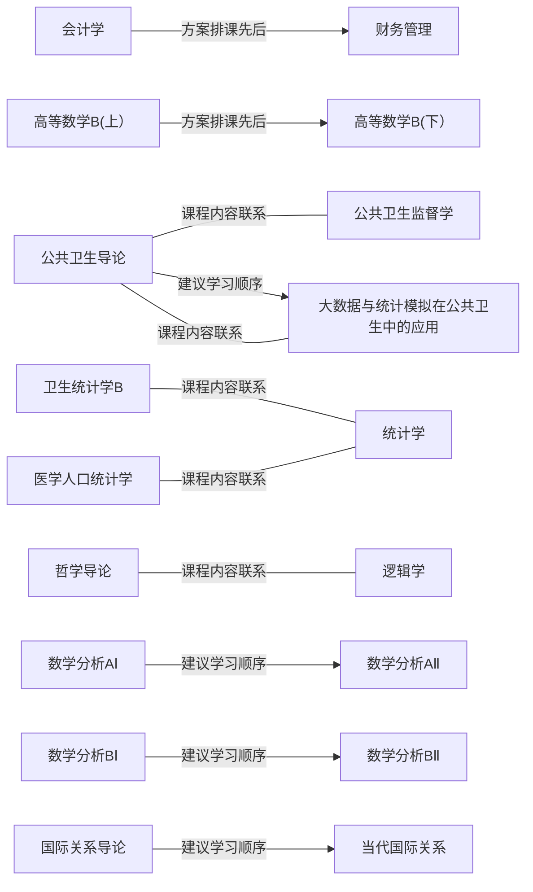

# 2025公共事业管理专业本科培养方案

公共卫生学院 · 公共事业管理 · 方案 97013 · 121 个不同课程或科研条目。

[官方 Word](../originals/plan-97013.docx) · [教务详情](https://fdjwgl.fudan.edu.cn/manager/bizType/2/major-program-search/info/97013?skipAuth=1) · [方案快照](../raw/plan-97013.json.gz) · [年级目录](../README.md)

## 修读导读

- **建议先学**　《会计学》（`BA10003`） → 《财务管理》（`BA20009`）。会计报表和核算概念可用于理解财务决策。方案分别列在第2、3学期。

- **可以对照着读**　《公共卫生导论》（`PHPM10002`）与《公共卫生监督学》（`PHPM30007`）。两门课的题名都涉及公共卫生。围绕同一人群健康问题，区分个体与群体层面的证据、风险与干预目标。

- **查模块选课**　《卫生经济学》（`PHPM20007`）、《卫生法与卫生监督》（`PHPM20008`）列在“专业核心教育课程”中。原表见 `/courseModules/8`。

## 课程关系图

图中展示部分关系。下表保留全部已建立的课程对，来源位置使用本方案 JSON Pointer。

## 先修与内容联系

| 类型 | 起点 | 终点 | 依据 | 原表定位 |
| --- | --- | --- | --- | --- |
| 建议学习顺序 | 会计学 (BA10003) | 财务管理 (BA20009) | 会计报表和核算概念可用于理解财务决策。  | `/courseModules/6/planCourses/5`、`/courseModules/8/planCourses/3` |
| 建议学习顺序 | 高等数学B(上） (MATH10004) | 高等数学B(下） (MATH10005) | 同方案的课程题名具有连续分册或序号。  | `/courseModules/6/planCourses/0`、`/courseModules/6/planCourses/1` |
| 建议学习顺序 | 数学分析AⅠ (MATH10010) | 数学分析AⅡ (MATH10011) | 同方案的课程题名具有连续分册或序号。  | `/courseModules/7/planCourses/44`、`/courseModules/7/planCourses/45` |
| 建议学习顺序 | 数学分析BⅠ (MATH10012) | 数学分析BⅡ (MATH10013) | 同方案的课程题名具有连续分册或序号。  | `/courseModules/7/planCourses/46`、`/courseModules/7/planCourses/47` |
| 建议学习顺序 | 公共卫生导论 (PHPM10002) | 大数据与统计模拟在公共卫生中的应用 (AIS410011) | “公共卫生导论”题名标明基础层次，前置阅读可帮助了解“大数据与统计模拟在公共卫生中的应用”中的公共卫生主题。  | `/courseModules/8/planCourses/1`、`/courseModules/12/planCourses/15` |
| 建议学习顺序 | 公共卫生导论 (PHPM10002) | 公共卫生监督学 (PHPM30007) | “公共卫生导论”题名标明基础层次，前置阅读可帮助了解“公共卫生监督学”中的公共卫生主题。  | `/courseModules/8/planCourses/1`、`/courseModules/11/planCourses/8` |
| 建议学习顺序 | 国际关系导论 (POLI10008) | 当代国际关系 (ICLE10008) | 国际体系和行为体概念可用于时事与历史案例分析。  | `/courseModules/7/planCourses/54`、`/courseModules/7/planCourses/34` |
| 方案排课先后 | 会计学 (BA10003) | 财务管理 (BA20009) | 同方案该课程全部明确数字学期均早于后者。  | `/courseModules/6/planCourses/5`、`/courseModules/8/planCourses/3` |
| 方案排课先后 | 高等数学B(上） (MATH10004) | 高等数学B(下） (MATH10005) | 同方案该课程全部明确数字学期均早于后者。  | `/courseModules/6/planCourses/0`、`/courseModules/6/planCourses/1` |
| 课程内容联系 | 大数据与统计模拟在公共卫生中的应用 (AIS410011) | 公共卫生导论 (PHPM10002) | 本方案两门课程的题名均含“公共卫生”，可据此对照这一主题。  | `/courseModules/12/planCourses/15`、`/courseModules/8/planCourses/1` |
| 课程内容联系 | 会计学 (BA10003) | 财务管理 (BA20009) | 会计信息与企业融资、投资决策存在应用联系。  | `/courseModules/6/planCourses/5`、`/courseModules/8/planCourses/3` |
| 课程内容联系 | 中国文学传统 (CHIN10001) | 中国文学经典 (CHIN10005) | 经典文本与文学传统可从作品接受与文学演变联系。  | `/courseModules/7/planCourses/0`、`/courseModules/7/planCourses/4` |
| 课程内容联系 | 当代国际关系 (ICLE10008) | 国际关系导论 (POLI10008) | 本方案两门课程的题名均含“国际关系”，可据此对照这一主题。  | `/courseModules/7/planCourses/34`、`/courseModules/7/planCourses/54` |
| 课程内容联系 | 马克思主义新闻思想 (JCM10001) | 新闻学概论 (JCM10002) | 本方案两门课程的题名均含“新闻”，可据此对照这一主题。  | `/courseModules/7/planCourses/14`、`/courseModules/7/planCourses/15` |
| 课程内容联系 | 法理学导论 (LAW10004) | 宪法 (LAW10005) | 两课均涉及权利与公共权力的规范依据。  | `/courseModules/7/planCourses/50`、`/courseModules/7/planCourses/57` |
| 课程内容联系 | 从生物学和统计学视角看人类疾病 (MED130266) | 统计学 (SOCI20003) | 本方案两门课程的题名均含“统计学”，可据此对照这一主题。  | `/courseModules/11/planCourses/7`、`/courseModules/7/planCourses/59` |
| 课程内容联系 | 哲学导论 (PHIL10002) | 逻辑学 (PHIL10003) | 论证与概念分析是哲学讨论的共同方法。  | `/courseModules/7/planCourses/23`、`/courseModules/7/planCourses/24` |
| 课程内容联系 | 公共卫生导论 (PHPM10002) | 公共卫生监督学 (PHPM30007) | 本方案两门课程的题名均含“公共卫生”，可据此对照这一主题。  | `/courseModules/8/planCourses/1`、`/courseModules/11/planCourses/8` |
| 课程内容联系 | 医学人口统计学 (PHPM30006) | 统计学 (SOCI20003) | 本方案两门课程的题名均含“统计学”，可据此对照这一主题。  | `/courseModules/12/planCourses/9`、`/courseModules/7/planCourses/59` |
| 课程内容联系 | 卫生统计学B (PHPM30010) | 统计学 (SOCI20003) | 本方案两门课程的题名均含“统计学”，可据此对照这一主题。  | `/courseModules/12/planCourses/0`、`/courseModules/7/planCourses/59` |

本次未从可定位的明确表述中确认课程对课程预修。学期安排、系列分册与编辑建议均保留各自的依据。

## 课程表

同一课程在不同模块分别出现时，按原表逐行列出。季节字段保留原值。

| 课程 | 代码 | 学分 | 学期 | 模块 |
| --- | --- | ---: | --- | --- |
| 高等数学B(上） | MATH10004 | 5.0 | 第1学期 | 培养方案 / 专业培养课程 / 学科基础课程 / 必修课程 |
| 高等数学B(下） | MATH10005 | 5.0 | 第2学期 | 培养方案 / 专业培养课程 / 学科基础课程 / 必修课程 |
| 线性代数Ⅰ | MATH10001 | 3.0 | 第1学期 | 培养方案 / 专业培养课程 / 学科基础课程 / 必修课程 |
| 微观经济学 | ECON20003 | 3.0 | 第2学期 | 培养方案 / 专业培养课程 / 学科基础课程 / 必修课程 |
| 宏观经济学 | ECON20004 | 3.0 | 第3学期 | 培养方案 / 专业培养课程 / 学科基础课程 / 必修课程 |
| 会计学 | BA10003 | 3.0 | 第2学期 | 培养方案 / 专业培养课程 / 学科基础课程 / 必修课程 |
| 管理学导论 | BA10004 | 3.0 | 第1学期 | 培养方案 / 专业培养课程 / 学科基础课程 / 必修课程 |
| 中国文学传统 | CHIN10001 | 2.0 | SPRING、AUTUMN | 培养方案 / 专业培养课程 / 学科基础课程 / 选修课程 |
| 美学 | CHIN10002 | 2.0 | SPRING、AUTUMN | 培养方案 / 专业培养课程 / 学科基础课程 / 选修课程 |
| 现代文艺赏析 | CHIN10003 | 2.0 | SPRING、AUTUMN | 培养方案 / 专业培养课程 / 学科基础课程 / 选修课程 |
| 汉语概论 | CHIN10004 | 2.0 | SPRING、AUTUMN | 培养方案 / 专业培养课程 / 学科基础课程 / 选修课程 |
| 中国文学经典 | CHIN10005 | 3.0 | SPRING、AUTUMN | 培养方案 / 专业培养课程 / 学科基础课程 / 选修课程 |
| 语言与文化 | CHIN10006 | 2.0 | SPRING、AUTUMN | 培养方案 / 专业培养课程 / 学科基础课程 / 选修课程 |
| 语言学导论 | FORE10005 | 2.0 | SPRING、AUTUMN | 培养方案 / 专业培养课程 / 学科基础课程 / 选修课程 |
| 世界文学导读 | FORE10006 | 2.0 | SPRING、AUTUMN | 培养方案 / 专业培养课程 / 学科基础课程 / 选修课程 |
| 美国历史与文化 | FORE120007 | 2.0 | SPRING、AUTUMN | 培养方案 / 专业培养课程 / 学科基础课程 / 选修课程 |
| 现代欧美戏剧名篇赏析 | FORE120009 | 2.0 | SPRING、AUTUMN | 培养方案 / 专业培养课程 / 学科基础课程 / 选修课程 |
| 史学原典导读 | HIST10003 | 2.0 | SPRING、AUTUMN | 培养方案 / 专业培养课程 / 学科基础课程 / 选修课程 |
| 世界文明史通论 | HIST10004 | 2.0 | SPRING、AUTUMN | 培养方案 / 专业培养课程 / 学科基础课程 / 选修课程 |
| 近代中国社会研究 | HIST10005 | 2.0 | SPRING、AUTUMN | 培养方案 / 专业培养课程 / 学科基础课程 / 选修课程 |
| 近代的世界 | HIST120010 | 2.0 | SPRING | 培养方案 / 专业培养课程 / 学科基础课程 / 选修课程 |
| 马克思主义新闻思想 | JCM10001 | 2.0 | SPRING、AUTUMN | 培养方案 / 专业培养课程 / 学科基础课程 / 选修课程 |
| 新闻学概论 | JCM10002 | 2.0 | SPRING、AUTUMN | 培养方案 / 专业培养课程 / 学科基础课程 / 选修课程 |
| 传播学概论 | JCM10003 | 2.0 | SPRING、AUTUMN | 培养方案 / 专业培养课程 / 学科基础课程 / 选修课程 |
| 媒介学导论 | JOUR120010 | 2.0 | SPRING、AUTUMN | 培养方案 / 专业培养课程 / 学科基础课程 / 选修课程 |
| 考古学导论 | ARCH10001 | 2.0 | AUTUMN | 培养方案 / 专业培养课程 / 学科基础课程 / 选修课程 |
| 中国古代工艺美术 | CULT10001 | 2.0 | SPRING、AUTUMN | 培养方案 / 专业培养课程 / 学科基础课程 / 选修课程 |
| 中国文字源流 | CULT10002 | 2.0 | AUTUMN | 培养方案 / 专业培养课程 / 学科基础课程 / 选修课程 |
| 基督教哲学 | PHIL120005 | 2.0 | SPRING | 培养方案 / 专业培养课程 / 学科基础课程 / 选修课程 |
| 佛教哲学 | PHIL120006 | 2.0 | SPRING | 培养方案 / 专业培养课程 / 学科基础课程 / 选修课程 |
| 哲学导论 | PHIL10002 | 3.0 | SPRING、AUTUMN | 培养方案 / 专业培养课程 / 学科基础课程 / 选修课程 |
| 逻辑学 | PHIL10003 | 3.0 | SPRING、AUTUMN | 培养方案 / 专业培养课程 / 学科基础课程 / 选修课程 |
| 先秦哲学 | PHIL120014 | 2.0 | AUTUMN | 培养方案 / 专业培养课程 / 学科基础课程 / 选修课程 |
| 宗教学导论 | PHIL10004 | 2.0 | AUTUMN | 培养方案 / 专业培养课程 / 学科基础课程 / 选修课程 |
| 中国哲学 | ICLE10001 | 2.0 | AUTUMN | 培养方案 / 专业培养课程 / 学科基础课程 / 选修课程 |
| 中国绘画 | ICLE10002 | 2.0 | AUTUMN | 培养方案 / 专业培养课程 / 学科基础课程 / 选修课程 |
| 中国书法 | ICLE10003 | 2.0 | SPRING | 培养方案 / 专业培养课程 / 学科基础课程 / 选修课程 |
| 文物鉴赏 | ICLE10004 | 2.0 | AUTUMN | 培养方案 / 专业培养课程 / 学科基础课程 / 选修课程 |
| 中国印 | ICLE10005 | 2.0 | AUTUMN | 培养方案 / 专业培养课程 / 学科基础课程 / 选修课程 |
| 中国神话传说 | ICLE10006 | 2.0 | AUTUMN | 培养方案 / 专业培养课程 / 学科基础课程 / 选修课程 |
| 中国传统医学文化 | ICLE10007 | 2.0 | AUTUMN | 培养方案 / 专业培养课程 / 学科基础课程 / 选修课程 |
| 当代国际关系 | ICLE10008 | 2.0 | AUTUMN | 培养方案 / 专业培养课程 / 学科基础课程 / 选修课程 |
| 中国旅游文化 | ICLE10009 | 2.0 | SPRING | 培养方案 / 专业培养课程 / 学科基础课程 / 选修课程 |
| 中国传统戏曲赏析 | ICLE10010 | 2.0 | SPRING | 培养方案 / 专业培养课程 / 学科基础课程 / 选修课程 |
| 中国传统建筑文化 | ICLE10011 | 2.0 | AUTUMN | 培养方案 / 专业培养课程 / 学科基础课程 / 选修课程 |
| 经贸汉语 | ICLE10012 | 2.0 | SPRING | 培养方案 / 专业培养课程 / 学科基础课程 / 选修课程 |
| 中国历史名人 | ICLE10013 | 2.0 | AUTUMN | 培养方案 / 专业培养课程 / 学科基础课程 / 选修课程 |
| 中国文化地理 | ICLE10014 | 2.0 | SPRING | 培养方案 / 专业培养课程 / 学科基础课程 / 选修课程 |
| 汉语与中国文化 | ICLE10015 | 2.0 | AUTUMN | 培养方案 / 专业培养课程 / 学科基础课程 / 选修课程 |
| 中国古代文明 | HIST10006 | 3.0 | SPRING、AUTUMN | 培养方案 / 专业培养课程 / 学科基础课程 / 选修课程 |
| 跨文化交流理论与实践 | ICLE10016 | 2.0 | SPRING | 培养方案 / 专业培养课程 / 学科基础课程 / 选修课程 |
| 数学分析AⅠ | MATH10010 | 5.0 | SPRING、AUTUMN | 培养方案 / 专业培养课程 / 学科基础课程 / 选修课程 |
| 数学分析AⅡ | MATH10011 | 5.0 | SPRING、AUTUMN | 培养方案 / 专业培养课程 / 学科基础课程 / 选修课程 |
| 数学分析BⅠ | MATH10012 | 5.0 | SPRING、AUTUMN | 培养方案 / 专业培养课程 / 学科基础课程 / 选修课程 |
| 数学分析BⅡ | MATH10013 | 5.0 | SPRING、AUTUMN | 培养方案 / 专业培养课程 / 学科基础课程 / 选修课程 |
| 政治学原理 | POLI10007 | 3.0 | SPRING、AUTUMN | 培养方案 / 专业培养课程 / 学科基础课程 / 选修课程 |
| 社会学导论 | SOCI20001 | 3.0 | SPRING、AUTUMN | 培养方案 / 专业培养课程 / 学科基础课程 / 选修课程 |
| 法理学导论 | LAW10004 | 3.0 | SPRING、AUTUMN | 培养方案 / 专业培养课程 / 学科基础课程 / 选修课程 |
| 政治经济学 | ECON20006 | 3.0 | SPRING、AUTUMN | 培养方案 / 专业培养课程 / 学科基础课程 / 选修课程 |
| 社会研究方法A | SOCI20002 | 3.0 | SPRING、AUTUMN | 培养方案 / 专业培养课程 / 学科基础课程 / 选修课程 |
| 社会研究方法B | MSE30029 | 3.0 | SPRING、AUTUMN | 培养方案 / 专业培养课程 / 学科基础课程 / 选修课程 |
| 国际关系导论 | POLI10008 | 3.0 | SPRING、AUTUMN | 培养方案 / 专业培养课程 / 学科基础课程 / 选修课程 |
| 社会工作导论 | SWK20002 | 3.0 | SPRING、AUTUMN | 培养方案 / 专业培养课程 / 学科基础课程 / 选修课程 |
| 心理学导论 | PSYC20001 | 3.0 | SPRING、AUTUMN | 培养方案 / 专业培养课程 / 学科基础课程 / 选修课程 |
| 宪法 | LAW10005 | 3.0 | SPRING、AUTUMN | 培养方案 / 专业培养课程 / 学科基础课程 / 选修课程 |
| 经济法 | LAW20011 | 3.0 | SPRING、AUTUMN | 培养方案 / 专业培养课程 / 学科基础课程 / 选修课程 |
| 统计学 | SOCI20003 | 3.0 | SPRING、AUTUMN | 培养方案 / 专业培养课程 / 学科基础课程 / 选修课程 |
| 公共行政学 | MANA10002 | 3.0 | SPRING、AUTUMN | 培养方案 / 专业培养课程 / 学科基础课程 / 选修课程 |
| 当代中国政治制度 | POLI10009 | 3.0 | SPRING、AUTUMN | 培养方案 / 专业培养课程 / 学科基础课程 / 选修课程 |
| 微观经济学原理 | ECON20007 | 5.0 | 第1学期 | 培养方案 / 专业培养课程 / 学科基础课程 / 选修课程 |
| 宏观经济学原理 | ECON20008 | 5.0 | 第2学期 | 培养方案 / 专业培养课程 / 学科基础课程 / 选修课程 |
| 经济学原理 | ECON20005 | 3.0 | 第2学期 | 培养方案 / 专业培养课程 / 专业核心教育课程 |
| 公共卫生导论 | PHPM10002 | 1.0 | 第2学期 | 培养方案 / 专业培养课程 / 专业核心教育课程 |
| 概率论与数理统计 | STAT20012 | 4.0 | 第3学期 | 培养方案 / 专业培养课程 / 专业核心教育课程 |
| 财务管理 | BA20009 | 3.0 | 第3学期 | 培养方案 / 专业培养课程 / 专业核心教育课程 |
| 卫生经济学 | PHPM20007 | 4.0 | 第4学期 | 培养方案 / 专业培养课程 / 专业核心教育课程 |
| 卫生法与卫生监督 | PHPM20008 | 2.0 | 第4学期 | 培养方案 / 专业培养课程 / 专业核心教育课程 |
| 卫生管理运筹学 | PHPM20012 | 3.0 | 第4学期 | 培养方案 / 专业培养课程 / 专业核心教育课程 |
| 组织行为学：卫生视角 | PHPM20015 | 3.0 | 第4学期 | 培养方案 / 专业培养课程 / 专业核心教育课程 |
| 流行病学 | PHPM30009 | 4.0 | 第5学期 | 培养方案 / 专业培养课程 / 专业核心教育课程 |
| 预防医学导论 | PHPM30012 | 4.5 | 第5学期 | 培养方案 / 专业培养课程 / 专业核心教育课程 |
| 卫生事业管理学 | PHPM30011 | 4.0 | 第6学期 | 培养方案 / 专业培养课程 / 专业核心教育课程 |
| 医院管理学 | PHPM40010 | 4.0 | 第6学期 | 培养方案 / 专业培养课程 / 专业核心教育课程 |
| 医疗保险 | PHPM40011 | 2.0 | 第7学期 | 培养方案 / 专业培养课程 / 专业核心教育课程 |
| 卫生政策研究理论 | PHPM40024 | 3.0 | 第7学期 | 培养方案 / 专业培养课程 / 专业核心教育课程 |
| 管理信息系统 | MSE20003 | 2.0 | 第3学期 | 培养方案 / 专业培养课程 / 专业核心教育课程 |
| 正常人体形态与功能学IB | MED20021 | 3.0 | 第5学期 | 培养方案 / 专业进阶模块Ⅰ |
| 正常人体形态与功能学ⅡB | MED20022 | 1.5 | 第5学期 | 培养方案 / 专业进阶模块Ⅰ |
| 正常人体形态与功能学ⅢB | MED20023 | 1.5 | 第5学期 | 培养方案 / 专业进阶模块Ⅰ |
| 正常人体形态与功能学ⅣB | MED20024 | 2.0 | 第5学期 | 培养方案 / 专业进阶模块Ⅰ |
| 疾病机制 | MED20035 | 3.0 | 第6学期 | 培养方案 / 专业进阶模块Ⅰ |
| 诊断学C | MED30041 | 2.0 | 第6学期 | 培养方案 / 专业进阶模块Ⅰ |
| 医学文献检索与利用B | MED20016 | 2.0 | SPRING | 培养方案 / 专业进阶模块Ⅰ |
| 从生物学和统计学视角看人类疾病 | MED130266 | 2.0 | SUMMER | 培养方案 / 专业进阶模块Ⅰ |
| 公共卫生监督学 | PHPM30007 | 2.0 | SPRING、AUTUMN | 培养方案 / 专业进阶模块Ⅰ |
| 卫生人力规划 | PHPM30008 | 2.0 | AUTUMN | 培养方案 / 专业进阶模块Ⅰ |
| 健康心理学 | PHPM30005 | 1.0 | SPRING、AUTUMN | 培养方案 / 专业进阶模块Ⅰ |
| 医学生职业生涯规划 | PHPM10003 | 1.0 | SPRING、AUTUMN | 培养方案 / 专业进阶模块Ⅰ |
| 卫生统计学B | PHPM30010 | 4.0 | 第5学期 | 培养方案 / 专业进阶模块Ⅱ |
| 卫生服务研究 | PHPM40009 | 2.0 | 第6学期 | 培养方案 / 专业进阶模块Ⅱ |
| 卫生管理研究设计 | PHPM20009 | 2.0 | 第6学期 | 培养方案 / 专业进阶模块Ⅱ |
| 科学写作：聚焦群医学 | PHPM40029 | 2.0 | AUTUMN | 培养方案 / 专业进阶模块Ⅱ |
| 行为经济学与公众健康 | PHPM130116 | 2.0 | AUTUMN | 培养方案 / 专业进阶模块Ⅱ |
| 卫生管理预测与决策分析 | PHPM30025 | 2.0 | AUTUMN | 培养方案 / 专业进阶模块Ⅱ |
| 生殖健康进展 | PHPM130035 | 1.0 | SPRING | 培养方案 / 专业进阶模块Ⅱ |
| 管理与沟通技巧 | PHPM20005 | 1.0 | SPRING | 培养方案 / 专业进阶模块Ⅱ |
| 妇幼卫生学概论 | PHPM10001 | 1.0 | SPRING、AUTUMN | 培养方案 / 专业进阶模块Ⅱ |
| 医学人口统计学 | PHPM30006 | 2.0 | SPRING | 培养方案 / 专业进阶模块Ⅱ |
| 全球卫生导论 | PHPM20013 | 2.0 | AUTUMN | 培养方案 / 专业进阶模块Ⅱ |
| 卫生经济评价方法 | PHPM50003 | 2.0 | AUTUMN | 培养方案 / 专业进阶模块Ⅱ |
| 卫生技术评估导论 | PHPM30020 | 2.0 | AUTUMN | 培养方案 / 专业进阶模块Ⅱ |
| 学术前沿专题 | PHPM130087 | 1.0 | SPRING、AUTUMN | 培养方案 / 专业进阶模块Ⅱ |
| 健康公平 | PHPM20018 | 2.0 | AUTUMN | 培养方案 / 专业进阶模块Ⅱ |
| 大数据与统计模拟在公共卫生中的应用 | AIS410011 | 2.0 | SPRING、AUTUMN | 培养方案 / 专业进阶模块Ⅱ |
| 疫苗与传染病防控 | PHPM30002 | 2.0 | SPRING、AUTUMN | 培养方案 / 专业进阶模块Ⅱ |
| 心理与饮食行为 | PHPM50001 | 2.0 | SPRING、AUTUMN | 培养方案 / 专业进阶模块Ⅱ |
| 卫生学评价 | PHPM40008 | 1.0 | SPRING、AUTUMN | 培养方案 / 专业进阶模块Ⅱ |
| 复芏计划(FDUROP) | 102 | 0.0 |  | 融合创新能力 |
| 国际交流 | 7 | 0.0 |  | 融合创新能力 |
| 生产见习 | PHPM40012 | 2.0 | 第7学期 | 融合创新能力 |
| 毕业论文 | PHPM40007 | 6.0 | 第8学期 | 融合创新能力 |
