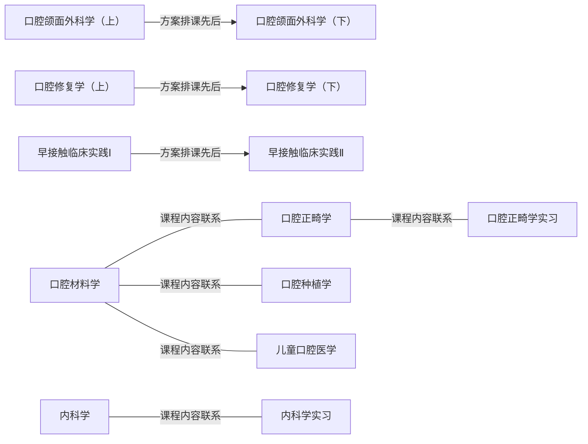

# 2024级口腔医学（五年制）专业“2+X”教学培养方案（港澳台侨生）

口腔医学院 · 口腔医学 · 方案 73041 · 66 个不同课程或科研条目。

[官方 Word](../originals/plan-73041.docx) · [教务详情](https://fdjwgl.fudan.edu.cn/manager/bizType/2/major-program-search/info/73041?skipAuth=1) · [方案快照](../raw/plan-73041.json.gz) · [年级目录](../README.md)

## 课程关系图

图中展示部分关系。下表保留全部已建立的课程对，来源位置使用本方案 JSON Pointer。

## 先修与内容联系

| 类型 | 起点 | 终点 | 依据 | 原表定位 |
| --- | --- | --- | --- | --- |
| 建议学习顺序 | 早接触临床实践Ⅰ (STOM20002) | 早接触临床实践Ⅱ (STOM30010) | 同方案的课程题名具有连续分册或序号。  | `/courseModules/9/planCourses/6`、`/courseModules/9/planCourses/7` |
| 建议学习顺序 | 口腔颌面外科学（上） (STOM40026) | 口腔颌面外科学（下） (STOM40027) | 同方案的课程题名具有连续分册或序号。  | `/courseModules/5/planCourses/35`、`/courseModules/5/planCourses/36` |
| 建议学习顺序 | 口腔修复学（上） (STOM40030) | 口腔修复学（下） (STOM40031) | 同方案的课程题名具有连续分册或序号。  | `/courseModules/5/planCourses/39`、`/courseModules/5/planCourses/40` |
| 方案排课先后 | 早接触临床实践Ⅰ (STOM20002) | 早接触临床实践Ⅱ (STOM30010) | 同方案该课程全部明确数字学期均早于后者。  | `/courseModules/9/planCourses/6`、`/courseModules/9/planCourses/7` |
| 方案排课先后 | 口腔颌面外科学（上） (STOM40026) | 口腔颌面外科学（下） (STOM40027) | 同方案该课程全部明确数字学期均早于后者。  | `/courseModules/5/planCourses/35`、`/courseModules/5/planCourses/36` |
| 方案排课先后 | 口腔修复学（上） (STOM40030) | 口腔修复学（下） (STOM40031) | 同方案该课程全部明确数字学期均早于后者。  | `/courseModules/5/planCourses/39`、`/courseModules/5/planCourses/40` |
| 课程内容联系 | 有机化学实验I (CHEM10006) | 有机化学C (CHEM10007) | 本方案两门课程的题名均含“有机化学”，可据此对照这一主题。  | `/courseModules/4/planCourses/7`、`/courseModules/4/planCourses/5` |
| 课程内容联系 | 病理生理学C (MED20068) | 病理学 (MED20069) | 本方案两门课程的题名均含“病理”，可据此对照这一主题。  | `/courseModules/5/planCourses/4`、`/courseModules/5/planCourses/5` |
| 课程内容联系 | 病理生理学C (MED20068) | 生理学 (MED20071) | 本方案两门课程的题名均含“生理学”，可据此对照这一主题。  | `/courseModules/5/planCourses/4`、`/courseModules/5/planCourses/7` |
| 课程内容联系 | 病理学 (MED20069) | 口腔组织病理学 (STOM30002) | 本方案两门课程的题名均含“病理”，可据此对照这一主题。  | `/courseModules/5/planCourses/5`、`/courseModules/5/planCourses/31` |
| 课程内容联系 | 人体解剖学 (MED20070) | 口腔解剖生理学 (STOM30009) | 本方案两门课程的题名均含“解剖”，可据此对照这一主题。  | `/courseModules/5/planCourses/6`、`/courseModules/5/planCourses/37` |
| 课程内容联系 | 生理学 (MED20071) | 药理学 (MED20073) | 共同主题为生理调节与药物作用。  | `/courseModules/5/planCourses/7`、`/courseModules/5/planCourses/8` |
| 课程内容联系 | 生理学 (MED20071) | 口腔解剖生理学 (STOM30009) | 本方案两门课程的题名均含“生理学”，可据此对照这一主题。  | `/courseModules/5/planCourses/7`、`/courseModules/5/planCourses/37` |
| 课程内容联系 | 人体分子与细胞 (MED20093) | 医学遗传学 (MED30117) | 基因、细胞与人体性状是共同知识背景。  | `/courseModules/5/planCourses/13`、`/courseModules/8/planCourses/5` |
| 课程内容联系 | 外科学C (MED30022) | 外科学实习 (STOM30004) | 本方案两门课程的题名均含“外科”，可据此对照这一主题。  | `/courseModules/5/planCourses/1`、`/courseModules/5/planCourses/18` |
| 课程内容联系 | 外科学C (MED30022) | 口腔颌面外科学（上） (STOM40026) | 本方案两门课程的题名均含“外科”，可据此对照这一主题。  | `/courseModules/5/planCourses/1`、`/courseModules/5/planCourses/35` |
| 课程内容联系 | 外科学C (MED30022) | 口腔颌面外科学（下） (STOM40027) | 本方案两门课程的题名均含“外科”，可据此对照这一主题。  | `/courseModules/5/planCourses/1`、`/courseModules/5/planCourses/36` |
| 课程内容联系 | 外科学C (MED30022) | 口腔颌面外科实习 (STOM50008) | 本方案两门课程的题名均含“外科”，可据此对照这一主题。  | `/courseModules/5/planCourses/1`、`/courseModules/5/planCourses/42` |
| 课程内容联系 | 内科学 (MED30088) | 内科学实习 (STOM30003) | 题名显示相同主题的课程与实验、实践或实习。  | `/courseModules/5/planCourses/9`、`/courseModules/5/planCourses/17` |
| 课程内容联系 | 口腔医学导论 (STOM10002) | 口腔材料学 (STOM30005) | 本方案两门课程的题名均含“口腔”，可据此对照这一主题。  | `/courseModules/9/planCourses/0`、`/courseModules/9/planCourses/1` |
| 课程内容联系 | 口腔材料学 (STOM30005) | 儿童口腔医学 (STOM40011) | 本方案两门课程的题名均含“口腔”，可据此对照这一主题。  | `/courseModules/9/planCourses/1`、`/courseModules/5/planCourses/23` |
| 课程内容联系 | 口腔材料学 (STOM30005) | 口腔正畸学 (STOM40012) | 本方案两门课程的题名均含“口腔”，可据此对照这一主题。  | `/courseModules/9/planCourses/1`、`/courseModules/5/planCourses/24` |
| 课程内容联系 | 口腔材料学 (STOM30005) | 口腔种植学 (STOM40013) | 本方案两门课程的题名均含“口腔”，可据此对照这一主题。  | `/courseModules/9/planCourses/1`、`/courseModules/5/planCourses/25` |
| 课程内容联系 | 口腔正畸学 (STOM40012) | 口腔正畸学实习 (STOM50009) | 题名显示相同主题的课程与实验、实践或实习。  | `/courseModules/5/planCourses/24`、`/courseModules/5/planCourses/41` |

本次未从可定位的明确表述中确认课程对课程预修。学期安排、系列分册与编辑建议均保留各自的依据。

## 按原方案模块阅读

同一模块展示原表中的课程归属。模块内课程之间的先后仍须逐项查阅。

- **医学类基础课程**　现代生物科学导论C、普通化学实验I、有机化学实验I、有机化学C、普通化学C、高等数学C I、普通物理B、基础物理实验（原表模块 4）

## 课程表

同一课程在不同模块分别出现时，按原表逐行列出。季节字段保留原值。

| 课程 | 代码 | 学分 | 学期 | 模块 |
| --- | --- | ---: | --- | --- |
| 高等数学C I | MATH10018 | 5.0 | 第1学期 | 培养方案 / 医学类基础课程 |
| 普通物理B | PHYS10002 | 3.0 | 第1学期 | 培养方案 / 医学类基础课程 |
| 基础物理实验 | PHYS10005 | 2.0 | 第1学期 | 培养方案 / 医学类基础课程 |
| 普通化学C | CHEM10008 | 3.0 | 第1学期 | 培养方案 / 医学类基础课程 |
| 普通化学实验I | CHEM10005 | 1.0 | 第2学期 | 培养方案 / 医学类基础课程 |
| 有机化学C | CHEM10007 | 3.0 | 第2学期 | 培养方案 / 医学类基础课程 |
| 现代生物科学导论C | BIOL10002 | 2.0 | 第1学期、第2学期 | 培养方案 / 医学类基础课程 |
| 有机化学实验I | CHEM10006 | 1.0 | 第2学期 | 培养方案 / 医学类基础课程 |
| 免疫学B | MED20013 | 3.0 | 第4学期 | 培养方案 / 专业核心教育课程 |
| 外科学C | MED30022 | 3.0 | 第5学期 | 培养方案 / 专业核心教育课程 |
| 医学伦理学 | MED30046 | 1.0 | 第5学期 | 培养方案 / 专业核心教育课程 |
| 组织胚胎学 | MED20067 | 2.0 | 第3学期 | 培养方案 / 专业核心教育课程 |
| 病理生理学C | MED20068 | 2.0 | 第4学期 | 培养方案 / 专业核心教育课程 |
| 病理学 | MED20069 | 3.5 | 第4学期 | 培养方案 / 专业核心教育课程 |
| 人体解剖学 | MED20070 | 3.0 | 第3学期 | 培养方案 / 专业核心教育课程 |
| 生理学 | MED20071 | 2.0 | 第4学期 | 培养方案 / 专业核心教育课程 |
| 药理学 | MED20073 | 2.0 | 第4学期 | 培养方案 / 专业核心教育课程 |
| 内科学 | MED30088 | 4.0 | 第5学期 | 培养方案 / 专业核心教育课程 |
| 妇产科学总论 | MED30089 | 1.0 | 第6学期 | 培养方案 / 专业核心教育课程 |
| 儿科学总论 | MED30093 | 1.0 | 第6学期 | 培养方案 / 专业核心教育课程 |
| 医学微生物学C | MED20086 | 2.0 | 第6学期 | 培养方案 / 专业核心教育课程 |
| 人体分子与细胞 | MED20093 | 4.5 | 第3学期 | 培养方案 / 专业核心教育课程 |
| 医学心理学 | MED30106 | 1.0 | 第6学期 | 培养方案 / 专业核心教育课程 |
| 卫生法 | PHPM20011 | 1.0 | 第5学期 | 培养方案 / 专业核心教育课程 |
| 预防医学 | PHPM30021 | 1.0 | 第5学期 | 培养方案 / 专业核心教育课程 |
| 内科学实习 | STOM30003 | 4.0 | 第6学期 | 培养方案 / 专业核心教育课程 |
| 外科学实习 | STOM30004 | 4.0 | 第6学期 | 培养方案 / 专业核心教育课程 |
| 口腔颌面医学影像诊断学 | STOM40006 | 1.5 | 第7学期 | 培养方案 / 专业核心教育课程 |
| 牙体牙髓病学 | STOM40007 | 5.5 | 第7学期 | 培养方案 / 专业核心教育课程 |
| 牙周病学 | STOM40008 | 2.5 | 第7学期 | 培养方案 / 专业核心教育课程 |
| 口腔预防医学 | STOM40010 | 1.5 | 第8学期 | 培养方案 / 专业核心教育课程 |
| 儿童口腔医学 | STOM40011 | 2.0 | 第8学期 | 培养方案 / 专业核心教育课程 |
| 口腔正畸学 | STOM40012 | 2.5 | 第8学期 | 培养方案 / 专业核心教育课程 |
| 口腔种植学 | STOM40013 | 1.0 | 第8学期 | 培养方案 / 专业核心教育课程 |
| 临床衔接课程 | STOM40014 | 1.5 | 第8学期 | 培养方案 / 专业核心教育课程 |
| 口腔预防科实习 | STOM50001 | 2.0 | 第9学期 | 培养方案 / 专业核心教育课程 |
| 口腔黏膜病科实习 | STOM50002 | 2.0 | 第9学期 | 培养方案 / 专业核心教育课程 |
| 口腔放射科实习 | STOM50003 | 2.0 | 第9学期 | 培养方案 / 专业核心教育课程 |
| 牙周科实习 | STOM50004 | 5.0 | 第10学期 | 培养方案 / 专业核心教育课程 |
| 口腔组织病理学 | STOM30002 | 2.5 | 第6学期 | 培养方案 / 专业核心教育课程 |
| 口腔修复科实习 | STOM50005 | 10.0 | 第9学期 | 培养方案 / 专业核心教育课程 |
| 儿童口腔科实习 | STOM50006 | 4.0 | 第9学期 | 培养方案 / 专业核心教育课程 |
| 牙体牙髓病科实习 | STOM50007 | 8.0 | 第10学期 | 培养方案 / 专业核心教育课程 |
| 口腔颌面外科学（上） | STOM40026 | 3.5 | 第7学期 | 培养方案 / 专业核心教育课程 |
| 口腔颌面外科学（下） | STOM40027 | 2.5 | 第8学期 | 培养方案 / 专业核心教育课程 |
| 口腔解剖生理学 | STOM30009 | 4.0 | 第6学期 | 培养方案 / 专业核心教育课程 |
| 口腔黏膜病学 | STOM40028 | 1.5 | 第7学期 | 培养方案 / 专业核心教育课程 |
| 口腔修复学（上） | STOM40030 | 4.0 | 第7学期 | 培养方案 / 专业核心教育课程 |
| 口腔修复学（下） | STOM40031 | 3.5 | 第8学期 | 培养方案 / 专业核心教育课程 |
| 口腔正畸学实习 | STOM50009 | 4.0 | 第10学期 | 培养方案 / 专业核心教育课程 |
| 口腔颌面外科实习 | STOM50008 | 9.0 | 第10学期 | 培养方案 / 专业核心教育课程 |
| 诊断学B | MED30019 | 3.5 | 第5学期 | 培养方案 / 专业进阶课程I |
| 皮肤病与性病学概论 | MED30090 | 1.0 | 第5学期 | 培养方案 / 专业进阶课程I |
| 传染病学 | MED30091 | 1.0 | 第5学期 | 培养方案 / 专业进阶课程I |
| 耳鼻咽喉科学 | MED30092 | 1.5 | 第6学期 | 培养方案 / 专业进阶课程I |
| 功能学科综合实验 | MED30103 | 2.0 | 第4学期 | 培养方案 / 专业进阶课程I |
| 医学遗传学 | MED30117 | 1.5 | 第5学期 | 培养方案 / 专业进阶课程I |
| 卫生统计学A | PHPM40014 | 3.0 | 第6学期 | 培养方案 / 专业进阶课程I |
| 口腔医学导论 | STOM10002 | 1.5 | 第2学期 | 培养方案 / 专业进阶课程Ⅱ |
| 口腔材料学 | STOM30005 | 1.0 | 第5学期 | 培养方案 / 专业进阶课程Ⅱ |
| 牙合学 | STOM40019 | 1.5 | 第8学期 | 培养方案 / 专业进阶课程Ⅱ |
| 早接触科研思维训练 | STOM40020 | 2.0 | 第8学期 | 培养方案 / 专业进阶课程Ⅱ |
| 基于口腔疾病的多学科教学 | STOM40025 | 1.5 | 第8学期 | 培养方案 / 专业进阶课程Ⅱ |
| 口腔人工智能设备学 | STOM40029 | 2.0 | 第8学期 | 培养方案 / 专业进阶课程Ⅱ |
| 早接触临床实践Ⅰ | STOM20002 | 1.0 | 第3学期 | 培养方案 / 专业进阶课程Ⅱ |
| 早接触临床实践Ⅱ | STOM30010 | 1.0 | 第5学期 | 培养方案 / 专业进阶课程Ⅱ |
