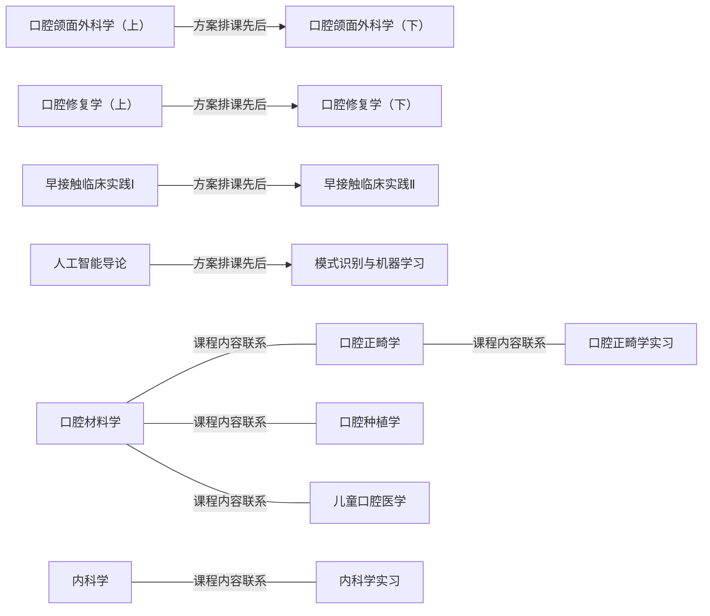

# 2024级口腔医学-人工智能双学士学位项目“2+X”教学培养方案

口腔医学院 · 口腔医学-人工智能(双学士学位项目) · 方案 73042 · 81 个不同课程或科研条目。

[官方 Word](../originals/plan-73042.docx) · [教务详情](https://fdjwgl.fudan.edu.cn/manager/bizType/2/major-program-search/info/73042?skipAuth=1) · [方案快照](../raw/plan-73042.json.gz) · [年级目录](../README.md)

## 修读导读

- **建议先学**　《口腔颌面外科学（上）》（`STOM40026`） → 《口腔颌面外科学（下）》（`STOM40027`）。题名列出连续册次或级别。可按解剖部位或临床问题整理前一阶段的病例要点，再用后续案例补充比较。方案分别列在第7、8学期。

- **可以对照着读**　《口腔正畸学》（`STOM40012`）与《口腔正畸学实习》（`STOM50009`）。可在实验或实践课中记录用到了哪些课堂概念，再回到相应章节复习。

- **查模块选课**　《儿童口腔医学》（`STOM40011`）、《口腔人工智能设备学》（`STOM40029`）列在“专业核心教育课程”中。原表见 `/courseModules/5`。

## 课程关系图

图中展示部分关系。下表保留全部已建立的课程对，来源位置使用本方案 JSON Pointer。

## 先修与内容联系

| 类型 | 起点 | 终点 | 依据 | 原表定位 |
| --- | --- | --- | --- | --- |
| 建议学习顺序 | 人工智能导论 (AIE310005) | 模式识别与机器学习 (AIE410001) | 人工智能问题与模型类别可为学习模式识别作准备。  | `/courseModules/5/planCourses/50`、`/courseModules/5/planCourses/52` |
| 建议学习顺序 | 早接触临床实践Ⅰ (STOM20002) | 早接触临床实践Ⅱ (STOM30010) | 同方案的课程题名具有连续分册或序号。  | `/courseModules/8/planCourses/1`、`/courseModules/8/planCourses/2` |
| 建议学习顺序 | 口腔颌面外科学（上） (STOM40026) | 口腔颌面外科学（下） (STOM40027) | 同方案的课程题名具有连续分册或序号。  | `/courseModules/5/planCourses/35`、`/courseModules/5/planCourses/36` |
| 建议学习顺序 | 口腔修复学（上） (STOM40030) | 口腔修复学（下） (STOM40031) | 同方案的课程题名具有连续分册或序号。  | `/courseModules/5/planCourses/39`、`/courseModules/5/planCourses/40` |
| 方案排课先后 | 人工智能导论 (AIE310005) | 模式识别与机器学习 (AIE410001) | 同方案该课程全部明确数字学期均早于后者。  | `/courseModules/5/planCourses/50`、`/courseModules/5/planCourses/52` |
| 方案排课先后 | 早接触临床实践Ⅰ (STOM20002) | 早接触临床实践Ⅱ (STOM30010) | 同方案该课程全部明确数字学期均早于后者。  | `/courseModules/8/planCourses/1`、`/courseModules/8/planCourses/2` |
| 方案排课先后 | 口腔颌面外科学（上） (STOM40026) | 口腔颌面外科学（下） (STOM40027) | 同方案该课程全部明确数字学期均早于后者。  | `/courseModules/5/planCourses/35`、`/courseModules/5/planCourses/36` |
| 方案排课先后 | 口腔修复学（上） (STOM40030) | 口腔修复学（下） (STOM40031) | 同方案该课程全部明确数字学期均早于后者。  | `/courseModules/5/planCourses/39`、`/courseModules/5/planCourses/40` |
| 课程内容联系 | 计算机系统基础 (AIE210006) | 计算机组成与体系结构 (CS30052) | 处理器、存储与系统执行模型具有共同内容。  | `/courseModules/5/planCourses/49`、`/courseModules/8/planCourses/11` |
| 课程内容联系 | 人工智能导论 (AIE310005) | 人工智能安全 (AIE831001) | 本方案两门课程的题名均含“人工智能”，可据此对照这一主题。  | `/courseModules/5/planCourses/50`、`/courseModules/5/planCourses/53` |
| 课程内容联系 | 人工智能的编程基础 (AIE310006) | 人工智能安全 (AIE831001) | 本方案两门课程的题名均含“人工智能”，可据此对照这一主题。  | `/courseModules/5/planCourses/46`、`/courseModules/5/planCourses/53` |
| 课程内容联系 | 人工智能的软件基础 (AIE310008) | 人工智能安全 (AIE831001) | 本方案两门课程的题名均含“人工智能”，可据此对照这一主题。  | `/courseModules/5/planCourses/51`、`/courseModules/5/planCourses/53` |
| 课程内容联系 | 人工智能的数学基础 (AIE310009) | 模式识别与机器学习 (AIE410001) | 数学表达与学习模型的统计、优化工具可对照。  | `/courseModules/5/planCourses/48`、`/courseModules/5/planCourses/52` |
| 课程内容联系 | 人工智能的数学基础 (AIE310009) | 人工智能安全 (AIE831001) | 本方案两门课程的题名均含“人工智能”，可据此对照这一主题。  | `/courseModules/5/planCourses/48`、`/courseModules/5/planCourses/53` |
| 课程内容联系 | 模式识别与机器学习 (AIE410001) | 机器学习系统 (CS30058) | 本方案两门课程的题名均含“机器学习”，可据此对照这一主题。  | `/courseModules/5/planCourses/52`、`/courseModules/8/planCourses/19` |
| 课程内容联系 | 医学影像深度学习 (AIS310019) | 口腔颌面医学影像诊断学 (STOM40006) | 本方案两门课程的题名均含“医学影像”，可据此对照这一主题。  | `/courseModules/8/planCourses/6`、`/courseModules/5/planCourses/19` |
| 课程内容联系 | 病理生理学C (MED20068) | 病理学 (MED20069) | 本方案两门课程的题名均含“病理”，可据此对照这一主题。  | `/courseModules/5/planCourses/4`、`/courseModules/5/planCourses/5` |
| 课程内容联系 | 病理生理学C (MED20068) | 生理学 (MED20071) | 本方案两门课程的题名均含“生理学”，可据此对照这一主题。  | `/courseModules/5/planCourses/4`、`/courseModules/5/planCourses/7` |
| 课程内容联系 | 病理学 (MED20069) | 口腔组织病理学 (STOM30002) | 本方案两门课程的题名均含“病理”，可据此对照这一主题。  | `/courseModules/5/planCourses/5`、`/courseModules/5/planCourses/31` |
| 课程内容联系 | 人体解剖学 (MED20070) | 口腔解剖生理学 (STOM30009) | 本方案两门课程的题名均含“解剖”，可据此对照这一主题。  | `/courseModules/5/planCourses/6`、`/courseModules/5/planCourses/37` |
| 课程内容联系 | 生理学 (MED20071) | 药理学 (MED20073) | 共同主题为生理调节与药物作用。  | `/courseModules/5/planCourses/7`、`/courseModules/5/planCourses/8` |
| 课程内容联系 | 生理学 (MED20071) | 口腔解剖生理学 (STOM30009) | 本方案两门课程的题名均含“生理学”，可据此对照这一主题。  | `/courseModules/5/planCourses/7`、`/courseModules/5/planCourses/37` |
| 课程内容联系 | 人体分子与细胞 (MED20093) | 医学遗传学 (MED30117) | 基因、细胞与人体性状是共同知识背景。  | `/courseModules/5/planCourses/13`、`/courseModules/8/planCourses/13` |
| 课程内容联系 | 外科学C (MED30022) | 外科学实习 (STOM30004) | 本方案两门课程的题名均含“外科”，可据此对照这一主题。  | `/courseModules/5/planCourses/1`、`/courseModules/5/planCourses/18` |
| 课程内容联系 | 外科学C (MED30022) | 口腔颌面外科学（上） (STOM40026) | 本方案两门课程的题名均含“外科”，可据此对照这一主题。  | `/courseModules/5/planCourses/1`、`/courseModules/5/planCourses/35` |
| 课程内容联系 | 外科学C (MED30022) | 口腔颌面外科学（下） (STOM40027) | 本方案两门课程的题名均含“外科”，可据此对照这一主题。  | `/courseModules/5/planCourses/1`、`/courseModules/5/planCourses/36` |
| 课程内容联系 | 外科学C (MED30022) | 口腔颌面外科实习 (STOM50008) | 本方案两门课程的题名均含“外科”，可据此对照这一主题。  | `/courseModules/5/planCourses/1`、`/courseModules/5/planCourses/42` |
| 课程内容联系 | 内科学 (MED30088) | 内科学实习 (STOM30003) | 题名显示相同主题的课程与实验、实践或实习。  | `/courseModules/5/planCourses/9`、`/courseModules/5/planCourses/17` |
| 课程内容联系 | 口腔医学导论 (STOM10002) | 口腔材料学 (STOM30005) | 本方案两门课程的题名均含“口腔”，可据此对照这一主题。  | `/courseModules/8/planCourses/0`、`/courseModules/8/planCourses/3` |
| 课程内容联系 | 口腔材料学 (STOM30005) | 儿童口腔医学 (STOM40011) | 本方案两门课程的题名均含“口腔”，可据此对照这一主题。  | `/courseModules/8/planCourses/3`、`/courseModules/5/planCourses/23` |
| 课程内容联系 | 口腔材料学 (STOM30005) | 口腔正畸学 (STOM40012) | 本方案两门课程的题名均含“口腔”，可据此对照这一主题。  | `/courseModules/8/planCourses/3`、`/courseModules/5/planCourses/24` |
| 课程内容联系 | 口腔材料学 (STOM30005) | 口腔种植学 (STOM40013) | 本方案两门课程的题名均含“口腔”，可据此对照这一主题。  | `/courseModules/8/planCourses/3`、`/courseModules/5/planCourses/25` |
| 课程内容联系 | 口腔正畸学 (STOM40012) | 口腔正畸学实习 (STOM50009) | 题名显示相同主题的课程与实验、实践或实习。  | `/courseModules/5/planCourses/24`、`/courseModules/5/planCourses/41` |

本次未从可定位的明确表述中确认课程对课程预修。学期安排、系列分册与编辑建议均保留各自的依据。

## 课程表

同一课程在不同模块分别出现时，按原表逐行列出。季节字段保留原值。

| 课程 | 代码 | 学分 | 学期 | 模块 |
| --- | --- | ---: | --- | --- |
| 免疫学B | MED20013 | 3.0 | 第4学期 | 培养方案 / 专业核心教育课程 |
| 外科学C | MED30022 | 3.0 | 第5学期 | 培养方案 / 专业核心教育课程 |
| 医学伦理学 | MED30046 | 1.0 | 第5学期 | 培养方案 / 专业核心教育课程 |
| 组织胚胎学 | MED20067 | 2.0 | 第3学期 | 培养方案 / 专业核心教育课程 |
| 病理生理学C | MED20068 | 2.0 | 第4学期 | 培养方案 / 专业核心教育课程 |
| 病理学 | MED20069 | 3.5 | 第4学期 | 培养方案 / 专业核心教育课程 |
| 人体解剖学 | MED20070 | 3.0 | 第3学期 | 培养方案 / 专业核心教育课程 |
| 生理学 | MED20071 | 2.0 | 第4学期 | 培养方案 / 专业核心教育课程 |
| 药理学 | MED20073 | 2.0 | 第4学期 | 培养方案 / 专业核心教育课程 |
| 内科学 | MED30088 | 4.0 | 第5学期 | 培养方案 / 专业核心教育课程 |
| 妇产科学总论 | MED30089 | 1.0 | 第6学期 | 培养方案 / 专业核心教育课程 |
| 儿科学总论 | MED30093 | 1.0 | 第6学期 | 培养方案 / 专业核心教育课程 |
| 医学微生物学C | MED20086 | 2.0 | 第6学期 | 培养方案 / 专业核心教育课程 |
| 人体分子与细胞 | MED20093 | 4.5 | 第3学期 | 培养方案 / 专业核心教育课程 |
| 医学心理学 | MED30106 | 1.0 | 第6学期 | 培养方案 / 专业核心教育课程 |
| 卫生法 | PHPM20011 | 1.0 | 第5学期 | 培养方案 / 专业核心教育课程 |
| 预防医学 | PHPM30021 | 1.0 | 第5学期 | 培养方案 / 专业核心教育课程 |
| 内科学实习 | STOM30003 | 4.0 | 第6学期 | 培养方案 / 专业核心教育课程 |
| 外科学实习 | STOM30004 | 4.0 | 第6学期 | 培养方案 / 专业核心教育课程 |
| 口腔颌面医学影像诊断学 | STOM40006 | 1.5 | 第7学期 | 培养方案 / 专业核心教育课程 |
| 牙体牙髓病学 | STOM40007 | 5.5 | 第7学期 | 培养方案 / 专业核心教育课程 |
| 牙周病学 | STOM40008 | 2.5 | 第7学期 | 培养方案 / 专业核心教育课程 |
| 口腔预防医学 | STOM40010 | 1.5 | 第8学期 | 培养方案 / 专业核心教育课程 |
| 儿童口腔医学 | STOM40011 | 2.0 | 第8学期 | 培养方案 / 专业核心教育课程 |
| 口腔正畸学 | STOM40012 | 2.5 | 第8学期 | 培养方案 / 专业核心教育课程 |
| 口腔种植学 | STOM40013 | 1.0 | 第8学期 | 培养方案 / 专业核心教育课程 |
| 临床衔接课程 | STOM40014 | 1.5 | 第8学期 | 培养方案 / 专业核心教育课程 |
| 口腔预防科实习 | STOM50001 | 2.0 | 第9学期 | 培养方案 / 专业核心教育课程 |
| 口腔黏膜病科实习 | STOM50002 | 2.0 | 第9学期 | 培养方案 / 专业核心教育课程 |
| 口腔放射科实习 | STOM50003 | 2.0 | 第9学期 | 培养方案 / 专业核心教育课程 |
| 牙周科实习 | STOM50004 | 5.0 | 第10学期 | 培养方案 / 专业核心教育课程 |
| 口腔组织病理学 | STOM30002 | 2.5 | 第6学期 | 培养方案 / 专业核心教育课程 |
| 口腔修复科实习 | STOM50005 | 10.0 | 第9学期 | 培养方案 / 专业核心教育课程 |
| 儿童口腔科实习 | STOM50006 | 4.0 | 第9学期 | 培养方案 / 专业核心教育课程 |
| 牙体牙髓病科实习 | STOM50007 | 8.0 | 第10学期 | 培养方案 / 专业核心教育课程 |
| 口腔颌面外科学（上） | STOM40026 | 3.5 | 第7学期 | 培养方案 / 专业核心教育课程 |
| 口腔颌面外科学（下） | STOM40027 | 2.5 | 第8学期 | 培养方案 / 专业核心教育课程 |
| 口腔解剖生理学 | STOM30009 | 4.0 | 第6学期 | 培养方案 / 专业核心教育课程 |
| 口腔黏膜病学 | STOM40028 | 1.5 | 第7学期 | 培养方案 / 专业核心教育课程 |
| 口腔修复学（上） | STOM40030 | 4.0 | 第7学期 | 培养方案 / 专业核心教育课程 |
| 口腔修复学（下） | STOM40031 | 3.5 | 第8学期 | 培养方案 / 专业核心教育课程 |
| 口腔正畸学实习 | STOM50009 | 4.0 | 第10学期 | 培养方案 / 专业核心教育课程 |
| 口腔颌面外科实习 | STOM50008 | 9.0 | 第10学期 | 培养方案 / 专业核心教育课程 |
| 功能学科综合实验 | MED30103 | 2.0 | 第4学期 | 培养方案 / 专业核心教育课程 |
| 诊断学B | MED30019 | 3.5 | 第5学期 | 培养方案 / 专业核心教育课程 |
| 口腔人工智能设备学 | STOM40029 | 2.0 | 第8学期 | 培养方案 / 专业核心教育课程 |
| 人工智能的编程基础 | AIE310006 | 2.0 | 第2学期 | 培养方案 / 专业核心教育课程 |
| 数据结构 | AIE310007 | 4.0 | 第3学期 | 培养方案 / 专业核心教育课程 |
| 人工智能的数学基础 | AIE310009 | 3.0 | 第3学期 | 培养方案 / 专业核心教育课程 |
| 计算机系统基础 | AIE210006 | 3.0 | 第3学期 | 培养方案 / 专业核心教育课程 |
| 人工智能导论 | AIE310005 | 3.0 | 第4学期 | 培养方案 / 专业核心教育课程 |
| 人工智能的软件基础 | AIE310008 | 3.0 | 第4学期 | 培养方案 / 专业核心教育课程 |
| 模式识别与机器学习 | AIE410001 | 3.0 | 第5学期 | 培养方案 / 专业核心教育课程 |
| 人工智能安全 | AIE831001 | 3.0 | 第5学期 | 培养方案 / 专业核心教育课程 |
| 人工智能的伦理与治理 | PHIL50006 | 2.0 | SPRING | 培养方案 / 专业核心教育课程 |
| 自然语言处理与大语言模型 | AIE410002 | 3.0 | 第6学期 | 培养方案 / 专业核心教育课程 |
| 计算机视觉 | AIE310004 | 3.0 | 第7学期 | 培养方案 / 专业核心教育课程 |
| 人工智能前沿探索实践 | AIE531001 | 3.0 | 第7学期 | 培养方案 / 专业核心教育课程 |
| 口腔医学导论 | STOM10002 | 1.5 | 第2学期 | 培养方案 / 专业进阶课程 |
| 早接触临床实践Ⅰ | STOM20002 | 1.0 | 第3学期 | 培养方案 / 专业进阶课程 |
| 早接触临床实践Ⅱ | STOM30010 | 1.0 | 第5学期 | 培养方案 / 专业进阶课程 |
| 口腔材料学 | STOM30005 | 1.0 | 第5学期 | 培养方案 / 专业进阶课程 |
| 基于口腔疾病的多学科教学 | STOM40025 | 1.5 | 第8学期 | 培养方案 / 专业进阶课程 |
| 牙合学 | STOM40019 | 1.5 | 第8学期 | 培养方案 / 专业进阶课程 |
| 医学影像深度学习 | AIS310019 | 3.0 | 第3学期 | 培养方案 / 专业进阶课程 |
| 智慧医疗应用拓展 | AIT531027 | 2.0 | 第3学期 | 培养方案 / 专业进阶课程 |
| 集合与图论 | CS30043 | 3.0 | 第3学期 | 培养方案 / 专业进阶课程 |
| 医学大数据与人工智能 | AIS410015 | 3.0 | 第4学期 | 培养方案 / 专业进阶课程 |
| 人工智能在临床医学研究中的实际应用 | AIT531026 | 2.0 | 第4学期 | 培养方案 / 专业进阶课程 |
| 计算机组成与体系结构 | CS30052 | 4.0 | 第4学期 | 培养方案 / 专业进阶课程 |
| 数据库引论 | CS20010 | 3.0 | 第4学期 | 培养方案 / 专业进阶课程 |
| 医学遗传学 | MED30117 | 1.5 | 第5学期 | 培养方案 / 专业进阶课程 |
| 计算机网络 | CS30036 | 3.0 | 第5学期 | 培养方案 / 专业进阶课程 |
| 皮肤病与性病学概论 | MED30090 | 1.0 | 第5学期 | 培养方案 / 专业进阶课程 |
| 传染病学 | MED30091 | 1.0 | 第5学期 | 培养方案 / 专业进阶课程 |
| 卫生统计学A | PHPM40014 | 3.0 | 第6学期 | 培养方案 / 专业进阶课程 |
| 软件工程 | CS30018 | 3.0 | 第6学期 | 培养方案 / 专业进阶课程 |
| 机器学习系统 | CS30058 | 3.0 | 第6学期 | 培养方案 / 专业进阶课程 |
| 计算机图形学A | CS30019 | 3.0 | 第6学期 | 培养方案 / 专业进阶课程 |
| 耳鼻咽喉科学 | MED30092 | 1.5 | 第6学期 | 培养方案 / 专业进阶课程 |
| 早接触科研思维训练 | STOM40020 | 2.0 | 第8学期 | 培养方案 / 专业进阶课程 |
