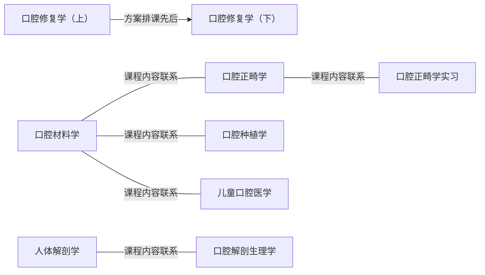

# 2025级口腔医学（五年制）专业“2+X+Y”教学培养方案（留学生）

口腔医学院 · 口腔医学 · 方案 159559 · 78 个不同课程或科研条目。

[官方 Word](../originals/plan-159559.docx) · [教务详情](https://fdjwgl.fudan.edu.cn/manager/bizType/2/major-program-search/info/159559?skipAuth=1) · [方案快照](../raw/plan-159559.json.gz) · [年级目录](../README.md)

## 课程关系图

图中展示部分关系。下表保留全部已建立的课程对，来源位置使用本方案 JSON Pointer。

## 先修与内容联系

| 类型 | 起点 | 终点 | 依据 | 原表定位 |
| --- | --- | --- | --- | --- |
| 建议学习顺序 | 口腔修复学（上） (STOM40030) | 口腔修复学（下） (STOM40031) | 同方案的课程题名具有连续分册或序号。  | `/courseModules/13/planCourses/22`、`/courseModules/13/planCourses/28` |
| 方案排课先后 | 口腔修复学（上） (STOM40030) | 口腔修复学（下） (STOM40031) | 同方案该课程全部明确数字学期均早于后者。  | `/courseModules/13/planCourses/22`、`/courseModules/13/planCourses/28` |
| 课程内容联系 | 有机化学实验I (CHEM10006) | 有机化学C (CHEM10007) | 本方案两门课程的题名均含“有机化学”，可据此对照这一主题。  | `/courseModules/12/planCourses/6`、`/courseModules/12/planCourses/5` |
| 课程内容联系 | 病理生理学C (MED20068) | 病理学 (MED20069) | 本方案两门课程的题名均含“病理”，可据此对照这一主题。  | `/courseModules/13/planCourses/5`、`/courseModules/13/planCourses/6` |
| 课程内容联系 | 病理生理学C (MED20068) | 生理学 (MED20071) | 本方案两门课程的题名均含“生理学”，可据此对照这一主题。  | `/courseModules/13/planCourses/5`、`/courseModules/13/planCourses/7` |
| 课程内容联系 | 病理学 (MED20069) | 口腔组织病理学 (STOM30012) | 本方案两门课程的题名均含“病理”，可据此对照这一主题。  | `/courseModules/13/planCourses/6`、`/courseModules/13/planCourses/19` |
| 课程内容联系 | 人体解剖学 (MED20070) | 口腔解剖生理学 (STOM30009) | 本方案两门课程的题名均含“解剖”，可据此对照这一主题。  | `/courseModules/13/planCourses/2`、`/courseModules/13/planCourses/18` |
| 课程内容联系 | 生理学 (MED20071) | 药理学 (MED20073) | 共同主题为生理调节与药物作用。  | `/courseModules/13/planCourses/7`、`/courseModules/13/planCourses/8` |
| 课程内容联系 | 生理学 (MED20071) | 口腔解剖生理学 (STOM30009) | 本方案两门课程的题名均含“生理学”，可据此对照这一主题。  | `/courseModules/13/planCourses/7`、`/courseModules/13/planCourses/18` |
| 课程内容联系 | 人体分子与细胞 (MED20093) | 医学遗传学 (MED30117) | 基因、细胞与人体性状是共同知识背景。  | `/courseModules/13/planCourses/0`、`/courseModules/16/planCourses/2` |
| 课程内容联系 | 外科学C (MED30022) | 外科学实习 (STOM30004) | 本方案两门课程的题名均含“外科”，可据此对照这一主题。  | `/courseModules/13/planCourses/11`、`/courseModules/23/planCourses/4` |
| 课程内容联系 | 外科学C (MED30022) | 口腔颌面外科学 (STOM40033) | 本方案两门课程的题名均含“外科”，可据此对照这一主题。  | `/courseModules/13/planCourses/11`、`/courseModules/13/planCourses/21` |
| 课程内容联系 | 外科学C (MED30022) | 口腔颌面外科实习 (STOM50008) | 本方案两门课程的题名均含“外科”，可据此对照这一主题。  | `/courseModules/13/planCourses/11`、`/courseModules/23/planCourses/10` |
| 课程内容联系 | 内科学 (MED30088) | 内科学实习 (STOM30003) | 题名显示相同主题的课程与实验、实践或实习。  | `/courseModules/13/planCourses/10`、`/courseModules/23/planCourses/1` |
| 课程内容联系 | 口腔材料学 (STOM30005) | 儿童口腔医学 (STOM40011) | 本方案两门课程的题名均含“口腔”，可据此对照这一主题。  | `/courseModules/16/planCourses/7`、`/courseModules/13/planCourses/29` |
| 课程内容联系 | 口腔材料学 (STOM30005) | 口腔正畸学 (STOM40012) | 本方案两门课程的题名均含“口腔”，可据此对照这一主题。  | `/courseModules/16/planCourses/7`、`/courseModules/13/planCourses/30` |
| 课程内容联系 | 口腔材料学 (STOM30005) | 口腔种植学 (STOM40013) | 本方案两门课程的题名均含“口腔”，可据此对照这一主题。  | `/courseModules/16/planCourses/7`、`/courseModules/13/planCourses/31` |
| 课程内容联系 | 口腔材料学 (STOM30005) | 口腔专业英语 (STOM40017) | 本方案两门课程的题名均含“口腔”，可据此对照这一主题。  | `/courseModules/16/planCourses/7`、`/courseModules/16/planCourses/9` |
| 课程内容联系 | 口腔正畸学 (STOM40012) | 口腔正畸学实习 (STOM50009) | 题名显示相同主题的课程与实验、实践或实习。  | `/courseModules/13/planCourses/30`、`/courseModules/23/planCourses/12` |

本次未从可定位的明确表述中确认课程对课程预修。学期安排、系列分册与编辑建议均保留各自的依据。

## 课程表

同一课程在不同模块分别出现时，按原表逐行列出。季节字段保留原值。

| 课程 | 代码 | 学分 | 学期 | 模块 |
| --- | --- | ---: | --- | --- |
| 人工智能基础 | AIB210002 | 3.0 | SPRING、AUTUMN | 培养方案 / 通识教育课程 / 通识教育专项教育课程 / 人工智能教学专项 |
| 深度学习基础 | AIB310003 | 3.0 | SPRING、AUTUMN | 培养方案 / 通识教育课程 / 通识教育专项教育课程 / 人工智能教学专项 |
| 具身智能引论 | AIB310002 | 3.0 | SPRING、AUTUMN | 培养方案 / 通识教育课程 / 通识教育专项教育课程 / 人工智能教学专项 |
| 生成式软件开发 | AIB110005 | 3.0 | SPRING、AUTUMN | 培养方案 / 通识教育课程 / 通识教育专项教育课程 / 人工智能教学专项 |
| 计算与智能概论A | AIB210006 | 3.0 |  | 培养方案 / 通识教育课程 / 通识教育专项教育课程 / 人工智能教学专项 |
| 中国概况（上） | GESP10001 | 2.0 | AUTUMN | 培养方案 / 通识教育课程 / 通识教育专项教育课程 / 留学生中国语言与文化素养课程 / 中国概况 |
| 中国概况（下） | GESP10002 | 2.0 | SPRING | 培养方案 / 通识教育课程 / 通识教育专项教育课程 / 留学生中国语言与文化素养课程 / 中国概况 |
| 初级汉语 | GECS10005 | 4.0 | SPRING、AUTUMN | 培养方案 / 通识教育课程 / 通识教育专项教育课程 / 留学生中国语言与文化素养课程 / 留学生基础汉语 |
| 中级汉语 | GECS10006 | 4.0 | SPRING、AUTUMN | 培养方案 / 通识教育课程 / 通识教育专项教育课程 / 留学生中国语言与文化素养课程 / 留学生基础汉语 |
| 留学生高级汉语I | GECS10001 | 4.0 | SPRING、AUTUMN | 培养方案 / 通识教育课程 / 通识教育专项教育课程 / 留学生中国语言与文化素养课程 / 留学生基础汉语 |
| 留学生高级汉语II | GECS10002 | 4.0 | SPRING、AUTUMN | 培养方案 / 通识教育课程 / 通识教育专项教育课程 / 留学生中国语言与文化素养课程 / 留学生基础汉语 |
| 留学生基础汉语 | GECS10010 | 4.0 | 第1学期 | 培养方案 / 通识教育课程 / 通识教育专项教育课程 / 留学生中国语言与文化素养课程 / 留学生基础汉语 |
| 留学生专业汉语I | GECS10003 | 4.0 | SPRING、AUTUMN | 培养方案 / 通识教育课程 / 通识教育专项教育课程 / 留学生中国语言与文化素养课程 / 留学生专业汉语 |
| 留学生专业汉语 | GECS10009 | 4.0 | 第1学期 | 培养方案 / 通识教育课程 / 通识教育专项教育课程 / 留学生中国语言与文化素养课程 / 留学生专业汉语 |
| 高等数学C I | MATH10018 | 5.0 | 第1学期 | 培养方案 / 专业培养课程 / 学科基础课程 |
| 普通物理B | PHYS10002 | 3.0 | 第1学期 | 培养方案 / 专业培养课程 / 学科基础课程 |
| 基础物理实验 | PHYS10005 | 2.0 | 第1学期 | 培养方案 / 专业培养课程 / 学科基础课程 |
| 普通化学C | CHEM10008 | 3.0 | 第1学期 | 培养方案 / 专业培养课程 / 学科基础课程 |
| 普通化学实验I | CHEM10005 | 1.0 | 第2学期 | 培养方案 / 专业培养课程 / 学科基础课程 |
| 有机化学C | CHEM10007 | 3.0 | 第2学期 | 培养方案 / 专业培养课程 / 学科基础课程 |
| 有机化学实验I | CHEM10006 | 1.0 | 第2学期 | 培养方案 / 专业培养课程 / 学科基础课程 |
| 人体分子与细胞 | MED20093 | 4.5 | 第3学期 | 培养方案 / 专业培养课程 / 专业核心教育课程 |
| 组织胚胎学 | MED20067 | 2.0 | 第3学期 | 培养方案 / 专业培养课程 / 专业核心教育课程 |
| 人体解剖学 | MED20070 | 3.0 | 第3学期 | 培养方案 / 专业培养课程 / 专业核心教育课程 |
| 医学微生物学C | MED20086 | 2.0 | 第4学期 | 培养方案 / 专业培养课程 / 专业核心教育课程 |
| 免疫学B | MED20013 | 3.0 | 第4学期 | 培养方案 / 专业培养课程 / 专业核心教育课程 |
| 病理生理学C | MED20068 | 2.0 | 第4学期 | 培养方案 / 专业培养课程 / 专业核心教育课程 |
| 病理学 | MED20069 | 3.5 | 第4学期 | 培养方案 / 专业培养课程 / 专业核心教育课程 |
| 生理学 | MED20071 | 2.0 | 第4学期 | 培养方案 / 专业培养课程 / 专业核心教育课程 |
| 药理学 | MED20073 | 2.0 | 第4学期 | 培养方案 / 专业培养课程 / 专业核心教育课程 |
| 预防医学 | PHPM30021 | 1.0 | 第5学期 | 培养方案 / 专业培养课程 / 专业核心教育课程 |
| 内科学 | MED30088 | 4.0 | 第5学期 | 培养方案 / 专业培养课程 / 专业核心教育课程 |
| 外科学C | MED30022 | 3.0 | 第5学期 | 培养方案 / 专业培养课程 / 专业核心教育课程 |
| 卫生法 | PHPM20011 | 1.0 | 第5学期 | 培养方案 / 专业培养课程 / 专业核心教育课程 |
| 医学伦理学 | MED30046 | 1.0 | 第5学期 | 培养方案 / 专业培养课程 / 专业核心教育课程 |
| 医学心理学 | MED30106 | 1.0 | 第6学期 | 培养方案 / 专业培养课程 / 专业核心教育课程 |
| 卫生统计学A | PHPM40014 | 3.0 | 第6学期 | 培养方案 / 专业培养课程 / 专业核心教育课程 |
| 妇产科学总论 | MED30089 | 1.0 | 第6学期 | 培养方案 / 专业培养课程 / 专业核心教育课程 |
| 儿科学总论 | MED30093 | 1.0 | 第6学期 | 培养方案 / 专业培养课程 / 专业核心教育课程 |
| 口腔解剖生理学 | STOM30009 | 4.0 | 第6学期 | 培养方案 / 专业培养课程 / 专业核心教育课程 |
| 口腔组织病理学 | STOM30012 | 2.0 | 第6学期 | 培养方案 / 专业培养课程 / 专业核心教育课程 |
| 口腔黏膜病学 | STOM40028 | 1.5 | 第7学期 | 培养方案 / 专业培养课程 / 专业核心教育课程 |
| 口腔颌面外科学 | STOM40033 | 5.0 | 第7学期 | 培养方案 / 专业培养课程 / 专业核心教育课程 |
| 口腔修复学（上） | STOM40030 | 4.0 | 第7学期 | 培养方案 / 专业培养课程 / 专业核心教育课程 |
| 口腔颌面医学影像诊断学 | STOM40006 | 1.5 | 第7学期 | 培养方案 / 专业培养课程 / 专业核心教育课程 |
| 牙体牙髓病学 | STOM40007 | 5.5 | 第7学期 | 培养方案 / 专业培养课程 / 专业核心教育课程 |
| 牙周病学 | STOM40008 | 2.5 | 第7学期 | 培养方案 / 专业培养课程 / 专业核心教育课程 |
| 口腔预防医学 | STOM40032 | 2.0 | 第8学期 | 培养方案 / 专业培养课程 / 专业核心教育课程 |
| 口腔颌面整合肿瘤学 | STOM40034 | 2.5 | 第8学期 | 培养方案 / 专业培养课程 / 专业核心教育课程 |
| 口腔修复学（下） | STOM40031 | 3.5 | 第8学期 | 培养方案 / 专业培养课程 / 专业核心教育课程 |
| 儿童口腔医学 | STOM40011 | 2.0 | 第8学期 | 培养方案 / 专业培养课程 / 专业核心教育课程 |
| 口腔正畸学 | STOM40012 | 2.5 | 第8学期 | 培养方案 / 专业培养课程 / 专业核心教育课程 |
| 口腔种植学 | STOM40013 | 1.0 | 第8学期 | 培养方案 / 专业培养课程 / 专业核心教育课程 |
| 口腔医学导论 | STOM10002 | 1.5 | 第1学期 | 培养方案 / 专业进阶课程 |
| 走近口腔医学Ⅰ | STOM20003 | 1.0 | 第2学期、第3学期 | 培养方案 / 专业进阶课程 |
| 医学遗传学 | MED30117 | 1.5 | 第3学期 | 培养方案 / 专业进阶课程 |
| 功能学科综合实验 | MED30103 | 2.0 | 第4学期 | 培养方案 / 专业进阶课程 |
| 走进口腔医学II | STOM20004 | 1.0 | 第4学期 | 培养方案 / 专业进阶课程 |
| 诊断学B | MED30019 | 3.5 | 第5学期 | 培养方案 / 专业进阶课程 |
| 传染病学 | MED30091 | 1.0 | 第5学期 | 培养方案 / 专业进阶课程 |
| 口腔材料学 | STOM30005 | 1.0 | 第6学期 | 培养方案 / 专业进阶课程 |
| 牙合学 | STOM40019 | 1.5 | 第8学期 | 培养方案 / 专业进阶课程 |
| 口腔专业英语 | STOM40017 | 1.0 | 第8学期 | 培养方案 / 专业进阶课程 |
| 口腔人工智能设备学 | STOM40029 | 2.0 | 第8学期 | 培养方案 / 专业进阶课程 |
| 基于口腔疾病的多学科教学 | STOM40025 | 1.5 | 第8学期 | 培养方案 / 专业进阶课程 |
| 早接触科研思维训练 | STOM40020 | 2.0 | 第1学期、第2学期、第3学期、第4学期、第5学期、第6学期、第7学期、第8学期 | 融合创新能力 |
| 内科学实习 | STOM30003 | 4.0 | 第6学期 | 融合创新能力 |
| 临床衔接课程 | STOM40014 | 1.5 | 第8学期 | 融合创新能力 |
| 儿童口腔科实习 | STOM50006 | 4.0 | 第9学期 | 融合创新能力 |
| 外科学实习 | STOM30004 | 4.0 | 第6学期 | 融合创新能力 |
| 牙体牙髓病科实习 | STOM50007 | 8.0 | 第9学期 | 融合创新能力 |
| 口腔预防科实习 | STOM50001 | 2.0 | 第9学期 | 融合创新能力 |
| 口腔黏膜病科实习 | STOM50002 | 2.0 | 第9学期 | 融合创新能力 |
| 口腔放射科实习 | STOM50003 | 2.0 | 第9学期 | 融合创新能力 |
| 牙周科实习 | STOM50004 | 5.0 | 第9学期 | 融合创新能力 |
| 口腔颌面外科实习 | STOM50008 | 9.0 | 第10学期 | 融合创新能力 |
| 口腔修复科实习 | STOM50005 | 10.0 | 第10学期 | 融合创新能力 |
| 口腔正畸学实习 | STOM50009 | 4.0 | 第10学期 | 融合创新能力 |
