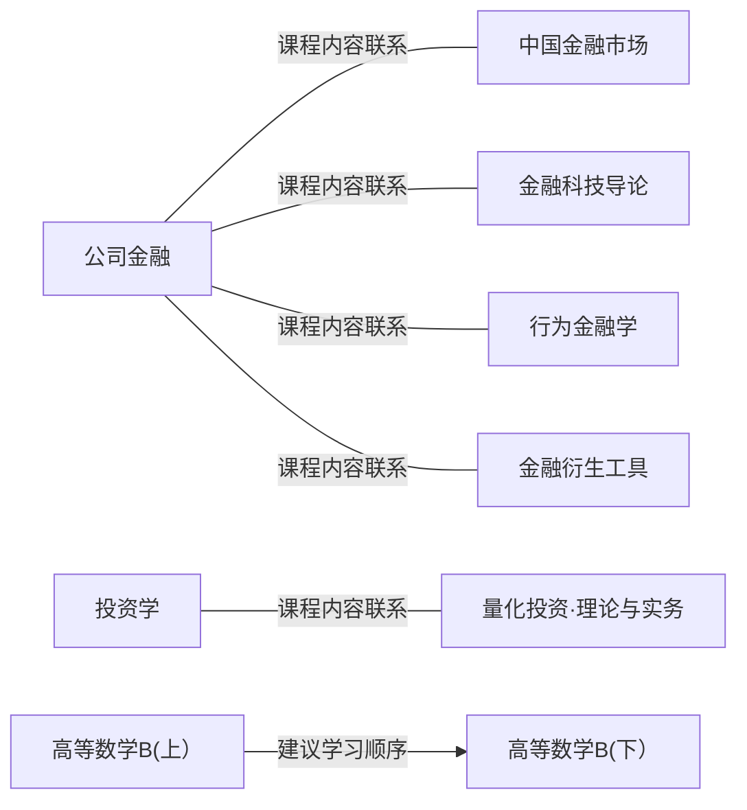

# 2023金融学（金融科技方向）专业“2+X”教学培养方案（大陆生适用）

国际金融学院 · 金融学(金融科技方向) · 方案 67293 · 31 个不同课程或科研条目。

[官方 Word](../originals/plan-67293.docx) · [教务详情](https://fdjwgl.fudan.edu.cn/manager/bizType/2/major-program-search/info/67293?skipAuth=1) · [方案快照](../raw/plan-67293.json.gz) · [年级目录](../README.md)

## 修读导读

- **建议先学**　《高等数学B(上）》（`MATH10004`） → 《高等数学B(下）》（`MATH10005`）。题名列出连续册次或级别。可把定义、定理的条件和典型例题保留下来，读后续分册时继续沿用。

- **可以对照着读**　《公司金融》（`MF20001`）与《中国金融市场》（`MF30002`）。两门课的题名都涉及金融。用同一个融资案例比较谁提供资金、谁承担风险，以及从哪个市场观察它。

- **查模块选课**　《投资学》（`MF20002`）、《中国经济》（`MF30003`）列在“专业核心教育课程”中。原表见 `/courseModules/6`。

## 课程关系图

图中展示部分关系。下表保留全部已建立的课程对，来源位置使用本方案 JSON Pointer。

## 先修与内容联系

| 类型 | 起点 | 终点 | 依据 | 原表定位 |
| --- | --- | --- | --- | --- |
| 建议学习顺序 | 高等数学B(上） (MATH10004) | 高等数学B(下） (MATH10005) | 同方案的课程题名具有连续分册或序号。  | `/courseModules/5/planCourses/0`、`/courseModules/5/planCourses/1` |
| 课程内容联系 | 公司金融 (MF20001) | 金融科技导论 (MF20004) | 本方案两门课程的题名均含“金融”，可据此对照这一主题。  | `/courseModules/6/planCourses/0`、`/courseModules/6/planCourses/6` |
| 课程内容联系 | 公司金融 (MF20001) | 中国金融市场 (MF30002) | 本方案两门课程的题名均含“金融”，可据此对照这一主题。  | `/courseModules/6/planCourses/0`、`/courseModules/6/planCourses/2` |
| 课程内容联系 | 公司金融 (MF20001) | 行为金融学 (MF30006) | 本方案两门课程的题名均含“金融”，可据此对照这一主题。  | `/courseModules/6/planCourses/0`、`/courseModules/11/planCourses/0` |
| 课程内容联系 | 公司金融 (MF20001) | 金融衍生工具 (MF30009) | 本方案两门课程的题名均含“金融”，可据此对照这一主题。  | `/courseModules/6/planCourses/0`、`/courseModules/11/planCourses/1` |
| 课程内容联系 | 投资学 (MF20002) | 量化投资：理论与实务 (MF40016) | 本方案两门课程的题名均含“投资”，可据此对照这一主题。  | `/courseModules/6/planCourses/1`、`/courseModules/12/planCourses/4` |

本次未从可定位的明确表述中确认课程对课程预修。学期安排、系列分册与编辑建议均保留各自的依据。

## 按原方案模块阅读

同一模块展示原表中的课程归属。模块内课程之间的先后仍须逐项查阅。

- **基础进阶模块（必修）**　中级微观经济学、金融数据科学和编程、中级宏观经济学、财务报表分析、金融经济实证分析方法（原表模块 9）
- **金融实务模块**　行为金融学、金融衍生工具（原表模块 11）
- **量化科技模块**　金融中的数学方法、机器学习、区块链与数字货币、社会科学数据挖掘、量化投资：理论与实务（原表模块 12）

## 课程表

同一课程在不同模块分别出现时，按原表逐行列出。季节字段保留原值。

| 课程 | 代码 | 学分 | 学期 | 模块 |
| --- | --- | ---: | --- | --- |
| 高等数学B(上） | MATH10004 | 5.0 | AUTUMN | 培养方案 / 专业培养课程 / 大类基础课程 |
| 高等数学B(下） | MATH10005 | 5.0 | SPRING | 培养方案 / 专业培养课程 / 大类基础课程 |
| 微观经济学 | ECON20003 | 3.0 | AUTUMN | 培养方案 / 专业培养课程 / 大类基础课程 |
| 宏观经济学 | ECON20004 | 3.0 | SPRING | 培养方案 / 专业培养课程 / 大类基础课程 |
| 会计学 | BA10003 | 3.0 | AUTUMN | 培养方案 / 专业培养课程 / 大类基础课程 |
| 公司金融 | MF20001 | 3.0 | AUTUMN | 培养方案 / 专业培养课程 / 专业核心教育课程 |
| 投资学 | MF20002 | 3.0 | SPRING | 培养方案 / 专业培养课程 / 专业核心教育课程 |
| 中国金融市场 | MF30002 | 3.0 | AUTUMN | 培养方案 / 专业培养课程 / 专业核心教育课程 |
| 中国经济 | MF30003 | 3.0 | AUTUMN | 培养方案 / 专业培养课程 / 专业核心教育课程 |
| 计量经济学 | MF20003 | 3.0 | SPRING | 培养方案 / 专业培养课程 / 专业核心教育课程 |
| 国际经济学 | MF30004 | 3.0 | SPRING、AUTUMN | 培养方案 / 专业培养课程 / 专业核心教育课程 |
| 金融科技导论 | MF20004 | 3.0 | SPRING | 培养方案 / 专业培养课程 / 专业核心教育课程 |
| 领导力课程系列一 | MF10001 | 1.0 | SPRING | 培养方案 / 专业培养课程 / 专业核心教育课程 |
| 领导力课程系列二 | MF20005 | 2.0 | SPRING | 培养方案 / 专业培养课程 / 专业核心教育课程 |
| 专业实习 | MF40012 | 3.0 | SPRING | 培养方案 / 专业培养课程 / 专业核心教育课程 |
| 计算机导论 | MF20006 | 3.0 | AUTUMN | 培养方案 / 专业培养课程 / 专业核心教育课程 |
| 行动学习 | MF30011 | 3.0 | AUTUMN | 培养方案 / 专业培养课程 / 专业核心教育课程 |
| 统计学基础与R软件 | MF20007 | 3.0 | AUTUMN | 培养方案 / 专业培养课程 / 专业核心教育课程 |
| 毕业论文 | MF40014 | 6.0 | SPRING | 培养方案 / 专业培养课程 / 专业核心教育课程 |
| 金融数据科学和编程 | MF30005 | 3.0 | AUTUMN | 培养方案 / 专业进阶模块M1 / 基础进阶模块（必修） |
| 中级宏观经济学 | MF30008 | 3.0 | SPRING、AUTUMN | 培养方案 / 专业进阶模块M1 / 基础进阶模块（必修） |
| 财务报表分析 | MF30010 | 3.0 | SPRING | 培养方案 / 专业进阶模块M1 / 基础进阶模块（必修） |
| 金融经济实证分析方法 | MF30012 | 3.0 | AUTUMN | 培养方案 / 专业进阶模块M1 / 基础进阶模块（必修） |
| 中级微观经济学 | MF20009 | 3.0 | AUTUMN | 培养方案 / 专业进阶模块M1 / 基础进阶模块（必修） |
| 行为金融学 | MF30006 | 3.0 | SPRING、AUTUMN | 培养方案 / 专业进阶模块M2、M3 / 金融实务模块 |
| 金融衍生工具 | MF30009 | 3.0 | SPRING、AUTUMN | 培养方案 / 专业进阶模块M2、M3 / 金融实务模块 |
| 区块链与数字货币 | MF40011 | 3.0 | SPRING、AUTUMN | 培养方案 / 专业进阶模块M2、M3 / 量化科技模块 |
| 社会科学数据挖掘 | MF40015 | 3.0 | SPRING、AUTUMN | 培养方案 / 专业进阶模块M2、M3 / 量化科技模块 |
| 机器学习 | MF30013 | 3.0 | SPRING、AUTUMN | 培养方案 / 专业进阶模块M2、M3 / 量化科技模块 |
| 金融中的数学方法 | MF20008 | 3.0 | SPRING、AUTUMN | 培养方案 / 专业进阶模块M2、M3 / 量化科技模块 |
| 量化投资：理论与实务 | MF40016 | 3.0 | SPRING、AUTUMN | 培养方案 / 专业进阶模块M2、M3 / 量化科技模块 |
