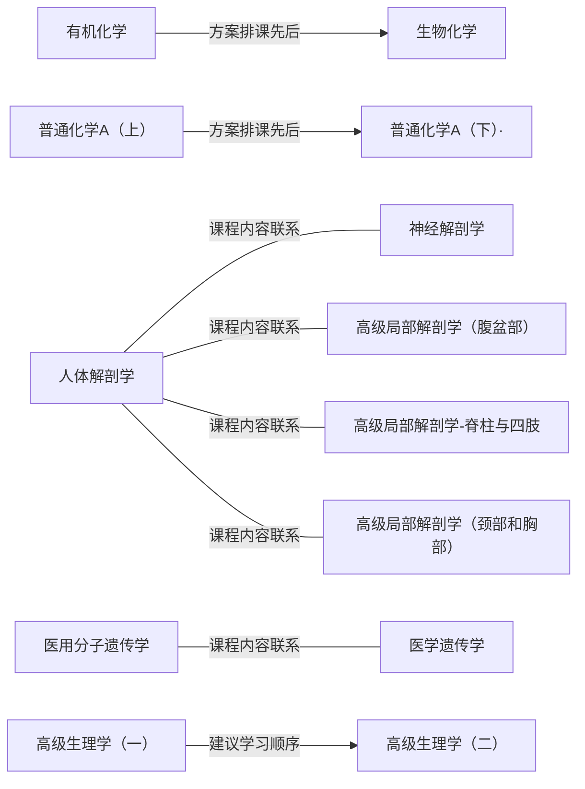

# 2025基础医学（强基计划） 本科培养方案

基础医学院 · 基础医学 · 方案 96685 · 91 个不同课程或科研条目。

[官方 Word](../originals/plan-96685.docx) · [教务详情](https://fdjwgl.fudan.edu.cn/manager/bizType/2/major-program-search/info/96685?skipAuth=1) · [方案快照](../raw/plan-96685.json.gz) · [年级目录](../README.md)

## 课程关系图

图中展示部分关系。下表保留全部已建立的课程对，来源位置使用本方案 JSON Pointer。

## 先修与内容联系

| 类型 | 起点 | 终点 | 依据 | 原表定位 |
| --- | --- | --- | --- | --- |
| 建议学习顺序 | 高级生理学（一） (BIOL60041) | 高级生理学（二） (BIOL80001) | 同方案的课程题名具有连续分册或序号。  | `/courseModules/13/planCourses/1`、`/courseModules/13/planCourses/2` |
| 建议学习顺序 | 有机化学 (CHEM10002) | 生物化学 (MED20048) | 官能团与有机反应是理解生物分子性质的基础。  | `/courseModules/5/planCourses/6`、`/courseModules/6/planCourses/3` |
| 建议学习顺序 | 普通化学A（上） (CHEM10003) | 普通化学A（下） (CHEM10004) | 同方案的课程题名具有连续分册或序号。  | `/courseModules/5/planCourses/1`、`/courseModules/5/planCourses/4` |
| 方案排课先后 | 有机化学 (CHEM10002) | 生物化学 (MED20048) | 同方案该课程全部明确数字学期均早于后者。  | `/courseModules/5/planCourses/6`、`/courseModules/6/planCourses/3` |
| 方案排课先后 | 普通化学A（上） (CHEM10003) | 普通化学A（下） (CHEM10004) | 同方案该课程全部明确数字学期均早于后者。  | `/courseModules/5/planCourses/1`、`/courseModules/5/planCourses/4` |
| 课程内容联系 | 人工智能病理学 (AIS631011) | 人工智能与多组学数据分析 (MED40001) | 本方案两门课程的题名均含“人工智能”，可据此对照这一主题。  | `/courseModules/11/planCourses/21`、`/courseModules/11/planCourses/14` |
| 课程内容联系 | 人工智能病理学 (AIS631011) | 分子病理学 (MED80028) | 本方案两门课程的题名均含“病理”，可据此对照这一主题。  | `/courseModules/11/planCourses/21`、`/courseModules/12/planCourses/4` |
| 课程内容联系 | 医用分子遗传学 (BIOL60035) | 医学遗传学 (MED30117) | 本方案两门课程的题名均含“遗传学”，可据此对照这一主题。  | `/courseModules/13/planCourses/3`、`/courseModules/6/planCourses/15` |
| 课程内容联系 | 医学分子细胞生物学 (BIOL60037) | 细胞生物学C (MED20030) | 本方案两门课程的题名均含“细胞生物学”，可据此对照这一主题。  | `/courseModules/13/planCourses/4`、`/courseModules/6/planCourses/1` |
| 课程内容联系 | 高级生理学（一） (BIOL60041) | 高级病理生理学 (MED60035) | 本方案两门课程的题名均含“生理学”，可据此对照这一主题。  | `/courseModules/13/planCourses/1`、`/courseModules/12/planCourses/3` |
| 课程内容联系 | 高级生理学（二） (BIOL80001) | 高级病理生理学 (MED60035) | 本方案两门课程的题名均含“生理学”，可据此对照这一主题。  | `/courseModules/13/planCourses/2`、`/courseModules/12/planCourses/3` |
| 课程内容联系 | 有机化学 (CHEM10002) | 有机化学实验I (CHEM10006) | 本方案两门课程的题名均含“有机化学”，可据此对照这一主题。  | `/courseModules/5/planCourses/6`、`/courseModules/5/planCourses/7` |
| 课程内容联系 | 人体解剖学 (MED20070) | 高级局部解剖学（腹盆部） (MED40003) | 本方案两门课程的题名均含“解剖”，可据此对照这一主题。  | `/courseModules/6/planCourses/4`、`/courseModules/11/planCourses/17` |
| 课程内容联系 | 人体解剖学 (MED20070) | 高级局部解剖学（颈部和胸部） (MED40004) | 本方案两门课程的题名均含“解剖”，可据此对照这一主题。  | `/courseModules/6/planCourses/4`、`/courseModules/11/planCourses/15` |
| 课程内容联系 | 人体解剖学 (MED20070) | 高级局部解剖学-脊柱与四肢 (MED40005) | 本方案两门课程的题名均含“解剖”，可据此对照这一主题。  | `/courseModules/6/planCourses/4`、`/courseModules/11/planCourses/16` |
| 课程内容联系 | 人体解剖学 (MED20070) | 神经解剖学 (MED60030) | 本方案两门课程的题名均含“解剖”，可据此对照这一主题。  | `/courseModules/6/planCourses/4`、`/courseModules/12/planCourses/1` |
| 课程内容联系 | 解码疾病的医学遗传学原理 (MED20082) | 医学遗传学 (MED30117) | 本方案两门课程的题名均含“遗传学”，可据此对照这一主题。  | `/courseModules/9/planCourses/2`、`/courseModules/6/planCourses/15` |
| 课程内容联系 | 内科学C (MED30021) | 内科实习 (MED40028) | 本方案两门课程的题名均含“内科”，可据此对照这一主题。  | `/courseModules/6/planCourses/18`、`/courseModules/21/planCourses/2` |
| 课程内容联系 | 外科学C (MED30022) | 外科实习 (MED40029) | 本方案两门课程的题名均含“外科”，可据此对照这一主题。  | `/courseModules/6/planCourses/19`、`/courseModules/21/planCourses/6` |
| 课程内容联系 | 儿科学C (MED30024) | 儿科实习 (MED40062) | 本方案两门课程的题名均含“儿科”，可据此对照这一主题。  | `/courseModules/6/planCourses/21`、`/courseModules/21/planCourses/7` |
| 课程内容联系 | 高级病理生理学 (MED60035) | 分子病理学 (MED80028) | 本方案两门课程的题名均含“病理”，可据此对照这一主题。  | `/courseModules/12/planCourses/3`、`/courseModules/12/planCourses/4` |

本次未从可定位的明确表述中确认课程对课程预修。学期安排、系列分册与编辑建议均保留各自的依据。

## 课程表

同一课程在不同模块分别出现时，按原表逐行列出。季节字段保留原值。

| 课程 | 代码 | 学分 | 学期 | 模块 |
| --- | --- | ---: | --- | --- |
| 高等数学C I | MATH10018 | 5.0 | 第1学期 | 培养方案 / 专业培养课程 / 学科基础课程 |
| 普通化学A（上） | CHEM10003 | 2.0 | 第1学期 | 培养方案 / 专业培养课程 / 学科基础课程 |
| 普通物理B | PHYS10002 | 3.0 | 第1学期 | 培养方案 / 专业培养课程 / 学科基础课程 |
| 基础物理实验 | PHYS10005 | 2.0 | 第1学期 | 培养方案 / 专业培养课程 / 学科基础课程 |
| 普通化学A（下） | CHEM10004 | 2.0 | 第2学期 | 培养方案 / 专业培养课程 / 学科基础课程 |
| 普通化学实验I | CHEM10005 | 1.0 | 第2学期 | 培养方案 / 专业培养课程 / 学科基础课程 |
| 有机化学 | CHEM10002 | 4.0 | 第2学期 | 培养方案 / 专业培养课程 / 学科基础课程 |
| 有机化学实验I | CHEM10006 | 1.0 | 第2学期 | 培养方案 / 专业培养课程 / 学科基础课程 |
| 基础医学导论 | MED20065 | 1.0 | 第2学期 | 培养方案 / 专业培养课程 / 专业核心教育课程 |
| 细胞生物学C | MED20030 | 2.0 | 第2学期 | 培养方案 / 专业培养课程 / 专业核心教育课程 |
| 卫生统计学C | PHPM30013 | 2.0 | 第2学期 | 培养方案 / 专业培养课程 / 专业核心教育课程 |
| 生物化学 | MED20048 | 4.0 | 第3学期 | 培养方案 / 专业培养课程 / 专业核心教育课程 |
| 人体解剖学 | MED20070 | 3.0 | 第3学期 | 培养方案 / 专业培养课程 / 专业核心教育课程 |
| 基础医学分论 | MED20077 | 5.0 | 第3学期 | 培养方案 / 专业培养课程 / 专业核心教育课程 |
| 神经系统疾病基础 | MED30094 | 5.0 | 第4学期 | 培养方案 / 专业培养课程 / 专业核心教育课程 |
| 循环血液系统疾病基础 | MED20079 | 4.5 | 第4学期 | 培养方案 / 专业培养课程 / 专业核心教育课程 |
| 呼吸系统疾病基础 | MED30095 | 2.5 | 第4学期 | 培养方案 / 专业培养课程 / 专业核心教育课程 |
| 免疫学B | MED20013 | 3.0 | 第4学期 | 培养方案 / 专业培养课程 / 专业核心教育课程 |
| 医学微生物学C | MED20060 | 3.5 | 第4学期 | 培养方案 / 专业培养课程 / 专业核心教育课程 |
| 寄生虫学C | MED30008 | 2.0 | 第5学期 | 培养方案 / 专业培养课程 / 专业核心教育课程 |
| 消化系统疾病基础 | MED30096 | 3.0 | 第5学期 | 培养方案 / 专业培养课程 / 专业核心教育课程 |
| 泌尿系统疾病基础 | MED30097 | 2.5 | 第5学期 | 培养方案 / 专业培养课程 / 专业核心教育课程 |
| 内分泌生殖系统疾病基础 | MED30098 | 2.5 | 第5学期 | 培养方案 / 专业培养课程 / 专业核心教育课程 |
| 医学遗传学 | MED30117 | 1.5 | 第5学期 | 培养方案 / 专业培养课程 / 专业核心教育课程 |
| 诊断学B | MED30019 | 3.5 | 第5学期 | 培养方案 / 专业培养课程 / 专业核心教育课程 |
| 医学伦理与法规 | MED30087 | 1.0 | 第5学期 | 培养方案 / 专业培养课程 / 专业核心教育课程 |
| 内科学C | MED30021 | 6.0 | 第6学期 | 培养方案 / 专业培养课程 / 专业核心教育课程 |
| 外科学C | MED30022 | 3.0 | 第6学期 | 培养方案 / 专业培养课程 / 专业核心教育课程 |
| 妇产科学C | MED30023 | 2.5 | 第6学期 | 培养方案 / 专业培养课程 / 专业核心教育课程 |
| 儿科学C | MED30024 | 2.5 | 第6学期 | 培养方案 / 专业培养课程 / 专业核心教育课程 |
| 医学文献检索与利用A | MED40012 | 2.5 | 第2学期 | 培养方案 / 专业进阶I |
| 代谢分子医学与疾病 | MED20081 | 2.0 | AUTUMN | 培养方案 / 专业进阶I |
| 解码疾病的医学遗传学原理 | MED20082 | 2.0 | SPRING | 培养方案 / 专业进阶I |
| 健康衰老 | MED50001 | 2.0 | AUTUMN | 培养方案 / 专业进阶I |
| 脑科学前沿 | MED20076 | 2.0 | SPRING | 培养方案 / 专业进阶I |
| 免疫学进阶 | MED50031 | 2.0 | SPRING | 培养方案 / 专业进阶I |
| 医学微生物学进阶 | MED50048 | 2.0 | AUTUMN | 培养方案 / 专业进阶I |
| 人体寄生虫感染的原理 | MED30144 | 2.0 | SPRING | 培养方案 / 专业进阶I |
| 生物医学信息学概论 | MED20054 | 2.0 | SPRING | 培养方案 / 专业进阶I |
| 医学物理实验 | PHYS40017 | 2.0 | 第2学期 | 培养方案 / 专业进阶II / 专业进阶II-公选课程 |
| 医学影像深度学习 | AIS310019 | 3.0 | AUTUMN | 培养方案 / 专业进阶II / 专业进阶II-公选课程 |
| 影像诊断学C | MED30020 | 2.5 | SPRING | 培养方案 / 专业进阶II / 专业进阶II-公选课程 |
| 医学心理学 | MED30011 | 1.5 | SPRING | 培养方案 / 专业进阶II / 专业进阶II-公选课程 |
| 中西医结合基础概论 | MED20018 | 2.0 | AUTUMN | 培养方案 / 专业进阶II / 专业进阶II-公选课程 |
| 法医学概论 | MED20020 | 2.0 | AUTUMN | 培养方案 / 专业进阶II / 专业进阶II-公选课程 |
| 基因组学-高通量测序实验与数据分析 | MED20092 | 2.0 | SUMMER | 培养方案 / 专业进阶II / 专业进阶II-公选课程 |
| 细胞超微结构与电镜技术 | MED20015 | 3.0 | SPRING、AUTUMN | 培养方案 / 专业进阶II / 专业进阶II-公选课程 |
| 疼痛生物医学 | MED20063 | 2.0 | SPRING、AUTUMN | 培养方案 / 专业进阶II / 专业进阶II-公选课程 |
| 实验动物学 | MED20029 | 2.0 | SPRING、AUTUMN | 培养方案 / 专业进阶II / 专业进阶II-公选课程 |
| 神经精神疾病Ⅱ | MED20056 | 2.0 | AUTUMN | 培养方案 / 专业进阶II / 专业进阶II-公选课程 |
| 免疫工程 | MED20019 | 2.0 | AUTUMN | 培养方案 / 专业进阶II / 专业进阶II-公选课程 |
| 人体的社交网络：共生微生物 | MED30064 | 2.0 | SUMMER | 培养方案 / 专业进阶II / 专业进阶II-公选课程 |
| 达尔文演化论和现代医学 | MED30074 | 2.0 | SUMMER | 培养方案 / 专业进阶II / 专业进阶II-公选课程 |
| 人工智能与多组学数据分析 | MED40001 | 2.5 | SPRING | 培养方案 / 专业进阶II / 专业进阶II-公选课程 |
| 高级局部解剖学（颈部和胸部） | MED40004 | 2.0 | SPRING、AUTUMN | 培养方案 / 专业进阶II / 专业进阶II-公选课程 |
| 高级局部解剖学-脊柱与四肢 | MED40005 | 2.0 | SPRING、AUTUMN | 培养方案 / 专业进阶II / 专业进阶II-公选课程 |
| 高级局部解剖学（腹盆部） | MED40003 | 2.0 | SPRING、AUTUMN | 培养方案 / 专业进阶II / 专业进阶II-公选课程 |
| 医学遗传与基因组医学 | MED40006 | 2.0 | SPRING、AUTUMN | 培养方案 / 专业进阶II / 专业进阶II-公选课程 |
| 医学实用AI | MED30003 | 1.0 | SPRING、AUTUMN | 培养方案 / 专业进阶II / 专业进阶II-公选课程 |
| 实用药物代谢动力学 | MED70001 | 2.0 | SPRING、AUTUMN | 培养方案 / 专业进阶II / 专业进阶II-公选课程 |
| 人工智能病理学 | AIS631011 | 3.0 | AUTUMN | 培养方案 / 专业进阶II / 专业进阶II-公选课程 |
| 现代组织化学（一） | MED60023 | 3.0 | SPRING、AUTUMN | 培养方案 / 专业进阶II / 专业进阶II-本研课程--医学形态学学科群方向 |
| 神经解剖学 | MED60030 | 3.5 | SPRING | 培养方案 / 专业进阶II / 专业进阶II-本研课程--医学形态学学科群方向 |
| 神经培养 | MED60031 | 1.5 | SPRING | 培养方案 / 专业进阶II / 专业进阶II-本研课程--医学形态学学科群方向 |
| 高级病理生理学 | MED60035 | 2.0 | AUTUMN | 培养方案 / 专业进阶II / 专业进阶II-本研课程--医学形态学学科群方向 |
| 分子病理学 | MED80028 | 2.0 | AUTUMN | 培养方案 / 专业进阶II / 专业进阶II-本研课程--医学形态学学科群方向 |
| 高级生化（一）——生物大分子的结构与功能 | BIOL60033 | 3.0 | SPRING | 培养方案 / 专业进阶II / 专业进阶II-本研课程--分子生物学与生理学学科群方向 |
| 高级生理学（一） | BIOL60041 | 3.5 | AUTUMN | 培养方案 / 专业进阶II / 专业进阶II-本研课程--分子生物学与生理学学科群方向 |
| 高级生理学（二） | BIOL80001 | 3.0 | AUTUMN | 培养方案 / 专业进阶II / 专业进阶II-本研课程--分子生物学与生理学学科群方向 |
| 医用分子遗传学 | BIOL60035 | 2.5 | AUTUMN | 培养方案 / 专业进阶II / 专业进阶II-本研课程--分子生物学与生理学学科群方向 |
| 医学分子细胞生物学 | BIOL60037 | 2.0 | SPRING | 培养方案 / 专业进阶II / 专业进阶II-本研课程--分子生物学与生理学学科群方向 |
| 现代免疫学 | MED80021 | 4.0 | AUTUMN | 培养方案 / 专业进阶II / 专业进阶II-本研课程--病原生物学与免疫学学科群方向 |
| 人体寄生虫学进展 | MED80025 | 3.0 | AUTUMN | 培养方案 / 专业进阶II / 专业进阶II-本研课程--病原生物学与免疫学学科群方向 |
| 高级药理学进展 | PHAR80002 | 2.0 | AUTUMN | 培养方案 / 专业进阶II / 专业进阶II-本研课程--病原生物学与免疫学学科群方向 |
| 医学分子病毒学（一） | MED60028 | 2.0 | AUTUMN | 培养方案 / 专业进阶II / 专业进阶II-本研课程--病原生物学与免疫学学科群方向 |
| 现代医学微生物学（一） | MED60027 | 2.0 | AUTUMN | 培养方案 / 专业进阶II / 专业进阶II-本研课程--病原生物学与免疫学学科群方向 |
| 发育神经生物学（一） | MED60032 | 2.5 | AUTUMN | 培养方案 / 专业进阶II / 专业进阶II-本研课程--神经生物学学科群方向 |
| 神经科学专题 | BIOL60032 | 2.0 | AUTUMN | 培养方案 / 专业进阶II / 专业进阶II-本研课程--神经生物学学科群方向 |
| 神经生物学 | BIOL60038 | 4.0 | AUTUMN | 培养方案 / 专业进阶II / 专业进阶II-本研课程--神经生物学学科群方向 |
| 药物耐受成瘾与脑的高级功能 | PHAR80001 | 4.0 | AUTUMN | 培养方案 / 专业进阶II / 专业进阶II-本研课程--神经生物学学科群方向 |
| 脑功能和脑疾病研究进展 | BIOL60031 | 2.0 | SPRING、AUTUMN | 培养方案 / 专业进阶II / 专业进阶II-本研课程--神经生物学学科群方向 |
| 基础医学核心实验 | MED20002 | 2.0 | 第3学期 | 融合创新能力 |
| 医学科学的前沿创新和实践 | GEIN10036 | 1.0 | 第1学期 | 融合创新能力 |
| 内科实习 | MED40028 | 6.0 | 第7学期 | 融合创新能力 |
| 复芏计划(FDUROP) | 102 | 0.0 |  | 融合创新能力 |
| 基础医学综合实验 | MED20001 | 1.5 | 第4学期 | 融合创新能力 |
| 毕业论文 | MED40100 | 6.0 | 第10学期 | 融合创新能力 |
| 外科实习 | MED40029 | 6.0 | 第7学期 | 融合创新能力 |
| 儿科实习 | MED40062 | 4.0 | 第7学期 | 融合创新能力 |
| 妇产科实习 | MED40063 | 4.0 | 第7学期 | 融合创新能力 |
| 专业实习 | MED40099 | 10.0 | 第9学期 | 融合创新能力 |
