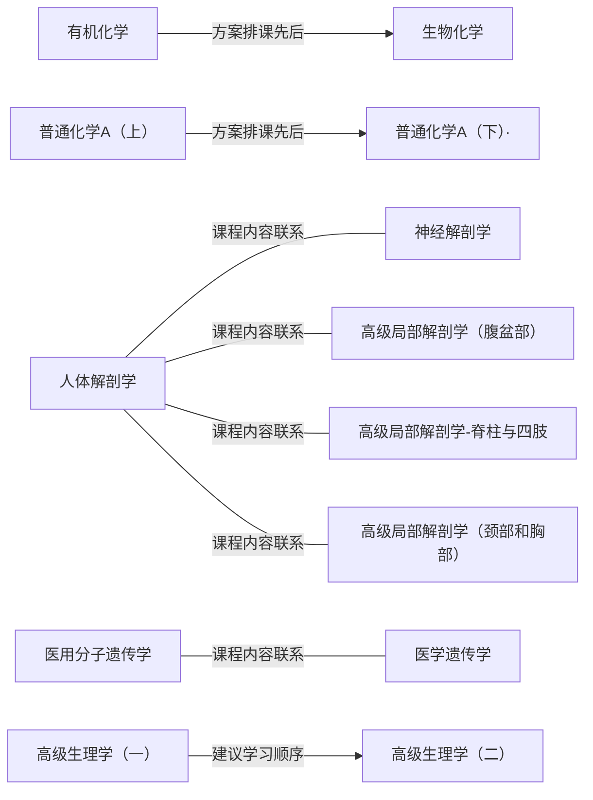

# 2025基础医学本科培养方案港澳台适用

基础医学院 · 基础医学 · 方案 99838 · 681 个不同课程或科研条目。

[官方 Word](../originals/plan-99838.docx) · [教务详情](https://fdjwgl.fudan.edu.cn/manager/bizType/2/major-program-search/info/99838?skipAuth=1) · [方案快照](../raw/plan-99838.json.gz) · [年级目录](../README.md)

## 修读导读

- **建议先学**　《有机化学》（`CHEM10002`） → 《生物化学》（`MED20048`）。官能团与有机反应是理解生物分子性质的基础。方案分别列在第2、3学期。

- **可以对照着读**　《人体解剖学》（`MED20070`）与《神经解剖学》（`MED60030`）。两门课的题名都涉及解剖。用同一身体区域对照结构名称、空间位置和相邻关系。

- **查模块选课**　《基础医学导论》（`MED20065`）、《基础医学分论》（`MED20077`）列在“专业核心教育课程”中。原表见 `/courseModules/4`。

## 课程关系图

图中展示部分关系。下表保留全部已建立的课程对，来源位置使用本方案 JSON Pointer。

## 先修与内容联系

| 类型 | 起点 | 终点 | 依据 | 原表定位 |
| --- | --- | --- | --- | --- |
| 建议学习顺序 | 高级生理学（一） (BIOL60041) | 高级生理学（二） (BIOL80001) | 同方案的课程题名具有连续分册或序号。  | `/courseModules/11/planCourses/1`、`/courseModules/11/planCourses/2` |
| 建议学习顺序 | 有机化学 (CHEM10002) | 生物化学 (MED20048) | 官能团与有机反应是理解生物分子性质的基础。  | `/courseModules/3/planCourses/6`、`/courseModules/4/planCourses/3` |
| 建议学习顺序 | 普通化学A（上） (CHEM10003) | 普通化学A（下） (CHEM10004) | 同方案的课程题名具有连续分册或序号。  | `/courseModules/3/planCourses/1`、`/courseModules/3/planCourses/4` |
| 方案排课先后 | 有机化学 (CHEM10002) | 生物化学 (MED20048) | 同方案该课程全部明确数字学期均早于后者。  | `/courseModules/3/planCourses/6`、`/courseModules/4/planCourses/3` |
| 方案排课先后 | 普通化学A（上） (CHEM10003) | 普通化学A（下） (CHEM10004) | 同方案该课程全部明确数字学期均早于后者。  | `/courseModules/3/planCourses/1`、`/courseModules/3/planCourses/4` |
| 课程内容联系 | 人工智能病理学 (AIS631011) | 人工智能与多组学数据分析 (MED40001) | 本方案两门课程的题名均含“人工智能”，可据此对照这一主题。  | `/courseModules/9/planCourses/21`、`/courseModules/9/planCourses/14` |
| 课程内容联系 | 人工智能病理学 (AIS631011) | 分子病理学 (MED80028) | 本方案两门课程的题名均含“病理”，可据此对照这一主题。  | `/courseModules/9/planCourses/21`、`/courseModules/10/planCourses/4` |
| 课程内容联系 | 医用分子遗传学 (BIOL60035) | 医学遗传学 (MED30117) | 本方案两门课程的题名均含“遗传学”，可据此对照这一主题。  | `/courseModules/11/planCourses/3`、`/courseModules/4/planCourses/15` |
| 课程内容联系 | 医学分子细胞生物学 (BIOL60037) | 细胞生物学C (MED20030) | 本方案两门课程的题名均含“细胞生物学”，可据此对照这一主题。  | `/courseModules/11/planCourses/4`、`/courseModules/4/planCourses/1` |
| 课程内容联系 | 高级生理学（一） (BIOL60041) | 高级病理生理学 (MED60035) | 本方案两门课程的题名均含“生理学”，可据此对照这一主题。  | `/courseModules/11/planCourses/1`、`/courseModules/10/planCourses/3` |
| 课程内容联系 | 高级生理学（二） (BIOL80001) | 高级病理生理学 (MED60035) | 本方案两门课程的题名均含“生理学”，可据此对照这一主题。  | `/courseModules/11/planCourses/2`、`/courseModules/10/planCourses/3` |
| 课程内容联系 | 有机化学 (CHEM10002) | 有机化学实验I (CHEM10006) | 本方案两门课程的题名均含“有机化学”，可据此对照这一主题。  | `/courseModules/3/planCourses/6`、`/courseModules/3/planCourses/7` |
| 课程内容联系 | 人体解剖学 (MED20070) | 高级局部解剖学（腹盆部） (MED40003) | 本方案两门课程的题名均含“解剖”，可据此对照这一主题。  | `/courseModules/4/planCourses/4`、`/courseModules/9/planCourses/17` |
| 课程内容联系 | 人体解剖学 (MED20070) | 高级局部解剖学（颈部和胸部） (MED40004) | 本方案两门课程的题名均含“解剖”，可据此对照这一主题。  | `/courseModules/4/planCourses/4`、`/courseModules/9/planCourses/15` |
| 课程内容联系 | 人体解剖学 (MED20070) | 高级局部解剖学-脊柱与四肢 (MED40005) | 本方案两门课程的题名均含“解剖”，可据此对照这一主题。  | `/courseModules/4/planCourses/4`、`/courseModules/9/planCourses/16` |
| 课程内容联系 | 人体解剖学 (MED20070) | 神经解剖学 (MED60030) | 本方案两门课程的题名均含“解剖”，可据此对照这一主题。  | `/courseModules/4/planCourses/4`、`/courseModules/10/planCourses/1` |
| 课程内容联系 | 解码疾病的医学遗传学原理 (MED20082) | 医学遗传学 (MED30117) | 本方案两门课程的题名均含“遗传学”，可据此对照这一主题。  | `/courseModules/7/planCourses/2`、`/courseModules/4/planCourses/15` |
| 课程内容联系 | 内科学C (MED30021) | 内科实习 (MED40028) | 本方案两门课程的题名均含“内科”，可据此对照这一主题。  | `/courseModules/4/planCourses/18`、`/courseModules/19/planCourses/3` |
| 课程内容联系 | 外科学C (MED30022) | 外科实习 (MED40029) | 本方案两门课程的题名均含“外科”，可据此对照这一主题。  | `/courseModules/4/planCourses/19`、`/courseModules/19/planCourses/6` |
| 课程内容联系 | 儿科学C (MED30024) | 儿科实习 (MED40062) | 本方案两门课程的题名均含“儿科”，可据此对照这一主题。  | `/courseModules/4/planCourses/21`、`/courseModules/19/planCourses/7` |
| 课程内容联系 | 高级病理生理学 (MED60035) | 分子病理学 (MED80028) | 本方案两门课程的题名均含“病理”，可据此对照这一主题。  | `/courseModules/10/planCourses/3`、`/courseModules/10/planCourses/4` |

本次未从可定位的明确表述中确认课程对课程预修。学期安排、系列分册与编辑建议均保留各自的依据。

## 课程表

同一课程在不同模块分别出现时，按原表逐行列出。季节字段保留原值。

| 课程 | 代码 | 学分 | 学期 | 模块 |
| --- | --- | ---: | --- | --- |
| 《艺术即经验》导读 | GECC10019 | 2.0 | SPRING、AUTUMN | 培养方案 / 通识教育课程 |
| 文学与跨文化阅读 | GECC10028 | 2.0 | SPRING、AUTUMN | 培养方案 / 通识教育课程 |
| 经济与社会 | GECC10032 | 3.0 | SPRING、AUTUMN | 培养方案 / 通识教育课程 |
| 化学与人类 | GECC10002 | 2.0 | SPRING、AUTUMN | 培养方案 / 通识教育课程 |
| 宜居地球与人类未来 | GECC10001 | 2.0 | SPRING、AUTUMN | 培养方案 / 通识教育课程 |
| 游戏与文化 | GECC10026 | 2.0 | SPRING、AUTUMN | 培养方案 / 通识教育课程 |
| 学术英语（科学技术） | GEEF30013 | 2.0 | SPRING、AUTUMN | 培养方案 / 通识教育课程 |
| 跨文化交际 | GEEF30029 | 2.0 | SPRING、AUTUMN | 培养方案 / 通识教育课程 |
| 英语视听 | GEEF20004 | 2.0 | SPRING、AUTUMN | 培养方案 / 通识教育课程 |
| 学术英语（科学技术） | GEEF30013 | 2.0 | SPRING、AUTUMN | 培养方案 / 通识教育课程 |
| 跨文化交际 | GEEF30029 | 2.0 | SPRING、AUTUMN | 培养方案 / 通识教育课程 |
| 英语视听 | GEEF20004 | 2.0 | SPRING、AUTUMN | 培养方案 / 通识教育课程 |
| 传统文化资源的保护与利用 | GEIN10003 | 1.0 | SPRING、AUTUMN | 培养方案 / 通识教育课程 |
| 心理健康与大学生活 | GEMH10013 | 1.0 | AUTUMN | 培养方案 / 通识教育课程 |
| 古典诗词导读 | GECC10004 | 2.0 | SPRING、AUTUMN | 培养方案 / 通识教育课程 |
| 笛卡尔《谈谈方法》导读 | GECC20009 | 2.0 | SPRING、AUTUMN | 培养方案 / 通识教育课程 |
| 莎士比亚作品撷英 | GECC10045 | 3.0 | SPRING、AUTUMN | 培养方案 / 通识教育课程 |
| 传播与社会 | GECC10089 | 3.0 | SPRING、AUTUMN | 培养方案 / 通识教育课程 |
| 化学与中国文明 | GECC10003 | 3.0 | SPRING、AUTUMN | 培养方案 / 通识教育课程 |
| 生命进化论 | GECC20002 | 2.0 | SPRING、AUTUMN | 培养方案 / 通识教育课程 |
| 音乐理论与实践 | GECC10036 | 2.0 | SPRING、AUTUMN | 培养方案 / 通识教育课程 |
| 人类政治的哲学原理 | GECC10118 | 0.5 | SPRING、AUTUMN | 培养方案 / 通识教育课程 |
| 复旦大学英语水平测试 | GEEF30032 | 0.0 | SPRING、AUTUMN | 培养方案 / 通识教育课程 |
| 大学英语高阶课程 | GEEF30033 | 2.0 | SPRING、AUTUMN | 培养方案 / 通识教育课程 |
| 学术英语（综合） | GEEF30023 | 2.0 | SPRING、AUTUMN | 培养方案 / 通识教育课程 |
| 学术英语（社会科学） | GEEF30014 | 2.0 | SPRING、AUTUMN | 培养方案 / 通识教育课程 |
| 中外大学文化对比研究 | GEEF30024 | 2.0 | SPRING、AUTUMN | 培养方案 / 通识教育课程 |
| 基础俄语Ⅰ | GESF10005 | 2.0 | SPRING、AUTUMN | 培养方案 / 通识教育课程 |
| 复旦大学英语水平测试 | GEEF30032 | 0.0 | SPRING、AUTUMN | 培养方案 / 通识教育课程 |
| 大学英语进阶课程 | GEEF20016 | 2.0 | SPRING、AUTUMN | 培养方案 / 通识教育课程 |
| 实用交际英语口语 | GEEF20006 | 2.0 | SPRING、AUTUMN | 培养方案 / 通识教育课程 |
| 英美文化概论 | GEEF20003 | 2.0 | SPRING、AUTUMN | 培养方案 / 通识教育课程 |
| 大学英语高阶课程 | GEEF30033 | 2.0 | SPRING、AUTUMN | 培养方案 / 通识教育课程 |
| 学术英语（综合） | GEEF30023 | 2.0 | SPRING、AUTUMN | 培养方案 / 通识教育课程 |
| 学术英语（社会科学） | GEEF30014 | 2.0 | SPRING、AUTUMN | 培养方案 / 通识教育课程 |
| 中外大学文化对比研究 | GEEF30024 | 2.0 | SPRING、AUTUMN | 培养方案 / 通识教育课程 |
| 复旦大学英语水平测试 | GEEF30032 | 0.0 | SPRING、AUTUMN | 培养方案 / 通识教育课程 |
| 综合英语 | GEEF10001 | 2.0 | AUTUMN | 培养方案 / 通识教育课程 |
| 大学英语进阶课程 | GEEF20016 | 2.0 | SPRING、AUTUMN | 培养方案 / 通识教育课程 |
| 实用交际英语口语 | GEEF20006 | 2.0 | SPRING、AUTUMN | 培养方案 / 通识教育课程 |
| 英美文化概论 | GEEF20003 | 2.0 | SPRING、AUTUMN | 培养方案 / 通识教育课程 |
| 大学英语高阶课程 | GEEF30033 | 2.0 | SPRING、AUTUMN | 培养方案 / 通识教育课程 |
| 学术英语（综合） | GEEF30023 | 2.0 | SPRING、AUTUMN | 培养方案 / 通识教育课程 |
| 学术英语（科学技术） | GEEF30013 | 2.0 | SPRING、AUTUMN | 培养方案 / 通识教育课程 |
| 跨文化交际 | GEEF30029 | 2.0 | SPRING、AUTUMN | 培养方案 / 通识教育课程 |
| Python程序设计 | AIB110002 | 1.0 | 第1学期、第2学期 | 培养方案 / 通识教育课程 |
| 人工智能基础 | AIB210002 | 3.0 | SPRING、AUTUMN | 培养方案 / 通识教育课程 |
| 木兰拳 | GEPE10007 | 1.0 | AUTUMN | 培养方案 / 通识教育课程 |
| 军事理论 | GEND10001 | 2.0 | SPRING、AUTUMN | 培养方案 / 通识教育课程 |
| 文物艺术品保护与修复 | GEIN10039 | 1.0 | SPRING、AUTUMN | 培养方案 / 通识教育课程 |
| 国学涵养与心理成长 | GEMH10016 | 1.0 | AUTUMN | 培养方案 / 通识教育课程 |
| 庄子导读 | GECC10005 | 2.0 | SPRING、AUTUMN | 培养方案 / 通识教育课程 |
| 康德《实践理性批判》精读 | GECC20013 | 2.0 | SPRING、AUTUMN | 培养方案 / 通识教育课程 |
| 从特洛伊到漫威世界：西方叙事传统的演变与发展 | GECC10046 | 2.0 | SPRING、AUTUMN | 培养方案 / 通识教育课程 |
| 人权与法 | GECC10090 | 2.0 | SPRING、AUTUMN | 培养方案 / 通识教育课程 |
| 从计算到智能 | GECC10029 | 2.0 | SPRING、AUTUMN | 培养方案 / 通识教育课程 |
| 微生物与人类健康 | GECC20003 | 2.0 | SPRING、AUTUMN | 培养方案 / 通识教育课程 |
| 中国戏曲·京剧 | GECC10037 | 2.0 | SPRING、AUTUMN | 培养方案 / 通识教育课程 |
| 国家治理的科学逻辑 | GECC10119 | 0.5 | SPRING、AUTUMN | 培养方案 / 通识教育课程 |
| 英语公众演说 | GEEF30012 | 2.0 | SPRING、AUTUMN | 培养方案 / 通识教育课程 |
| 学术英语（文史哲） | GEEF30015 | 2.0 | SPRING、AUTUMN | 培养方案 / 通识教育课程 |
| 西方儒学研究名著导读 | GEEF30021 | 2.0 | SPRING、AUTUMN | 培养方案 / 通识教育课程 |
| 基础俄语Ⅱ | GESF20001 | 2.0 | SPRING、AUTUMN | 培养方案 / 通识教育课程 |
| 英语口译 | GEEF20008 | 2.0 | SPRING、AUTUMN | 培养方案 / 通识教育课程 |
| 影视与英美文化讨论 | GEEF20005 | 2.0 | SPRING、AUTUMN | 培养方案 / 通识教育课程 |
| 英语公众演说 | GEEF30012 | 2.0 | SPRING、AUTUMN | 培养方案 / 通识教育课程 |
| 学术英语（文史哲） | GEEF30015 | 2.0 | SPRING、AUTUMN | 培养方案 / 通识教育课程 |
| 西方儒学研究名著导读 | GEEF30021 | 2.0 | SPRING、AUTUMN | 培养方案 / 通识教育课程 |
| 英语口译 | GEEF20008 | 2.0 | SPRING、AUTUMN | 培养方案 / 通识教育课程 |
| 影视与英美文化讨论 | GEEF20005 | 2.0 | SPRING、AUTUMN | 培养方案 / 通识教育课程 |
| 英语公众演说 | GEEF30012 | 2.0 | SPRING、AUTUMN | 培养方案 / 通识教育课程 |
| 学术英语（社会科学） | GEEF30014 | 2.0 | SPRING、AUTUMN | 培养方案 / 通识教育课程 |
| 中外大学文化对比研究 | GEEF30024 | 2.0 | SPRING、AUTUMN | 培养方案 / 通识教育课程 |
| C程序设计 | AIB110001 | 1.0 | 第1学期、第2学期 | 培养方案 / 通识教育课程 |
| 深度学习基础 | AIB310003 | 3.0 | SPRING、AUTUMN | 培养方案 / 通识教育课程 |
| 木兰扇 | GEPE10008 | 1.0 | SPRING | 培养方案 / 通识教育课程 |
| 军事技能 | GEND10002 | 2.0 | SUMMER | 培养方案 / 通识教育课程 |
| 个人基因组检测创业实践 | GEIN10040 | 2.0 | SPRING、AUTUMN | 培养方案 / 通识教育课程 |
| 静心冥想与心理健康 | GEMH10017 | 1.0 | SPRING | 培养方案 / 通识教育课程 |
| 《周易》与中华审美文化 | GECC10006 | 2.0 | SPRING、AUTUMN | 培养方案 / 通识教育课程 |
| 《论法的精神》导读 | GECC20014 | 2.0 | SPRING、AUTUMN | 培养方案 / 通识教育课程 |
| 英国中世纪文学与文化 | GECC10048 | 2.0 | SPRING、AUTUMN | 培养方案 / 通识教育课程 |
| 法治理念与实践 | GECC10091 | 2.0 | SPRING、AUTUMN | 培养方案 / 通识教育课程 |
| 计算思维 | GECC10030 | 2.0 | SPRING、AUTUMN | 培养方案 / 通识教育课程 |
| 人类进化 | GECC20004 | 3.0 | SPRING、AUTUMN | 培养方案 / 通识教育课程 |
| 中国戏曲·昆曲 | GECC10038 | 2.0 | SPRING、AUTUMN | 培养方案 / 通识教育课程 |
| 动物考古与古代文明 | GECC10120 | 0.5 | SPRING、AUTUMN | 培养方案 / 通识教育课程 |
| 英语论辩与思辨 | GEEF30018 | 2.0 | SPRING、AUTUMN | 培养方案 / 通识教育课程 |
| 学术英语（管理科学） | GEEF30016 | 2.0 | SPRING、AUTUMN | 培养方案 / 通识教育课程 |
| 中美文化对比研究 | GEEF30001 | 2.0 | SPRING、AUTUMN | 培养方案 / 通识教育课程 |
| 基础法语Ⅰ | GESF10006 | 2.0 | SPRING、AUTUMN | 培养方案 / 通识教育课程 |
| 英语论说文写作 | GEEF20011 | 2.0 | SPRING、AUTUMN | 培养方案 / 通识教育课程 |
| 文学翻译鉴赏 | GEEF20013 | 2.0 | SPRING、AUTUMN | 培养方案 / 通识教育课程 |
| 英语论辩与思辨 | GEEF30018 | 2.0 | SPRING、AUTUMN | 培养方案 / 通识教育课程 |
| 学术英语（管理科学） | GEEF30016 | 2.0 | SPRING、AUTUMN | 培养方案 / 通识教育课程 |
| 中美文化对比研究 | GEEF30001 | 2.0 | SPRING、AUTUMN | 培养方案 / 通识教育课程 |
| 英语论说文写作 | GEEF20011 | 2.0 | SPRING、AUTUMN | 培养方案 / 通识教育课程 |
| 文学翻译鉴赏 | GEEF20013 | 2.0 | SPRING、AUTUMN | 培养方案 / 通识教育课程 |
| 英语论辩与思辨 | GEEF30018 | 2.0 | SPRING、AUTUMN | 培养方案 / 通识教育课程 |
| 学术英语（文史哲） | GEEF30015 | 2.0 | SPRING、AUTUMN | 培养方案 / 通识教育课程 |
| 西方儒学研究名著导读 | GEEF30021 | 2.0 | SPRING、AUTUMN | 培养方案 / 通识教育课程 |
| 人工智能程序设计 | AIB210001 | 1.0 | 第1学期、第2学期 | 培养方案 / 通识教育课程 |
| 具身智能引论 | AIB310002 | 3.0 | SPRING、AUTUMN | 培养方案 / 通识教育课程 |
| 十六式太极拳 | GEPE10009 | 1.0 | AUTUMN | 培养方案 / 通识教育课程 |
| 旅游创新创业理论与实践 | GEIN10055 | 1.0 | SPRING、AUTUMN | 培养方案 / 通识教育课程 |
| 健康行为心理 | GEMH10005 | 1.0 | SPRING、AUTUMN | 培养方案 / 通识教育课程 |
| 唐诗经典与中国文化传统 | GECC10007 | 2.0 | SPRING、AUTUMN | 培养方案 / 通识教育课程 |
| 《法哲学原理》导读 | GECC20015 | 2.0 | SPRING、AUTUMN | 培养方案 / 通识教育课程 |
| 卡夫卡与全球现代性 | GECC10049 | 3.0 | SPRING、AUTUMN | 培养方案 / 通识教育课程 |
| 法律与科技文明 | GECC10092 | 2.0 | SPRING、AUTUMN | 培养方案 / 通识教育课程 |
| 信号、信息与社会 | GECC10088 | 2.0 | SPRING、AUTUMN | 培养方案 / 通识教育课程 |
| 生态学：管理大自然的经济学 | GECC20005 | 3.0 | SPRING、AUTUMN | 培养方案 / 通识教育课程 |
| 陶艺与雕塑 | GECC10039 | 2.0 | SPRING、AUTUMN | 培养方案 / 通识教育课程 |
| 地球、城市与人类未来 | GECC10121 | 1.0 | SPRING、AUTUMN | 培养方案 / 通识教育课程 |
| 国际学术交流 | GEEF30019 | 2.0 | SPRING、AUTUMN | 培养方案 / 通识教育课程 |
| 医学英语论文写作 | GEEF30028 | 2.0 | SPRING、AUTUMN | 培养方案 / 通识教育课程 |
| 数智时代的翻译与跨文化传播 | GEEF30005 | 2.0 | SPRING、AUTUMN | 培养方案 / 通识教育课程 |
| 基础法语Ⅱ | GESF20002 | 2.0 | SPRING、AUTUMN | 培养方案 / 通识教育课程 |
| 高级英语 | GEEF20012 | 2.0 | SPRING、AUTUMN | 培养方案 / 通识教育课程 |
| 美国文学选读 | GEEF20014 | 2.0 | SPRING、AUTUMN | 培养方案 / 通识教育课程 |
| 国际学术交流 | GEEF30019 | 2.0 | SPRING、AUTUMN | 培养方案 / 通识教育课程 |
| 医学英语论文写作 | GEEF30028 | 2.0 | SPRING、AUTUMN | 培养方案 / 通识教育课程 |
| 数智时代的翻译与跨文化传播 | GEEF30005 | 2.0 | SPRING、AUTUMN | 培养方案 / 通识教育课程 |
| 高级英语 | GEEF20012 | 2.0 | SPRING、AUTUMN | 培养方案 / 通识教育课程 |
| 美国文学选读 | GEEF20014 | 2.0 | SPRING、AUTUMN | 培养方案 / 通识教育课程 |
| 国际学术交流 | GEEF30019 | 2.0 | SPRING、AUTUMN | 培养方案 / 通识教育课程 |
| 学术英语（管理科学） | GEEF30016 | 2.0 | SPRING、AUTUMN | 培养方案 / 通识教育课程 |
| 中美文化对比研究 | GEEF30001 | 2.0 | SPRING、AUTUMN | 培养方案 / 通识教育课程 |
| 生成式软件开发 | AIB110005 | 3.0 | SPRING、AUTUMN | 培养方案 / 通识教育课程 |
| 陈式太极拳 | GEPE10010 | 1.0 | SPRING | 培养方案 / 通识教育课程 |
| 哲学视野下的价值关怀与创业实践 | GEIN10045 | 1.0 | SPRING、AUTUMN | 培养方案 / 通识教育课程 |
| 领导力与自我管理 | GEMH10011 | 1.0 | SPRING、AUTUMN | 培养方案 / 通识教育课程 |
| 唐宋八大家古文 | GECC10008 | 2.0 | SPRING、AUTUMN | 培养方案 / 通识教育课程 |
| 《尼各马可伦理学》导读 | GECC20016 | 2.0 | SPRING、AUTUMN | 培养方案 / 通识教育课程 |
| 英国经典小说与19世纪社会 | GECC10050 | 2.0 | SPRING、AUTUMN | 培养方案 / 通识教育课程 |
| 全球化时代的法律冲突与对话 | GECC10093 | 2.0 | SPRING、AUTUMN | 培养方案 / 通识教育课程 |
| 无处不在的大分子 | GECC10094 | 2.0 | SPRING、AUTUMN | 培养方案 / 通识教育课程 |
| 生物技术与人类社会 | GECC20006 | 3.0 | SPRING、AUTUMN | 培养方案 / 通识教育课程 |
| 戏剧经典与表达·西方戏剧 | GECC10040 | 2.0 | SPRING、AUTUMN | 培养方案 / 通识教育课程 |
| 社会学视野下的关系和金钱 | GECC10122 | 1.0 | AUTUMN | 培养方案 / 通识教育课程 |
| 研究论文写作 | GEEF30020 | 2.0 | SPRING、AUTUMN | 培养方案 / 通识教育课程 |
| 医学英语视听说 | GEEF30025 | 2.0 | SPRING、AUTUMN | 培养方案 / 通识教育课程 |
| 基础日语Ⅰ | GESF10007 | 2.0 | SPRING、AUTUMN | 培养方案 / 通识教育课程 |
| 数智化实用英文写作 | GEEF20002 | 2.0 | SPRING、AUTUMN | 培养方案 / 通识教育课程 |
| 文化阅读 | GEEF20009 | 2.0 | SPRING、AUTUMN | 培养方案 / 通识教育课程 |
| 研究论文写作 | GEEF30020 | 2.0 | SPRING、AUTUMN | 培养方案 / 通识教育课程 |
| 医学英语视听说 | GEEF30025 | 2.0 | SPRING、AUTUMN | 培养方案 / 通识教育课程 |
| 数智化实用英文写作 | GEEF20002 | 2.0 | SPRING、AUTUMN | 培养方案 / 通识教育课程 |
| 文化阅读 | GEEF20009 | 2.0 | SPRING、AUTUMN | 培养方案 / 通识教育课程 |
| 研究论文写作 | GEEF30020 | 2.0 | SPRING、AUTUMN | 培养方案 / 通识教育课程 |
| 医学英语论文写作 | GEEF30028 | 2.0 | SPRING、AUTUMN | 培养方案 / 通识教育课程 |
| 数智时代的翻译与跨文化传播 | GEEF30005 | 2.0 | SPRING、AUTUMN | 培养方案 / 通识教育课程 |
| 计算与智能概论A | AIB210006 | 3.0 |  | 培养方案 / 通识教育课程 |
| 长拳二段 | GEPE10011 | 1.0 | AUTUMN | 培养方案 / 通识教育课程 |
| 外语专业创新创业理论与实践 | GEIN10021 | 1.0 | SPRING、AUTUMN | 培养方案 / 通识教育课程 |
| 大学生心理健康与发展 | GEMH10014 | 2.0 | SPRING、AUTUMN | 培养方案 / 通识教育课程 |
| 中国当代小说选读 | GECC10009 | 2.0 | SPRING、AUTUMN | 培养方案 / 通识教育课程 |
| 《逻辑哲学论》导读 | GECC20018 | 2.0 | SPRING、AUTUMN | 培养方案 / 通识教育课程 |
| 文艺复兴史 | GECC10052 | 2.0 | SPRING、AUTUMN | 培养方案 / 通识教育课程 |
| 法律与社会 | GECC20008 | 3.0 | SPRING、AUTUMN | 培养方案 / 通识教育课程 |
| 材料与社会 | GECC10095 | 2.0 | SPRING、AUTUMN | 培养方案 / 通识教育课程 |
| 身边的基因科学 | GECC20007 | 3.0 | SPRING、AUTUMN | 培养方案 / 通识教育课程 |
| 达芬奇笔记与绘画实践 | GECC10041 | 3.0 | SPRING、AUTUMN | 培养方案 / 通识教育课程 |
| 智能纤维与可穿戴电子世界 | GECC10123 | 1.0 | AUTUMN | 培养方案 / 通识教育课程 |
| 学术英语视听说 | GEEF30026 | 2.0 | SPRING、AUTUMN | 培养方案 / 通识教育课程 |
| 医学英语术语及应用 | GEEF30027 | 2.0 | SPRING、AUTUMN | 培养方案 / 通识教育课程 |
| 基础日语 II | GESF20003 | 2.0 | SPRING、AUTUMN | 培养方案 / 通识教育课程 |
| 英国文学欣赏指南 | GEEF20010 | 2.0 | SPRING、AUTUMN | 培养方案 / 通识教育课程 |
| 学术英语视听说 | GEEF30026 | 2.0 | SPRING、AUTUMN | 培养方案 / 通识教育课程 |
| 医学英语术语及应用 | GEEF30027 | 2.0 | SPRING、AUTUMN | 培养方案 / 通识教育课程 |
| 英国文学欣赏指南 | GEEF20010 | 2.0 | SPRING、AUTUMN | 培养方案 / 通识教育课程 |
| 学术英语视听说 | GEEF30026 | 2.0 | SPRING、AUTUMN | 培养方案 / 通识教育课程 |
| 医学英语视听说 | GEEF30025 | 2.0 | SPRING、AUTUMN | 培养方案 / 通识教育课程 |
| 长拳三段 | GEPE10012 | 1.0 | SPRING | 培养方案 / 通识教育课程 |
| 社会组织公益创新与创业设计 | GEIN40004 | 1.0 | SPRING、AUTUMN | 培养方案 / 通识教育课程 |
| 咨询心理学与心智成长 | GEMH10015 | 2.0 | SPRING、AUTUMN | 培养方案 / 通识教育课程 |
| 中国新诗导读 | GECC10010 | 2.0 | SPRING、AUTUMN | 培养方案 / 通识教育课程 |
| 《查拉图斯特拉如是说》导读 | GECC20021 | 2.0 | SPRING、AUTUMN | 培养方案 / 通识教育课程 |
| 中西文化交流史 | GECC10054 | 2.0 | SPRING、AUTUMN | 培养方案 / 通识教育课程 |
| 政治与社会 | GECC10111 | 2.0 | SPRING、AUTUMN | 培养方案 / 通识教育课程 |
| 数据的背后 | GECC10096 | 2.0 | SPRING、AUTUMN | 培养方案 / 通识教育课程 |
| 环境与人类 | GECC10033 | 2.0 | SPRING、AUTUMN | 培养方案 / 通识教育课程 |
| 西方古典建筑 | GECC10042 | 3.0 | SPRING、AUTUMN | 培养方案 / 通识教育课程 |
| 数学分析的理性与浪漫 | GECC10124 | 0.5 | AUTUMN | 培养方案 / 通识教育课程 |
| AI赋能学术英语读写 | GEEF30030 | 2.0 | SPRING、AUTUMN | 培养方案 / 通识教育课程 |
| 商务英语沟通 | GEEF30022 | 2.0 | SPRING、AUTUMN | 培养方案 / 通识教育课程 |
| 基础韩语Ⅰ | GESF10008 | 2.0 | SPRING、AUTUMN | 培养方案 / 通识教育课程 |
| 英语诗歌选读 | GEEF20015 | 2.0 | SPRING、AUTUMN | 培养方案 / 通识教育课程 |
| AI赋能学术英语读写 | GEEF30030 | 2.0 | SPRING、AUTUMN | 培养方案 / 通识教育课程 |
| 商务英语沟通 | GEEF30022 | 2.0 | SPRING、AUTUMN | 培养方案 / 通识教育课程 |
| 英语诗歌选读 | GEEF20015 | 2.0 | SPRING、AUTUMN | 培养方案 / 通识教育课程 |
| AI赋能学术英语读写 | GEEF30030 | 2.0 | SPRING、AUTUMN | 培养方案 / 通识教育课程 |
| 医学英语术语及应用 | GEEF30027 | 2.0 | SPRING、AUTUMN | 培养方案 / 通识教育课程 |
| 段位剑术二段 | GEPE10013 | 1.0 | AUTUMN | 培养方案 / 通识教育课程 |
| 文化创意产业 | GEIN10024 | 1.0 | SPRING、AUTUMN | 培养方案 / 通识教育课程 |
| 幸福心理学 | GEMH10008 | 2.0 | SPRING、AUTUMN | 培养方案 / 通识教育课程 |
| 鲁迅与中国现代文化 | GECC10011 | 2.0 | SPRING、AUTUMN | 培养方案 / 通识教育课程 |
| 《费尔巴哈论》研读 | GECC20022 | 2.0 | SPRING、AUTUMN | 培养方案 / 通识教育课程 |
| 《荷马史诗》导读 | GECC10055 | 2.0 | SPRING、AUTUMN | 培养方案 / 通识教育课程 |
| 社会科学经典导读 | GECC10114 | 2.0 | SPRING、AUTUMN | 培养方案 / 通识教育课程 |
| 随机现象与概率 | GECC10097 | 2.0 | SPRING、AUTUMN | 培养方案 / 通识教育课程 |
| 环境灾害与启示 | GECC10034 | 2.0 | SPRING、AUTUMN | 培养方案 / 通识教育课程 |
| 诗意的音画世界 | GECC10043 | 3.0 | SPRING、AUTUMN | 培养方案 / 通识教育课程 |
| 科幻世界中的经济分析 | GECC10125 | 0.5 | AUTUMN | 培养方案 / 通识教育课程 |
| 学术英语沟通与写作 | GEEF30002 | 2.0 | SPRING、AUTUMN | 培养方案 / 通识教育课程 |
| 医学英语（基础医学） | GEEF30009 | 2.0 | SPRING、AUTUMN | 培养方案 / 通识教育课程 |
| 基础韩语Ⅱ | GESF20004 | 2.0 | SPRING、AUTUMN | 培养方案 / 通识教育课程 |
| 中国文化理解与传播 | GEEF20001 | 2.0 | SPRING、AUTUMN | 培养方案 / 通识教育课程 |
| 学术英语沟通与写作 | GEEF30002 | 2.0 | SPRING、AUTUMN | 培养方案 / 通识教育课程 |
| 医学英语（基础医学） | GEEF30009 | 2.0 | SPRING、AUTUMN | 培养方案 / 通识教育课程 |
| 中国文化理解与传播 | GEEF20001 | 2.0 | SPRING、AUTUMN | 培养方案 / 通识教育课程 |
| 学术英语沟通与写作 | GEEF30002 | 2.0 | SPRING、AUTUMN | 培养方案 / 通识教育课程 |
| 商务英语沟通 | GEEF30022 | 2.0 | SPRING、AUTUMN | 培养方案 / 通识教育课程 |
| 段位剑术三段 | GEPE10014 | 1.0 | SPRING | 培养方案 / 通识教育课程 |
| 思辨与创新 | GEIN10025 | 1.0 | SPRING、AUTUMN | 培养方案 / 通识教育课程 |
| 两性心理学 | GEMH10009 | 2.0 | SPRING | 培养方案 / 通识教育课程 |
| 《史记》导读 | GECC10012 | 2.0 | SPRING、AUTUMN | 培养方案 / 通识教育课程 |
| 西方道德哲学原著选读 | GECC20023 | 2.0 | SPRING、AUTUMN | 培养方案 / 通识教育课程 |
| 中国现代学科的形成 | GECC10056 | 2.0 | SPRING、AUTUMN | 培养方案 / 通识教育课程 |
| 社会科学研究方法 | GECC10115 | 3.0 | SPRING、AUTUMN | 培养方案 / 通识教育课程 |
| 航空与航天 | GECC10098 | 2.0 | SPRING、AUTUMN | 培养方案 / 通识教育课程 |
| 生态文明：人与自然和谐共生 | GECC10035 | 2.0 | SPRING、AUTUMN | 培养方案 / 通识教育课程 |
| 走进电影世界 | GECC10044 | 3.0 | SPRING、AUTUMN | 培养方案 / 通识教育课程 |
| 中国文化之美的跨文化表达 | GECC20057 | 0.5 | AUTUMN | 培养方案 / 通识教育课程 |
| 医学英语（临床医学） | GEEF30010 | 2.0 | SPRING、AUTUMN | 培养方案 / 通识教育课程 |
| 基础德语Ⅰ | GESF10009 | 2.0 | SPRING、AUTUMN | 培养方案 / 通识教育课程 |
| 医学英语（临床医学） | GEEF30010 | 2.0 | SPRING、AUTUMN | 培养方案 / 通识教育课程 |
| 医学英语（基础医学） | GEEF30009 | 2.0 | SPRING、AUTUMN | 培养方案 / 通识教育课程 |
| 太极推手（一） | GEPE10015 | 1.0 | AUTUMN | 培养方案 / 通识教育课程 |
| 金融创新 | GEIN10006 | 2.0 | SPRING、AUTUMN | 培养方案 / 通识教育课程 |
| 从公共卫生视角看心理健康 | GEMH20001 | 2.0 | SPRING、AUTUMN | 培养方案 / 通识教育课程 |
| 宋词导读 | GECC10013 | 2.0 | SPRING、AUTUMN | 培养方案 / 通识教育课程 |
| 《第一哲学沉思集》导读 | GECC20024 | 2.0 | SPRING、AUTUMN | 培养方案 / 通识教育课程 |
| 基督教文明史 | GECC10057 | 2.0 | SPRING、AUTUMN | 培养方案 / 通识教育课程 |
| 文化与社会 | GECC10116 | 3.0 | SPRING、AUTUMN | 培养方案 / 通识教育课程 |
| 物理与文化 | GECC20046 | 2.0 | SPRING、AUTUMN | 培养方案 / 通识教育课程 |
| 医学的社会文化史 | GECC10076 | 3.0 | SPRING、AUTUMN | 培养方案 / 通识教育课程 |
| 欧洲电影解析与实践 | GECC10047 | 3.0 | SPRING、AUTUMN | 培养方案 / 通识教育课程 |
| 医学英语（社会医学） | GEEF30008 | 2.0 | SPRING、AUTUMN | 培养方案 / 通识教育课程 |
| 基础德语Ⅱ | GESF20005 | 2.0 | SPRING、AUTUMN | 培养方案 / 通识教育课程 |
| 医学英语（社会医学） | GEEF30008 | 2.0 | SPRING、AUTUMN | 培养方案 / 通识教育课程 |
| 医学英语（临床医学） | GEEF30010 | 2.0 | SPRING、AUTUMN | 培养方案 / 通识教育课程 |
| 太极推手（二） | GEPE10016 | 1.0 | SPRING | 培养方案 / 通识教育课程 |
| 创新与经济学 | GEIN10007 | 1.0 | SPRING、AUTUMN | 培养方案 / 通识教育课程 |
| 沟通心理学 | GEMH10020 | 2.0 | AUTUMN | 培养方案 / 通识教育课程 |
| 诗经与传统文化 | GECC10014 | 2.0 | SPRING、AUTUMN | 培养方案 / 通识教育课程 |
| 休谟《人性论》导读 | GECC20025 | 2.0 | SPRING、AUTUMN | 培养方案 / 通识教育课程 |
| 欧洲文明的现代历程 | GECC10059 | 2.0 | SPRING、AUTUMN | 培养方案 / 通识教育课程 |
| 城市建筑媒介与跨学科传播 | JWCH110031 | 2.0 | SPRING、AUTUMN | 培养方案 / 通识教育课程 |
| 天体物理与宇宙论的演化 | GECC20047 | 2.0 | SPRING、AUTUMN | 培养方案 / 通识教育课程 |
| 认识地球 | GECC10081 | 2.0 | SPRING、AUTUMN | 培养方案 / 通识教育课程 |
| 玺印赏析与篆刻实践 | GECC10079 | 2.0 | SPRING、AUTUMN | 培养方案 / 通识教育课程 |
| 医学英语（医学人文） | GEEF30007 | 2.0 | SPRING、AUTUMN | 培养方案 / 通识教育课程 |
| 基础西班牙语Ⅰ | GESF10010 | 4.0 | SPRING、AUTUMN | 培养方案 / 通识教育课程 |
| 医学英语（医学人文） | GEEF30007 | 2.0 | SPRING、AUTUMN | 培养方案 / 通识教育课程 |
| 医学英语（社会医学） | GEEF30008 | 2.0 | SPRING、AUTUMN | 培养方案 / 通识教育课程 |
| 咏春拳（一） | GEPE10017 | 1.0 | AUTUMN | 培养方案 / 通识教育课程 |
| 保险企业经营管理 | GEIN10008 | 2.0 | SPRING、AUTUMN | 培养方案 / 通识教育课程 |
| 大学生心理健康导论 | GEMH10010 | 2.0 | SPRING、AUTUMN | 培养方案 / 通识教育课程 |
| 《红楼梦》与人生 | GECC10015 | 2.0 | SPRING、AUTUMN | 培养方案 / 通识教育课程 |
| 《新教伦理与资本主义精神》导读 | GECC20026 | 2.0 | SPRING、AUTUMN | 培养方案 / 通识教育课程 |
| 历史上的中国与世界 | GECC10060 | 2.0 | SPRING、AUTUMN | 培养方案 / 通识教育课程 |
| 城市化与发展 | GECC10117 | 2.0 | SPRING、SUMMER | 培养方案 / 通识教育课程 |
| 人文的物理学 | GECC20048 | 2.0 | SPRING、AUTUMN | 培养方案 / 通识教育课程 |
| 病原生物与人类 | GECC20055 | 2.0 | SPRING、AUTUMN | 培养方案 / 通识教育课程 |
| 中国古代艺术史专题 | GECC10082 | 2.0 | SPRING、AUTUMN | 培养方案 / 通识教育课程 |
| 科技人才英语沟通 | GEEF30003 | 2.0 | SPRING、AUTUMN | 培养方案 / 通识教育课程 |
| 基础西班牙语Ⅱ | GESF20006 | 4.0 | SPRING、AUTUMN | 培养方案 / 通识教育课程 |
| 科技人才英语沟通 | GEEF30003 | 2.0 | SPRING、AUTUMN | 培养方案 / 通识教育课程 |
| 医学英语（医学人文） | GEEF30007 | 2.0 | SPRING、AUTUMN | 培养方案 / 通识教育课程 |
| 咏春拳（二） | GEPE10018 | 1.0 | SPRING | 培养方案 / 通识教育课程 |
| 保险科技 | GEIN10009 | 2.0 | SPRING、AUTUMN | 培养方案 / 通识教育课程 |
| 朋辈心理辅导理论与实践 | GEMH10018 | 1.0 | SPRING | 培养方案 / 通识教育课程 |
| 《三国志》导读 | GECC10016 | 2.0 | SPRING、AUTUMN | 培养方案 / 通识教育课程 |
| 艺术哲学与审美问题 | GECC20027 | 3.0 | SPRING、AUTUMN | 培养方案 / 通识教育课程 |
| 希腊悲剧 | GECC10061 | 2.0 | SPRING、AUTUMN | 培养方案 / 通识教育课程 |
| 货币、银行与经济 | GEIS30002 | 2.0 | SUMMER | 培养方案 / 通识教育课程 |
| 量子科学与未来计算 | GECC20049 | 2.0 | SPRING、AUTUMN | 培养方案 / 通识教育课程 |
| 元宇宙与未来医学 | GECC20053 | 2.0 | SPRING、AUTUMN | 培养方案 / 通识教育课程 |
| 文物赏析与体验 | GECC10099 | 2.0 | SPRING、AUTUMN | 培养方案 / 通识教育课程 |
| 科技英语写作 | GEEF30011 | 2.0 | SPRING、AUTUMN | 培养方案 / 通识教育课程 |
| 基础瑞典语Ⅰ | GESF10011 | 4.0 | SPRING、AUTUMN | 培养方案 / 通识教育课程 |
| 科技英语写作 | GEEF30011 | 2.0 | SPRING、AUTUMN | 培养方案 / 通识教育课程 |
| 科技人才英语沟通 | GEEF30003 | 2.0 | SPRING、AUTUMN | 培养方案 / 通识教育课程 |
| 高尔夫（一） | GEPE10019 | 1.0 | AUTUMN | 培养方案 / 通识教育课程 |
| 像经济学家那样思考：信息、激励与政策 | GEIN10010 | 2.0 | SPRING、AUTUMN | 培养方案 / 通识教育课程 |
| 儿童发展和社会适应 | GEMH10006 | 2.0 | SPRING、AUTUMN | 培养方案 / 通识教育课程 |
| 《文选》与中古社会 | GECC10017 | 2.0 | SPRING、AUTUMN | 培养方案 / 通识教育课程 |
| 科学哲学与认知问题 | GECC20028 | 2.0 | SPRING、AUTUMN | 培养方案 / 通识教育课程 |
| 性别与历史 | GECC10062 | 2.0 | SPRING、AUTUMN | 培养方案 / 通识教育课程 |
| 心理学与生活 | GEIS10028 | 2.0 | SUMMER | 培养方案 / 通识教育课程 |
| 智能社会与“元宇宙” | AIB119004 | 2.0 | SPRING、AUTUMN | 培养方案 / 通识教育课程 |
| 医药伦理 | GECC10105 | 2.0 | SPRING、AUTUMN | 培养方案 / 通识教育课程 |
| 博物馆文化解读 | GECC10100 | 2.0 | SPRING、AUTUMN | 培养方案 / 通识教育课程 |
| 学术英语阅读与思辨（科学技术） | GEEF30004 | 2.0 | SPRING、AUTUMN | 培养方案 / 通识教育课程 |
| 梵语Ⅰ | GESF40004 | 2.0 | SPRING、AUTUMN | 培养方案 / 通识教育课程 |
| 学术英语阅读与思辨（科学技术） | GEEF30004 | 2.0 | SPRING、AUTUMN | 培养方案 / 通识教育课程 |
| 科技英语写作 | GEEF30011 | 2.0 | SPRING、AUTUMN | 培养方案 / 通识教育课程 |
| 高尔夫（二） | GEPE10020 | 1.0 | SPRING | 培养方案 / 通识教育课程 |
| 会计学原理 | GEIN10011 | 2.0 | SPRING、AUTUMN | 培养方案 / 通识教育课程 |
| 新生命教育与心理健康 | GEMH10001 | 2.0 | SPRING、AUTUMN | 培养方案 / 通识教育课程 |
| 中国现代散文导读 | GECC10018 | 2.0 | SPRING、AUTUMN | 培养方案 / 通识教育课程 |
| 批判性思维与论证问题 | GECC20029 | 2.0 | SPRING、AUTUMN | 培养方案 / 通识教育课程 |
| 日本文明的历史变迁 | GECC10063 | 2.0 | SPRING、AUTUMN | 培养方案 / 通识教育课程 |
| 全球化与中国媒体和政治 | GEIS10013 | 2.0 | SUMMER | 培养方案 / 通识教育课程 |
| 超级智能与人类文明 | GECC20044 | 2.0 | SPRING、AUTUMN | 培养方案 / 通识教育课程 |
| 药物·生命·社会 | GECC10106 | 2.0 | SPRING、AUTUMN | 培养方案 / 通识教育课程 |
| 考古与人类 | GECC10101 | 2.0 | SPRING、AUTUMN | 培养方案 / 通识教育课程 |
| 科技与人文：英语语境下的深度思辨 | GEEF30006 | 2.0 | SPRING、AUTUMN | 培养方案 / 通识教育课程 |
| 梵语Ⅱ | GESF40005 | 2.0 | SPRING、AUTUMN | 培养方案 / 通识教育课程 |
| 科技与人文：英语语境下的深度思辨 | GEEF30006 | 2.0 | SPRING、AUTUMN | 培养方案 / 通识教育课程 |
| 学术英语阅读与思辨（科学技术） | GEEF30004 | 2.0 | SPRING、AUTUMN | 培养方案 / 通识教育课程 |
| 篮球（一） | GEPE10021 | 1.0 | AUTUMN | 培养方案 / 通识教育课程 |
| 科技创新创业 | GEIN10012 | 2.0 | SPRING、AUTUMN | 培养方案 / 通识教育课程 |
| 媒介心理学 | GEMH10002 | 2.0 | AUTUMN | 培养方案 / 通识教育课程 |
| 《尔雅》与中国古典语文 | GECC10020 | 2.0 | SPRING、AUTUMN | 培养方案 / 通识教育课程 |
| 形而上学与知识论问题 | GECC20030 | 2.0 | SPRING、AUTUMN | 培养方案 / 通识教育课程 |
| 印度宗教经典导读 | GECC10064 | 2.0 | SPRING、AUTUMN | 培养方案 / 通识教育课程 |
| 中国金融市场 | GEIS30020 | 2.0 | SUMMER | 培养方案 / 通识教育课程 |
| 从生物智能到机器智能 | GECC20001 | 2.0 | SPRING、AUTUMN | 培养方案 / 通识教育课程 |
| 环境与人群健康 | GECC10107 | 2.0 | SPRING、AUTUMN | 培养方案 / 通识教育课程 |
| 中国古代物质文化·读懂青铜器 | GECC10102 | 3.0 | SPRING、AUTUMN | 培养方案 / 通识教育课程 |
| 梵语Ⅲ | GESF40006 | 2.0 | SPRING、AUTUMN | 培养方案 / 通识教育课程 |
| 科技与人文：英语语境下的深度思辨 | GEEF30006 | 2.0 | SPRING、AUTUMN | 培养方案 / 通识教育课程 |
| 篮球（二） | GEPE10022 | 1.0 | SPRING | 培养方案 / 通识教育课程 |
| 设计驱动创新与创业 | GEIN10013 | 2.0 | SPRING、AUTUMN | 培养方案 / 通识教育课程 |
| 自我与认同 | GEMH10004 | 1.0 | SPRING | 培养方案 / 通识教育课程 |
| 《谈艺录》导读 | GECC10021 | 2.0 | SPRING、AUTUMN | 培养方案 / 通识教育课程 |
| 《理想国》导读 | GECC20034 | 3.0 | SPRING、AUTUMN | 培养方案 / 通识教育课程 |
| 东亚文明史 | GECC10065 | 3.0 | SPRING、AUTUMN | 培养方案 / 通识教育课程 |
| 经济史 | GEIS30019 | 2.0 | SUMMER | 培养方案 / 通识教育课程 |
| 金融科技中的人工智能 | GEIS10001 | 2.0 | SUMMER | 培养方案 / 通识教育课程 |
| 社会发展与健康 | GECC10108 | 2.0 | SPRING、AUTUMN | 培养方案 / 通识教育课程 |
| 中国古代物质文化·玉与瓷的技艺之美 | GECC10103 | 3.0 | SPRING、AUTUMN | 培养方案 / 通识教育课程 |
| 梵语Ⅳ | GESF40007 | 2.0 | SPRING、AUTUMN | 培养方案 / 通识教育课程 |
| 排球（一） | GEPE10023 | 1.0 | AUTUMN | 培养方案 / 通识教育课程 |
| 营销创新 | GEIN10026 | 2.0 | SPRING、AUTUMN | 培养方案 / 通识教育课程 |
| 积极心理成长的理论与实践 | GEMH10003 | 2.0 | AUTUMN | 培养方案 / 通识教育课程 |
| 中国现代文学名著选讲 | GECC10022 | 3.0 | SPRING、AUTUMN | 培养方案 / 通识教育课程 |
| 卢梭论人类不平等的起源与基础 | GECC20037 | 3.0 | SPRING、AUTUMN | 培养方案 / 通识教育课程 |
| 古代近东的英雄与神祇 | GECC10066 | 2.0 | SPRING、AUTUMN | 培养方案 / 通识教育课程 |
| 发展经济学 | GEIS30005 | 2.0 | SUMMER | 培养方案 / 通识教育课程 |
| 计算理论导论 | GEIS20001 | 2.0 | SUMMER | 培养方案 / 通识教育课程 |
| 改变世界的流行病 | GECC30001 | 2.0 | SPRING、AUTUMN | 培养方案 / 通识教育课程 |
| 中国古代物质文化·生活美学 | GECC10104 | 3.0 | SPRING、AUTUMN | 培养方案 / 通识教育课程 |
| 丹麦语 I | GESF10012 | 4.0 | SPRING、AUTUMN | 培养方案 / 通识教育课程 |
| 排球（二） | GEPE10024 | 1.0 | SPRING | 培养方案 / 通识教育课程 |
| 设计创新思维下的精益创业A | GEIN10027 | 2.0 | SPRING、AUTUMN | 培养方案 / 通识教育课程 |
| 《西游记》导读 | GECC10023 | 2.0 | SPRING、AUTUMN | 培养方案 / 通识教育课程 |
| 《法华经》导读 | GECC20038 | 2.0 | SPRING、AUTUMN | 培养方案 / 通识教育课程 |
| 16-20世纪的欧洲殖民帝国 | GECC10067 | 2.0 | SPRING、AUTUMN | 培养方案 / 通识教育课程 |
| 中国法律文化 | GEIS10017 | 2.0 | SUMMER | 培养方案 / 通识教育课程 |
| 数据科学基础 | GEIS30010 | 2.0 | SUMMER | 培养方案 / 通识教育课程 |
| 公共卫生应急与现代社会 | GECC10109 | 2.0 | SPRING、AUTUMN | 培养方案 / 通识教育课程 |
| 西方现代艺术：历史与理论 | GECC20035 | 2.0 | SPRING、AUTUMN | 培养方案 / 通识教育课程 |
| 丹麦语 II | GESF20007 | 4.0 | SPRING、AUTUMN | 培养方案 / 通识教育课程 |
| 足球（一） | GEPE10025 | 1.0 | AUTUMN | 培养方案 / 通识教育课程 |
| 创业企业战略与机会选择 | GEIN10028 | 2.0 | SPRING、AUTUMN | 培养方案 / 通识教育课程 |
| 陶渊明精读 | GECC10024 | 2.0 | SPRING、AUTUMN | 培养方案 / 通识教育课程 |
| 康德的哲学世界 | GECC20039 | 3.0 | SPRING、AUTUMN | 培养方案 / 通识教育课程 |
| 中世纪欧洲文明 | GECC10068 | 2.0 | SPRING、AUTUMN | 培养方案 / 通识教育课程 |
| 当代中国经济 | GEIS30003 | 2.0 | SUMMER | 培养方案 / 通识教育课程 |
| 数理逻辑 | PHIL20013 | 2.0 | SUMMER | 培养方案 / 通识教育课程 |
| 生命科学史 | GECC20050 | 2.0 | SPRING、AUTUMN | 培养方案 / 通识教育课程 |
| 中国书法艺术 | GECC10110 | 2.0 | SPRING、AUTUMN | 培养方案 / 通识教育课程 |
| 现代希伯来语I | GESF10013 | 4.0 | SPRING、AUTUMN | 培养方案 / 通识教育课程 |
| 足球（二） | GEPE10026 | 1.0 | SPRING | 培养方案 / 通识教育课程 |
| 创业企业金融与会计 | GEIN10029 | 2.0 | SPRING、AUTUMN | 培养方案 / 通识教育课程 |
| 现代散文经典选读 | GECC10025 | 3.0 | SPRING、AUTUMN | 培养方案 / 通识教育课程 |
| 哲学视野中的人工智能 | GECC20040 | 2.0 | SPRING、AUTUMN | 培养方案 / 通识教育课程 |
| 古埃及文明 | GECC10070 | 2.0 | SPRING、AUTUMN | 培养方案 / 通识教育课程 |
| 社会媒体和社会网络 | GEIS10014 | 2.0 | SUMMER | 培养方案 / 通识教育课程 |
| 可持续智能城镇化 | JWCH110026 | 1.0 | SPRING、AUTUMN | 培养方案 / 通识教育课程 |
| 影视剧艺术 | GEEC10099 | 2.0 | SPRING、AUTUMN | 培养方案 / 通识教育课程 |
| 现代希伯来语II | GESF20008 | 4.0 | SPRING、AUTUMN | 培养方案 / 通识教育课程 |
| 乒乓球（一） | GEPE10027 | 1.0 | AUTUMN | 培养方案 / 通识教育课程 |
| 社会问题和社会创新 | GEIN10049 | 1.0 | SPRING、AUTUMN | 培养方案 / 通识教育课程 |
| 汉语方言与中国文化 | GECC10027 | 2.0 | SPRING、AUTUMN | 培养方案 / 通识教育课程 |
| 霍布斯论“利维坦” | GECC20041 | 3.0 | SPRING、AUTUMN | 培养方案 / 通识教育课程 |
| 古希腊神话 | GECC10071 | 2.0 | SPRING、AUTUMN | 培养方案 / 通识教育课程 |
| 社会网络与中国社会 | GEIS10029 | 2.0 | SUMMER | 培养方案 / 通识教育课程 |
| 神经、认知与类脑智能 | AIB219005 | 3.0 | SPRING、AUTUMN | 培养方案 / 通识教育课程 |
| 当代电影美学 | GEEC10101 | 2.0 | SPRING、AUTUMN | 培养方案 / 通识教育课程 |
| 阿拉伯语I | GESF10014 | 4.0 | SPRING、AUTUMN | 培养方案 / 通识教育课程 |
| 乒乓球（二） | GEPE10028 | 1.0 | SPRING | 培养方案 / 通识教育课程 |
| 心理健康教育行业创业与发展 | GEIN10050 | 1.0 | SPRING、AUTUMN | 培养方案 / 通识教育课程 |
| 《说文解字》与汉字源流 | GECC10051 | 2.0 | SPRING、AUTUMN | 培养方案 / 通识教育课程 |
| 《共产党宣言》导读 | GECC20042 | 3.0 | SPRING、AUTUMN | 培养方案 / 通识教育课程 |
| 20世纪的中美关系与东亚世界 | GECC10073 | 2.0 | SPRING、AUTUMN | 培养方案 / 通识教育课程 |
| 一带一路和中国在发展中国家的影响 | GEIS10030 | 2.0 | SUMMER | 培养方案 / 通识教育课程 |
| 癌症：科学、人文与社会 | GECC20054 | 2.0 | SPRING、AUTUMN | 培养方案 / 通识教育课程 |
| 中外音乐审美 | GEEC10102 | 2.0 | SPRING、AUTUMN | 培养方案 / 通识教育课程 |
| 阿拉伯语II | GESF20009 | 4.0 | SPRING、AUTUMN | 培养方案 / 通识教育课程 |
| 羽毛球（一） | GEPE10029 | 1.0 | AUTUMN | 培养方案 / 通识教育课程 |
| 大学生创业:思维、能力与方法 | GEIN10051 | 2.0 | SPRING、AUTUMN | 培养方案 / 通识教育课程 |
| 《十三经》导读 | GECC10058 | 2.0 | SPRING、AUTUMN | 培养方案 / 通识教育课程 |
| 托克维尔论美国的民主 | GECC10112 | 3.0 | SPRING、AUTUMN | 培养方案 / 通识教育课程 |
| 古代两河流域考古与艺术 | GECC10075 | 3.0 | SPRING、AUTUMN | 培养方案 / 通识教育课程 |
| 中国数字经济和人工智能的法律规制 | GEIS40002 | 2.0 | SUMMER | 培养方案 / 通识教育课程 |
| 文化探索之旅：神奇的中国传统医学 | GEIS30022 | 2.0 | SUMMER | 培养方案 / 通识教育课程 |
| 中西美术 | GEEC10103 | 2.0 | SPRING、AUTUMN | 培养方案 / 通识教育课程 |
| 阿拉伯语III | GESF30001 | 4.0 | SPRING、AUTUMN | 培养方案 / 通识教育课程 |
| 羽毛球（二） | GEPE10030 | 1.0 | SPRING | 培养方案 / 通识教育课程 |
| 社会问题和社会创新A | GEIN10052 | 2.0 | SPRING、AUTUMN | 培养方案 / 通识教育课程 |
| 《资治通鉴》导读 | GECC10069 | 3.0 | SPRING、AUTUMN | 培养方案 / 通识教育课程 |
| 亚里士多德《政治学》导读 | GECC20051 | 2.0 | SPRING、AUTUMN | 培养方案 / 通识教育课程 |
| 现代欧洲思想观念 | GECC10077 | 2.0 | SPRING、AUTUMN | 培养方案 / 通识教育课程 |
| 可再生能源：基本原理与实际应用 | GEIS10006 | 2.0 | SUMMER | 培养方案 / 通识教育课程 |
| 中国音乐史 | GEEC10108 | 2.0 | SPRING、AUTUMN | 培养方案 / 通识教育课程 |
| 荷兰语I | GESF10015 | 4.0 | SPRING、AUTUMN | 培养方案 / 通识教育课程 |
| 网球（一） | GEPE10031 | 1.0 | AUTUMN | 培养方案 / 通识教育课程 |
| 设计色彩与创意思维 | GEIN10017 | 2.0 | SPRING、AUTUMN | 培养方案 / 通识教育课程 |
| 《周易》的思维世界 | GECC10072 | 2.0 | SPRING、AUTUMN | 培养方案 / 通识教育课程 |
| 《功利主义》研读 | GECC20043 | 2.0 | SPRING、AUTUMN | 培养方案 / 通识教育课程 |
| 艺术与文明-公元1400年之前 | GECC10078 | 3.0 | SPRING、AUTUMN | 培养方案 / 通识教育课程 |
| 上海医疗服务的多样性 | GEIS40001 | 1.0 | SUMMER | 培养方案 / 通识教育课程 |
| 数码钢琴演奏（初级） | GEEC10109 | 2.0 | SPRING、AUTUMN | 培养方案 / 通识教育课程 |
| 荷兰语II | GESF20010 | 4.0 | SPRING、AUTUMN | 培养方案 / 通识教育课程 |
| 网球（二） | GEPE10032 | 1.0 | SPRING | 培养方案 / 通识教育课程 |
| 数字影视动画 | GEIN10018 | 2.0 | SPRING、AUTUMN | 培养方案 / 通识教育课程 |
| 《三国志》与三国史 | GECC10083 | 3.0 | SPRING、AUTUMN | 培养方案 / 通识教育课程 |
| 《共产党宣言》导读 | GECC20010 | 2.0 | SPRING、AUTUMN | 培养方案 / 通识教育课程 |
| 近现代中西文化交流 | GECC10084 | 2.0 | SPRING、AUTUMN | 培养方案 / 通识教育课程 |
| 文化与健康 | SOCI30042 | 2.0 | SUMMER | 培养方案 / 通识教育课程 |
| 数码钢琴演奏（中级） | GEEC20004 | 2.0 | SPRING、AUTUMN | 培养方案 / 通识教育课程 |
| 荷兰语III | GESF30002 | 4.0 | SPRING、AUTUMN | 培养方案 / 通识教育课程 |
| 棒球（一） | GEPE10033 | 1.0 | AUTUMN | 培养方案 / 通识教育课程 |
| 创意网络视频策划、制作与营销A | GEIN10019 | 2.0 | SPRING、AUTUMN | 培养方案 / 通识教育课程 |
| 中国历史上的民族与国家 | GECC10087 | 2.0 | SPRING、AUTUMN | 培养方案 / 通识教育课程 |
| 现代非洲与世界 | GECC10085 | 2.0 | SPRING、AUTUMN | 培养方案 / 通识教育课程 |
| 常见疾病与健康促进 | GEXZ30001 | 3.0 | SPRING | 培养方案 / 通识教育课程 |
| 中外电影比较研究 | GEEC10110 | 2.0 | SPRING、AUTUMN | 培养方案 / 通识教育课程 |
| 波斯语I | GESF10016 | 4.0 | SPRING、AUTUMN | 培养方案 / 通识教育课程 |
| 棒球（二） | GEPE10034 | 1.0 | SPRING | 培养方案 / 通识教育课程 |
| 扩展现实艺术与数字人文 | GEIN10020 | 2.0 | SPRING、AUTUMN | 培养方案 / 通识教育课程 |
| 《论语》导读 | GECC20011 | 2.0 | SPRING、AUTUMN | 培养方案 / 通识教育课程 |
| 雅典-斯巴达战争年代的古希腊文学 | GECC10086 | 2.0 | SPRING、AUTUMN | 培养方案 / 通识教育课程 |
| 合唱作品赏析与实践（初级） | GEEC10111 | 2.0 | SPRING、AUTUMN | 培养方案 / 通识教育课程 |
| 波斯语II | GESF20011 | 4.0 | SPRING、AUTUMN | 培养方案 / 通识教育课程 |
| 垒球（一） | GEPE10035 | 1.0 | AUTUMN | 培养方案 / 通识教育课程 |
| 留学生创新与创业 | GEIN30001 | 1.0 | SPRING、AUTUMN | 培养方案 / 通识教育课程 |
| 《荀子》导读 | GECC20012 | 2.0 | SPRING、AUTUMN | 培养方案 / 通识教育课程 |
| 《古兰经》与伊斯兰文明 | GECC20019 | 2.0 | SPRING、AUTUMN | 培养方案 / 通识教育课程 |
| 二胡演奏艺术及技法 | GEEC10112 | 2.0 | SPRING、AUTUMN | 培养方案 / 通识教育课程 |
| 波斯语III | GESF30003 | 4.0 | SPRING、AUTUMN | 培养方案 / 通识教育课程 |
| 垒球（二） | GEPE10036 | 1.0 | SPRING | 培养方案 / 通识教育课程 |
| 天才引导的历程——数学史上的重大发现 | GEIN10034 | 1.0 | SPRING、AUTUMN | 培养方案 / 通识教育课程 |
| 《孟子》导读 | GECC20017 | 2.0 | SPRING、AUTUMN | 培养方案 / 通识教育课程 |
| 希伯来圣经 | GECC20031 | 2.0 | SPRING、AUTUMN | 培养方案 / 通识教育课程 |
| 世界民族音乐文化 | GEEC10113 | 2.0 | SPRING、AUTUMN | 培养方案 / 通识教育课程 |
| 土耳其语I | GESF10017 | 4.0 | SPRING、AUTUMN | 培养方案 / 通识教育课程 |
| 板球（一） | GEPE10037 | 1.0 | AUTUMN | 培养方案 / 通识教育课程 |
| 基于数学建模的创新实践 | GEIN10035 | 2.0 | SPRING、AUTUMN | 培养方案 / 通识教育课程 |
| 《老子》导读 | GECC20020 | 2.0 | SPRING、AUTUMN | 培养方案 / 通识教育课程 |
| 启蒙运动 | GECC20032 | 2.0 | SPRING、AUTUMN | 培养方案 / 通识教育课程 |
| 美学与人生 | GEEC10114 | 2.0 | SPRING、AUTUMN | 培养方案 / 通识教育课程 |
| 土耳其语II | GESF20012 | 4.0 | SPRING、AUTUMN | 培养方案 / 通识教育课程 |
| 板球（二） | GEPE10038 | 1.0 | SPRING | 培养方案 / 通识教育课程 |
| 物理学的新启示 | GEIN20012 | 1.0 | SPRING、AUTUMN | 培养方案 / 通识教育课程 |
| 《春秋》三传选读 | GECC20036 | 3.0 | SPRING、AUTUMN | 培养方案 / 通识教育课程 |
| 新约历史、文学与宗教 | GECC20033 | 2.0 | SPRING、AUTUMN | 培养方案 / 通识教育课程 |
| 中外建筑与环境艺术 | GEEC10115 | 2.0 | SPRING、AUTUMN | 培养方案 / 通识教育课程 |
| 土耳其语III | GESF30004 | 4.0 | SPRING、AUTUMN | 培养方案 / 通识教育课程 |
| 体育舞蹈（一） | GEPE10039 | 1.0 | AUTUMN | 培养方案 / 通识教育课程 |
| 科普创作 | GEIN10048 | 2.0 | SPRING、AUTUMN | 培养方案 / 通识教育课程 |
| 中国古代思想 | GEIS10024 | 2.0 | SUMMER | 培养方案 / 通识教育课程 |
| 修昔底德战争史 | GECC10113 | 3.0 | SPRING、AUTUMN | 培养方案 / 通识教育课程 |
| 现代设计思维 | GEEC10116 | 2.0 | SPRING、AUTUMN | 培养方案 / 通识教育课程 |
| 匈牙利语I | GESF10018 | 4.0 | SPRING、AUTUMN | 培养方案 / 通识教育课程 |
| 体育舞蹈（二） | GEPE10040 | 1.0 | SPRING | 培养方案 / 通识教育课程 |
| 微流控芯片实验室 | GEIN10002 | 2.0 | SPRING、AUTUMN | 培养方案 / 通识教育课程 |
| 欧洲公法发展与现代国家观念 | GECC20052 | 2.0 | SPRING、AUTUMN | 培养方案 / 通识教育课程 |
| 构成艺术与设计思维 | GEEC10117 | 2.0 | SPRING、AUTUMN | 培养方案 / 通识教育课程 |
| 匈牙利语II | GESF20013 | 4.0 | SPRING、AUTUMN | 培养方案 / 通识教育课程 |
| 击剑（一） | GEPE10041 | 1.0 | AUTUMN | 培养方案 / 通识教育课程 |
| 生物技术产业与大学生生涯发展 | GEIN20003 | 1.0 | SPRING、AUTUMN | 培养方案 / 通识教育课程 |
| 古希腊文明研究 | GECC10053 | 2.0 | SPRING、AUTUMN | 培养方案 / 通识教育课程 |
| 数码艺术设计基础 | GEEC10118 | 2.0 | SPRING、AUTUMN | 培养方案 / 通识教育课程 |
| 匈牙利语III | GESF30005 | 4.0 | SPRING、AUTUMN | 培养方案 / 通识教育课程 |
| 击剑（二） | GEPE10042 | 1.0 | SPRING | 培养方案 / 通识教育课程 |
| 核事业与行业发展 | GEIN10054 | 1.0 | SPRING、AUTUMN | 培养方案 / 通识教育课程 |
| 美国政治与对外政策 | GEIS10027 | 2.0 | SUMMER | 培养方案 / 通识教育课程 |
| 新媒体艺术 | GEEC10119 | 2.0 | SPRING、AUTUMN | 培养方案 / 通识教育课程 |
| 基础瑞典语Ⅰ | GESF10001 | 2.0 | SPRING、AUTUMN | 培养方案 / 通识教育课程 |
| 综合体育（一） | GEPE10043 | 1.0 | AUTUMN | 培养方案 / 通识教育课程 |
| 计算机与互联网的未来 | GEIN10004 | 1.0 | SPRING、AUTUMN | 培养方案 / 通识教育课程 |
| 中国、第三世界与冷战 | GEIS10008 | 2.0 | SUMMER | 培养方案 / 通识教育课程 |
| 数字动画艺术与设计 | GEEC10120 | 2.0 | SPRING、AUTUMN | 培养方案 / 通识教育课程 |
| 基础瑞典语Ⅱ | GESF10002 | 2.0 | SPRING、AUTUMN | 培养方案 / 通识教育课程 |
| 综合体育（二） | GEPE10044 | 1.0 | SPRING | 培养方案 / 通识教育课程 |
| 信息科学技术的创新创业与发展 | GEIN10022 | 1.0 | SPRING、AUTUMN | 培养方案 / 通识教育课程 |
| 外国代表性舞蹈表演与赏析 | GEEC10121 | 2.0 | SPRING、AUTUMN | 培养方案 / 通识教育课程 |
| 基础阿拉伯语Ⅰ | GESF10003 | 2.0 | SPRING、AUTUMN | 培养方案 / 通识教育课程 |
| 艺术体操（一） | GEPE10045 | 1.0 | AUTUMN | 培养方案 / 通识教育课程 |
| 智能硬件创新与创业 | GEIN10037 | 1.0 | SPRING、AUTUMN | 培养方案 / 通识教育课程 |
| 建筑空间艺术之旅 | GEEC10122 | 2.0 | SPRING、AUTUMN | 培养方案 / 通识教育课程 |
| 基础阿拉伯语Ⅱ | GESF10004 | 2.0 | SPRING、AUTUMN | 培养方案 / 通识教育课程 |
| 艺术体操（二） | GEPE10046 | 1.0 | SPRING | 培养方案 / 通识教育课程 |
| 智能硬件创新与创业A | GEIN10038 | 2.0 | SPRING、AUTUMN | 培养方案 / 通识教育课程 |
| 视觉艺术流派解析 | GEEC10123 | 2.0 | SPRING、AUTUMN | 培养方案 / 通识教育课程 |
| 高级外国语（法语） | GESF40001 | 3.0 | SPRING、AUTUMN | 培养方案 / 通识教育课程 |
| 形体健美（一） | GEPE10047 | 1.0 | AUTUMN | 培养方案 / 通识教育课程 |
| 软件技术创新 | GEIN10053 | 1.0 | SPRING、AUTUMN | 培养方案 / 通识教育课程 |
| 建筑艺术创意解读 | GEEC10124 | 2.0 | SPRING、AUTUMN | 培养方案 / 通识教育课程 |
| 高级外国语（日语） | GESF40002 | 3.0 | SPRING、AUTUMN | 培养方案 / 通识教育课程 |
| 形体健美（二） | GEPE10048 | 1.0 | SPRING | 培养方案 / 通识教育课程 |
| 工程创新思维与方法 | GEIN10014 | 1.0 | SPRING、AUTUMN | 培养方案 / 通识教育课程 |
| 音乐美学与实践 | GEEC10125 | 2.0 | SPRING、AUTUMN | 培养方案 / 通识教育课程 |
| 高级外国语（俄语） | GESF40003 | 3.0 | SPRING、AUTUMN | 培养方案 / 通识教育课程 |
| 健美操（一） | GEPE10049 | 1.0 | AUTUMN | 培养方案 / 通识教育课程 |
| 大气与海洋科学的行业创新与创业 | GEIN20002 | 1.0 | SPRING、AUTUMN | 培养方案 / 通识教育课程 |
| 影片精读：方法与实践 | GEEC10126 | 2.0 | SPRING、AUTUMN | 培养方案 / 通识教育课程 |
| 高级外国语（德语) | GESF40008 | 3.0 | SPRING、AUTUMN | 培养方案 / 通识教育课程 |
| 健美操（二） | GEPE10050 | 1.0 | SPRING | 培养方案 / 通识教育课程 |
| 石墨烯：神奇材料的新机遇 | GEIN20009 | 1.0 | SPRING、AUTUMN | 培养方案 / 通识教育课程 |
| 中国民族民间舞表演与赏析 | GEEC10127 | 2.0 | SPRING、AUTUMN | 培养方案 / 通识教育课程 |
| 泰语Ⅰ | GESF10019 | 4.0 | SPRING、AUTUMN | 培养方案 / 通识教育课程 |
| 健美（一） | GEPE10051 | 1.0 | AUTUMN | 培养方案 / 通识教育课程 |
| 电子信息与材料创新 | GEIN20010 | 2.0 | SPRING、AUTUMN | 培养方案 / 通识教育课程 |
| 素描 | GEEC10129 | 2.0 | SPRING、AUTUMN | 培养方案 / 通识教育课程 |
| 泰语Ⅱ | GESF20014 | 4.0 | SPRING、AUTUMN | 培养方案 / 通识教育课程 |
| 健美（二） | GEPE10052 | 1.0 | SPRING | 培养方案 / 通识教育课程 |
| 材料科学前沿与商业应用 | GEIN10030 | 1.0 | SPRING、AUTUMN | 培养方案 / 通识教育课程 |
| 色彩 | GEEC10130 | 2.0 | SPRING、AUTUMN | 培养方案 / 通识教育课程 |
| 泰语Ⅲ | GESF30006 | 4.0 | SPRING、AUTUMN | 培养方案 / 通识教育课程 |
| 游泳（一） | GEPE10053 | 1.0 | AUTUMN | 培养方案 / 通识教育课程 |
| 产品设计与开发 | GEIN10031 | 2.0 | SPRING、AUTUMN | 培养方案 / 通识教育课程 |
| 写生 | GEEC10131 | 2.0 | SPRING、AUTUMN | 培养方案 / 通识教育课程 |
| 游泳（二） | GEPE10054 | 1.0 | SPRING | 培养方案 / 通识教育课程 |
| 智能可穿戴材料导论 | GEIN10032 | 2.0 | SPRING、AUTUMN | 培养方案 / 通识教育课程 |
| 微电影与微时代 | GEEC10132 | 2.0 | SPRING、AUTUMN | 培养方案 / 通识教育课程 |
| 传统体育养生-八段锦 | GEPE10055 | 1.0 | SPRING | 培养方案 / 通识教育课程 |
| 技术进步与专利制度发展 | GEIN10033 | 2.0 | SPRING、AUTUMN | 培养方案 / 通识教育课程 |
| 微影人的自我修养 | GEEC10133 | 2.0 | SPRING、AUTUMN | 培养方案 / 通识教育课程 |
| 传统体育养生-易筋经 | GEPE10056 | 1.0 | AUTUMN | 培养方案 / 通识教育课程 |
| 行业大数据的应用与创新 | GEIN10005 | 1.0 | SPRING、AUTUMN | 培养方案 / 通识教育课程 |
| 中国传统建筑文化 | GEEC10134 | 2.0 | SPRING、AUTUMN | 培养方案 / 通识教育课程 |
| 传统体育养生-五禽戏 | GEPE10057 | 1.0 | SPRING | 培养方案 / 通识教育课程 |
| 智慧医疗概论与案例解析A | GEIN20011 | 2.0 | SPRING、AUTUMN | 培养方案 / 通识教育课程 |
| 合唱与指挥 | GEEC10135 | 2.0 | SPRING、AUTUMN | 培养方案 / 通识教育课程 |
| 传统体育养生-六字诀 | GEPE10058 | 1.0 | AUTUMN | 培养方案 / 通识教育课程 |
| 医学科学的前沿创新和实践 | GEIN10036 | 1.0 | SPRING、AUTUMN | 培养方案 / 通识教育课程 |
| 戏剧表演 | GEEC10136 | 2.0 | SPRING、AUTUMN | 培养方案 / 通识教育课程 |
| 手球（一） | GEPE10059 | 1.0 | AUTUMN | 培养方案 / 通识教育课程 |
| 生物医药的创新、转化与创业 | GEIN10042 | 1.0 | SPRING、AUTUMN | 培养方案 / 通识教育课程 |
| 古琴艺术导赏与演奏入门 | GEEC10137 | 2.0 | SPRING、AUTUMN | 培养方案 / 通识教育课程 |
| 手球（二） | GEPE10060 | 1.0 | SPRING | 培养方案 / 通识教育课程 |
| 互联网医药与大健康 | GEIN10043 | 2.0 | SPRING、AUTUMN | 培养方案 / 通识教育课程 |
| 虚拟空间设计与表现 | GEEC10138 | 2.0 | SPRING、AUTUMN | 培养方案 / 通识教育课程 |
| 气排球（一） | GEPE10061 | 1.0 | AUTUMN | 培养方案 / 通识教育课程 |
| 药学生涯规划与创新实践 | GEIN10044 | 2.0 | SPRING、AUTUMN | 培养方案 / 通识教育课程 |
| 数字影像艺术 | GEEC10139 | 2.0 | SPRING、AUTUMN | 培养方案 / 通识教育课程 |
| 气排球（二） | GEPE10062 | 1.0 | SPRING | 培养方案 / 通识教育课程 |
| 大数据在健康产业中的应用 | GEIN10046 | 1.0 | SPRING、AUTUMN | 培养方案 / 通识教育课程 |
| 中国民族器乐概论 | GEEC10140 | 2.0 | SPRING、AUTUMN | 培养方案 / 通识教育课程 |
| 有氧塑身（一） | GEPE10063 | 1.0 | AUTUMN | 培养方案 / 通识教育课程 |
| 大数据在健康产业中的应用A | GEIN10047 | 2.0 | SPRING、AUTUMN | 培养方案 / 通识教育课程 |
| 合唱作品赏析与实践（中级） | GEEC20005 | 2.0 | SPRING、AUTUMN | 培养方案 / 通识教育课程 |
| 有氧塑身（二） | GEPE10064 | 1.0 | SPRING | 培养方案 / 通识教育课程 |
| 人本视角下的创业实践A | GEIN10041 | 2.0 | SPRING、AUTUMN | 培养方案 / 通识教育课程 |
| 声乐（美声唱法） | GEEC10141 | 2.0 | SPRING、AUTUMN | 培养方案 / 通识教育课程 |
| 游泳救生（一） | GEPE10065 | 1.0 | AUTUMN | 培养方案 / 通识教育课程 |
| 大学生创业实训 | GEIN20005 | 2.0 | SPRING、AUTUMN | 培养方案 / 通识教育课程 |
| 后人类艺术观察 | GEEC10142 | 2.0 | SPRING、AUTUMN | 培养方案 / 通识教育课程 |
| 游泳救生（二） | GEPE10066 | 1.0 | SPRING | 培养方案 / 通识教育课程 |
| 企业商战创新 | GEIN20006 | 2.0 | SPRING、AUTUMN | 培养方案 / 通识教育课程 |
| 声乐（民族唱法） | GEEC10143 | 2.0 | SPRING、AUTUMN | 培养方案 / 通识教育课程 |
| 龙狮运动（一） | GEPE10067 | 1.0 | AUTUMN | 培养方案 / 通识教育课程 |
| 创新创业大讲堂 | GEIN20007 | 2.0 | SPRING、AUTUMN | 培养方案 / 通识教育课程 |
| 普拉提器械初级 | GEEC10144 | 2.0 | SPRING、AUTUMN | 培养方案 / 通识教育课程 |
| 龙狮运动（二） | GEPE10068 | 1.0 | SPRING | 培养方案 / 通识教育课程 |
| 科创法学 | GEIN30005 | 2.0 | SPRING、AUTUMN | 培养方案 / 通识教育课程 |
| 校园歌曲赏析和创作 | GEEC10100 | 2.0 | SPRING、AUTUMN | 培养方案 / 通识教育课程 |
| 射艺（一） | GEPE10069 | 1.0 | AUTUMN | 培养方案 / 通识教育课程 |
| 大学生创新实践A | GEIN40002 | 8.0 | SPRING、AUTUMN | 培养方案 / 通识教育课程 |
| 艺术与创造力（陶艺） | GEXZ10009 | 3.0 | SPRING、AUTUMN | 培养方案 / 通识教育课程 |
| 射艺（二） | GEPE10070 | 1.0 | SPRING | 培养方案 / 通识教育课程 |
| 大学生创新实践B | GEIN40003 | 6.0 | SPRING、AUTUMN | 培养方案 / 通识教育课程 |
| 古村落的保护与开发 | GEXZ10010 | 3.0 | SUMMER | 培养方案 / 通识教育课程 |
| 导引养生（一） | GEPE10071 | 1.0 | AUTUMN | 培养方案 / 通识教育课程 |
| 大学生创新实践C | GEIN20008 | 1.0 | SPRING、AUTUMN | 培养方案 / 通识教育课程 |
| 原本性音乐教育与社区服务 | GEXZ10011 | 3.0 | SUMMER | 培养方案 / 通识教育课程 |
| 导引养生（二） | GEPE10072 | 1.0 | SPRING | 培养方案 / 通识教育课程 |
| 大学生创新实践D | GEIN10023 | 4.0 | SPRING、AUTUMN | 培养方案 / 通识教育课程 |
| 油画风景写生 | GEXZ10012 | 3.0 | SUMMER | 培养方案 / 通识教育课程 |
| 防身术（一） | GEPE10073 | 1.0 | AUTUMN | 培养方案 / 通识教育课程 |
| 创意设计前沿 | GEIN10016 | 2.0 | SPRING、AUTUMN | 培养方案 / 通识教育课程 |
| 多声部声乐实践 | GEXZ10013 | 3.0 | SPRING、AUTUMN | 培养方案 / 通识教育课程 |
| 防身术（二） | GEPE10074 | 1.0 | SPRING | 培养方案 / 通识教育课程 |
| 新时代创新创业实践 | GEIN10001 | 2.0 | SPRING、AUTUMN | 培养方案 / 通识教育课程 |
| 植物标本的艺术创作 | GEXZ10014 | 3.0 | SUMMER | 培养方案 / 通识教育课程 |
| 篮球（提高一） | GEPE20003 | 1.0 | AUTUMN | 培养方案 / 通识教育课程 |
| 设计思维与科技创新 | GEIN20001 | 2.0 | SPRING、AUTUMN | 培养方案 / 通识教育课程 |
| 虚拟现实艺术与在地创新 | GEXZ10016 | 3.0 | SPRING、AUTUMN | 培养方案 / 通识教育课程 |
| 篮球（提高二） | GEPE20004 | 1.0 | SPRING | 培养方案 / 通识教育课程 |
| 昇腾AI实训 | GEIN40001 | 1.0 | AUTUMN | 培养方案 / 通识教育课程 |
| 丝绸之路与古陶瓷外销 | GEXZ10017 | 3.0 | SUMMER | 培养方案 / 通识教育课程 |
| 排球（提高一） | GEPE20005 | 1.0 | AUTUMN | 培养方案 / 通识教育课程 |
| 管理学原理 | GEEC10006 | 2.0 | SPRING、AUTUMN | 培养方案 / 通识教育课程 |
| 视觉艺术现场研究 | GEXZ10015 | 3.0 | SPRING、AUTUMN | 培养方案 / 通识教育课程 |
| 排球（提高二） | GEPE20006 | 1.0 | SPRING | 培养方案 / 通识教育课程 |
| 科创企业治理 | GEEC30001 | 2.0 | SPRING、AUTUMN | 培养方案 / 通识教育课程 |
| 时尚与跨界设计 | JWCH110024 | 2.0 | SPRING、AUTUMN | 培养方案 / 通识教育课程 |
| 足球（提高一） | GEPE20007 | 1.0 | AUTUMN | 培养方案 / 通识教育课程 |
| 学术创新实践A | GEIN40006 | 8.0 |  | 培养方案 / 通识教育课程 |
| 星期音乐会 | JWCH110025 | 2.0 | SPRING、AUTUMN | 培养方案 / 通识教育课程 |
| 足球（提高二） | GEPE20008 | 1.0 | SPRING | 培养方案 / 通识教育课程 |
| 学术创新实践B | GEIN40007 | 6.0 |  | 培养方案 / 通识教育课程 |
| 中国传统绘画工笔技法 | JWCH110027 | 2.0 | SPRING、AUTUMN | 培养方案 / 通识教育课程 |
| 网球（提高一） | GEPE20009 | 1.0 | AUTUMN | 培养方案 / 通识教育课程 |
| 学术创新实践C | GEIN20013 | 1.0 |  | 培养方案 / 通识教育课程 |
| 传承与创造:砖木雕的“技”与“艺” | JWCH110028 | 3.0 | SPRING、AUTUMN | 培养方案 / 通识教育课程 |
| 网球（提高二） | GEPE20010 | 1.0 | SPRING | 培养方案 / 通识教育课程 |
| 城市色彩 | JWCH110029 | 2.0 | SPRING、AUTUMN | 培养方案 / 通识教育课程 |
| 羽毛球（提高一） | GEPE20011 | 1.0 | AUTUMN | 培养方案 / 通识教育课程 |
| 阅读当代中国建筑 | JWCH110030 | 2.0 | SPRING、AUTUMN | 培养方案 / 通识教育课程 |
| 羽毛球（提高二） | GEPE20012 | 1.0 | SPRING | 培养方案 / 通识教育课程 |
| 中国玉石及玉文化鉴赏 | JWCH110032 | 2.0 | SPRING、AUTUMN | 培养方案 / 通识教育课程 |
| 乒乓球（提高一） | GEPE20013 | 1.0 | AUTUMN | 培养方案 / 通识教育课程 |
| 木刻版画 | JWCH110033 | 3.0 | SPRING、AUTUMN | 培养方案 / 通识教育课程 |
| 乒乓球（提高二） | GEPE20014 | 1.0 | SPRING | 培养方案 / 通识教育课程 |
| 当代艺术评论 | JWCH110034 | 2.0 | SPRING、AUTUMN | 培养方案 / 通识教育课程 |
| 健美操（提高一） | GEPE20015 | 1.0 | AUTUMN | 培养方案 / 通识教育课程 |
| 文化遗产概览 | JWCH110035 | 2.0 | SPRING、AUTUMN | 培养方案 / 通识教育课程 |
| 健美操（提高二） | GEPE20016 | 1.0 | SPRING | 培养方案 / 通识教育课程 |
| 设计、生活与创新 | JWCH110036 | 2.0 | SPRING、AUTUMN | 培养方案 / 通识教育课程 |
| 旱地冰球（一） | GEPE10075 | 1.0 | AUTUMN | 培养方案 / 通识教育课程 |
| 工匠文化 | JWCH110037 | 2.0 | SPRING、AUTUMN | 培养方案 / 通识教育课程 |
| 旱地冰球（二） | GEPE10076 | 1.0 | SPRING | 培养方案 / 通识教育课程 |
| 植物文化与古典园林空间 | JWCH110038 | 2.0 | SPRING、AUTUMN | 培养方案 / 通识教育课程 |
| 健康体适能（一） | GEPE10077 | 1.0 | AUTUMN | 培养方案 / 通识教育课程 |
| 中国古典审美理想 | GECC20045 | 2.0 | SPRING、SUMMER、AUTUMN | 培养方案 / 通识教育课程 |
| 健康体适能（二） | GEPE10078 | 1.0 | SPRING | 培养方案 / 通识教育课程 |
| 声乐疗愈 | GEEC10002 | 2.0 | SPRING、AUTUMN | 培养方案 / 通识教育课程 |
| 瑜伽（一） | GEPE10079 | 1.0 | AUTUMN | 培养方案 / 通识教育课程 |
| 未来叙事与创新表达 | GEEC20001 | 2.0 | SPRING、AUTUMN | 培养方案 / 通识教育课程 |
| 瑜伽（二） | GEPE10080 | 1.0 | SPRING | 培养方案 / 通识教育课程 |
| 戏剧导演 | GEEC10001 | 2.0 | SPRING、AUTUMN | 培养方案 / 通识教育课程 |
| 极限飞盘（一） | GEPE10081 | 1.0 | AUTUMN | 培养方案 / 通识教育课程 |
| 文明互鉴视域下的合作艺术 | GEEC10439 | 3.0 |  | 培养方案 / 通识教育课程 |
| 极限飞盘（二） | GEPE10082 | 1.0 | SPRING | 培养方案 / 通识教育课程 |
| 中国古典音乐与人文精神 | GEEC10440 | 2.0 |  | 培养方案 / 通识教育课程 |
| 武术兵道（一） | GEPE10083 | 1.0 | AUTUMN | 培养方案 / 通识教育课程 |
| 武术兵道（二） | GEPE10084 | 1.0 | SPRING | 培养方案 / 通识教育课程 |
| 毽球（一） | GEPE10085 | 1.0 | AUTUMN | 培养方案 / 通识教育课程 |
| 毽球（二） | GEPE10086 | 1.0 | SPRING | 培养方案 / 通识教育课程 |
| 高级体育训练（一） | GEPE40001 | 1.0 | AUTUMN | 培养方案 / 通识教育课程 |
| 高级体育训练（二） | GEPE40002 | 1.0 | SPRING | 培养方案 / 通识教育课程 |
| 高级体育训练（三） | GEPE40003 | 1.0 | AUTUMN | 培养方案 / 通识教育课程 |
| 高级体育训练（四） | GEPE40004 | 1.0 | SPRING | 培养方案 / 通识教育课程 |
| 花样跳绳（一） | GEPE10003 | 1.0 | AUTUMN | 培养方案 / 通识教育课程 |
| 花样跳绳（二） | GEPE10004 | 1.0 | SPRING | 培养方案 / 通识教育课程 |
| 花样跳绳-提高（一） | GEPE20001 | 1.0 | AUTUMN | 培养方案 / 通识教育课程 |
| 花样跳绳-提高（二） | GEPE20002 | 1.0 | SPRING | 培养方案 / 通识教育课程 |
| 跆拳道（一） | GEPE10005 | 1.0 | AUTUMN | 培养方案 / 通识教育课程 |
| 跆拳道（二） | GEPE10006 | 1.0 | SPRING | 培养方案 / 通识教育课程 |
| 射击（一） | GEPE10001 | 1.0 | AUTUMN | 培养方案 / 通识教育课程 |
| 射击（二） | GEPE10002 | 1.0 | SPRING | 培养方案 / 通识教育课程 |
| 中国传统舞蹈（一） | GEPE10087 | 1.0 |  | 培养方案 / 通识教育课程 |
| 中国传统舞蹈（二） | GEPE10088 | 1.0 |  | 培养方案 / 通识教育课程 |
| 中国传统舞蹈（提高一） | GEPE10089 | 1.0 |  | 培养方案 / 通识教育课程 |
| 中国传统舞蹈（提高二） | GEPE10090 | 1.0 |  | 培养方案 / 通识教育课程 |
| 匹克球（一） | GEPE10091 | 1.0 |  | 培养方案 / 通识教育课程 |
| 匹克球（二） | GEPE10092 | 1.0 |  | 培养方案 / 通识教育课程 |
| 武术短兵（一） | GEPE10093 | 1.0 |  | 培养方案 / 通识教育课程 |
| 武术短兵（二） | GEPE10094 | 1.0 |  | 培养方案 / 通识教育课程 |
| 中国传统舞蹈（提高一） | GEPE20017 | 1.0 |  | 培养方案 / 通识教育课程 |
| 中国传统舞蹈（提高二） | GEPE20018 | 1.0 |  | 培养方案 / 通识教育课程 |
| 高等数学C I | MATH10018 | 5.0 | 第1学期 | 培养方案 / 专业培养课程 / 学科基础课程 |
| 普通化学A（上） | CHEM10003 | 2.0 | 第1学期 | 培养方案 / 专业培养课程 / 学科基础课程 |
| 普通物理B | PHYS10002 | 3.0 | 第1学期 | 培养方案 / 专业培养课程 / 学科基础课程 |
| 基础物理实验 | PHYS10005 | 2.0 | 第1学期 | 培养方案 / 专业培养课程 / 学科基础课程 |
| 普通化学A（下） | CHEM10004 | 2.0 | 第2学期 | 培养方案 / 专业培养课程 / 学科基础课程 |
| 普通化学实验I | CHEM10005 | 1.0 | 第2学期 | 培养方案 / 专业培养课程 / 学科基础课程 |
| 有机化学 | CHEM10002 | 4.0 | 第2学期 | 培养方案 / 专业培养课程 / 学科基础课程 |
| 有机化学实验I | CHEM10006 | 1.0 | 第2学期 | 培养方案 / 专业培养课程 / 学科基础课程 |
| 基础医学导论 | MED20065 | 1.0 | 第2学期 | 培养方案 / 专业培养课程 / 专业核心教育课程 |
| 细胞生物学C | MED20030 | 2.0 | 第2学期 | 培养方案 / 专业培养课程 / 专业核心教育课程 |
| 卫生统计学C | PHPM30013 | 2.0 | 第2学期 | 培养方案 / 专业培养课程 / 专业核心教育课程 |
| 生物化学 | MED20048 | 4.0 | 第3学期 | 培养方案 / 专业培养课程 / 专业核心教育课程 |
| 人体解剖学 | MED20070 | 3.0 | 第3学期 | 培养方案 / 专业培养课程 / 专业核心教育课程 |
| 基础医学分论 | MED20077 | 5.0 | 第3学期 | 培养方案 / 专业培养课程 / 专业核心教育课程 |
| 神经系统疾病基础 | MED30094 | 5.0 | 第4学期 | 培养方案 / 专业培养课程 / 专业核心教育课程 |
| 循环血液系统疾病基础 | MED20079 | 4.5 | 第4学期 | 培养方案 / 专业培养课程 / 专业核心教育课程 |
| 呼吸系统疾病基础 | MED30095 | 2.5 | 第4学期 | 培养方案 / 专业培养课程 / 专业核心教育课程 |
| 免疫学B | MED20013 | 3.0 | 第4学期 | 培养方案 / 专业培养课程 / 专业核心教育课程 |
| 医学微生物学C | MED20060 | 3.5 | 第4学期 | 培养方案 / 专业培养课程 / 专业核心教育课程 |
| 寄生虫学C | MED30008 | 2.0 | 第5学期 | 培养方案 / 专业培养课程 / 专业核心教育课程 |
| 消化系统疾病基础 | MED30096 | 3.0 | 第5学期 | 培养方案 / 专业培养课程 / 专业核心教育课程 |
| 泌尿系统疾病基础 | MED30097 | 2.5 | 第5学期 | 培养方案 / 专业培养课程 / 专业核心教育课程 |
| 内分泌生殖系统疾病基础 | MED30098 | 2.5 | 第5学期 | 培养方案 / 专业培养课程 / 专业核心教育课程 |
| 医学遗传学 | MED30117 | 1.5 | 第5学期 | 培养方案 / 专业培养课程 / 专业核心教育课程 |
| 诊断学B | MED30019 | 3.5 | 第5学期 | 培养方案 / 专业培养课程 / 专业核心教育课程 |
| 医学伦理与法规 | MED30087 | 1.0 | 第5学期 | 培养方案 / 专业培养课程 / 专业核心教育课程 |
| 内科学C | MED30021 | 6.0 | 第6学期 | 培养方案 / 专业培养课程 / 专业核心教育课程 |
| 外科学C | MED30022 | 3.0 | 第6学期 | 培养方案 / 专业培养课程 / 专业核心教育课程 |
| 妇产科学C | MED30023 | 2.5 | 第6学期 | 培养方案 / 专业培养课程 / 专业核心教育课程 |
| 儿科学C | MED30024 | 2.5 | 第6学期 | 培养方案 / 专业培养课程 / 专业核心教育课程 |
| 医学文献检索与利用A | MED40012 | 2.5 | 第2学期 | 培养方案 / 专业进阶I |
| 代谢分子医学与疾病 | MED20081 | 2.0 | AUTUMN | 培养方案 / 专业进阶I |
| 解码疾病的医学遗传学原理 | MED20082 | 2.0 | SPRING | 培养方案 / 专业进阶I |
| 健康衰老 | MED50001 | 2.0 | AUTUMN | 培养方案 / 专业进阶I |
| 脑科学前沿 | MED20076 | 2.0 | SPRING | 培养方案 / 专业进阶I |
| 免疫学进阶 | MED50031 | 2.0 | SPRING | 培养方案 / 专业进阶I |
| 医学微生物学进阶 | MED50048 | 2.0 | AUTUMN | 培养方案 / 专业进阶I |
| 人体寄生虫感染的原理 | MED30144 | 2.0 | SPRING | 培养方案 / 专业进阶I |
| 生物医学信息学概论 | MED20054 | 2.0 | SPRING | 培养方案 / 专业进阶I |
| 医学物理实验 | PHYS40017 | 2.0 | 第2学期 | 培养方案 / 专业进阶II / 专业进阶II-公选课程 |
| 医学影像深度学习 | AIS310019 | 3.0 | AUTUMN | 培养方案 / 专业进阶II / 专业进阶II-公选课程 |
| 影像诊断学C | MED30020 | 2.5 | SPRING | 培养方案 / 专业进阶II / 专业进阶II-公选课程 |
| 医学心理学 | MED30011 | 1.5 | SPRING | 培养方案 / 专业进阶II / 专业进阶II-公选课程 |
| 中西医结合基础概论 | MED20018 | 2.0 | AUTUMN | 培养方案 / 专业进阶II / 专业进阶II-公选课程 |
| 法医学概论 | MED20020 | 2.0 | AUTUMN | 培养方案 / 专业进阶II / 专业进阶II-公选课程 |
| 基因组学-高通量测序实验与数据分析 | MED20092 | 2.0 | SUMMER | 培养方案 / 专业进阶II / 专业进阶II-公选课程 |
| 细胞超微结构与电镜技术 | MED20015 | 3.0 | SPRING、AUTUMN | 培养方案 / 专业进阶II / 专业进阶II-公选课程 |
| 疼痛生物医学 | MED20063 | 2.0 | SPRING、AUTUMN | 培养方案 / 专业进阶II / 专业进阶II-公选课程 |
| 实验动物学 | MED20029 | 2.0 | SPRING、AUTUMN | 培养方案 / 专业进阶II / 专业进阶II-公选课程 |
| 神经精神疾病Ⅱ | MED20056 | 2.0 | AUTUMN | 培养方案 / 专业进阶II / 专业进阶II-公选课程 |
| 免疫工程 | MED20019 | 2.0 | AUTUMN | 培养方案 / 专业进阶II / 专业进阶II-公选课程 |
| 人体的社交网络：共生微生物 | MED30064 | 2.0 | SUMMER | 培养方案 / 专业进阶II / 专业进阶II-公选课程 |
| 达尔文演化论和现代医学 | MED30074 | 2.0 | SUMMER | 培养方案 / 专业进阶II / 专业进阶II-公选课程 |
| 人工智能与多组学数据分析 | MED40001 | 2.5 | SPRING | 培养方案 / 专业进阶II / 专业进阶II-公选课程 |
| 高级局部解剖学（颈部和胸部） | MED40004 | 2.0 | SPRING、AUTUMN | 培养方案 / 专业进阶II / 专业进阶II-公选课程 |
| 高级局部解剖学-脊柱与四肢 | MED40005 | 2.0 | SPRING、AUTUMN | 培养方案 / 专业进阶II / 专业进阶II-公选课程 |
| 高级局部解剖学（腹盆部） | MED40003 | 2.0 | SPRING、AUTUMN | 培养方案 / 专业进阶II / 专业进阶II-公选课程 |
| 医学遗传与基因组医学 | MED40006 | 2.0 | SPRING、AUTUMN | 培养方案 / 专业进阶II / 专业进阶II-公选课程 |
| 医学实用AI | MED30003 | 1.0 | SPRING、AUTUMN | 培养方案 / 专业进阶II / 专业进阶II-公选课程 |
| 实用药物代谢动力学 | MED70001 | 2.0 | SPRING、AUTUMN | 培养方案 / 专业进阶II / 专业进阶II-公选课程 |
| 人工智能病理学 | AIS631011 | 3.0 | AUTUMN | 培养方案 / 专业进阶II / 专业进阶II-公选课程 |
| 现代组织化学（一） | MED60023 | 3.0 | SPRING、AUTUMN | 培养方案 / 专业进阶II / 专业进阶II-本研课程--医学形态学学科群方向 |
| 神经解剖学 | MED60030 | 3.5 | SPRING | 培养方案 / 专业进阶II / 专业进阶II-本研课程--医学形态学学科群方向 |
| 神经培养 | MED60031 | 1.5 | SPRING | 培养方案 / 专业进阶II / 专业进阶II-本研课程--医学形态学学科群方向 |
| 高级病理生理学 | MED60035 | 2.0 | AUTUMN | 培养方案 / 专业进阶II / 专业进阶II-本研课程--医学形态学学科群方向 |
| 分子病理学 | MED80028 | 2.0 | AUTUMN | 培养方案 / 专业进阶II / 专业进阶II-本研课程--医学形态学学科群方向 |
| 高级生化（一）——生物大分子的结构与功能 | BIOL60033 | 3.0 | SPRING | 培养方案 / 专业进阶II / 专业进阶II-本研课程--分子生物学与生理学学科群方向 |
| 高级生理学（一） | BIOL60041 | 3.5 | AUTUMN | 培养方案 / 专业进阶II / 专业进阶II-本研课程--分子生物学与生理学学科群方向 |
| 高级生理学（二） | BIOL80001 | 3.0 | AUTUMN | 培养方案 / 专业进阶II / 专业进阶II-本研课程--分子生物学与生理学学科群方向 |
| 医用分子遗传学 | BIOL60035 | 2.5 | AUTUMN | 培养方案 / 专业进阶II / 专业进阶II-本研课程--分子生物学与生理学学科群方向 |
| 医学分子细胞生物学 | BIOL60037 | 2.0 | SPRING | 培养方案 / 专业进阶II / 专业进阶II-本研课程--分子生物学与生理学学科群方向 |
| 现代免疫学 | MED80021 | 4.0 | AUTUMN | 培养方案 / 专业进阶II / 专业进阶II-本研课程--病原生物学与免疫学学科群方向 |
| 人体寄生虫学进展 | MED80025 | 3.0 | AUTUMN | 培养方案 / 专业进阶II / 专业进阶II-本研课程--病原生物学与免疫学学科群方向 |
| 高级药理学进展 | PHAR80002 | 2.0 | AUTUMN | 培养方案 / 专业进阶II / 专业进阶II-本研课程--病原生物学与免疫学学科群方向 |
| 医学分子病毒学（一） | MED60028 | 2.0 | AUTUMN | 培养方案 / 专业进阶II / 专业进阶II-本研课程--病原生物学与免疫学学科群方向 |
| 现代医学微生物学（一） | MED60027 | 2.0 | AUTUMN | 培养方案 / 专业进阶II / 专业进阶II-本研课程--病原生物学与免疫学学科群方向 |
| 发育神经生物学（一） | MED60032 | 2.5 | AUTUMN | 培养方案 / 专业进阶II / 专业进阶II-本研课程--神经生物学学科群方向 |
| 神经科学专题 | BIOL60032 | 2.0 | AUTUMN | 培养方案 / 专业进阶II / 专业进阶II-本研课程--神经生物学学科群方向 |
| 神经生物学 | BIOL60038 | 4.0 | AUTUMN | 培养方案 / 专业进阶II / 专业进阶II-本研课程--神经生物学学科群方向 |
| 药物耐受成瘾与脑的高级功能 | PHAR80001 | 4.0 | AUTUMN | 培养方案 / 专业进阶II / 专业进阶II-本研课程--神经生物学学科群方向 |
| 脑功能和脑疾病研究进展 | BIOL60031 | 2.0 | SPRING、AUTUMN | 培养方案 / 专业进阶II / 专业进阶II-本研课程--神经生物学学科群方向 |
| 复芏计划(FDUROP) | 102 | 0.0 |  | 融合创新能力 |
| 基础医学核心实验 | MED20002 | 2.0 | 第3学期 | 融合创新能力 |
| 医学科学的前沿创新和实践 | GEIN10036 | 1.0 | 第1学期 | 融合创新能力 |
| 内科实习 | MED40028 | 6.0 | 第7学期 | 融合创新能力 |
| 基础医学综合实验 | MED20001 | 1.5 | 第4学期 | 融合创新能力 |
| 毕业论文 | MED40100 | 6.0 | 第10学期 | 融合创新能力 |
| 外科实习 | MED40029 | 6.0 | 第7学期 | 融合创新能力 |
| 儿科实习 | MED40062 | 4.0 | 第7学期 | 融合创新能力 |
| 妇产科实习 | MED40063 | 4.0 | 第7学期 | 融合创新能力 |
| 专业实习 | MED40099 | 10.0 | 第9学期 | 融合创新能力 |
