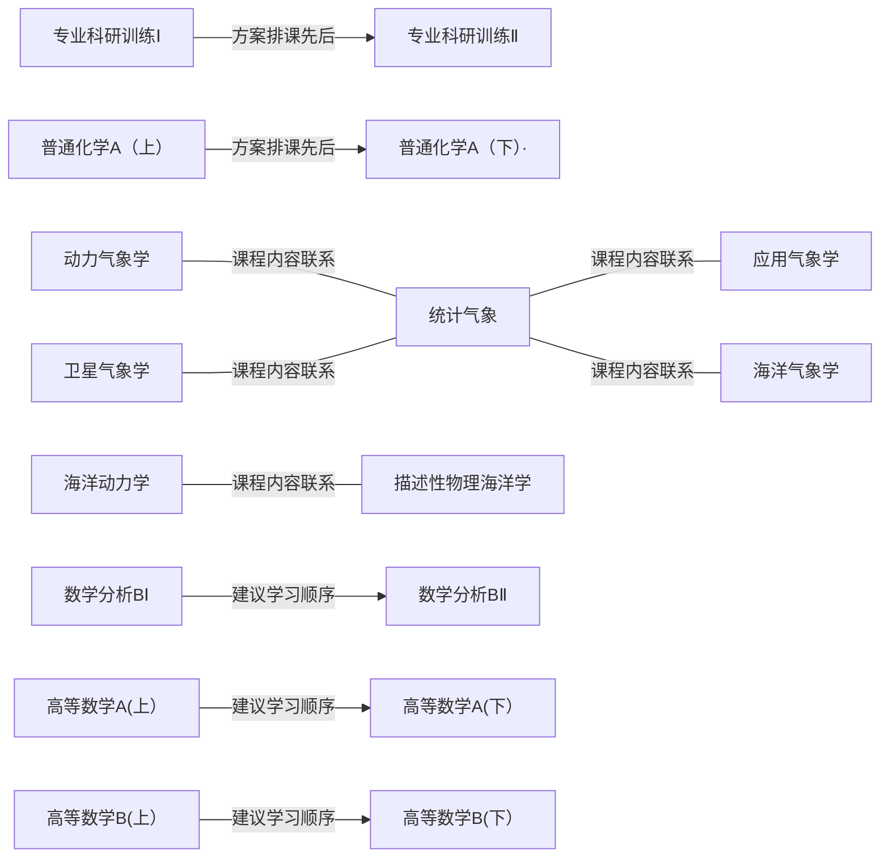

# 2023 大气科学专业“2+X”教学培养方案

大气与海洋科学系 · 大气科学 · 方案 67432 · 62 个不同课程或科研条目。

[官方 Word](../originals/plan-67432.docx) · [教务详情](https://fdjwgl.fudan.edu.cn/manager/bizType/2/major-program-search/info/67432?skipAuth=1) · [方案快照](../raw/plan-67432.json.gz) · [年级目录](../README.md)

## 修读导读

- **建议先学**　《专业科研训练Ⅰ》（`ATMO30016`） → 《专业科研训练Ⅱ》（`ATMO30017`）。题名列出连续册次或级别。保留前一阶段的问题、记录和反馈，下一阶段可据此调整研究或实践计划。方案分别列在第6、7学期。

- **可以对照着读**　《动力气象学》（`ATMO20003`）与《统计气象》（`ATMO30015`）。两门课的题名都涉及气象。选一次天气过程，对照观测到的变化与解释这些变化的物理量。

- **查模块选课**　《大气科学导论》（`ATMO10001`）、《天气学原理》（`ATMO30005`）列在“专业核心教育课程”中。原表见 `/courseModules/10`。

## 课程关系图

图中展示部分关系。下表保留全部已建立的课程对，来源位置使用本方案 JSON Pointer。

## 先修与内容联系

| 类型 | 起点 | 终点 | 依据 | 原表定位 |
| --- | --- | --- | --- | --- |
| 建议学习顺序 | 专业科研训练Ⅰ (ATMO30016) | 专业科研训练Ⅱ (ATMO30017) | 同方案的课程题名具有连续分册或序号。  | `/courseModules/13/planCourses/14`、`/courseModules/13/planCourses/15` |
| 建议学习顺序 | 普通化学A（上） (CHEM10003) | 普通化学A（下） (CHEM10004) | 同方案的课程题名具有连续分册或序号。  | `/courseModules/5/planCourses/0`、`/courseModules/5/planCourses/1` |
| 建议学习顺序 | 高等数学B(上） (MATH10004) | 高等数学B(下） (MATH10005) | 同方案的课程题名具有连续分册或序号。  | `/courseModules/9/planCourses/0`、`/courseModules/9/planCourses/1` |
| 建议学习顺序 | 数学分析BⅠ (MATH10012) | 数学分析BⅡ (MATH10013) | 同方案的课程题名具有连续分册或序号。  | `/courseModules/7/planCourses/0`、`/courseModules/7/planCourses/1` |
| 建议学习顺序 | 高等数学A(上） (MATH10015) | 高等数学A(下） (MATH10016) | 同方案的课程题名具有连续分册或序号。  | `/courseModules/8/planCourses/0`、`/courseModules/8/planCourses/1` |
| 方案排课先后 | 专业科研训练Ⅰ (ATMO30016) | 专业科研训练Ⅱ (ATMO30017) | 同方案该课程全部明确数字学期均早于后者。  | `/courseModules/13/planCourses/14`、`/courseModules/13/planCourses/15` |
| 方案排课先后 | 普通化学A（上） (CHEM10003) | 普通化学A（下） (CHEM10004) | 同方案该课程全部明确数字学期均早于后者。  | `/courseModules/5/planCourses/0`、`/courseModules/5/planCourses/1` |
| 课程内容联系 | 流体力学Ⅰ (AAST30005) | 地球流体力学前沿问题选讲 (ATMO30001) | 本方案两门课程的题名均含“流体力学”，可据此对照这一主题。  | `/courseModules/10/planCourses/11`、`/courseModules/13/planCourses/23` |
| 课程内容联系 | 卫星气象学 (ATMO130038) | 统计气象 (ATMO30015) | 本方案两门课程的题名均含“气象”，可据此对照这一主题。  | `/courseModules/13/planCourses/7`、`/courseModules/12/planCourses/5` |
| 课程内容联系 | 大气与海洋遥感 (ATMO130047) | 海洋动力学 (ATMO20002) | 本方案两门课程的题名均含“海洋”，可据此对照这一主题。  | `/courseModules/13/planCourses/12`、`/courseModules/12/planCourses/2` |
| 课程内容联系 | 海洋动力学 (ATMO20002) | 描述性物理海洋学 (ATMO20005) | 本方案两门课程的题名均含“海洋”，可据此对照这一主题。  | `/courseModules/12/planCourses/2`、`/courseModules/10/planCourses/5` |
| 课程内容联系 | 海洋动力学 (ATMO20002) | 海洋调查与实践 (ATMO20009) | 本方案两门课程的题名均含“海洋”，可据此对照这一主题。  | `/courseModules/12/planCourses/2`、`/courseModules/13/planCourses/16` |
| 课程内容联系 | 海洋动力学 (ATMO20002) | 海洋气象学 (ATMO40002) | 本方案两门课程的题名均含“海洋”，可据此对照这一主题。  | `/courseModules/12/planCourses/2`、`/courseModules/13/planCourses/6` |
| 课程内容联系 | 动力气象学 (ATMO20003) | 统计气象 (ATMO30015) | 本方案两门课程的题名均含“气象”，可据此对照这一主题。  | `/courseModules/10/planCourses/3`、`/courseModules/12/planCourses/5` |
| 课程内容联系 | 气溶胶-云-气候相互作用 (ATMO30003) | 现代气候学 (ATMO40003) | 本方案两门课程的题名均含“气候”，可据此对照这一主题。  | `/courseModules/13/planCourses/27`、`/courseModules/12/planCourses/3` |
| 课程内容联系 | 气候变化导论 (ATMO30012) | 现代气候学 (ATMO40003) | 本方案两门课程的题名均含“气候”，可据此对照这一主题。  | `/courseModules/13/planCourses/4`、`/courseModules/12/planCourses/3` |
| 课程内容联系 | 统计气象 (ATMO30015) | 海洋气象学 (ATMO40002) | 本方案两门课程的题名均含“气象”，可据此对照这一主题。  | `/courseModules/12/planCourses/5`、`/courseModules/13/planCourses/6` |
| 课程内容联系 | 统计气象 (ATMO30015) | 应用气象学 (ATMO40007) | 本方案两门课程的题名均含“气象”，可据此对照这一主题。  | `/courseModules/12/planCourses/5`、`/courseModules/13/planCourses/17` |

本次未从可定位的明确表述中确认课程对课程预修。学期安排、系列分册与编辑建议均保留各自的依据。

## 按原方案模块阅读

同一模块展示原表中的课程归属。模块内课程之间的先后仍须逐项查阅。

- **数学分析B**　数学分析BⅠ、数学分析BⅡ（原表模块 7）
- **高等数学A**　高等数学A(上）、高等数学A(下）（原表模块 8）
- **高等数学B**　高等数学B(上）、高等数学B(下）（原表模块 9）

## 课程表

同一课程在不同模块分别出现时，按原表逐行列出。季节字段保留原值。

| 课程 | 代码 | 学分 | 学期 | 模块 |
| --- | --- | ---: | --- | --- |
| 普通化学A（上） | CHEM10003 | 2.0 | 第1学期 | 培养方案 / 专业培养课程 / 大类基础课程 |
| 普通化学A（下） | CHEM10004 | 2.0 | 第2学期 | 培养方案 / 专业培养课程 / 大类基础课程 |
| 普通化学实验I | CHEM10005 | 1.0 | 第1学期 | 培养方案 / 专业培养课程 / 大类基础课程 |
| 线性代数（理工类） | MATH10014 | 3.0 | 第3学期 | 培养方案 / 专业培养课程 / 大类基础课程 |
| 基础物理实验 | PHYS10005 | 2.0 | 第2学期 | 培养方案 / 专业培养课程 / 大类基础课程 |
| 大学物理A：力学 | PHYS10006 | 4.0 | 第1学期 | 培养方案 / 专业培养课程 / 大类基础课程 |
| 大学物理A：热学 | PHYS10007 | 2.0 | 第2学期 | 培养方案 / 专业培养课程 / 大类基础课程 |
| 大学物理A：电磁学 | PHYS10008 | 4.0 | 第2学期 | 培养方案 / 专业培养课程 / 大类基础课程 |
| 数学分析BⅠ | MATH10012 | 5.0 | AUTUMN | 培养方案 / 专业培养课程 / 大类基础课程 / 数学组 / 数学分析B |
| 数学分析BⅡ | MATH10013 | 5.0 | SPRING | 培养方案 / 专业培养课程 / 大类基础课程 / 数学组 / 数学分析B |
| 高等数学A(上） | MATH10015 | 5.0 | AUTUMN | 培养方案 / 专业培养课程 / 大类基础课程 / 数学组 / 高等数学A |
| 高等数学A(下） | MATH10016 | 5.0 | SPRING | 培养方案 / 专业培养课程 / 大类基础课程 / 数学组 / 高等数学A |
| 高等数学B(上） | MATH10004 | 5.0 | AUTUMN | 培养方案 / 专业培养课程 / 大类基础课程 / 数学组 / 高等数学B |
| 高等数学B(下） | MATH10005 | 5.0 | SPRING | 培养方案 / 专业培养课程 / 大类基础课程 / 数学组 / 高等数学B |
| 天气学原理 | ATMO30005 | 4.0 | 第5学期 | 培养方案 / 专业培养课程 / 专业核心教育课程 |
| 大气科学导论 | ATMO10001 | 2.0 | 第3学期 | 培养方案 / 专业培养课程 / 专业核心教育课程 |
| 毕业论文 | ATMO40001 | 6.0 | 第8学期 | 培养方案 / 专业培养课程 / 专业核心教育课程 |
| 动力气象学 | ATMO20003 | 4.0 | 第4学期 | 培养方案 / 专业培养课程 / 专业核心教育课程 |
| 大气物理学 | ATMO20004 | 3.0 | 第3学期 | 培养方案 / 专业培养课程 / 专业核心教育课程 |
| 描述性物理海洋学 | ATMO20005 | 3.0 | 第3学期 | 培养方案 / 专业培养课程 / 专业核心教育课程 |
| 理论力学 | ATMO20006 | 4.0 | 第3学期 | 培养方案 / 专业培养课程 / 专业核心教育课程 |
| 大气探测 | ATMO20007 | 5.0 | 第4学期 | 培养方案 / 专业培养课程 / 专业核心教育课程 |
| 大气化学 | ATMO20008 | 3.0 | 第4学期 | 培养方案 / 专业培养课程 / 专业核心教育课程 |
| 概率论与数理统计 | STAT20012 | 4.0 | 第3学期 | 培养方案 / 专业培养课程 / 专业核心教育课程 |
| 计算方法 | MATH30008 | 3.0 | 第5学期 | 培养方案 / 专业培养课程 / 专业核心教育课程 |
| 流体力学Ⅰ | AAST30005 | 4.0 | 第4学期 | 培养方案 / 专业培养课程 / 专业核心教育课程 |
| 数学物理方法A | PHYS20006 | 4.0 | 第3学期 | 培养方案 / 专业培养课程 / 专业核心教育课程 |
| 专业实习 | ATMO30006 | 1.0 | 第6学期 | 培养方案 / 专业进阶模块I |
| 数值天气预报 | ATMO30008 | 3.0 | 第6学期 | 培养方案 / 专业进阶模块I |
| 海洋动力学 | ATMO20002 | 3.0 | 第4学期 | 培养方案 / 专业进阶模块I |
| 现代气候学 | ATMO40003 | 2.0 | 第7学期 | 培养方案 / 专业进阶模块I |
| 大数据分析与可视化 | ATMO30013 | 3.0 | 第5学期 | 培养方案 / 专业进阶模块I |
| 统计气象 | ATMO30015 | 3.0 | 第5学期 | 培养方案 / 专业进阶模块I |
| 天气分析与预报 | ATMO30007 | 3.0 | 第6学期 | 培养方案 / 专业进阶模块II |
| 中小尺度气象学 | ATMO30009 | 3.0 | 第6学期 | 培养方案 / 专业进阶模块II |
| 热带气象学 | ATMO30010 | 3.0 | 第6学期 | 培养方案 / 专业进阶模块II |
| 大气辐射学 | ATMO30011 | 3.0 | 第5学期 | 培养方案 / 专业进阶模块II |
| 气候变化导论 | ATMO30012 | 2.0 | 第6学期 | 培养方案 / 专业进阶模块II |
| 并行计算与性能优化 | ATMO130032 | 4.0 | 第6学期 | 培养方案 / 专业进阶模块II |
| 海洋气象学 | ATMO40002 | 2.0 | 第7学期 | 培养方案 / 专业进阶模块II |
| 卫星气象学 | ATMO130038 | 2.0 | 第7学期 | 培养方案 / 专业进阶模块II |
| 气象预报与预测实践 | ATMO30014 | 3.0 | 第6学期、SUMMER | 培养方案 / 专业进阶模块II |
| 热带厄尔尼诺动力学 | ATMO40004 | 2.0 | 第7学期 | 培养方案 / 专业进阶模块II |
| 空气污染与人体健康 | ATMO40005 | 2.0 | 第7学期 | 培养方案 / 专业进阶模块II |
| Fortran语言程序设计 | ATMO130046 | 3.0 | 第4学期 | 培养方案 / 专业进阶模块II |
| 大气与海洋遥感 | ATMO130047 | 3.0 | 第5学期 | 培养方案 / 专业进阶模块II |
| 环境气象学 | ATMO40006 | 2.0 | 第7学期 | 培养方案 / 专业进阶模块II |
| 专业科研训练Ⅰ | ATMO30016 | 1.0 | 第6学期 | 培养方案 / 专业进阶模块II |
| 专业科研训练Ⅱ | ATMO30017 | 1.0 | 第7学期 | 培养方案 / 专业进阶模块II |
| 海洋调查与实践 | ATMO20009 | 2.0 | 第4学期、SUMMER | 培养方案 / 专业进阶模块II |
| 应用气象学 | ATMO40007 | 2.0 | 第7学期 | 培养方案 / 专业进阶模块II |
| 物理化学AⅠ | CHEM20005 | 3.0 | 第3学期 | 培养方案 / 专业进阶模块II |
| 无机化学 | CHEM30005 | 3.0 | 第4学期 | 培养方案 / 专业进阶模块II |
| 有机化学A I | CHEM20013 | 4.0 | 第5学期 | 培养方案 / 专业进阶模块II |
| 微分方程数值解法 | MATH40010 | 3.0 | 第6学期 | 培养方案 / 专业进阶模块II |
| 热力学与统计物理I | PHYS20013 | 4.0 | 第4学期 | 培养方案 / 专业进阶模块II |
| 地球流体力学前沿问题选讲 | ATMO30001 | 2.0 |  | 培养方案 / 专业进阶模块II |
| 大气与海洋卫星遥感 | ATMO30002 | 2.0 |  | 培养方案 / 专业进阶模块II |
| Fortran程序设计 | ATMO20001 | 4.0 |  | 培养方案 / 专业进阶模块II |
| 混沌动力学与随机动力系统 | PHYS20001 | 4.0 |  | 培养方案 / 专业进阶模块II |
| 气溶胶-云-气候相互作用 | ATMO30003 | 2.0 |  | 培养方案 / 专业进阶模块II |
| 混沌动力学与随机动力系统 | PHYS20018 | 3.0 |  | 培养方案 / 专业进阶模块II |
