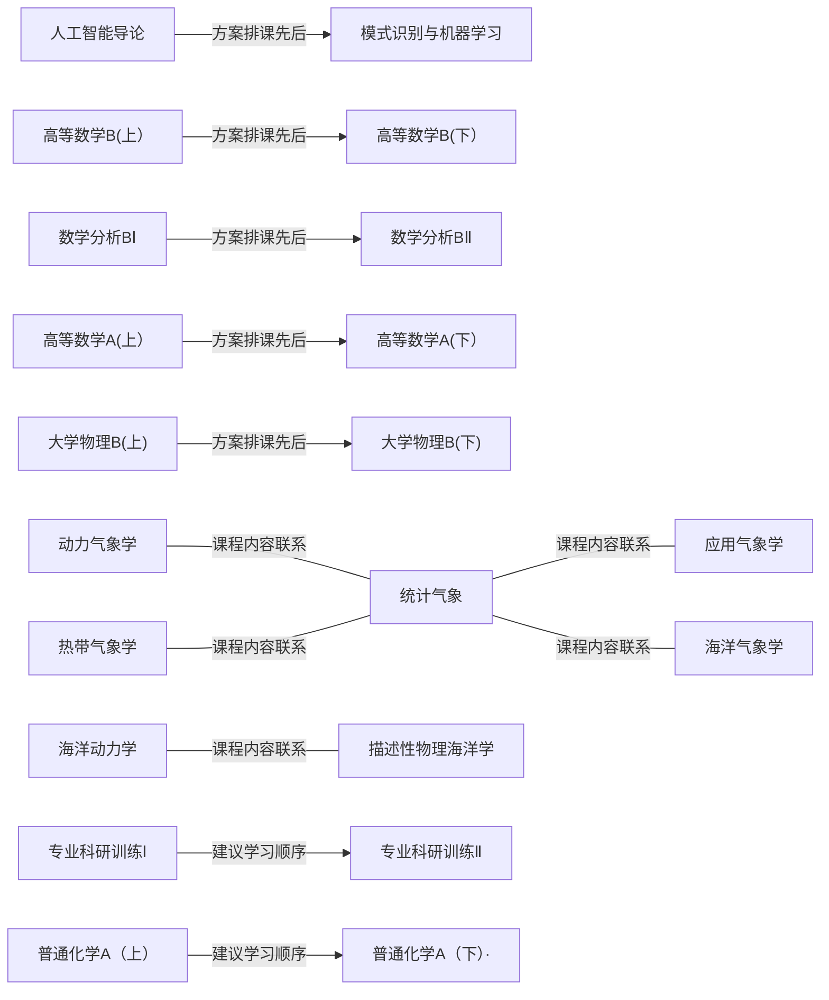

# 2024大气科学-人工智能双学士学位项目“2+X”教学培养方案

大气与海洋科学系 · 大气科学-人工智能(双学士学位项目) · 方案 73311 · 85 个不同课程或科研条目。

[官方 Word](../originals/plan-73311.docx) · [教务详情](https://fdjwgl.fudan.edu.cn/manager/bizType/2/major-program-search/info/73311?skipAuth=1) · [方案快照](../raw/plan-73311.json.gz) · [年级目录](../README.md)

## 修读导读

- **建议先学**　《人工智能导论》（`AIE310005`） → 《模式识别与机器学习》（`AIE410001`）。人工智能问题与模型类别可为学习模式识别作准备。方案分别列在第4、5学期。

- **可以对照着读**　《动力气象学》（`ATMO20003`）与《统计气象》（`ATMO30015`）。两门课的题名都涉及气象。选一次天气过程，对照观测到的变化与解释这些变化的物理量。

- **查模块选课**　《大气科学导论》（`ATMO10001`）、《描述性物理海洋学》（`ATMO20005`）列在“专业核心教育课程”中。原表见 `/courseModules/11`。

## 课程关系图

图中展示部分关系。下表保留全部已建立的课程对，来源位置使用本方案 JSON Pointer。

## 先修与内容联系

| 类型 | 起点 | 终点 | 依据 | 原表定位 |
| --- | --- | --- | --- | --- |
| 建议学习顺序 | 人工智能导论 (AIE310005) | 模式识别与机器学习 (AIE410001) | 人工智能问题与模型类别可为学习模式识别作准备。  | `/courseModules/11/planCourses/17`、`/courseModules/11/planCourses/19` |
| 建议学习顺序 | 专业科研训练Ⅰ (ATMO30016) | 专业科研训练Ⅱ (ATMO30017) | 同方案的课程题名具有连续分册或序号。  | `/courseModules/13/planCourses/7`、`/courseModules/13/planCourses/8` |
| 建议学习顺序 | 普通化学A（上） (CHEM10003) | 普通化学A（下） (CHEM10004) | 同方案的课程题名具有连续分册或序号。  | `/courseModules/10/planCourses/5`、`/courseModules/10/planCourses/6` |
| 建议学习顺序 | 高等数学B(上） (MATH10004) | 高等数学B(下） (MATH10005) | 同方案的课程题名具有连续分册或序号。  | `/courseModules/7/planCourses/0`、`/courseModules/7/planCourses/1` |
| 建议学习顺序 | 数学分析BⅠ (MATH10012) | 数学分析BⅡ (MATH10013) | 同方案的课程题名具有连续分册或序号。  | `/courseModules/8/planCourses/0`、`/courseModules/8/planCourses/1` |
| 建议学习顺序 | 高等数学A(上） (MATH10015) | 高等数学A(下） (MATH10016) | 同方案的课程题名具有连续分册或序号。  | `/courseModules/9/planCourses/0`、`/courseModules/9/planCourses/1` |
| 建议学习顺序 | 大学物理B(上) (PHYS10003) | 大学物理B(下) (PHYS10004) | 同方案的课程题名具有连续分册或序号。  | `/courseModules/10/planCourses/3`、`/courseModules/10/planCourses/4` |
| 方案排课先后 | 人工智能导论 (AIE310005) | 模式识别与机器学习 (AIE410001) | 同方案该课程全部明确数字学期均早于后者。  | `/courseModules/11/planCourses/17`、`/courseModules/11/planCourses/19` |
| 方案排课先后 | 普通化学A（上） (CHEM10003) | 普通化学A（下） (CHEM10004) | 同方案该课程全部明确数字学期均早于后者。  | `/courseModules/10/planCourses/5`、`/courseModules/10/planCourses/6` |
| 方案排课先后 | 高等数学B(上） (MATH10004) | 高等数学B(下） (MATH10005) | 同方案该课程全部明确数字学期均早于后者。  | `/courseModules/7/planCourses/0`、`/courseModules/7/planCourses/1` |
| 方案排课先后 | 数学分析BⅠ (MATH10012) | 数学分析BⅡ (MATH10013) | 同方案该课程全部明确数字学期均早于后者。  | `/courseModules/8/planCourses/0`、`/courseModules/8/planCourses/1` |
| 方案排课先后 | 高等数学A(上） (MATH10015) | 高等数学A(下） (MATH10016) | 同方案该课程全部明确数字学期均早于后者。  | `/courseModules/9/planCourses/0`、`/courseModules/9/planCourses/1` |
| 方案排课先后 | 大学物理B(上) (PHYS10003) | 大学物理B(下) (PHYS10004) | 同方案该课程全部明确数字学期均早于后者。  | `/courseModules/10/planCourses/3`、`/courseModules/10/planCourses/4` |
| 课程内容联系 | 计算机系统基础 (AIE210006) | 计算机组成与体系结构 (CS30052) | 处理器、存储与系统执行模型具有共同内容。  | `/courseModules/11/planCourses/16`、`/courseModules/14/planCourses/1` |
| 课程内容联系 | 人工智能导论 (AIE310005) | 人工智能安全 (AIE831001) | 本方案两门课程的题名均含“人工智能”，可据此对照这一主题。  | `/courseModules/11/planCourses/17`、`/courseModules/11/planCourses/20` |
| 课程内容联系 | 人工智能的编程基础 (AIE310006) | 人工智能安全 (AIE831001) | 本方案两门课程的题名均含“人工智能”，可据此对照这一主题。  | `/courseModules/11/planCourses/13`、`/courseModules/11/planCourses/20` |
| 课程内容联系 | 人工智能的软件基础 (AIE310008) | 人工智能安全 (AIE831001) | 本方案两门课程的题名均含“人工智能”，可据此对照这一主题。  | `/courseModules/11/planCourses/18`、`/courseModules/11/planCourses/20` |
| 课程内容联系 | 人工智能的数学基础 (AIE310009) | 模式识别与机器学习 (AIE410001) | 数学表达与学习模型的统计、优化工具可对照。  | `/courseModules/11/planCourses/15`、`/courseModules/11/planCourses/19` |
| 课程内容联系 | 人工智能的数学基础 (AIE310009) | 人工智能安全 (AIE831001) | 本方案两门课程的题名均含“人工智能”，可据此对照这一主题。  | `/courseModules/11/planCourses/15`、`/courseModules/11/planCourses/20` |
| 课程内容联系 | 模式识别与机器学习 (AIE410001) | 机器学习系统 (CS30058) | 本方案两门课程的题名均含“机器学习”，可据此对照这一主题。  | `/courseModules/11/planCourses/19`、`/courseModules/14/planCourses/5` |
| 课程内容联系 | 海洋动力学 (ATMO20002) | 海洋动力学（H） (ATMO20002h) | 本方案两门课程的题名均含“海洋”，可据此对照这一主题。  | `/courseModules/11/planCourses/7`、`/courseModules/17/planCourses/2` |
| 课程内容联系 | 海洋动力学 (ATMO20002) | 描述性物理海洋学 (ATMO20005) | 本方案两门课程的题名均含“海洋”，可据此对照这一主题。  | `/courseModules/11/planCourses/7`、`/courseModules/11/planCourses/1` |
| 课程内容联系 | 海洋动力学 (ATMO20002) | 海洋调查与实践 (ATMO20009) | 本方案两门课程的题名均含“海洋”，可据此对照这一主题。  | `/courseModules/11/planCourses/7`、`/courseModules/13/planCourses/1` |
| 课程内容联系 | 海洋动力学 (ATMO20002) | 海洋气象学 (ATMO40002) | 本方案两门课程的题名均含“海洋”，可据此对照这一主题。  | `/courseModules/11/planCourses/7`、`/courseModules/13/planCourses/10` |
| 课程内容联系 | 动力气象学 (ATMO20003) | 统计气象 (ATMO30015) | 本方案两门课程的题名均含“气象”，可据此对照这一主题。  | `/courseModules/11/planCourses/4`、`/courseModules/11/planCourses/9` |
| 课程内容联系 | 地球流体力学前沿问题选讲 (ATMO30001) | 流体力学 (MECH20001) | 本方案两门课程的题名均含“流体力学”，可据此对照这一主题。  | `/courseModules/13/planCourses/18`、`/courseModules/13/planCourses/20` |
| 课程内容联系 | 气溶胶-云-气候相互作用 (ATMO30003) | 现代气候学 (ATMO40003) | 本方案两门课程的题名均含“气候”，可据此对照这一主题。  | `/courseModules/13/planCourses/17`、`/courseModules/13/planCourses/0` |
| 课程内容联系 | 热带气象学 (ATMO30010) | 统计气象 (ATMO30015) | 本方案两门课程的题名均含“气象”，可据此对照这一主题。  | `/courseModules/13/planCourses/3`、`/courseModules/11/planCourses/9` |
| 课程内容联系 | 气候变化导论 (ATMO30012) | 现代气候学 (ATMO40003) | 本方案两门课程的题名均含“气候”，可据此对照这一主题。  | `/courseModules/13/planCourses/6`、`/courseModules/13/planCourses/0` |
| 课程内容联系 | 统计气象 (ATMO30015) | 海洋气象学 (ATMO40002) | 本方案两门课程的题名均含“气象”，可据此对照这一主题。  | `/courseModules/11/planCourses/9`、`/courseModules/13/planCourses/10` |
| 课程内容联系 | 统计气象 (ATMO30015) | 应用气象学 (ATMO40007) | 本方案两门课程的题名均含“气象”，可据此对照这一主题。  | `/courseModules/11/planCourses/9`、`/courseModules/13/planCourses/14` |

本次未从可定位的明确表述中确认课程对课程预修。学期安排、系列分册与编辑建议均保留各自的依据。

## 按原方案模块阅读

同一模块展示原表中的课程归属。模块内课程之间的先后仍须逐项查阅。

- **高等数学B**　高等数学B(上）、高等数学B(下）（原表模块 7）
- **数学分析B**　数学分析BⅠ、数学分析BⅡ（原表模块 8）
- **高等数学A**　高等数学A(上）、高等数学A(下）（原表模块 9）
- **限定选修课**　普通化学A（上）、普通化学A（下）、大学物理B(上)、大学物理B(下)、大学物理A：力学、大学物理A：热学、大学物理A：电磁学（原表模块 10）
- **5门荣誉课至少选修3门**　气象大数据与人工智能（H）、大气科学导论（H）、大气物理学（H）、大气探测（H）、大气化学（H）（原表模块 16）
- **其余荣誉课程**　海洋动力学（H）、动力气象学（H）、描述性物理海洋学（H）、天气学原理（H）、数值天气预报（H）、统计气象（H）（原表模块 17）

## 课程表

同一课程在不同模块分别出现时，按原表逐行列出。季节字段保留原值。

| 课程 | 代码 | 学分 | 学期 | 模块 |
| --- | --- | ---: | --- | --- |
| 线性代数（理工类） | MATH10014 | 3.0 | 第3学期 | 培养方案 / 专业培养课程 / 大类基础课程 |
| 基础物理实验 | PHYS10005 | 2.0 | 第2学期 | 培养方案 / 专业培养课程 / 大类基础课程 |
| 普通化学实验I | CHEM10005 | 1.0 | 第1学期 | 培养方案 / 专业培养课程 / 大类基础课程 |
| 程序设计 | CS10004 | 4.0 | 第2学期 | 培养方案 / 专业培养课程 / 大类基础课程 |
| 高等数学B(上） | MATH10004 | 5.0 | 第1学期 | 培养方案 / 专业培养课程 / 大类基础课程 / 数学组 / 高等数学B |
| 高等数学B(下） | MATH10005 | 5.0 | 第2学期 | 培养方案 / 专业培养课程 / 大类基础课程 / 数学组 / 高等数学B |
| 数学分析BⅠ | MATH10012 | 5.0 | 第1学期 | 培养方案 / 专业培养课程 / 大类基础课程 / 数学组 / 数学分析B |
| 数学分析BⅡ | MATH10013 | 5.0 | 第2学期 | 培养方案 / 专业培养课程 / 大类基础课程 / 数学组 / 数学分析B |
| 高等数学A(上） | MATH10015 | 5.0 | 第1学期 | 培养方案 / 专业培养课程 / 大类基础课程 / 数学组 / 高等数学A |
| 高等数学A(下） | MATH10016 | 5.0 | 第2学期 | 培养方案 / 专业培养课程 / 大类基础课程 / 数学组 / 高等数学A |
| 大学物理A：力学 | PHYS10006 | 4.0 | 第1学期 | 培养方案 / 专业培养课程 / 大类基础课程 / 限定选修课 |
| 大学物理A：热学 | PHYS10007 | 2.0 | 第2学期 | 培养方案 / 专业培养课程 / 大类基础课程 / 限定选修课 |
| 大学物理A：电磁学 | PHYS10008 | 4.0 | 第2学期 | 培养方案 / 专业培养课程 / 大类基础课程 / 限定选修课 |
| 大学物理B(上) | PHYS10003 | 4.0 | 第1学期 | 培养方案 / 专业培养课程 / 大类基础课程 / 限定选修课 |
| 大学物理B(下) | PHYS10004 | 4.0 | 第2学期 | 培养方案 / 专业培养课程 / 大类基础课程 / 限定选修课 |
| 普通化学A（上） | CHEM10003 | 2.0 | 第1学期 | 培养方案 / 专业培养课程 / 大类基础课程 / 限定选修课 |
| 普通化学A（下） | CHEM10004 | 2.0 | 第2学期 | 培养方案 / 专业培养课程 / 大类基础课程 / 限定选修课 |
| 大气科学导论 | ATMO10001 | 2.0 | 第1学期 | 培养方案 / 专业培养课程 / 专业核心教育课程 |
| 描述性物理海洋学 | ATMO20005 | 3.0 | 第3学期 | 培养方案 / 专业培养课程 / 专业核心教育课程 |
| 大气物理学 | ATMO20004 | 3.0 | 第3学期 | 培养方案 / 专业培养课程 / 专业核心教育课程 |
| 大气探测 | ATMO20007 | 5.0 | 第4学期 | 培养方案 / 专业培养课程 / 专业核心教育课程 |
| 动力气象学 | ATMO20003 | 4.0 | 第4学期 | 培养方案 / 专业培养课程 / 专业核心教育课程 |
| 大气化学 | ATMO20008 | 3.0 | 第4学期 | 培养方案 / 专业培养课程 / 专业核心教育课程 |
| 天气学原理 | ATMO30005 | 4.0 | 第5学期 | 培养方案 / 专业培养课程 / 专业核心教育课程 |
| 海洋动力学 | ATMO20002 | 3.0 | 第4学期 | 培养方案 / 专业培养课程 / 专业核心教育课程 |
| 大数据分析与可视化 | ATMO30013 | 3.0 | 第5学期 | 培养方案 / 专业培养课程 / 专业核心教育课程 |
| 统计气象 | ATMO30015 | 3.0 | 第5学期 | 培养方案 / 专业培养课程 / 专业核心教育课程 |
| 数值天气预报 | ATMO30008 | 3.0 | 第6学期 | 培养方案 / 专业培养课程 / 专业核心教育课程 |
| 专业实习 | ATMO30006 | 1.0 | 第6学期 | 培养方案 / 专业培养课程 / 专业核心教育课程 |
| 毕业论文 | ATMO40001 | 6.0 | 第8学期 | 培养方案 / 专业培养课程 / 专业核心教育课程 |
| 人工智能的编程基础 | AIE310006 | 2.0 | 第2学期 | 培养方案 / 专业培养课程 / 专业核心教育课程 |
| 数据结构 | AIE310007 | 4.0 | 第3学期 | 培养方案 / 专业培养课程 / 专业核心教育课程 |
| 人工智能的数学基础 | AIE310009 | 3.0 | 第3学期 | 培养方案 / 专业培养课程 / 专业核心教育课程 |
| 计算机系统基础 | AIE210006 | 3.0 | 第3学期 | 培养方案 / 专业培养课程 / 专业核心教育课程 |
| 人工智能导论 | AIE310005 | 3.0 | 第4学期 | 培养方案 / 专业培养课程 / 专业核心教育课程 |
| 人工智能的软件基础 | AIE310008 | 3.0 | 第4学期 | 培养方案 / 专业培养课程 / 专业核心教育课程 |
| 模式识别与机器学习 | AIE410001 | 3.0 | 第5学期 | 培养方案 / 专业培养课程 / 专业核心教育课程 |
| 人工智能安全 | AIE831001 | 3.0 | 第4学期、第6学期 | 培养方案 / 专业培养课程 / 专业核心教育课程 |
| 人工智能的伦理与治理 | PHIL50006 | 2.0 | 第5学期 | 培养方案 / 专业培养课程 / 专业核心教育课程 |
| 自然语言处理与大语言模型 | AIE410002 | 3.0 | 第6学期 | 培养方案 / 专业培养课程 / 专业核心教育课程 |
| 计算机视觉 | AIE310004 | 3.0 | 第7学期 | 培养方案 / 专业培养课程 / 专业核心教育课程 |
| 人工智能前沿探索实践 | AIE531001 | 3.0 | 第7学期 | 培养方案 / 专业培养课程 / 专业核心教育课程 |
| 现代气候学 | ATMO40003 | 2.0 | 第7学期 | 培养方案 / 专业进阶模块I |
| 海洋调查与实践 | ATMO20009 | 2.0 | 第4学期 | 培养方案 / 专业进阶模块I |
| 大气辐射学 | ATMO30011 | 3.0 | 第5学期 | 培养方案 / 专业进阶模块I |
| 热带气象学 | ATMO30010 | 3.0 | 第6学期 | 培养方案 / 专业进阶模块I |
| 中小尺度气象学 | ATMO30009 | 3.0 | 第6学期 | 培养方案 / 专业进阶模块I |
| 天气分析与预报 | ATMO30007 | 3.0 | 第6学期 | 培养方案 / 专业进阶模块I |
| 气候变化导论 | ATMO30012 | 2.0 | 第6学期 | 培养方案 / 专业进阶模块I |
| 专业科研训练Ⅰ | ATMO30016 | 1.0 | 第6学期 | 培养方案 / 专业进阶模块I |
| 专业科研训练Ⅱ | ATMO30017 | 1.0 | 第6学期 | 培养方案 / 专业进阶模块I |
| 气象预报与预测实践 | ATMO30014 | 3.0 | 第6学期 | 培养方案 / 专业进阶模块I |
| 海洋气象学 | ATMO40002 | 2.0 | 第7学期 | 培养方案 / 专业进阶模块I |
| 热带厄尔尼诺动力学 | ATMO40004 | 2.0 | 第7学期 | 培养方案 / 专业进阶模块I |
| 环境气象学 | ATMO40006 | 2.0 | 第7学期 | 培养方案 / 专业进阶模块I |
| 空气污染与人体健康 | ATMO40005 | 2.0 | 第7学期 | 培养方案 / 专业进阶模块I |
| 应用气象学 | ATMO40007 | 2.0 | 第7学期 | 培养方案 / 专业进阶模块I |
| 并行计算与性能优化 | CS40033 | 2.0 | 第7学期 | 培养方案 / 专业进阶模块I |
| Fortran程序设计 | ATMO20001 | 4.0 | 第4学期 | 培养方案 / 专业进阶模块I |
| 气溶胶-云-气候相互作用 | ATMO30003 | 2.0 | 第5学期 | 培养方案 / 专业进阶模块I |
| 地球流体力学前沿问题选讲 | ATMO30001 | 2.0 | 第6学期 | 培养方案 / 专业进阶模块I |
| 大气与海洋卫星遥感 | ATMO30002 | 2.0 | 第5学期 | 培养方案 / 专业进阶模块I |
| 流体力学 | MECH20001 | 4.0 | 第4学期 | 培养方案 / 专业进阶模块I |
| 海洋数值模拟简介 | ATMO40008 | 2.0 | AUTUMN | 培养方案 / 专业进阶模块I |
| 集合与图论 | CS30043 | 3.0 | 第3学期 | 培养方案 / 专业进阶模块II |
| 计算机组成与体系结构 | CS30052 | 4.0 | 第4学期 | 培养方案 / 专业进阶模块II |
| 数据库引论 | CS20010 | 3.0 | 第4学期 | 培养方案 / 专业进阶模块II |
| 计算机网络 | CS30036 | 3.0 | 第5学期 | 培养方案 / 专业进阶模块II |
| 软件工程 | CS30018 | 3.0 | 第6学期 | 培养方案 / 专业进阶模块II |
| 机器学习系统 | CS30058 | 3.0 | 第6学期 | 培养方案 / 专业进阶模块II |
| 计算机图形学A | CS30019 | 3.0 | 第6学期 | 培养方案 / 专业进阶模块II |
| 气象大数据与人工智能 | AIS410013 | 3.0 | 第6学期 | 培养方案 / 专业进阶模块II |
| 混沌动力学与随机动力系统 | PHYS20001 | 4.0 | 第4学期 | 培养方案 / 专业进阶模块II |
| 混沌动力学与随机动力系统 | PHYS20018 | 3.0 |  | 培养方案 / 专业进阶模块II |
| 大气科学导论（H） | ATMO10001h | 3.0 | 第1学期 | 培养方案 / 荣誉课程 / 5门荣誉课至少选修3门 |
| 大气物理学（H） | ATMO20004h | 4.0 | 第3学期 | 培养方案 / 荣誉课程 / 5门荣誉课至少选修3门 |
| 大气探测（H） | ATMO20007h | 6.0 | 第4学期 | 培养方案 / 荣誉课程 / 5门荣誉课至少选修3门 |
| 大气化学（H） | ATMO20008h | 4.0 | 第4学期 | 培养方案 / 荣誉课程 / 5门荣誉课至少选修3门 |
| 气象大数据与人工智能（H） | AIS410013h | 4.0 | 第6学期 | 培养方案 / 荣誉课程 / 5门荣誉课至少选修3门 |
| 描述性物理海洋学（H） | ATMO20005h | 4.0 | 第3学期 | 培养方案 / 荣誉课程 / 其余荣誉课程 |
| 动力气象学（H） | ATMO20003h | 5.0 | 第4学期 | 培养方案 / 荣誉课程 / 其余荣誉课程 |
| 海洋动力学（H） | ATMO20002h | 4.0 | 第4学期 | 培养方案 / 荣誉课程 / 其余荣誉课程 |
| 天气学原理（H） | ATMO30005h | 5.0 | 第5学期 | 培养方案 / 荣誉课程 / 其余荣誉课程 |
| 统计气象（H） | ATMO30015h | 4.0 | 第5学期 | 培养方案 / 荣誉课程 / 其余荣誉课程 |
| 数值天气预报（H） | ATMO30008h | 4.0 | 第6学期 | 培养方案 / 荣誉课程 / 其余荣誉课程 |
