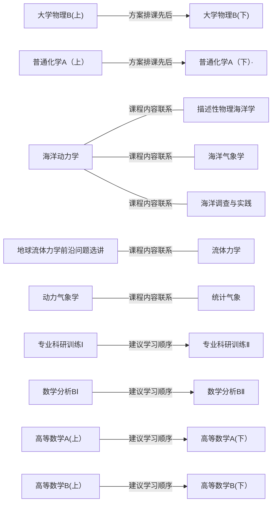

# 2025大气科学本科培养方案

大气与海洋科学系 · 大气科学 · 方案 96682 · 88 个不同课程或科研条目。

[官方 Word](../originals/plan-96682.docx) · [教务详情](https://fdjwgl.fudan.edu.cn/manager/bizType/2/major-program-search/info/96682?skipAuth=1) · [方案快照](../raw/plan-96682.json.gz) · [年级目录](../README.md)

## 课程关系图

图中展示部分关系。下表保留全部已建立的课程对，来源位置使用本方案 JSON Pointer。

## 先修与内容联系

| 类型 | 起点 | 终点 | 依据 | 原表定位 |
| --- | --- | --- | --- | --- |
| 建议学习顺序 | 专业科研训练Ⅰ (ATMO30016) | 专业科研训练Ⅱ (ATMO30017) | 同方案的课程题名具有连续分册或序号。  | `/courseModules/43/planCourses/8`、`/courseModules/43/planCourses/10` |
| 建议学习顺序 | 普通化学A（上） (CHEM10003) | 普通化学A（下） (CHEM10004) | 同方案的课程题名具有连续分册或序号。  | `/courseModules/11/planCourses/5`、`/courseModules/11/planCourses/6` |
| 建议学习顺序 | 高等数学B(上） (MATH10004) | 高等数学B(下） (MATH10005) | 同方案的课程题名具有连续分册或序号。  | `/courseModules/10/planCourses/0`、`/courseModules/10/planCourses/1` |
| 建议学习顺序 | 数学分析BⅠ (MATH10012) | 数学分析BⅡ (MATH10013) | 同方案的课程题名具有连续分册或序号。  | `/courseModules/8/planCourses/0`、`/courseModules/8/planCourses/1` |
| 建议学习顺序 | 高等数学A(上） (MATH10015) | 高等数学A(下） (MATH10016) | 同方案的课程题名具有连续分册或序号。  | `/courseModules/9/planCourses/0`、`/courseModules/9/planCourses/1` |
| 建议学习顺序 | 大学物理B(上) (PHYS10003) | 大学物理B(下) (PHYS10004) | 同方案的课程题名具有连续分册或序号。  | `/courseModules/11/planCourses/3`、`/courseModules/11/planCourses/4` |
| 方案排课先后 | 普通化学A（上） (CHEM10003) | 普通化学A（下） (CHEM10004) | 同方案该课程全部明确数字学期均早于后者。  | `/courseModules/11/planCourses/5`、`/courseModules/11/planCourses/6` |
| 方案排课先后 | 大学物理B(上) (PHYS10003) | 大学物理B(下) (PHYS10004) | 同方案该课程全部明确数字学期均早于后者。  | `/courseModules/11/planCourses/3`、`/courseModules/11/planCourses/4` |
| 课程内容联系 | 人工智能的编程基础 (AIE310006) | 人工智能与国家治理 (AIS310012) | 本方案两门课程的题名均含“人工智能”，可据此对照这一主题。  | `/courseModules/22/planCourses/13`、`/courseModules/22/planCourses/10` |
| 课程内容联系 | 模式识别与机器学习 (AIE410001) | 机器学习系统 (CS30058) | 本方案两门课程的题名均含“机器学习”，可据此对照这一主题。  | `/courseModules/22/planCourses/11`、`/courseModules/22/planCourses/7` |
| 课程内容联系 | 人工智能与国家治理 (AIS310012) | 气象大数据与人工智能 (AIS410013) | 本方案两门课程的题名均含“人工智能”，可据此对照这一主题。  | `/courseModules/22/planCourses/10`、`/courseModules/22/planCourses/5` |
| 课程内容联系 | 人工智能与国家治理 (AIS310012) | 气象大数据与人工智能（H） (AIS410013h) | 本方案两门课程的题名均含“人工智能”，可据此对照这一主题。  | `/courseModules/22/planCourses/10`、`/courseModules/37/planCourses/4` |
| 课程内容联系 | 海洋动力学 (ATMO20002) | 海洋动力学（H） (ATMO20002h) | 本方案两门课程的题名均含“海洋”，可据此对照这一主题。  | `/courseModules/13/planCourses/6`、`/courseModules/38/planCourses/2` |
| 课程内容联系 | 海洋动力学 (ATMO20002) | 描述性物理海洋学 (ATMO20005) | 本方案两门课程的题名均含“海洋”，可据此对照这一主题。  | `/courseModules/13/planCourses/6`、`/courseModules/13/planCourses/3` |
| 课程内容联系 | 海洋动力学 (ATMO20002) | 海洋调查与实践 (ATMO20009) | 本方案两门课程的题名均含“海洋”，可据此对照这一主题。  | `/courseModules/13/planCourses/6`、`/courseModules/43/planCourses/4` |
| 课程内容联系 | 海洋动力学 (ATMO20002) | 海洋气象学 (ATMO40002) | 本方案两门课程的题名均含“海洋”，可据此对照这一主题。  | `/courseModules/13/planCourses/6`、`/courseModules/20/planCourses/9` |
| 课程内容联系 | 动力气象学 (ATMO20003) | 统计气象 (ATMO30015) | 本方案两门课程的题名均含“气象”，可据此对照这一主题。  | `/courseModules/13/planCourses/0`、`/courseModules/43/planCourses/7` |
| 课程内容联系 | 地球流体力学前沿问题选讲 (ATMO30001) | 流体力学 (MECH20001) | 本方案两门课程的题名均含“流体力学”，可据此对照这一主题。  | `/courseModules/20/planCourses/2`、`/courseModules/13/planCourses/5` |
| 课程内容联系 | 气溶胶-云-气候相互作用 (ATMO30003) | 现代气候学 (ATMO40003) | 本方案两门课程的题名均含“气候”，可据此对照这一主题。  | `/courseModules/20/planCourses/1`、`/courseModules/20/planCourses/7` |
| 课程内容联系 | 热带气象学 (ATMO30010) | 统计气象 (ATMO30015) | 本方案两门课程的题名均含“气象”，可据此对照这一主题。  | `/courseModules/20/planCourses/4`、`/courseModules/43/planCourses/7` |
| 课程内容联系 | 气候变化导论 (ATMO30012) | 现代气候学 (ATMO40003) | 本方案两门课程的题名均含“气候”，可据此对照这一主题。  | `/courseModules/20/planCourses/6`、`/courseModules/20/planCourses/7` |
| 课程内容联系 | 统计气象 (ATMO30015) | 海洋气象学 (ATMO40002) | 本方案两门课程的题名均含“气象”，可据此对照这一主题。  | `/courseModules/43/planCourses/7`、`/courseModules/20/planCourses/9` |
| 课程内容联系 | 统计气象 (ATMO30015) | 应用气象学 (ATMO40007) | 本方案两门课程的题名均含“气象”，可据此对照这一主题。  | `/courseModules/43/planCourses/7`、`/courseModules/21/planCourses/3` |
| 课程内容联系 | 现代气候学 (ATMO40003) | 气候变化及其风险 (ATMO737001) | 本方案两门课程的题名均含“气候”，可据此对照这一主题。  | `/courseModules/20/planCourses/7`、`/courseModules/43/planCourses/11` |

本次未从可定位的明确表述中确认课程对课程预修。学期安排、系列分册与编辑建议均保留各自的依据。

## 按原方案模块阅读

同一模块展示原表中的课程归属。模块内课程之间的先后仍须逐项查阅。

- **数学分析B**　数学分析BⅠ、数学分析BⅡ（原表模块 8）
- **高等数学A**　高等数学A(上）、高等数学A(下）（原表模块 9）
- **高等数学B**　高等数学B(上）、高等数学B(下）（原表模块 10）
- **限定选修课**　普通化学A（上）、普通化学A（下）、大学物理B(上)、大学物理B(下)、大学物理A：力学、大学物理A：热学、大学物理A：电磁学（原表模块 11）
- **基础**　Fortran程序设计、数学物理方法C、物理化学AⅠ、有机化学A I、无机化学、计算方法、微分方程数值解法、数学物理方法A、概率论与数理统计（原表模块 18）
- **理论**　地球流体力学前沿问题选讲、气溶胶-云-气候相互作用、天气分析与预报、中小尺度气象学、热带气象学、大气辐射学、气候变化导论、海洋气象学、现代气候学、热带厄尔尼诺动力学（原表模块 20）
- **应用**　大气与海洋卫星遥感、空气污染与人体健康、环境气象学、应用气象学、海洋数值模拟简介（原表模块 21）
- **AI基础、AI交叉**　深度学习基础、人工智能的编程基础、模式识别与机器学习、人工智能与国家治理、气象大数据与人工智能、大数据分析与可视化、数据库引论、软件工程、计算机图形学A、计算机网络、集合与图论、计算机组成与体系结构、机器学习系统、混沌动力学与随机动力系统、混沌动力学与随机动力系统（原表模块 22）
- **基础**　Fortran程序设计、物理化学AⅠ、有机化学A I、无机化学、计算方法、微分方程数值解法、数学物理方法A、概率论与数理统计（原表模块 24）
- **理论**　地球流体力学前沿问题选讲、气溶胶-云-气候相互作用、天气分析与预报、中小尺度气象学、热带气象学、大气辐射学、气候变化导论、海洋气象学、现代气候学、热带厄尔尼诺动力学（原表模块 26）
- **应用**　大气与海洋卫星遥感、空气污染与人体健康、环境气象学、应用气象学、海洋数值模拟简介（原表模块 27）
- **AI基础、AI交叉**　深度学习基础、人工智能的编程基础、模式识别与机器学习、人工智能与国家治理、气象大数据与人工智能、大数据分析与可视化、数据库引论、软件工程、计算机图形学A、计算机网络、集合与图论、计算机组成与体系结构、机器学习系统、混沌动力学与随机动力系统（原表模块 28）
- **基础**　Fortran程序设计、物理化学AⅠ、有机化学A I、无机化学、计算方法、微分方程数值解法、数学物理方法A、概率论与数理统计（原表模块 30）
- **理论**　地球流体力学前沿问题选讲、气溶胶-云-气候相互作用、天气分析与预报、中小尺度气象学、热带气象学、大气辐射学、气候变化导论、海洋气象学、现代气候学、热带厄尔尼诺动力学（原表模块 32）
- **应用**　大气与海洋卫星遥感、空气污染与人体健康、环境气象学、应用气象学、海洋数值模拟简介（原表模块 33）
- **AI基础、AI交叉**　深度学习基础、人工智能的编程基础、模式识别与机器学习、人工智能与国家治理、气象大数据与人工智能、大数据分析与可视化、数据库引论、软件工程、计算机图形学A、计算机网络、集合与图论、计算机组成与体系结构、机器学习系统、混沌动力学与随机动力系统（原表模块 34）
- **5门荣誉课至少选修3门**　气象大数据与人工智能（H）、大气科学导论（H）、大气物理学（H）、大气探测（H）、大气化学（H）（原表模块 37）
- **其余荣誉课程**　海洋动力学（H）、动力气象学（H）、描述性物理海洋学（H）、天气学原理（H）、数值天气预报（H）、统计气象（H）（原表模块 38）

## 课程表

同一课程在不同模块分别出现时，按原表逐行列出。季节字段保留原值。

| 课程 | 代码 | 学分 | 学期 | 模块 |
| --- | --- | ---: | --- | --- |
| 线性代数（理工类） | MATH10014 | 3.0 | 第3学期 | 培养方案 / 专业培养课程 / 学科基础课程 / 必修课程 |
| 基础物理实验 | PHYS10005 | 2.0 | 第2学期 | 培养方案 / 专业培养课程 / 学科基础课程 / 必修课程 |
| 普通化学实验I | CHEM10005 | 1.0 | 第1学期 | 培养方案 / 专业培养课程 / 学科基础课程 / 必修课程 |
| 数学分析BⅠ | MATH10012 | 5.0 | AUTUMN | 培养方案 / 专业培养课程 / 学科基础课程 / 数学组 / 数学分析B |
| 数学分析BⅡ | MATH10013 | 5.0 | SPRING | 培养方案 / 专业培养课程 / 学科基础课程 / 数学组 / 数学分析B |
| 高等数学A(上） | MATH10015 | 5.0 | AUTUMN | 培养方案 / 专业培养课程 / 学科基础课程 / 数学组 / 高等数学A |
| 高等数学A(下） | MATH10016 | 5.0 | SPRING | 培养方案 / 专业培养课程 / 学科基础课程 / 数学组 / 高等数学A |
| 高等数学B(上） | MATH10004 | 5.0 | AUTUMN | 培养方案 / 专业培养课程 / 学科基础课程 / 数学组 / 高等数学B |
| 高等数学B(下） | MATH10005 | 5.0 | SPRING | 培养方案 / 专业培养课程 / 学科基础课程 / 数学组 / 高等数学B |
| 大学物理A：力学 | PHYS10006 | 4.0 | 第1学期 | 培养方案 / 专业培养课程 / 学科基础课程 / 限定选修课 |
| 大学物理A：热学 | PHYS10007 | 2.0 | 第2学期 | 培养方案 / 专业培养课程 / 学科基础课程 / 限定选修课 |
| 大学物理A：电磁学 | PHYS10008 | 4.0 | 第2学期 | 培养方案 / 专业培养课程 / 学科基础课程 / 限定选修课 |
| 大学物理B(上) | PHYS10003 | 4.0 | 第1学期 | 培养方案 / 专业培养课程 / 学科基础课程 / 限定选修课 |
| 大学物理B(下) | PHYS10004 | 4.0 | 第2学期 | 培养方案 / 专业培养课程 / 学科基础课程 / 限定选修课 |
| 普通化学A（上） | CHEM10003 | 2.0 | 第1学期 | 培养方案 / 专业培养课程 / 学科基础课程 / 限定选修课 |
| 普通化学A（下） | CHEM10004 | 2.0 | 第2学期 | 培养方案 / 专业培养课程 / 学科基础课程 / 限定选修课 |
| 动力气象学 | ATMO20003 | 4.0 | 第4学期 | 培养方案 / 专业培养课程 / 专业核心教育课程 / 专业必修课程 |
| 大气科学导论 | ATMO10001 | 2.0 | 第1学期 | 培养方案 / 专业培养课程 / 专业核心教育课程 / 专业必修课程 |
| 天气学原理 | ATMO30005 | 4.0 | 第5学期 | 培养方案 / 专业培养课程 / 专业核心教育课程 / 专业必修课程 |
| 描述性物理海洋学 | ATMO20005 | 3.0 | 第3学期 | 培养方案 / 专业培养课程 / 专业核心教育课程 / 专业必修课程 |
| 大气物理学 | ATMO20004 | 3.0 | 第3学期 | 培养方案 / 专业培养课程 / 专业核心教育课程 / 专业必修课程 |
| 流体力学 | MECH20001 | 4.0 | 第3学期 | 培养方案 / 专业培养课程 / 专业核心教育课程 / 专业必修课程 |
| 海洋动力学 | ATMO20002 | 3.0 | 第4学期 | 培养方案 / 专业培养课程 / 专业核心教育课程 / 专业必修课程 |
| 大气化学 | ATMO20008 | 3.0 | 第4学期 | 培养方案 / 专业培养课程 / 专业核心教育课程 / 专业选修课程 |
| 热力学与统计物理I | PHYS20013 | 4.0 | 第4学期 | 培养方案 / 专业培养课程 / 专业核心教育课程 / 专业选修课程 |
| 边界层气象学 | ATMO40014 | 3.0 |  | 培养方案 / 专业进阶模块-专业进阶路径 |
| 概率论与数理统计 | STAT20012 | 4.0 | 第3学期 | 培养方案 / 专业进阶模块-专业进阶路径 / 基础 |
| 物理化学AⅠ | CHEM20005 | 3.0 | 第5学期 | 培养方案 / 专业进阶模块-专业进阶路径 / 基础 |
| 计算方法 | MATH30008 | 3.0 | 第5学期 | 培养方案 / 专业进阶模块-专业进阶路径 / 基础 |
| 数学物理方法A | PHYS20006 | 4.0 | 第3学期 | 培养方案 / 专业进阶模块-专业进阶路径 / 基础 |
| 无机化学 | CHEM30005 | 3.0 | 第4学期 | 培养方案 / 专业进阶模块-专业进阶路径 / 基础 |
| Fortran程序设计 | ATMO20001 | 4.0 | 第4学期 | 培养方案 / 专业进阶模块-专业进阶路径 / 基础 |
| 有机化学A I | CHEM20013 | 4.0 | 第5学期 | 培养方案 / 专业进阶模块-专业进阶路径 / 基础 |
| 微分方程数值解法 | MATH40010 | 3.0 | 第6学期 | 培养方案 / 专业进阶模块-专业进阶路径 / 基础 |
| 数学物理方法C | ATMO20010 | 2.0 |  | 培养方案 / 专业进阶模块-专业进阶路径 / 基础 |
| 中小尺度气象学 | ATMO30009 | 3.0 | 第5学期 | 培养方案 / 专业进阶模块-专业进阶路径 / 理论与应用 / 理论 |
| 气溶胶-云-气候相互作用 | ATMO30003 | 2.0 | 第5学期 | 培养方案 / 专业进阶模块-专业进阶路径 / 理论与应用 / 理论 |
| 地球流体力学前沿问题选讲 | ATMO30001 | 2.0 | 第6学期 | 培养方案 / 专业进阶模块-专业进阶路径 / 理论与应用 / 理论 |
| 大气辐射学 | ATMO30011 | 3.0 | 第5学期 | 培养方案 / 专业进阶模块-专业进阶路径 / 理论与应用 / 理论 |
| 热带气象学 | ATMO30010 | 3.0 | 第6学期 | 培养方案 / 专业进阶模块-专业进阶路径 / 理论与应用 / 理论 |
| 天气分析与预报 | ATMO30007 | 3.0 | 第6学期 | 培养方案 / 专业进阶模块-专业进阶路径 / 理论与应用 / 理论 |
| 气候变化导论 | ATMO30012 | 2.0 | 第6学期 | 培养方案 / 专业进阶模块-专业进阶路径 / 理论与应用 / 理论 |
| 现代气候学 | ATMO40003 | 2.0 | 第7学期 | 培养方案 / 专业进阶模块-专业进阶路径 / 理论与应用 / 理论 |
| 热带厄尔尼诺动力学 | ATMO40004 | 2.0 | 第7学期 | 培养方案 / 专业进阶模块-专业进阶路径 / 理论与应用 / 理论 |
| 海洋气象学 | ATMO40002 | 2.0 | 第7学期 | 培养方案 / 专业进阶模块-专业进阶路径 / 理论与应用 / 理论 |
| 大气与海洋卫星遥感 | ATMO30002 | 2.0 | 第5学期 | 培养方案 / 专业进阶模块-专业进阶路径 / 理论与应用 / 应用 |
| 海洋数值模拟简介 | ATMO40008 | 2.0 | 第5学期 | 培养方案 / 专业进阶模块-专业进阶路径 / 理论与应用 / 应用 |
| 空气污染与人体健康 | ATMO40005 | 2.0 | 第7学期 | 培养方案 / 专业进阶模块-专业进阶路径 / 理论与应用 / 应用 |
| 应用气象学 | ATMO40007 | 2.0 | 第7学期 | 培养方案 / 专业进阶模块-专业进阶路径 / 理论与应用 / 应用 |
| 环境气象学 | ATMO40006 | 2.0 | 第7学期 | 培养方案 / 专业进阶模块-专业进阶路径 / 理论与应用 / 应用 |
| 集合与图论 | CS30043 | 3.0 | 第3学期 | 培养方案 / 专业进阶模块-专业进阶路径 / AI基础、AI交叉 |
| 混沌动力学与随机动力系统 | PHYS20001 | 4.0 | 第4学期 | 培养方案 / 专业进阶模块-专业进阶路径 / AI基础、AI交叉 |
| 计算机组成与体系结构 | CS30052 | 4.0 | 第4学期 | 培养方案 / 专业进阶模块-专业进阶路径 / AI基础、AI交叉 |
| 数据库引论 | CS20010 | 3.0 | 第4学期 | 培养方案 / 专业进阶模块-专业进阶路径 / AI基础、AI交叉 |
| 计算机网络 | CS30036 | 3.0 | 第5学期 | 培养方案 / 专业进阶模块-专业进阶路径 / AI基础、AI交叉 |
| 气象大数据与人工智能 | AIS410013 | 3.0 | 第6学期 | 培养方案 / 专业进阶模块-专业进阶路径 / AI基础、AI交叉 |
| 软件工程 | CS30018 | 3.0 | 第6学期 | 培养方案 / 专业进阶模块-专业进阶路径 / AI基础、AI交叉 |
| 机器学习系统 | CS30058 | 3.0 | 第6学期 | 培养方案 / 专业进阶模块-专业进阶路径 / AI基础、AI交叉 |
| 计算机图形学A | CS30019 | 3.0 | 第6学期 | 培养方案 / 专业进阶模块-专业进阶路径 / AI基础、AI交叉 |
| 大数据分析与可视化 | ATMO30013 | 3.0 | 第5学期 | 培养方案 / 专业进阶模块-专业进阶路径 / AI基础、AI交叉 |
| 人工智能与国家治理 | AIS310012 | 2.0 | SPRING、AUTUMN | 培养方案 / 专业进阶模块-专业进阶路径 / AI基础、AI交叉 |
| 模式识别与机器学习 | AIE410001 | 3.0 | AUTUMN | 培养方案 / 专业进阶模块-专业进阶路径 / AI基础、AI交叉 |
| 深度学习基础 | AIB310003 | 3.0 | AUTUMN | 培养方案 / 专业进阶模块-专业进阶路径 / AI基础、AI交叉 |
| 人工智能的编程基础 | AIE310006 | 2.0 | SPRING | 培养方案 / 专业进阶模块-专业进阶路径 / AI基础、AI交叉 |
| 混沌动力学与随机动力系统 | PHYS20018 | 3.0 |  | 培养方案 / 专业进阶模块-专业进阶路径 / AI基础、AI交叉 |
| 概率论与数理统计 | STAT20012 | 4.0 | 第3学期 | 培养方案 / 专业进阶模块-跨学科发展路径 / 基础 |
| 物理化学AⅠ | CHEM20005 | 3.0 | 第5学期 | 培养方案 / 专业进阶模块-跨学科发展路径 / 基础 |
| 计算方法 | MATH30008 | 3.0 | 第5学期 | 培养方案 / 专业进阶模块-跨学科发展路径 / 基础 |
| 数学物理方法A | PHYS20006 | 4.0 | 第3学期 | 培养方案 / 专业进阶模块-跨学科发展路径 / 基础 |
| 无机化学 | CHEM30005 | 3.0 | 第4学期 | 培养方案 / 专业进阶模块-跨学科发展路径 / 基础 |
| Fortran程序设计 | ATMO20001 | 4.0 | 第4学期 | 培养方案 / 专业进阶模块-跨学科发展路径 / 基础 |
| 有机化学A I | CHEM20013 | 4.0 | 第5学期 | 培养方案 / 专业进阶模块-跨学科发展路径 / 基础 |
| 微分方程数值解法 | MATH40010 | 3.0 | 第6学期 | 培养方案 / 专业进阶模块-跨学科发展路径 / 基础 |
| 中小尺度气象学 | ATMO30009 | 3.0 | 第5学期 | 培养方案 / 专业进阶模块-跨学科发展路径 / 理论与应用 / 理论 |
| 气溶胶-云-气候相互作用 | ATMO30003 | 2.0 | 第5学期 | 培养方案 / 专业进阶模块-跨学科发展路径 / 理论与应用 / 理论 |
| 地球流体力学前沿问题选讲 | ATMO30001 | 2.0 | 第6学期 | 培养方案 / 专业进阶模块-跨学科发展路径 / 理论与应用 / 理论 |
| 大气辐射学 | ATMO30011 | 3.0 | 第5学期 | 培养方案 / 专业进阶模块-跨学科发展路径 / 理论与应用 / 理论 |
| 热带气象学 | ATMO30010 | 3.0 | 第6学期 | 培养方案 / 专业进阶模块-跨学科发展路径 / 理论与应用 / 理论 |
| 天气分析与预报 | ATMO30007 | 3.0 | 第6学期 | 培养方案 / 专业进阶模块-跨学科发展路径 / 理论与应用 / 理论 |
| 气候变化导论 | ATMO30012 | 2.0 | 第6学期 | 培养方案 / 专业进阶模块-跨学科发展路径 / 理论与应用 / 理论 |
| 现代气候学 | ATMO40003 | 2.0 | 第7学期 | 培养方案 / 专业进阶模块-跨学科发展路径 / 理论与应用 / 理论 |
| 热带厄尔尼诺动力学 | ATMO40004 | 2.0 | 第7学期 | 培养方案 / 专业进阶模块-跨学科发展路径 / 理论与应用 / 理论 |
| 海洋气象学 | ATMO40002 | 2.0 | 第7学期 | 培养方案 / 专业进阶模块-跨学科发展路径 / 理论与应用 / 理论 |
| 大气与海洋卫星遥感 | ATMO30002 | 2.0 | 第5学期 | 培养方案 / 专业进阶模块-跨学科发展路径 / 理论与应用 / 应用 |
| 海洋数值模拟简介 | ATMO40008 | 2.0 | 第5学期 | 培养方案 / 专业进阶模块-跨学科发展路径 / 理论与应用 / 应用 |
| 空气污染与人体健康 | ATMO40005 | 2.0 | 第7学期 | 培养方案 / 专业进阶模块-跨学科发展路径 / 理论与应用 / 应用 |
| 应用气象学 | ATMO40007 | 2.0 | 第7学期 | 培养方案 / 专业进阶模块-跨学科发展路径 / 理论与应用 / 应用 |
| 环境气象学 | ATMO40006 | 2.0 | 第7学期 | 培养方案 / 专业进阶模块-跨学科发展路径 / 理论与应用 / 应用 |
| 集合与图论 | CS30043 | 3.0 | 第3学期 | 培养方案 / 专业进阶模块-跨学科发展路径 / AI基础、AI交叉 |
| 混沌动力学与随机动力系统 | PHYS20001 | 4.0 | 第4学期 | 培养方案 / 专业进阶模块-跨学科发展路径 / AI基础、AI交叉 |
| 计算机组成与体系结构 | CS30052 | 4.0 | 第4学期 | 培养方案 / 专业进阶模块-跨学科发展路径 / AI基础、AI交叉 |
| 数据库引论 | CS20010 | 3.0 | 第4学期 | 培养方案 / 专业进阶模块-跨学科发展路径 / AI基础、AI交叉 |
| 计算机网络 | CS30036 | 3.0 | 第5学期 | 培养方案 / 专业进阶模块-跨学科发展路径 / AI基础、AI交叉 |
| 气象大数据与人工智能 | AIS410013 | 3.0 | 第6学期 | 培养方案 / 专业进阶模块-跨学科发展路径 / AI基础、AI交叉 |
| 软件工程 | CS30018 | 3.0 | 第6学期 | 培养方案 / 专业进阶模块-跨学科发展路径 / AI基础、AI交叉 |
| 机器学习系统 | CS30058 | 3.0 | 第6学期 | 培养方案 / 专业进阶模块-跨学科发展路径 / AI基础、AI交叉 |
| 计算机图形学A | CS30019 | 3.0 | 第6学期 | 培养方案 / 专业进阶模块-跨学科发展路径 / AI基础、AI交叉 |
| 大数据分析与可视化 | ATMO30013 | 3.0 | 第5学期 | 培养方案 / 专业进阶模块-跨学科发展路径 / AI基础、AI交叉 |
| 人工智能与国家治理 | AIS310012 | 2.0 | SPRING、AUTUMN | 培养方案 / 专业进阶模块-跨学科发展路径 / AI基础、AI交叉 |
| 模式识别与机器学习 | AIE410001 | 3.0 | AUTUMN | 培养方案 / 专业进阶模块-跨学科发展路径 / AI基础、AI交叉 |
| 深度学习基础 | AIB310003 | 3.0 | AUTUMN | 培养方案 / 专业进阶模块-跨学科发展路径 / AI基础、AI交叉 |
| 人工智能的编程基础 | AIE310006 | 2.0 | SPRING | 培养方案 / 专业进阶模块-跨学科发展路径 / AI基础、AI交叉 |
| 概率论与数理统计 | STAT20012 | 4.0 | 第3学期 | 培养方案 / 专业进阶模块-辅修学士学位路径 / 基础 |
| 物理化学AⅠ | CHEM20005 | 3.0 | 第5学期 | 培养方案 / 专业进阶模块-辅修学士学位路径 / 基础 |
| 计算方法 | MATH30008 | 3.0 | 第5学期 | 培养方案 / 专业进阶模块-辅修学士学位路径 / 基础 |
| 数学物理方法A | PHYS20006 | 4.0 | 第3学期 | 培养方案 / 专业进阶模块-辅修学士学位路径 / 基础 |
| 无机化学 | CHEM30005 | 3.0 | 第4学期 | 培养方案 / 专业进阶模块-辅修学士学位路径 / 基础 |
| Fortran程序设计 | ATMO20001 | 4.0 | 第4学期 | 培养方案 / 专业进阶模块-辅修学士学位路径 / 基础 |
| 有机化学A I | CHEM20013 | 4.0 | 第5学期 | 培养方案 / 专业进阶模块-辅修学士学位路径 / 基础 |
| 微分方程数值解法 | MATH40010 | 3.0 | 第6学期 | 培养方案 / 专业进阶模块-辅修学士学位路径 / 基础 |
| 中小尺度气象学 | ATMO30009 | 3.0 | 第5学期 | 培养方案 / 专业进阶模块-辅修学士学位路径 / 理论与应用 / 理论 |
| 气溶胶-云-气候相互作用 | ATMO30003 | 2.0 | 第5学期 | 培养方案 / 专业进阶模块-辅修学士学位路径 / 理论与应用 / 理论 |
| 地球流体力学前沿问题选讲 | ATMO30001 | 2.0 | 第6学期 | 培养方案 / 专业进阶模块-辅修学士学位路径 / 理论与应用 / 理论 |
| 大气辐射学 | ATMO30011 | 3.0 | 第5学期 | 培养方案 / 专业进阶模块-辅修学士学位路径 / 理论与应用 / 理论 |
| 热带气象学 | ATMO30010 | 3.0 | 第6学期 | 培养方案 / 专业进阶模块-辅修学士学位路径 / 理论与应用 / 理论 |
| 天气分析与预报 | ATMO30007 | 3.0 | 第6学期 | 培养方案 / 专业进阶模块-辅修学士学位路径 / 理论与应用 / 理论 |
| 气候变化导论 | ATMO30012 | 2.0 | 第6学期 | 培养方案 / 专业进阶模块-辅修学士学位路径 / 理论与应用 / 理论 |
| 现代气候学 | ATMO40003 | 2.0 | 第7学期 | 培养方案 / 专业进阶模块-辅修学士学位路径 / 理论与应用 / 理论 |
| 热带厄尔尼诺动力学 | ATMO40004 | 2.0 | 第7学期 | 培养方案 / 专业进阶模块-辅修学士学位路径 / 理论与应用 / 理论 |
| 海洋气象学 | ATMO40002 | 2.0 | 第7学期 | 培养方案 / 专业进阶模块-辅修学士学位路径 / 理论与应用 / 理论 |
| 大气与海洋卫星遥感 | ATMO30002 | 2.0 | 第5学期 | 培养方案 / 专业进阶模块-辅修学士学位路径 / 理论与应用 / 应用 |
| 海洋数值模拟简介 | ATMO40008 | 2.0 | 第5学期 | 培养方案 / 专业进阶模块-辅修学士学位路径 / 理论与应用 / 应用 |
| 空气污染与人体健康 | ATMO40005 | 2.0 | 第7学期 | 培养方案 / 专业进阶模块-辅修学士学位路径 / 理论与应用 / 应用 |
| 应用气象学 | ATMO40007 | 2.0 | 第7学期 | 培养方案 / 专业进阶模块-辅修学士学位路径 / 理论与应用 / 应用 |
| 环境气象学 | ATMO40006 | 2.0 | 第7学期 | 培养方案 / 专业进阶模块-辅修学士学位路径 / 理论与应用 / 应用 |
| 集合与图论 | CS30043 | 3.0 | 第3学期 | 培养方案 / 专业进阶模块-辅修学士学位路径 / AI基础、AI交叉 |
| 混沌动力学与随机动力系统 | PHYS20001 | 4.0 | 第4学期 | 培养方案 / 专业进阶模块-辅修学士学位路径 / AI基础、AI交叉 |
| 计算机组成与体系结构 | CS30052 | 4.0 | 第4学期 | 培养方案 / 专业进阶模块-辅修学士学位路径 / AI基础、AI交叉 |
| 数据库引论 | CS20010 | 3.0 | 第4学期 | 培养方案 / 专业进阶模块-辅修学士学位路径 / AI基础、AI交叉 |
| 计算机网络 | CS30036 | 3.0 | 第5学期 | 培养方案 / 专业进阶模块-辅修学士学位路径 / AI基础、AI交叉 |
| 气象大数据与人工智能 | AIS410013 | 3.0 | 第6学期 | 培养方案 / 专业进阶模块-辅修学士学位路径 / AI基础、AI交叉 |
| 软件工程 | CS30018 | 3.0 | 第6学期 | 培养方案 / 专业进阶模块-辅修学士学位路径 / AI基础、AI交叉 |
| 机器学习系统 | CS30058 | 3.0 | 第6学期 | 培养方案 / 专业进阶模块-辅修学士学位路径 / AI基础、AI交叉 |
| 计算机图形学A | CS30019 | 3.0 | 第6学期 | 培养方案 / 专业进阶模块-辅修学士学位路径 / AI基础、AI交叉 |
| 大数据分析与可视化 | ATMO30013 | 3.0 | 第5学期 | 培养方案 / 专业进阶模块-辅修学士学位路径 / AI基础、AI交叉 |
| 人工智能与国家治理 | AIS310012 | 2.0 | SPRING、AUTUMN | 培养方案 / 专业进阶模块-辅修学士学位路径 / AI基础、AI交叉 |
| 模式识别与机器学习 | AIE410001 | 3.0 | AUTUMN | 培养方案 / 专业进阶模块-辅修学士学位路径 / AI基础、AI交叉 |
| 深度学习基础 | AIB310003 | 3.0 | AUTUMN | 培养方案 / 专业进阶模块-辅修学士学位路径 / AI基础、AI交叉 |
| 人工智能的编程基础 | AIE310006 | 2.0 | SPRING | 培养方案 / 专业进阶模块-辅修学士学位路径 / AI基础、AI交叉 |
| 大气科学导论（H） | ATMO10001h | 3.0 | 第1学期 | 培养方案 / 荣誉课程 / 5门荣誉课至少选修3门 |
| 大气物理学（H） | ATMO20004h | 4.0 | 第3学期 | 培养方案 / 荣誉课程 / 5门荣誉课至少选修3门 |
| 大气探测（H） | ATMO20007h | 6.0 | 第4学期 | 培养方案 / 荣誉课程 / 5门荣誉课至少选修3门 |
| 大气化学（H） | ATMO20008h | 4.0 | 第4学期 | 培养方案 / 荣誉课程 / 5门荣誉课至少选修3门 |
| 气象大数据与人工智能（H） | AIS410013h | 4.0 | 第6学期 | 培养方案 / 荣誉课程 / 5门荣誉课至少选修3门 |
| 描述性物理海洋学（H） | ATMO20005h | 4.0 | 第3学期 | 培养方案 / 荣誉课程 / 其余荣誉课程 |
| 动力气象学（H） | ATMO20003h | 5.0 | 第4学期 | 培养方案 / 荣誉课程 / 其余荣誉课程 |
| 海洋动力学（H） | ATMO20002h | 4.0 | 第4学期 | 培养方案 / 荣誉课程 / 其余荣誉课程 |
| 天气学原理（H） | ATMO30005h | 5.0 | 第5学期 | 培养方案 / 荣誉课程 / 其余荣誉课程 |
| 统计气象（H） | ATMO30015h | 4.0 | 第5学期 | 培养方案 / 荣誉课程 / 其余荣誉课程 |
| 数值天气预报（H） | ATMO30008h | 4.0 | 第6学期 | 培养方案 / 荣誉课程 / 其余荣誉课程 |
| 无学分讨论班 | 101 | 0.0 |  | 融合创新能力 |
| 复芏计划(FDUROP) | 102 | 0.0 |  | 融合创新能力 |
| 毕业论文 | ATMO40001 | 6.0 | 第8学期 | 融合创新能力 |
| 专业实习 | ATMO30006 | 1.0 | 第6学期 | 融合创新能力 |
| 海洋调查与实践 | ATMO20009 | 2.0 | SUMMER | 融合创新能力 |
| 大气探测 | ATMO20007 | 5.0 | 第4学期 | 融合创新能力 |
| 气象预报与预测实践 | ATMO30014 | 3.0 | SUMMER | 融合创新能力 |
| 统计气象 | ATMO30015 | 3.0 | 第5学期 | 融合创新能力 |
| 专业科研训练Ⅰ | ATMO30016 | 1.0 | SUMMER | 融合创新能力 |
| 数值天气预报 | ATMO30008 | 3.0 | 第6学期 | 融合创新能力 |
| 专业科研训练Ⅱ | ATMO30017 | 1.0 | SUMMER | 融合创新能力 |
| 气候变化及其风险 | ATMO737001 | 3.0 | SUMMER | 融合创新能力 |
