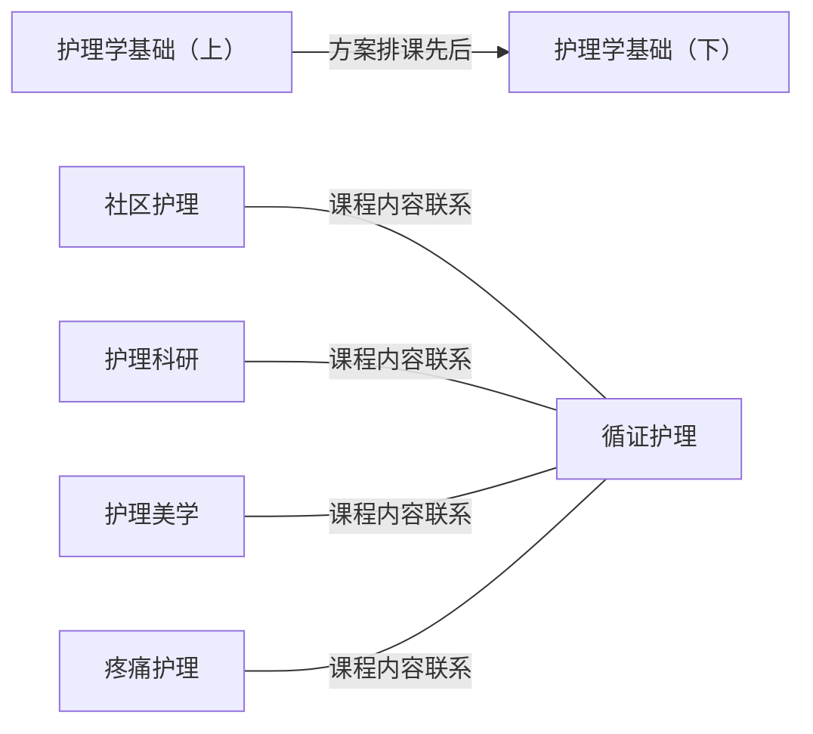

# 2025护理学专业本科培养方案

护理学院 · 护理学 · 方案 96691 · 64 个不同课程或科研条目。

[官方 Word](../originals/plan-96691.docx) · [教务详情](https://fdjwgl.fudan.edu.cn/manager/bizType/2/major-program-search/info/96691?skipAuth=1) · [方案快照](../raw/plan-96691.json.gz) · [年级目录](../README.md)

## 课程关系图

图中展示部分关系。下表保留全部已建立的课程对，来源位置使用本方案 JSON Pointer。

## 先修与内容联系

| 类型 | 起点 | 终点 | 依据 | 原表定位 |
| --- | --- | --- | --- | --- |
| 建议学习顺序 | 护理学基础（上） (NURS20002) | 护理学基础（下） (NURS20003) | 同方案的课程题名具有连续分册或序号。  | `/courseModules/8/planCourses/7`、`/courseModules/8/planCourses/11` |
| 方案排课先后 | 护理学基础（上） (NURS20002) | 护理学基础（下） (NURS20003) | 同方案该课程全部明确数字学期均早于后者。  | `/courseModules/8/planCourses/7`、`/courseModules/8/planCourses/11` |
| 课程内容联系 | 护理科研 (NURS20004) | 循证护理 (NURS50024) | 本方案两门课程的题名均含“护理”，可据此对照这一主题。  | `/courseModules/16/planCourses/4`、`/courseModules/12/planCourses/6` |
| 课程内容联系 | 社区护理 (NURS30007) | 循证护理 (NURS50024) | 本方案两门课程的题名均含“护理”，可据此对照这一主题。  | `/courseModules/8/planCourses/18`、`/courseModules/12/planCourses/6` |
| 课程内容联系 | 疼痛护理 (NURS50003) | 循证护理 (NURS50024) | 本方案两门课程的题名均含“护理”，可据此对照这一主题。  | `/courseModules/13/planCourses/5`、`/courseModules/12/planCourses/6` |
| 课程内容联系 | 护理美学 (NURS50004) | 循证护理 (NURS50024) | 本方案两门课程的题名均含“护理”，可据此对照这一主题。  | `/courseModules/13/planCourses/6`、`/courseModules/12/planCourses/6` |

本次未从可定位的明确表述中确认课程对课程预修。学期安排、系列分册与编辑建议均保留各自的依据。

## 按原方案模块阅读

同一模块展示原表中的课程归属。模块内课程之间的先后仍须逐项查阅。

- **医学基础课程**　现代生物科学导论C、有机化学（原表模块 7）
- **进阶必修课程**　护理学导论、护理教育学、护理管理学、护理伦理学（原表模块 11）
- **进阶选修课程**　元宇宙与未来医学、医学人工智能导论、老年护理、健康教育学、循证护理、卫生法学、流行病学（原表模块 12）

## 课程表

同一课程在不同模块分别出现时，按原表逐行列出。季节字段保留原值。

| 课程 | 代码 | 学分 | 学期 | 模块 |
| --- | --- | ---: | --- | --- |
| 高等数学D | MATH10008 | 4.0 | SPRING、AUTUMN | 培养方案 / 专业培养课程 / 学科基础课程 / 社会科学基础课程 |
| 有机化学 | CHEM10002 | 4.0 | 第2学期 | 培养方案 / 专业培养课程 / 学科基础课程 / 医学基础课程 |
| 现代生物科学导论C | BIOL10002 | 2.0 | 第1学期、第2学期 | 培养方案 / 专业培养课程 / 学科基础课程 / 医学基础课程 |
| 卫生统计学C | PHPM30013 | 2.0 | 第3学期 | 培养方案 / 专业培养课程 / 专业核心教育课程 |
| 正常人体形态与功能学IB | MED20021 | 3.0 | 第3学期 | 培养方案 / 专业培养课程 / 专业核心教育课程 |
| 正常人体形态与功能学ⅡB | MED20022 | 1.5 | 第3学期 | 培养方案 / 专业培养课程 / 专业核心教育课程 |
| 正常人体形态与功能学ⅢB | MED20023 | 1.5 | 第3学期 | 培养方案 / 专业培养课程 / 专业核心教育课程 |
| 正常人体形态与功能学ⅣB | MED20024 | 2.0 | 第3学期 | 培养方案 / 专业培养课程 / 专业核心教育课程 |
| 微生物学 | MED20033 | 3.0 | 第3学期 | 培养方案 / 专业培养课程 / 专业核心教育课程 |
| 免疫学 | MED20034 | 1.5 | 第3学期 | 培养方案 / 专业培养课程 / 专业核心教育课程 |
| 护理学基础（上） | NURS20002 | 3.0 | 第3学期 | 培养方案 / 专业培养课程 / 专业核心教育课程 |
| 健康评估 | NURS20001 | 5.5 | 第4学期 | 培养方案 / 专业培养课程 / 专业核心教育课程 |
| 药理学C | MED20011 | 4.0 | 第4学期 | 培养方案 / 专业培养课程 / 专业核心教育课程 |
| 疾病机制 | MED20035 | 3.0 | 第4学期 | 培养方案 / 专业培养课程 / 专业核心教育课程 |
| 护理学基础（下） | NURS20003 | 3.0 | 第4学期 | 培养方案 / 专业培养课程 / 专业核心教育课程 |
| 内科护理学 | NURS30001 | 8.0 | 第5学期 | 培养方案 / 专业培养课程 / 专业核心教育课程 |
| 儿科护理学 | NURS30002 | 3.0 | 第5学期 | 培养方案 / 专业培养课程 / 专业核心教育课程 |
| 急救护理学 | NURS30006 | 2.0 | 第5学期 | 培养方案 / 专业培养课程 / 专业核心教育课程 |
| 妇产科护理学 | NURS30009 | 4.0 | 第6学期 | 培养方案 / 专业培养课程 / 专业核心教育课程 |
| 精神科护理学 | NURS30003 | 2.0 | 第6学期 | 培养方案 / 专业培养课程 / 专业核心教育课程 |
| 外科护理学 | NURS30008 | 6.5 | 第6学期 | 培养方案 / 专业培养课程 / 专业核心教育课程 |
| 社区护理 | NURS30007 | 1.5 | 第6学期 | 培养方案 / 专业培养课程 / 专业核心教育课程 |
| 护理学导论 | NURS10001 | 1.0 | 第1学期 | 培养方案 / 专业进阶模块I / 进阶必修课程 |
| 护理教育学 | NURS30004 | 1.5 | 第5学期 | 培养方案 / 专业进阶模块I / 进阶必修课程 |
| 护理管理学 | NURS30005 | 1.5 | 第6学期 | 培养方案 / 专业进阶模块I / 进阶必修课程 |
| 护理伦理学 | NURS50009 | 1.0 | 第6学期 | 培养方案 / 专业进阶模块I / 进阶必修课程 |
| 医学人工智能导论 | MED130359 | 2.0 | 第1学期 | 培养方案 / 专业进阶模块I / 进阶选修课程 |
| 元宇宙与未来医学 | GECC20053 | 2.0 | 第2学期 | 培养方案 / 专业进阶模块I / 进阶选修课程 |
| 卫生法学 | PHPM20003 | 2.0 | 第4学期 | 培养方案 / 专业进阶模块I / 进阶选修课程 |
| 流行病学 | PHPM30015 | 2.5 | 第6学期 | 培养方案 / 专业进阶模块I / 进阶选修课程 |
| 老年护理 | NURS50002 | 2.0 | 第6学期 | 培养方案 / 专业进阶模块I / 进阶选修课程 |
| 健康教育学 | NURS50014 | 1.5 | 第8学期 | 培养方案 / 专业进阶模块I / 进阶选修课程 |
| 循证护理 | NURS50024 | 3.0 |  | 培养方案 / 专业进阶模块I / 进阶选修课程 |
| 针灸与推拿学 | MED40019 | 2.0 | SPRING、AUTUMN | 培养方案 / 专业进阶模块II |
| 新发传染病 | MED50011 | 2.0 | SPRING、AUTUMN | 培养方案 / 专业进阶模块II |
| 医患交流技巧 | MED30040 | 2.0 | AUTUMN | 培养方案 / 专业进阶模块II |
| 医学与生物安全 | MED20036 | 2.0 | SPRING、AUTUMN | 培养方案 / 专业进阶模块II |
| 肿瘤护理 | NURS50001 | 2.0 | SPRING、AUTUMN | 培养方案 / 专业进阶模块II |
| 疼痛护理 | NURS50003 | 2.0 | SPRING、AUTUMN | 培养方案 / 专业进阶模块II |
| 护理美学 | NURS50004 | 2.0 | SPRING、AUTUMN | 培养方案 / 专业进阶模块II |
| 循证护理概论 | NURS50005 | 2.0 | SPRING、AUTUMN | 培养方案 / 专业进阶模块II |
| 安宁疗护概论 | NURS50010 | 2.0 | SPRING、AUTUMN | 培养方案 / 专业进阶模块II |
| 中医护理学 | MED40020 | 2.0 | SPRING | 培养方案 / 专业进阶模块II |
| 传染病护理学 | NURS50007 | 1.0 | AUTUMN | 培养方案 / 专业进阶模块II |
| 医学营养学 | PHPM20010 | 2.0 | SPRING | 培养方案 / 专业进阶模块II |
| 学术前沿专题 | NURS50006 | 1.0 | SPRING | 培养方案 / 专业进阶模块II |
| 社会医学 | PHPM20001 | 2.0 | AUTUMN | 培养方案 / 专业进阶模块II |
| 全球卫生导论 | PHPM20013 | 2.0 | SPRING | 培养方案 / 专业进阶模块II |
| 五官科护理学 | NURS50017 | 2.0 | AUTUMN | 培养方案 / 专业进阶模块II |
| 心理护理探新：理论与实践 | NURS50016 | 2.0 | SPRING、AUTUMN | 培养方案 / 专业进阶模块II |
| 健康与护理（H） | NURS50008h | 4.0 | 第1学期 | 培养方案 / 荣誉课程 |
| 急救护理学（H） | NURS30006h | 4.0 | 第5学期 | 培养方案 / 荣誉课程 |
| 循证护理概论(H) | NURS50005h | 4.0 | 第3学期 | 培养方案 / 荣誉课程 |
| 护理科研（H) | NURS20004h | 4.0 | 第4学期 | 培养方案 / 荣誉课程 |
| 老年护理（H） | NURS50002h | 4.0 | 第6学期 | 培养方案 / 荣誉课程 |
| 社区护理学（H） | NURS30007h | 4.0 | 第6学期 | 培养方案 / 荣誉课程 |
| 复芏计划(FDUROP) | 102 | 0.0 |  | 融合创新能力 |
| 健康与护理 | NURS50008 | 1.5 | 第1学期 | 融合创新能力 |
| 护理创新设计理论与实践 | NURS50011 | 1.0 | 第2学期 | 融合创新能力 |
| 护理学社会实践 | NURS50015 | 2.0 | 第3学期 | 融合创新能力 |
| 护理科研 | NURS20004 | 2.0 | 第4学期 | 融合创新能力 |
| AI赋能护理科研与实践的策略与方法 | AIS531013 | 2.0 | 第5学期 | 融合创新能力 |
| 毕业论文 | NURS40001 | 2.0 | 第7学期、第8学期 | 融合创新能力 |
| 毕业实习 | NURS40002 | 10.0 | 第7学期、第8学期 | 融合创新能力 |
