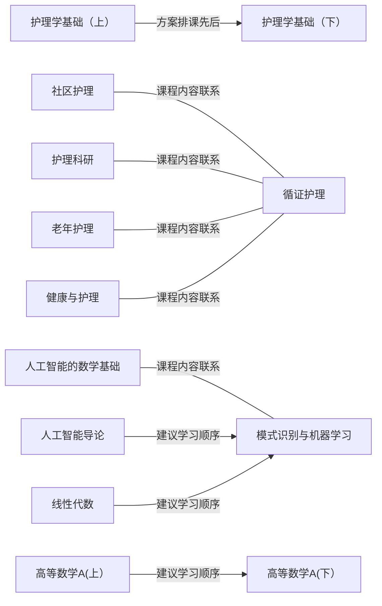

# 2025护理学-人工智能双学士学位项目培养方案

护理学院 · 护理学-人工智能(双学士学位项目) · 方案 96727 · 73 个不同课程或科研条目。

[官方 Word](../originals/plan-96727.docx) · [教务详情](https://fdjwgl.fudan.edu.cn/manager/bizType/2/major-program-search/info/96727?skipAuth=1) · [方案快照](../raw/plan-96727.json.gz) · [年级目录](../README.md)

## 课程关系图

图中展示部分关系。下表保留全部已建立的课程对，来源位置使用本方案 JSON Pointer。

## 先修与内容联系

| 类型 | 起点 | 终点 | 依据 | 原表定位 |
| --- | --- | --- | --- | --- |
| 建议学习顺序 | 人工智能导论 (AIE310005) | 模式识别与机器学习 (AIE410001) | 人工智能问题与模型类别可为学习模式识别作准备。  | `/courseModules/11/planCourses/4`、`/courseModules/11/planCourses/6` |
| 建议学习顺序 | 线性代数 (CS10003) | 模式识别与机器学习 (AIE410001) | 向量表示和矩阵运算支持理解分类、回归等模型。  | `/courseModules/8/planCourses/0`、`/courseModules/11/planCourses/6` |
| 建议学习顺序 | 高等数学A(上） (MATH10015) | 高等数学A(下） (MATH10016) | 同方案的课程题名具有连续分册或序号。  | `/courseModules/6/planCourses/0`、`/courseModules/6/planCourses/1` |
| 建议学习顺序 | 护理学基础（上） (NURS20002) | 护理学基础（下） (NURS20003) | 同方案的课程题名具有连续分册或序号。  | `/courseModules/10/planCourses/7`、`/courseModules/10/planCourses/11` |
| 方案排课先后 | 护理学基础（上） (NURS20002) | 护理学基础（下） (NURS20003) | 同方案该课程全部明确数字学期均早于后者。  | `/courseModules/10/planCourses/7`、`/courseModules/10/planCourses/11` |
| 课程内容联系 | 人工智能伦理 (AIB310001) | 人工智能导论 (AIE310005) | 本方案两门课程的题名均含“人工智能”，可据此对照这一主题。  | `/courseModules/11/planCourses/8`、`/courseModules/11/planCourses/4` |
| 课程内容联系 | 人工智能伦理 (AIB310001) | 人工智能的数学基础 (AIE310009) | 本方案两门课程的题名均含“人工智能”，可据此对照这一主题。  | `/courseModules/11/planCourses/8`、`/courseModules/11/planCourses/2` |
| 课程内容联系 | 人工智能伦理 (AIB310001) | 人工智能安全 (AIE831001) | 本方案两门课程的题名均含“人工智能”，可据此对照这一主题。  | `/courseModules/11/planCourses/8`、`/courseModules/11/planCourses/7` |
| 课程内容联系 | 人工智能伦理 (AIB310001) | 医学人工智能导论 (MED130359) | 本方案两门课程的题名均含“人工智能”，可据此对照这一主题。  | `/courseModules/11/planCourses/8`、`/courseModules/14/planCourses/0` |
| 课程内容联系 | 计算机系统基础 (AIE210006) | 计算机组成与体系结构 (CS30052) | 处理器、存储与系统执行模型具有共同内容。  | `/courseModules/11/planCourses/3`、`/courseModules/14/planCourses/9` |
| 课程内容联系 | 人工智能的数学基础 (AIE310009) | 模式识别与机器学习 (AIE410001) | 数学表达与学习模型的统计、优化工具可对照。  | `/courseModules/11/planCourses/2`、`/courseModules/11/planCourses/6` |
| 课程内容联系 | 模式识别与机器学习 (AIE410001) | 机器学习系统 (CS30058) | 本方案两门课程的题名均含“机器学习”，可据此对照这一主题。  | `/courseModules/11/planCourses/6`、`/courseModules/14/planCourses/13` |
| 课程内容联系 | 护理科研 (NURS20004) | 循证护理 (NURS50024) | 本方案两门课程的题名均含“护理”，可据此对照这一主题。  | `/courseModules/17/planCourses/4`、`/courseModules/14/planCourses/15` |
| 课程内容联系 | 社区护理 (NURS30007) | 循证护理 (NURS50024) | 本方案两门课程的题名均含“护理”，可据此对照这一主题。  | `/courseModules/10/planCourses/18`、`/courseModules/14/planCourses/15` |
| 课程内容联系 | 老年护理 (NURS50002) | 循证护理 (NURS50024) | 本方案两门课程的题名均含“护理”，可据此对照这一主题。  | `/courseModules/13/planCourses/4`、`/courseModules/14/planCourses/15` |
| 课程内容联系 | 健康与护理 (NURS50008) | 循证护理 (NURS50024) | 本方案两门课程的题名均含“护理”，可据此对照这一主题。  | `/courseModules/17/planCourses/1`、`/courseModules/14/planCourses/15` |

本次未从可定位的明确表述中确认课程对课程预修。学期安排、系列分册与编辑建议均保留各自的依据。

## 按原方案模块阅读

同一模块展示原表中的课程归属。模块内课程之间的先后仍须逐项查阅。

- **社会科学基础课程**　高等数学A(上）、高等数学A(下）（原表模块 6）
- **医学基础课程**　现代生物科学导论C、有机化学（原表模块 7）
- **工学基础课程**　线性代数、程序设计（原表模块 8）

## 课程表

同一课程在不同模块分别出现时，按原表逐行列出。季节字段保留原值。

| 课程 | 代码 | 学分 | 学期 | 模块 |
| --- | --- | ---: | --- | --- |
| 高等数学A(上） | MATH10015 | 5.0 | SPRING、AUTUMN | 培养方案 / 专业培养课程 / 学科基础课程 / 社会科学基础课程 |
| 高等数学A(下） | MATH10016 | 5.0 | SPRING、AUTUMN | 培养方案 / 专业培养课程 / 学科基础课程 / 社会科学基础课程 |
| 有机化学 | CHEM10002 | 4.0 | 第2学期 | 培养方案 / 专业培养课程 / 学科基础课程 / 医学基础课程 |
| 现代生物科学导论C | BIOL10002 | 2.0 | 第1学期、第2学期 | 培养方案 / 专业培养课程 / 学科基础课程 / 医学基础课程 |
| 线性代数 | CS10003 | 3.0 | AUTUMN | 培养方案 / 专业培养课程 / 学科基础课程 / 工学基础课程 |
| 程序设计 | CS10004 | 4.0 | 第1学期 | 培养方案 / 专业培养课程 / 学科基础课程 / 工学基础课程 |
| 卫生统计学C | PHPM30013 | 2.0 | 第3学期 | 培养方案 / 专业培养课程 / 专业核心教育课程 / A组 |
| 正常人体形态与功能学IB | MED20021 | 3.0 | 第3学期 | 培养方案 / 专业培养课程 / 专业核心教育课程 / A组 |
| 正常人体形态与功能学ⅡB | MED20022 | 1.5 | 第3学期 | 培养方案 / 专业培养课程 / 专业核心教育课程 / A组 |
| 正常人体形态与功能学ⅢB | MED20023 | 1.5 | 第3学期 | 培养方案 / 专业培养课程 / 专业核心教育课程 / A组 |
| 正常人体形态与功能学ⅣB | MED20024 | 2.0 | 第3学期 | 培养方案 / 专业培养课程 / 专业核心教育课程 / A组 |
| 微生物学 | MED20033 | 3.0 | 第3学期 | 培养方案 / 专业培养课程 / 专业核心教育课程 / A组 |
| 免疫学 | MED20034 | 1.5 | 第3学期 | 培养方案 / 专业培养课程 / 专业核心教育课程 / A组 |
| 护理学基础（上） | NURS20002 | 3.0 | 第3学期 | 培养方案 / 专业培养课程 / 专业核心教育课程 / A组 |
| 健康评估 | NURS20001 | 5.5 | 第4学期 | 培养方案 / 专业培养课程 / 专业核心教育课程 / A组 |
| 药理学C | MED20011 | 4.0 | 第4学期 | 培养方案 / 专业培养课程 / 专业核心教育课程 / A组 |
| 疾病机制 | MED20035 | 3.0 | 第4学期 | 培养方案 / 专业培养课程 / 专业核心教育课程 / A组 |
| 护理学基础（下） | NURS20003 | 3.0 | 第4学期 | 培养方案 / 专业培养课程 / 专业核心教育课程 / A组 |
| 内科护理学 | NURS30001 | 8.0 | 第5学期 | 培养方案 / 专业培养课程 / 专业核心教育课程 / A组 |
| 儿科护理学 | NURS30002 | 3.0 | 第5学期 | 培养方案 / 专业培养课程 / 专业核心教育课程 / A组 |
| 急救护理学 | NURS30006 | 2.0 | 第5学期 | 培养方案 / 专业培养课程 / 专业核心教育课程 / A组 |
| 妇产科护理学 | NURS30009 | 4.0 | 第6学期 | 培养方案 / 专业培养课程 / 专业核心教育课程 / A组 |
| 精神科护理学 | NURS30003 | 2.0 | 第6学期 | 培养方案 / 专业培养课程 / 专业核心教育课程 / A组 |
| 外科护理学 | NURS30008 | 6.5 | 第6学期 | 培养方案 / 专业培养课程 / 专业核心教育课程 / A组 |
| 社区护理 | NURS30007 | 1.5 | 第6学期 | 培养方案 / 专业培养课程 / 专业核心教育课程 / A组 |
| 人工智能的编程基础 | AIE310006 | 2.0 | 第2学期 | 培养方案 / 专业培养课程 / 专业核心教育课程 / B组 |
| 数据结构 | AIE310007 | 4.0 | AUTUMN | 培养方案 / 专业培养课程 / 专业核心教育课程 / B组 |
| 人工智能的数学基础 | AIE310009 | 3.0 | AUTUMN | 培养方案 / 专业培养课程 / 专业核心教育课程 / B组 |
| 计算机系统基础 | AIE210006 | 3.0 | AUTUMN | 培养方案 / 专业培养课程 / 专业核心教育课程 / B组 |
| 人工智能导论 | AIE310005 | 3.0 | 第4学期 | 培养方案 / 专业培养课程 / 专业核心教育课程 / B组 |
| 人工智能的软件基础 | AIE310008 | 3.0 | 第4学期 | 培养方案 / 专业培养课程 / 专业核心教育课程 / B组 |
| 模式识别与机器学习 | AIE410001 | 3.0 | AUTUMN | 培养方案 / 专业培养课程 / 专业核心教育课程 / B组 |
| 人工智能安全 | AIE831001 | 3.0 | AUTUMN | 培养方案 / 专业培养课程 / 专业核心教育课程 / B组 |
| 人工智能伦理 | AIB310001 | 2.0 | AUTUMN | 培养方案 / 专业培养课程 / 专业核心教育课程 / B组 |
| 自然语言处理与大语言模型 | AIE410002 | 3.0 | 第6学期 | 培养方案 / 专业培养课程 / 专业核心教育课程 / B组 |
| 计算机视觉 | AIE310004 | 3.0 | AUTUMN | 培养方案 / 专业培养课程 / 专业核心教育课程 / B组 |
| 人工智能前沿探索实践 | AIE531001 | 3.0 | AUTUMN | 培养方案 / 专业培养课程 / 专业核心教育课程 / B组 |
| 护理学导论 | NURS10001 | 1.0 | 第1学期 | 培养方案 / 专业进阶模块Ⅰ |
| 护理伦理学 | NURS50009 | 1.0 | 第6学期 | 培养方案 / 专业进阶模块Ⅰ |
| 护理教育学 | NURS30004 | 1.5 | 第5学期 | 培养方案 / 专业进阶模块Ⅰ |
| 护理管理学 | NURS30005 | 1.5 | 第6学期 | 培养方案 / 专业进阶模块Ⅰ |
| 老年护理 | NURS50002 | 2.0 | 第6学期 | 培养方案 / 专业进阶模块Ⅰ |
| 循证护理概论 | NURS50005 | 2.0 | SPRING、AUTUMN | 培养方案 / 专业进阶模块Ⅰ |
| 医学人工智能导论 | MED130359 | 2.0 | 第1学期 | 培养方案 / 专业进阶模块Ⅱ |
| 元宇宙与未来医学 | GECC20053 | 2.0 | 第2学期 | 培养方案 / 专业进阶模块Ⅱ |
| 具身智能引论 | AIB310002 | 3.0 | AUTUMN | 培养方案 / 专业进阶模块Ⅱ |
| 深度学习基础 | AIB310003 | 3.0 | AUTUMN | 培养方案 / 专业进阶模块Ⅱ |
| 信息论、控制论、系统论基础 | AIE631001 | 3.0 | 第4学期 | 培养方案 / 专业进阶模块Ⅱ |
| 可信大模型 | AIS631005 | 3.0 | AUTUMN | 培养方案 / 专业进阶模块Ⅱ |
| 大模型理论与方法 | AIS531006 | 3.0 | AUTUMN | 培养方案 / 专业进阶模块Ⅱ |
| 人工智能、数据挖掘与算法：社会研究方法的新范式 | AIS631009 | 3.0 | 第6学期 | 培养方案 / 专业进阶模块Ⅱ |
| 集合与图论 | CS30043 | 3.0 | 第3学期 | 培养方案 / 专业进阶模块Ⅱ |
| 计算机组成与体系结构 | CS30052 | 4.0 | 第4学期 | 培养方案 / 专业进阶模块Ⅱ |
| 数据库引论 | CS20010 | 3.0 | 第4学期 | 培养方案 / 专业进阶模块Ⅱ |
| 计算机网络 | CS30036 | 3.0 | 第5学期 | 培养方案 / 专业进阶模块Ⅱ |
| 软件工程 | CS30018 | 3.0 | 第6学期 | 培养方案 / 专业进阶模块Ⅱ |
| 机器学习系统 | CS30058 | 3.0 | 第6学期 | 培养方案 / 专业进阶模块Ⅱ |
| 计算机图形学A | CS30019 | 3.0 | 第6学期 | 培养方案 / 专业进阶模块Ⅱ |
| 循证护理 | NURS50024 | 3.0 |  | 培养方案 / 专业进阶模块Ⅱ |
| 健康与护理（H） | NURS50008h | 4.0 | 第1学期 | 培养方案 / 荣誉课程 |
| 急救护理学（H） | NURS30006h | 4.0 | 第5学期 | 培养方案 / 荣誉课程 |
| 循证护理概论(H) | NURS50005h | 4.0 | 第3学期 | 培养方案 / 荣誉课程 |
| 护理科研（H) | NURS20004h | 4.0 | 第4学期 | 培养方案 / 荣誉课程 |
| 老年护理（H） | NURS50002h | 4.0 | 第6学期 | 培养方案 / 荣誉课程 |
| 社区护理学（H） | NURS30007h | 4.0 | 第6学期 | 培养方案 / 荣誉课程 |
| 复芏计划(FDUROP) | 102 | 0.0 |  | 融合创新能力 |
| 健康与护理 | NURS50008 | 1.5 | 第1学期 | 融合创新能力 |
| 护理创新设计理论与实践 | NURS50011 | 1.0 | 第2学期 | 融合创新能力 |
| 护理学社会实践 | NURS50015 | 2.0 | 第3学期 | 融合创新能力 |
| 护理科研 | NURS20004 | 2.0 | 第4学期 | 融合创新能力 |
| AI赋能护理科研与实践的策略与方法 | AIS531013 | 2.0 | 第5学期 | 融合创新能力 |
| 毕业论文 | NURS40001 | 2.0 | 第7学期、第8学期 | 融合创新能力 |
| 毕业实习 | NURS40002 | 10.0 | 第7学期、第8学期 | 融合创新能力 |
