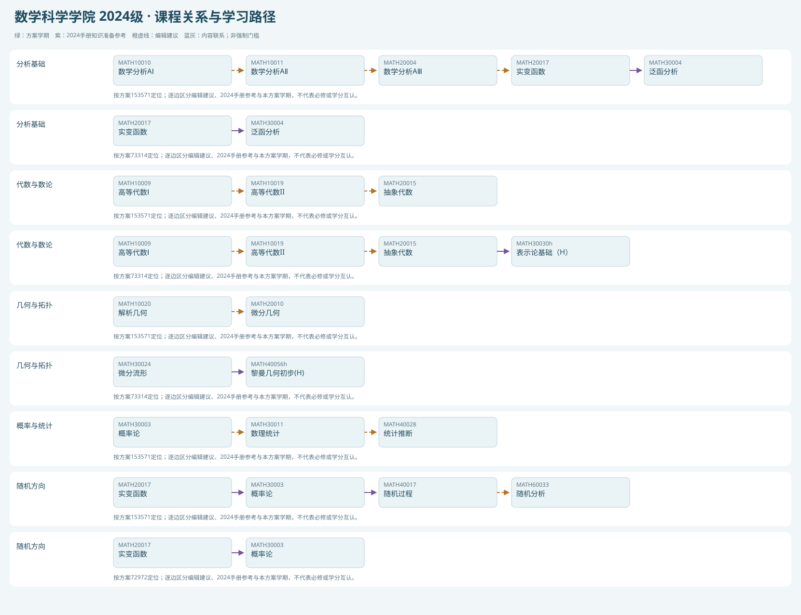

# 数学科学学院2024级课程关系图谱

[交互HTML](index.html)（下载后打开） · [课程关系与先修梳理](learning-paths.md) · [图谱JSON](graph.json) · [节点CSV](nodes.csv) · [关系CSV](edges.csv) · [原件与适用方案](../README.md)

关系区分本年级方案学期、2024版手册知识准备参考、编辑建议和内容联系；尚未确认本年级强制选课门槛。图谱含246个课程/科研条目，其中246个为方案内课程与科研条目、0个仅公共候选；另有118个模块节点。模块收录不代表全部必修，详情与原始定位见[source-audit.json](source-audit.json)。

## 手册与原图

[2024版手册原件](../../sources/math-handbook-2024.pdf) · [大纲基本要求摘录](../../sources/handbook-course-requirements.json) · [本年级官方内嵌图](../official/source-figures.html)
