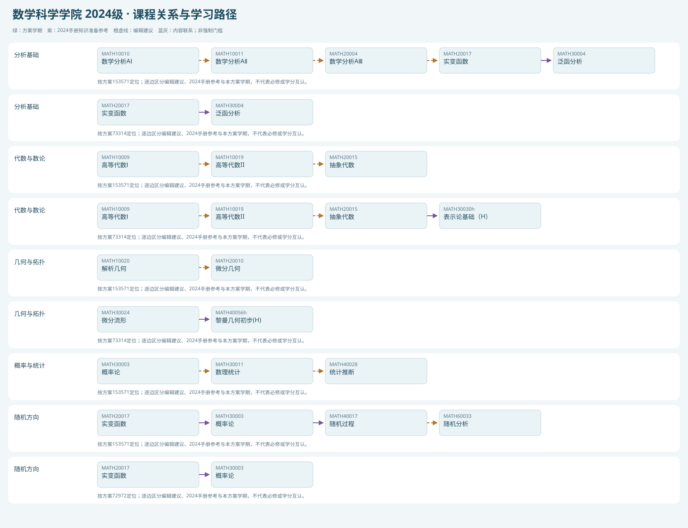

# 数学科学学院2024级课程关系与先修梳理

以下区分本年级数字学期、2024版手册的预修/基础参考与编辑建议；尚未确认本年级选课系统强制门槛。模块候选收录另见graph.json，不当作先修。

## 逐条课程关系

| 起点 | 终点 | 类型 | 理由 | 依据 |
| --- | --- | --- | --- | --- |
| 数学分析AⅠ MATH10010 | 数学分析AⅡ MATH10011 | 建议先学（编辑判断） | 先掌握极限、连续和微分，再进入积分与级数。 | [方案153571](https://fdjwgl.fudan.edu.cn/manager/bizType/2/major-program-search/info/153571?skipAuth=1)；[方案72704](https://fdjwgl.fudan.edu.cn/manager/bizType/2/major-program-search/info/72704?skipAuth=1)；等8个方案，完整范围见JSON |
| 数学分析AⅠ MATH10010 | 数学分析AⅡ MATH10011 | 本方案学期在先（非先修） | 同一方案的terms数字学期前者全部早于后者；不将学期差认定为先修。 | [方案153571](https://fdjwgl.fudan.edu.cn/manager/bizType/2/major-program-search/info/153571?skipAuth=1)；[方案72704](https://fdjwgl.fudan.edu.cn/manager/bizType/2/major-program-search/info/72704?skipAuth=1)；等8个方案，完整范围见JSON |
| 数学分析AⅡ MATH10011 | 数学分析AⅢ MATH20004 | 建议先学（编辑判断） | 积分与级数为多元分析的继续学习提供基础。 | [方案153571](https://fdjwgl.fudan.edu.cn/manager/bizType/2/major-program-search/info/153571?skipAuth=1)；[方案72704](https://fdjwgl.fudan.edu.cn/manager/bizType/2/major-program-search/info/72704?skipAuth=1)；等8个方案，完整范围见JSON |
| 数学分析AⅡ MATH10011 | 数学分析AⅢ MATH20004 | 本方案学期在先（非先修） | 同一方案的terms数字学期前者全部早于后者；不将学期差认定为先修。 | [方案153571](https://fdjwgl.fudan.edu.cn/manager/bizType/2/major-program-search/info/153571?skipAuth=1)；[方案72704](https://fdjwgl.fudan.edu.cn/manager/bizType/2/major-program-search/info/72704?skipAuth=1)；等8个方案，完整范围见JSON |
| 数学分析AⅠ(H) MATH10010h | 数学分析AⅡ(H) MATH10011h | 建议先学（编辑判断） | 荣誉分析系列按自身阶段学习，不能与普通系列默认互认。 | [方案72716](https://fdjwgl.fudan.edu.cn/manager/bizType/2/major-program-search/info/72716?skipAuth=1)；[方案72972](https://fdjwgl.fudan.edu.cn/manager/bizType/2/major-program-search/info/72972?skipAuth=1)；等3个方案，完整范围见JSON |
| 数学分析AⅠ(H) MATH10010h | 数学分析AⅡ(H) MATH10011h | 本方案学期在先（非先修） | 同一方案的terms数字学期前者全部早于后者；不将学期差认定为先修。 | [方案72716](https://fdjwgl.fudan.edu.cn/manager/bizType/2/major-program-search/info/72716?skipAuth=1)；[方案72972](https://fdjwgl.fudan.edu.cn/manager/bizType/2/major-program-search/info/72972?skipAuth=1)；等3个方案，完整范围见JSON |
| 高等代数Ⅰ MATH10009 | 高等代数II MATH10019 | 建议先学（编辑判断） | 线性空间、线性映射和矩阵的基础支持后续代数学习。 | [方案153571](https://fdjwgl.fudan.edu.cn/manager/bizType/2/major-program-search/info/153571?skipAuth=1)；[方案72704](https://fdjwgl.fudan.edu.cn/manager/bizType/2/major-program-search/info/72704?skipAuth=1)；等11个方案，完整范围见JSON |
| 高等代数Ⅰ MATH10009 | 高等代数II MATH10019 | 本方案学期在先（非先修） | 同一方案的terms数字学期前者全部早于后者；不将学期差认定为先修。 | [方案153571](https://fdjwgl.fudan.edu.cn/manager/bizType/2/major-program-search/info/153571?skipAuth=1)；[方案72704](https://fdjwgl.fudan.edu.cn/manager/bizType/2/major-program-search/info/72704?skipAuth=1)；等11个方案，完整范围见JSON |
| 高等代数II MATH10019 | 抽象代数 MATH20015 | 建议先学（编辑判断） | 线性代数中的结构观点有助于进入群、环、域。 | [方案153571](https://fdjwgl.fudan.edu.cn/manager/bizType/2/major-program-search/info/153571?skipAuth=1)；[方案72704](https://fdjwgl.fudan.edu.cn/manager/bizType/2/major-program-search/info/72704?skipAuth=1)；等11个方案，完整范围见JSON |
| 高等代数II MATH10019 | 抽象代数 MATH20015 | 本方案学期在先（非先修） | 同一方案的terms数字学期前者全部早于后者；不将学期差认定为先修。 | [方案153571](https://fdjwgl.fudan.edu.cn/manager/bizType/2/major-program-search/info/153571?skipAuth=1)；[方案72704](https://fdjwgl.fudan.edu.cn/manager/bizType/2/major-program-search/info/72704?skipAuth=1)；等11个方案，完整范围见JSON |
| 抽象代数 MATH20015 | 抽象代数II MATH20013 | 建议先学（编辑判断） | 一般代数结构的基础可为进一步代数学作准备。 | [方案153571](https://fdjwgl.fudan.edu.cn/manager/bizType/2/major-program-search/info/153571?skipAuth=1)；[方案72704](https://fdjwgl.fudan.edu.cn/manager/bizType/2/major-program-search/info/72704?skipAuth=1)；等8个方案，完整范围见JSON |
| 抽象代数 MATH20015 | 抽象代数II MATH20013 | 本方案学期在先（非先修） | 同一方案的terms数字学期前者全部早于后者；不将学期差认定为先修。 | [方案153571](https://fdjwgl.fudan.edu.cn/manager/bizType/2/major-program-search/info/153571?skipAuth=1)；[方案72704](https://fdjwgl.fudan.edu.cn/manager/bizType/2/major-program-search/info/72704?skipAuth=1)；等6个方案，完整范围见JSON |
| 抽象代数II MATH20013 | 抽象代数续论 MATH50019 | 建议先学（编辑判断） | 由基础代数结构向进一步代数理论延伸。 | [方案153571](https://fdjwgl.fudan.edu.cn/manager/bizType/2/major-program-search/info/153571?skipAuth=1)；[方案72704](https://fdjwgl.fudan.edu.cn/manager/bizType/2/major-program-search/info/72704?skipAuth=1)；等8个方案，完整范围见JSON |
| 数学分析AⅢ MATH20004 | 实变函数 MATH20017 | 建议先学（编辑判断） | 多元微积分与极限方法有助于理解测度和积分。 | [方案153571](https://fdjwgl.fudan.edu.cn/manager/bizType/2/major-program-search/info/153571?skipAuth=1)；[方案72704](https://fdjwgl.fudan.edu.cn/manager/bizType/2/major-program-search/info/72704?skipAuth=1)；等8个方案，完整范围见JSON |
| 数学分析AⅢ MATH20004 | 实变函数 MATH20017 | 本方案学期在先（非先修） | 同一方案的terms数字学期前者全部早于后者；不将学期差认定为先修。 | [方案153571](https://fdjwgl.fudan.edu.cn/manager/bizType/2/major-program-search/info/153571?skipAuth=1)；[方案72704](https://fdjwgl.fudan.edu.cn/manager/bizType/2/major-program-search/info/72704?skipAuth=1)；等8个方案，完整范围见JSON |
| 数学分析AⅡ MATH10011 | 复变函数 MATH20016 | 建议先学（编辑判断） | 微积分和级数方法有助于进入复分析。 | [方案153571](https://fdjwgl.fudan.edu.cn/manager/bizType/2/major-program-search/info/153571?skipAuth=1)；[方案72704](https://fdjwgl.fudan.edu.cn/manager/bizType/2/major-program-search/info/72704?skipAuth=1)；等8个方案，完整范围见JSON |
| 数学分析AⅡ MATH10011 | 复变函数 MATH20016 | 本方案学期在先（非先修） | 同一方案的terms数字学期前者全部早于后者；不将学期差认定为先修。 | [方案153571](https://fdjwgl.fudan.edu.cn/manager/bizType/2/major-program-search/info/153571?skipAuth=1)；[方案72704](https://fdjwgl.fudan.edu.cn/manager/bizType/2/major-program-search/info/72704?skipAuth=1)；等8个方案，完整范围见JSON |
| 数学分析AⅡ MATH10011 | 常微分方程 MATH20014 | 建议先学（编辑判断） | 微分、积分与级数方法支持微分方程学习。 | [方案153571](https://fdjwgl.fudan.edu.cn/manager/bizType/2/major-program-search/info/153571?skipAuth=1)；[方案72704](https://fdjwgl.fudan.edu.cn/manager/bizType/2/major-program-search/info/72704?skipAuth=1)；等8个方案，完整范围见JSON |
| 数学分析AⅡ MATH10011 | 常微分方程 MATH20014 | 本方案学期在先（非先修） | 同一方案的terms数字学期前者全部早于后者；不将学期差认定为先修。 | [方案153571](https://fdjwgl.fudan.edu.cn/manager/bizType/2/major-program-search/info/153571?skipAuth=1)；[方案72704](https://fdjwgl.fudan.edu.cn/manager/bizType/2/major-program-search/info/72704?skipAuth=1)；等8个方案，完整范围见JSON |
| 高等代数II MATH10019 | 常微分方程 MATH20014 | 建议先学（编辑判断） | 线性代数有助于理解线性微分方程组。 | [方案153571](https://fdjwgl.fudan.edu.cn/manager/bizType/2/major-program-search/info/153571?skipAuth=1)；[方案72704](https://fdjwgl.fudan.edu.cn/manager/bizType/2/major-program-search/info/72704?skipAuth=1)；等11个方案，完整范围见JSON |
| 高等代数II MATH10019 | 常微分方程 MATH20014 | 本方案学期在先（非先修） | 同一方案的terms数字学期前者全部早于后者；不将学期差认定为先修。 | [方案153571](https://fdjwgl.fudan.edu.cn/manager/bizType/2/major-program-search/info/153571?skipAuth=1)；[方案72704](https://fdjwgl.fudan.edu.cn/manager/bizType/2/major-program-search/info/72704?skipAuth=1)；等11个方案，完整范围见JSON |
| 解析几何 MATH10020 | 微分几何 MATH20010 | 建议先学（编辑判断） | 空间曲线曲面的几何描述有助于微分几何学习。 | [方案153571](https://fdjwgl.fudan.edu.cn/manager/bizType/2/major-program-search/info/153571?skipAuth=1)；[方案72704](https://fdjwgl.fudan.edu.cn/manager/bizType/2/major-program-search/info/72704?skipAuth=1)；等8个方案，完整范围见JSON |
| 解析几何 MATH10020 | 微分几何 MATH20010 | 本方案学期在先（非先修） | 同一方案的terms数字学期前者全部早于后者；不将学期差认定为先修。 | [方案153571](https://fdjwgl.fudan.edu.cn/manager/bizType/2/major-program-search/info/153571?skipAuth=1)；[方案72704](https://fdjwgl.fudan.edu.cn/manager/bizType/2/major-program-search/info/72704?skipAuth=1)；等8个方案，完整范围见JSON |
| 数学分析AⅢ MATH20004 | 微分几何 MATH20010 | 建议先学（编辑判断） | 多元微积分可支持曲线曲面与局部坐标的分析。 | [方案153571](https://fdjwgl.fudan.edu.cn/manager/bizType/2/major-program-search/info/153571?skipAuth=1)；[方案72704](https://fdjwgl.fudan.edu.cn/manager/bizType/2/major-program-search/info/72704?skipAuth=1)；等8个方案，完整范围见JSON |
| 数学分析AⅢ MATH20004 | 微分几何 MATH20010 | 本方案学期在先（非先修） | 同一方案的terms数字学期前者全部早于后者；不将学期差认定为先修。 | [方案153571](https://fdjwgl.fudan.edu.cn/manager/bizType/2/major-program-search/info/153571?skipAuth=1)；[方案72704](https://fdjwgl.fudan.edu.cn/manager/bizType/2/major-program-search/info/72704?skipAuth=1)；等8个方案，完整范围见JSON |
| 微分几何 MATH20010 | 微分几何续论 MATH30022 | 建议先学（编辑判断） | 基础曲线曲面理论可为进一步几何学习作准备。 | [方案153571](https://fdjwgl.fudan.edu.cn/manager/bizType/2/major-program-search/info/153571?skipAuth=1)；[方案72704](https://fdjwgl.fudan.edu.cn/manager/bizType/2/major-program-search/info/72704?skipAuth=1)；等8个方案，完整范围见JSON |
| 概率论 MATH30003 | 数理统计 MATH30011 | 建议先学（编辑判断） | 随机变量和分布是统计估计与检验的基础。 | [方案153571](https://fdjwgl.fudan.edu.cn/manager/bizType/2/major-program-search/info/153571?skipAuth=1)；[方案72704](https://fdjwgl.fudan.edu.cn/manager/bizType/2/major-program-search/info/72704?skipAuth=1)；等11个方案，完整范围见JSON |
| 数理统计 MATH30011 | 统计推断 MATH40028 | 建议先学（编辑判断） | 基本估计与检验方法支持进一步统计推断。 | [方案153571](https://fdjwgl.fudan.edu.cn/manager/bizType/2/major-program-search/info/153571?skipAuth=1)；[方案72704](https://fdjwgl.fudan.edu.cn/manager/bizType/2/major-program-search/info/72704?skipAuth=1)；等11个方案，完整范围见JSON |
| 随机过程 MATH40017 | 随机分析 MATH60033 | 建议先学（编辑判断） | 随机过程的基础支持随机积分和随机微分方程学习。 | [方案153571](https://fdjwgl.fudan.edu.cn/manager/bizType/2/major-program-search/info/153571?skipAuth=1)；[方案72704](https://fdjwgl.fudan.edu.cn/manager/bizType/2/major-program-search/info/72704?skipAuth=1)；等10个方案，完整范围见JSON |
| 概率论 MATH30003 | 现代概率论基础I MATH50027 | 建议先学（编辑判断） | 基础概率论支持测度论框架下的概率学习。 | [方案153571](https://fdjwgl.fudan.edu.cn/manager/bizType/2/major-program-search/info/153571?skipAuth=1)；[方案72704](https://fdjwgl.fudan.edu.cn/manager/bizType/2/major-program-search/info/72704?skipAuth=1)；等11个方案，完整范围见JSON |
| 现代概率论基础I MATH50027 | 现代概率论基础II MATH50028 | 建议先学（编辑判断） | 同一系列按阶段学习。 | [方案153571](https://fdjwgl.fudan.edu.cn/manager/bizType/2/major-program-search/info/153571?skipAuth=1)；[方案72704](https://fdjwgl.fudan.edu.cn/manager/bizType/2/major-program-search/info/72704?skipAuth=1)；等11个方案，完整范围见JSON |
| 控制理论基础 MATH50018 | 最优控制理论 MATH60031 | 建议先学（编辑判断） | 系统和控制的基本语言可为最优控制作准备。 | [方案153571](https://fdjwgl.fudan.edu.cn/manager/bizType/2/major-program-search/info/153571?skipAuth=1)；[方案72704](https://fdjwgl.fudan.edu.cn/manager/bizType/2/major-program-search/info/72704?skipAuth=1)；等11个方案，完整范围见JSON |
| 概率论 MATH30003 | 数学金融学 MATH30006 | 建议先学（编辑判断） | 随机变量、期望与分布可支持金融随机建模。 | [方案153571](https://fdjwgl.fudan.edu.cn/manager/bizType/2/major-program-search/info/153571?skipAuth=1)；[方案72704](https://fdjwgl.fudan.edu.cn/manager/bizType/2/major-program-search/info/72704?skipAuth=1)；等11个方案，完整范围见JSON |
| 数学金融学 MATH30006 | 金融中的随机分析 MATH30021 | 建议先学（编辑判断） | 金融建模与随机分析可以在应用问题上衔接。 | [方案153571](https://fdjwgl.fudan.edu.cn/manager/bizType/2/major-program-search/info/153571?skipAuth=1)；[方案72704](https://fdjwgl.fudan.edu.cn/manager/bizType/2/major-program-search/info/72704?skipAuth=1)；等11个方案，完整范围见JSON |
| 数理方程 MATH30005 | 现代偏微分方程 MATH40030 | 建议先学（编辑判断） | 基础偏微分方程可为现代方程理论作准备。 | [方案153571](https://fdjwgl.fudan.edu.cn/manager/bizType/2/major-program-search/info/153571?skipAuth=1)；[方案72704](https://fdjwgl.fudan.edu.cn/manager/bizType/2/major-program-search/info/72704?skipAuth=1)；等11个方案，完整范围见JSON |
| 数论基础 MATH20011 | 代数数论初步 MATH30018 | 建议先学（编辑判断） | 整除、同余与初等数论基础可为代数数论作准备。 | [方案153571](https://fdjwgl.fudan.edu.cn/manager/bizType/2/major-program-search/info/153571?skipAuth=1)；[方案72704](https://fdjwgl.fudan.edu.cn/manager/bizType/2/major-program-search/info/72704?skipAuth=1)；等11个方案，完整范围见JSON |
| 代数数论初步 MATH30018 | 代数数论进阶 MATH130181 | 建议先学（编辑判断） | 同一方向由初步理论进入进阶内容。 | [方案72704](https://fdjwgl.fudan.edu.cn/manager/bizType/2/major-program-search/info/72704?skipAuth=1)；[方案72716](https://fdjwgl.fudan.edu.cn/manager/bizType/2/major-program-search/info/72716?skipAuth=1)；等5个方案，完整范围见JSON |
| 代数数论初步 MATH30018 | 代数数论进阶 MATH60023 | 建议先学（编辑判断） | 同一方向由初步理论进入进阶内容。 | [方案72965](https://fdjwgl.fudan.edu.cn/manager/bizType/2/major-program-search/info/72965?skipAuth=1) |
| 复变函数 MATH20016 | 复分析 MATH40019 | 建议先学（编辑判断） | 单复变函数理论可为进一步复分析作准备。 | [方案153571](https://fdjwgl.fudan.edu.cn/manager/bizType/2/major-program-search/info/153571?skipAuth=1)；[方案72704](https://fdjwgl.fudan.edu.cn/manager/bizType/2/major-program-search/info/72704?skipAuth=1)；等11个方案，完整范围见JSON |
| 泛函分析 MATH30004 | 泛函分析续论 MATH50021 | 建议先学（编辑判断） | 赋范空间与算子基础可为进一步泛函分析作准备。 | [方案153571](https://fdjwgl.fudan.edu.cn/manager/bizType/2/major-program-search/info/153571?skipAuth=1)；[方案72704](https://fdjwgl.fudan.edu.cn/manager/bizType/2/major-program-search/info/72704?skipAuth=1)；等11个方案，完整范围见JSON |
| 学术前沿专题Ⅰ MATH40001 | 学术前沿专题Ⅱ MATH40002 | 建议先学（编辑判断） | 同一专题系列按阶段安排，具体选题不作推测。 | [方案153571](https://fdjwgl.fudan.edu.cn/manager/bizType/2/major-program-search/info/153571?skipAuth=1)；[方案72704](https://fdjwgl.fudan.edu.cn/manager/bizType/2/major-program-search/info/72704?skipAuth=1)；等11个方案，完整范围见JSON |
| 高等代数II MATH10019 | 数值代数 MATH30014 | 内容联系（编辑判断） | 线性空间与矩阵理论和矩阵计算方法形成理论与计算的联系。 | [方案72714](https://fdjwgl.fudan.edu.cn/manager/bizType/2/major-program-search/info/72714?skipAuth=1)；[方案73496](https://fdjwgl.fudan.edu.cn/manager/bizType/2/major-program-search/info/73496?skipAuth=1)；等3个方案，完整范围见JSON |
| 数值逼近 MATH30013 | 数值代数 MATH30014 | 内容联系（编辑判断） | 两课从函数逼近与矩阵计算共同构成数值计算基础。 | [方案72714](https://fdjwgl.fudan.edu.cn/manager/bizType/2/major-program-search/info/72714?skipAuth=1)；[方案73496](https://fdjwgl.fudan.edu.cn/manager/bizType/2/major-program-search/info/73496?skipAuth=1)；等3个方案，完整范围见JSON |
| 数值代数 MATH30014 | 最优化方法 MATH30020 | 内容联系（编辑判断） | 矩阵计算与数值优化存在算法和计算工具的交集。 | [方案72714](https://fdjwgl.fudan.edu.cn/manager/bizType/2/major-program-search/info/72714?skipAuth=1)；[方案73496](https://fdjwgl.fudan.edu.cn/manager/bizType/2/major-program-search/info/73496?skipAuth=1)；等3个方案，完整范围见JSON |
| 线性与非线性规划 MATH30019 | 最优化方法 MATH30020 | 内容联系（编辑判断） | 两课都涉及优化问题的结构与求解。 | [方案153571](https://fdjwgl.fudan.edu.cn/manager/bizType/2/major-program-search/info/153571?skipAuth=1)；[方案72704](https://fdjwgl.fudan.edu.cn/manager/bizType/2/major-program-search/info/72704?skipAuth=1)；等11个方案，完整范围见JSON |
| 统计学习 IST30007 | 深度学习 MATH40034 | 内容联系（编辑判断） | 两课可围绕数据建模与学习方法比较。 | [方案153571](https://fdjwgl.fudan.edu.cn/manager/bizType/2/major-program-search/info/153571?skipAuth=1)；[方案72704](https://fdjwgl.fudan.edu.cn/manager/bizType/2/major-program-search/info/72704?skipAuth=1)；等10个方案，完整范围见JSON |
| 数学模型 MATH20009 | 数学建模及应用 MATH50033 | 内容联系（编辑判断） | 两课共享从实际问题构造数学模型的主题。 | [方案153571](https://fdjwgl.fudan.edu.cn/manager/bizType/2/major-program-search/info/153571?skipAuth=1)；[方案72704](https://fdjwgl.fudan.edu.cn/manager/bizType/2/major-program-search/info/72704?skipAuth=1)；等11个方案，完整范围见JSON |
| 数学模型 MATH20009 | 生产实习 MATH40008 | 内容联系（编辑判断） | 建模方法可与实践问题联系，课程要求仍按原方案执行。 | [方案153571](https://fdjwgl.fudan.edu.cn/manager/bizType/2/major-program-search/info/153571?skipAuth=1)；[方案72704](https://fdjwgl.fudan.edu.cn/manager/bizType/2/major-program-search/info/72704?skipAuth=1)；等11个方案，完整范围见JSON |
| 实变函数 MATH20017 | 测度论 MATH30012 | 内容联系（编辑判断） | 两课在可测集、可测函数与积分的主题上相交。 | [方案153571](https://fdjwgl.fudan.edu.cn/manager/bizType/2/major-program-search/info/153571?skipAuth=1)；[方案72704](https://fdjwgl.fudan.edu.cn/manager/bizType/2/major-program-search/info/72704?skipAuth=1)；等8个方案，完整范围见JSON |
| 泛函分析 MATH30004 | 谱理论基础 MATH50007 | 内容联系（编辑判断） | 函数空间与算子理论构成共同知识背景。 | [方案153571](https://fdjwgl.fudan.edu.cn/manager/bizType/2/major-program-search/info/153571?skipAuth=1)；[方案72704](https://fdjwgl.fudan.edu.cn/manager/bizType/2/major-program-search/info/72704?skipAuth=1)；等11个方案，完整范围见JSON |
| Fourier分析 MATH40018 | 数字信号处理 MATH40020 | 内容联系（编辑判断） | 傅里叶方法可与信号的频域表示联系。 | [方案153571](https://fdjwgl.fudan.edu.cn/manager/bizType/2/major-program-search/info/153571?skipAuth=1)；[方案72704](https://fdjwgl.fudan.edu.cn/manager/bizType/2/major-program-search/info/72704?skipAuth=1)；等11个方案，完整范围见JSON |
| 随机过程 MATH40017 | 时间序列分析 MATH40021 | 内容联系（编辑判断） | 随机随时间演化与序列数据建模存在共同主题。 | [方案153571](https://fdjwgl.fudan.edu.cn/manager/bizType/2/major-program-search/info/153571?skipAuth=1)；[方案72704](https://fdjwgl.fudan.edu.cn/manager/bizType/2/major-program-search/info/72704?skipAuth=1)；等10个方案，完整范围见JSON |
| 数学金融学 MATH30006 | 金融衍生品数学导论 MATH30023 | 内容联系（编辑判断） | 两课都涉及金融问题的数学模型。 | [方案153571](https://fdjwgl.fudan.edu.cn/manager/bizType/2/major-program-search/info/153571?skipAuth=1)；[方案72704](https://fdjwgl.fudan.edu.cn/manager/bizType/2/major-program-search/info/72704?skipAuth=1)；等11个方案，完整范围见JSON |
| 几何拓扑选讲 MATH130113 | 拓扑学 MATH20018 | 内容联系（编辑判断） | 两课从不同层次研究空间、连续性与拓扑性质。 | [方案72704](https://fdjwgl.fudan.edu.cn/manager/bizType/2/major-program-search/info/72704?skipAuth=1)；[方案72965](https://fdjwgl.fudan.edu.cn/manager/bizType/2/major-program-search/info/72965?skipAuth=1)；等4个方案，完整范围见JSON |
| 同调论 MATH30002 | 代数拓扑 MATH50026 | 内容联系（编辑判断） | 同调方法是代数拓扑中的一类工具，名称相近不代表学分互认。 | [方案72716](https://fdjwgl.fudan.edu.cn/manager/bizType/2/major-program-search/info/72716?skipAuth=1)；[方案72972](https://fdjwgl.fudan.edu.cn/manager/bizType/2/major-program-search/info/72972?skipAuth=1)；等3个方案，完整范围见JSON |
| 复变函数 MATH20016 | 黎曼曲面 MATH50022 | 内容联系（编辑判断） | 复分析与曲面几何可在复结构中联系。 | [方案153571](https://fdjwgl.fudan.edu.cn/manager/bizType/2/major-program-search/info/153571?skipAuth=1)；[方案72704](https://fdjwgl.fudan.edu.cn/manager/bizType/2/major-program-search/info/72704?skipAuth=1)；等11个方案，完整范围见JSON |
| 常微分方程 MATH20014 | 动力系统 MATH40015 | 内容联系（编辑判断） | 微分方程的解随时间演化与动力系统共享研究对象。 | [方案153571](https://fdjwgl.fudan.edu.cn/manager/bizType/2/major-program-search/info/153571?skipAuth=1)；[方案72704](https://fdjwgl.fudan.edu.cn/manager/bizType/2/major-program-search/info/72704?skipAuth=1)；等11个方案，完整范围见JSON |
| 反问题的模型与计算 MATH130104 | 数理方程 MATH30005 | 内容联系（编辑判断） | 正问题与反问题从不同方向研究方程、数据和参数。 | [方案72704](https://fdjwgl.fudan.edu.cn/manager/bizType/2/major-program-search/info/72704?skipAuth=1)；[方案72714](https://fdjwgl.fudan.edu.cn/manager/bizType/2/major-program-search/info/72714?skipAuth=1)；等9个方案，完整范围见JSON |
| 数论基础 MATH20011 | 抽象代数 MATH20015 | 内容联系（编辑判断） | 代数结构和整数算术可通过同余与环的观点联系。 | [方案153571](https://fdjwgl.fudan.edu.cn/manager/bizType/2/major-program-search/info/153571?skipAuth=1)；[方案72704](https://fdjwgl.fudan.edu.cn/manager/bizType/2/major-program-search/info/72704?skipAuth=1)；等11个方案，完整范围见JSON |
| 计算机代数 MATH130172 | 抽象代数 MATH20015 | 内容联系（编辑判断） | 符号计算与代数结构可相互参照。 | [方案72704](https://fdjwgl.fudan.edu.cn/manager/bizType/2/major-program-search/info/72704?skipAuth=1)；[方案72716](https://fdjwgl.fudan.edu.cn/manager/bizType/2/major-program-search/info/72716?skipAuth=1)；等6个方案，完整范围见JSON |
| 高等代数Ⅰ MATH10009 | 高等代数II MATH10019 | 2024手册知识准备（题名参考） | 手册大纲将前者列为预修、前续课程或应具备的知识基础。 依据2024版手册，当前课号仅按题名对照，不能据此推定等价或本年级强制门槛。 | [手册PDF第60页](../../sources/math-handbook-2024.pdf#page=60)；[方案153571](https://fdjwgl.fudan.edu.cn/manager/bizType/2/major-program-search/info/153571?skipAuth=1)；[方案72704](https://fdjwgl.fudan.edu.cn/manager/bizType/2/major-program-search/info/72704?skipAuth=1)；等11个方案，完整范围见JSON |
| 解析几何 MATH10020 | 常微分方程 MATH20014 | 2024手册知识准备（题名参考） | 手册大纲将前者列为预修、前续课程或应具备的知识基础。 依据2024版手册，当前课号仅按题名对照，不能据此推定等价或本年级强制门槛。 | [手册PDF第68页](../../sources/math-handbook-2024.pdf#page=68)；[方案153571](https://fdjwgl.fudan.edu.cn/manager/bizType/2/major-program-search/info/153571?skipAuth=1)；[方案72704](https://fdjwgl.fudan.edu.cn/manager/bizType/2/major-program-search/info/72704?skipAuth=1)；等8个方案，完整范围见JSON |
| 常微分方程 MATH20014 | 数学模型 MATH20009 | 2024手册知识准备（题名参考） | 手册大纲将前者列为预修、前续课程或应具备的知识基础。 依据2024版手册，当前课号仅按题名对照，不能据此推定等价或本年级强制门槛。 | [手册PDF第91页](../../sources/math-handbook-2024.pdf#page=91)；[方案153571](https://fdjwgl.fudan.edu.cn/manager/bizType/2/major-program-search/info/153571?skipAuth=1)；[方案72704](https://fdjwgl.fudan.edu.cn/manager/bizType/2/major-program-search/info/72704?skipAuth=1)；等11个方案，完整范围见JSON |
| 复变函数 MATH20016 | 数理方程 MATH30005 | 2024手册知识准备（题名参考） | 手册大纲将前者列为预修、前续课程或应具备的知识基础。 依据2024版手册，当前课号仅按题名对照，不能据此推定等价或本年级强制门槛。 | [手册PDF第98页](../../sources/math-handbook-2024.pdf#page=98)；[方案153571](https://fdjwgl.fudan.edu.cn/manager/bizType/2/major-program-search/info/153571?skipAuth=1)；[方案72704](https://fdjwgl.fudan.edu.cn/manager/bizType/2/major-program-search/info/72704?skipAuth=1)；等11个方案，完整范围见JSON |
| 实变函数 MATH20017 | 数理方程 MATH30005 | 2024手册知识准备（题名参考） | 手册大纲将前者列为预修、前续课程或应具备的知识基础。 依据2024版手册，当前课号仅按题名对照，不能据此推定等价或本年级强制门槛。 | [手册PDF第98页](../../sources/math-handbook-2024.pdf#page=98)；[方案153571](https://fdjwgl.fudan.edu.cn/manager/bizType/2/major-program-search/info/153571?skipAuth=1)；[方案72704](https://fdjwgl.fudan.edu.cn/manager/bizType/2/major-program-search/info/72704?skipAuth=1)；等11个方案，完整范围见JSON |
| 泛函分析 MATH30004 | 数理方程 MATH30005 | 2024手册知识准备（题名参考） | 手册大纲将前者列为预修、前续课程或应具备的知识基础。 依据2024版手册，当前课号仅按题名对照，不能据此推定等价或本年级强制门槛。 | [手册PDF第98页](../../sources/math-handbook-2024.pdf#page=98)；[方案153571](https://fdjwgl.fudan.edu.cn/manager/bizType/2/major-program-search/info/153571?skipAuth=1)；[方案72704](https://fdjwgl.fudan.edu.cn/manager/bizType/2/major-program-search/info/72704?skipAuth=1)；等11个方案，完整范围见JSON |
| 常微分方程 MATH20014 | 数理方程 MATH30005 | 2024手册知识准备（题名参考） | 手册大纲将前者列为预修、前续课程或应具备的知识基础。 依据2024版手册，当前课号仅按题名对照，不能据此推定等价或本年级强制门槛。 | [手册PDF第98页](../../sources/math-handbook-2024.pdf#page=98)；[方案153571](https://fdjwgl.fudan.edu.cn/manager/bizType/2/major-program-search/info/153571?skipAuth=1)；[方案72704](https://fdjwgl.fudan.edu.cn/manager/bizType/2/major-program-search/info/72704?skipAuth=1)；等11个方案，完整范围见JSON |
| 复变函数 MATH20016 | 数理方程（H） MATH30005h | 2024手册知识准备（题名参考） | 手册大纲将前者列为预修、前续课程或应具备的知识基础。 依据2024版手册，当前课号仅按题名对照，不能据此推定等价或本年级强制门槛。 | [手册PDF第191页](../../sources/math-handbook-2024.pdf#page=191)；[方案72716](https://fdjwgl.fudan.edu.cn/manager/bizType/2/major-program-search/info/72716?skipAuth=1)；[方案72972](https://fdjwgl.fudan.edu.cn/manager/bizType/2/major-program-search/info/72972?skipAuth=1)；等3个方案，完整范围见JSON |
| 实变函数 MATH20017 | 数理方程（H） MATH30005h | 2024手册知识准备（题名参考） | 手册大纲将前者列为预修、前续课程或应具备的知识基础。 依据2024版手册，当前课号仅按题名对照，不能据此推定等价或本年级强制门槛。 | [手册PDF第191页](../../sources/math-handbook-2024.pdf#page=191)；[方案72716](https://fdjwgl.fudan.edu.cn/manager/bizType/2/major-program-search/info/72716?skipAuth=1)；[方案72972](https://fdjwgl.fudan.edu.cn/manager/bizType/2/major-program-search/info/72972?skipAuth=1)；等3个方案，完整范围见JSON |
| 泛函分析 MATH30004 | 数理方程（H） MATH30005h | 2024手册知识准备（题名参考） | 手册大纲将前者列为预修、前续课程或应具备的知识基础。 依据2024版手册，当前课号仅按题名对照，不能据此推定等价或本年级强制门槛。 | [手册PDF第191页](../../sources/math-handbook-2024.pdf#page=191)；[方案72716](https://fdjwgl.fudan.edu.cn/manager/bizType/2/major-program-search/info/72716?skipAuth=1)；[方案72972](https://fdjwgl.fudan.edu.cn/manager/bizType/2/major-program-search/info/72972?skipAuth=1)；等3个方案，完整范围见JSON |
| 常微分方程 MATH20014 | 数理方程（H） MATH30005h | 2024手册知识准备（题名参考） | 手册大纲将前者列为预修、前续课程或应具备的知识基础。 依据2024版手册，当前课号仅按题名对照，不能据此推定等价或本年级强制门槛。 | [手册PDF第191页](../../sources/math-handbook-2024.pdf#page=191)；[方案72716](https://fdjwgl.fudan.edu.cn/manager/bizType/2/major-program-search/info/72716?skipAuth=1)；[方案72972](https://fdjwgl.fudan.edu.cn/manager/bizType/2/major-program-search/info/72972?skipAuth=1)；等3个方案，完整范围见JSON |
| 数值逼近 MATH30013 | 微分方程数值解法 MATH40010 | 2024手册知识准备（题名参考） | 手册大纲将前者列为预修、前续课程或应具备的知识基础。 依据2024版手册，当前课号仅按题名对照，不能据此推定等价或本年级强制门槛。 | [手册PDF第104页](../../sources/math-handbook-2024.pdf#page=104)；[方案72714](https://fdjwgl.fudan.edu.cn/manager/bizType/2/major-program-search/info/72714?skipAuth=1)；[方案73496](https://fdjwgl.fudan.edu.cn/manager/bizType/2/major-program-search/info/73496?skipAuth=1)；等3个方案，完整范围见JSON |
| 数值代数 MATH30014 | 微分方程数值解法 MATH40010 | 2024手册知识准备（题名参考） | 手册大纲将前者列为预修、前续课程或应具备的知识基础。 依据2024版手册，当前课号仅按题名对照，不能据此推定等价或本年级强制门槛。 | [手册PDF第104页](../../sources/math-handbook-2024.pdf#page=104)；[方案72714](https://fdjwgl.fudan.edu.cn/manager/bizType/2/major-program-search/info/72714?skipAuth=1)；[方案73496](https://fdjwgl.fudan.edu.cn/manager/bizType/2/major-program-search/info/73496?skipAuth=1)；等3个方案，完整范围见JSON |
| 常微分方程 MATH20014 | 微分方程数值解法 MATH40010 | 2024手册知识准备（题名参考） | 手册大纲将前者列为预修、前续课程或应具备的知识基础。 依据2024版手册，当前课号仅按题名对照，不能据此推定等价或本年级强制门槛。 2024版手册选课指导将两课联系为知识准备，属于指导建议；当前方案只作题名参考。 | [手册PDF第104页](../../sources/math-handbook-2024.pdf#page=104)；[手册PDF第21页](../../sources/math-handbook-2024.pdf#page=21)；[方案153571](https://fdjwgl.fudan.edu.cn/manager/bizType/2/major-program-search/info/153571?skipAuth=1)；[方案72704](https://fdjwgl.fudan.edu.cn/manager/bizType/2/major-program-search/info/72704?skipAuth=1)；等8个方案，完整范围见JSON |
| 概率论 MATH30003 | 统计中的计算方法 MATH40026 | 2024手册知识准备（题名参考） | 手册大纲将前者列为预修、前续课程或应具备的知识基础。 依据2024版手册，当前课号仅按题名对照，不能据此推定等价或本年级强制门槛。 | [手册PDF第150页](../../sources/math-handbook-2024.pdf#page=150)；[方案153571](https://fdjwgl.fudan.edu.cn/manager/bizType/2/major-program-search/info/153571?skipAuth=1)；[方案72704](https://fdjwgl.fudan.edu.cn/manager/bizType/2/major-program-search/info/72704?skipAuth=1)；等11个方案，完整范围见JSON |
| 数理统计 MATH30011 | 统计中的计算方法 MATH40026 | 2024手册知识准备（题名参考） | 手册大纲将前者列为预修、前续课程或应具备的知识基础。 依据2024版手册，当前课号仅按题名对照，不能据此推定等价或本年级强制门槛。 | [手册PDF第150页](../../sources/math-handbook-2024.pdf#page=150)；[方案153571](https://fdjwgl.fudan.edu.cn/manager/bizType/2/major-program-search/info/153571?skipAuth=1)；[方案72704](https://fdjwgl.fudan.edu.cn/manager/bizType/2/major-program-search/info/72704?skipAuth=1)；等11个方案，完整范围见JSON |
| 数值代数 MATH30014 | 反问题的模型与计算 MATH130104 | 2024手册知识准备（题名参考） | 手册大纲将前者列为预修、前续课程或应具备的知识基础。 依据2024版手册，当前课号仅按题名对照，不能据此推定等价或本年级强制门槛。 | [手册PDF第153页](../../sources/math-handbook-2024.pdf#page=153)；[方案72714](https://fdjwgl.fudan.edu.cn/manager/bizType/2/major-program-search/info/72714?skipAuth=1)；[方案73496](https://fdjwgl.fudan.edu.cn/manager/bizType/2/major-program-search/info/73496?skipAuth=1)；等3个方案，完整范围见JSON |
| 数学模型 MATH20009 | 反问题的模型与计算 MATH130104 | 2024手册知识准备（题名参考） | 手册大纲将前者列为预修、前续课程或应具备的知识基础。 依据2024版手册，当前课号仅按题名对照，不能据此推定等价或本年级强制门槛。 | [手册PDF第153页](../../sources/math-handbook-2024.pdf#page=153)；[方案72704](https://fdjwgl.fudan.edu.cn/manager/bizType/2/major-program-search/info/72704?skipAuth=1)；[方案72714](https://fdjwgl.fudan.edu.cn/manager/bizType/2/major-program-search/info/72714?skipAuth=1)；等9个方案，完整范围见JSON |
| 常微分方程 MATH20014 | 最优控制理论 MATH60031 | 2024手册知识准备（题名参考） | 手册大纲将前者列为预修、前续课程或应具备的知识基础。 依据2024版手册，当前课号仅按题名对照，不能据此推定等价或本年级强制门槛。 | [手册PDF第159页](../../sources/math-handbook-2024.pdf#page=159)；[方案153571](https://fdjwgl.fudan.edu.cn/manager/bizType/2/major-program-search/info/153571?skipAuth=1)；[方案72704](https://fdjwgl.fudan.edu.cn/manager/bizType/2/major-program-search/info/72704?skipAuth=1)；等11个方案，完整范围见JSON |
| 实变函数 MATH20017 | 最优控制理论 MATH60031 | 2024手册知识准备（题名参考） | 手册大纲将前者列为预修、前续课程或应具备的知识基础。 依据2024版手册，当前课号仅按题名对照，不能据此推定等价或本年级强制门槛。 | [手册PDF第159页](../../sources/math-handbook-2024.pdf#page=159)；[方案153571](https://fdjwgl.fudan.edu.cn/manager/bizType/2/major-program-search/info/153571?skipAuth=1)；[方案72704](https://fdjwgl.fudan.edu.cn/manager/bizType/2/major-program-search/info/72704?skipAuth=1)；等11个方案，完整范围见JSON |
| 泛函分析 MATH30004 | 最优控制理论 MATH60031 | 2024手册知识准备（题名参考） | 手册大纲将前者列为预修、前续课程或应具备的知识基础。 依据2024版手册，当前课号仅按题名对照，不能据此推定等价或本年级强制门槛。 | [手册PDF第159页](../../sources/math-handbook-2024.pdf#page=159)；[方案153571](https://fdjwgl.fudan.edu.cn/manager/bizType/2/major-program-search/info/153571?skipAuth=1)；[方案72704](https://fdjwgl.fudan.edu.cn/manager/bizType/2/major-program-search/info/72704?skipAuth=1)；等11个方案，完整范围见JSON |
| 实变函数 MATH20017 | 泛函分析(H) MATH30004h | 2024手册知识准备（题名参考） | 手册大纲将前者列为预修、前续课程或应具备的知识基础。 依据2024版手册，当前课号仅按题名对照，不能据此推定等价或本年级强制门槛。 | [手册PDF第188页](../../sources/math-handbook-2024.pdf#page=188)；[方案72716](https://fdjwgl.fudan.edu.cn/manager/bizType/2/major-program-search/info/72716?skipAuth=1)；[方案72972](https://fdjwgl.fudan.edu.cn/manager/bizType/2/major-program-search/info/72972?skipAuth=1)；等3个方案，完整范围见JSON |
| 复变函数 MATH20016 | 泛函分析(H) MATH30004h | 2024手册知识准备（题名参考） | 手册大纲将前者列为预修、前续课程或应具备的知识基础。 依据2024版手册，当前课号仅按题名对照，不能据此推定等价或本年级强制门槛。 | [手册PDF第188页](../../sources/math-handbook-2024.pdf#page=188)；[方案72716](https://fdjwgl.fudan.edu.cn/manager/bizType/2/major-program-search/info/72716?skipAuth=1)；[方案72972](https://fdjwgl.fudan.edu.cn/manager/bizType/2/major-program-search/info/72972?skipAuth=1)；等3个方案，完整范围见JSON |
| 微分流形 MATH30024 | 代数拓扑与微分形式(H) MATH40055h | 2024手册知识准备（题名参考） | 手册大纲将前者列为预修、前续课程或应具备的知识基础。 依据2024版手册，当前课号仅按题名对照，不能据此推定等价或本年级强制门槛。 | [手册PDF第199页](../../sources/math-handbook-2024.pdf#page=199)；[方案72716](https://fdjwgl.fudan.edu.cn/manager/bizType/2/major-program-search/info/72716?skipAuth=1)；[方案72972](https://fdjwgl.fudan.edu.cn/manager/bizType/2/major-program-search/info/72972?skipAuth=1)；等3个方案，完整范围见JSON |
| 抽象代数 MATH20015 | 代数拓扑与微分形式(H) MATH40055h | 2024手册知识准备（题名参考） | 手册大纲将前者列为预修、前续课程或应具备的知识基础。 依据2024版手册，当前课号仅按题名对照，不能据此推定等价或本年级强制门槛。 | [手册PDF第199页](../../sources/math-handbook-2024.pdf#page=199)；[方案72716](https://fdjwgl.fudan.edu.cn/manager/bizType/2/major-program-search/info/72716?skipAuth=1)；[方案72972](https://fdjwgl.fudan.edu.cn/manager/bizType/2/major-program-search/info/72972?skipAuth=1)；等3个方案，完整范围见JSON |
| 微分流形 MATH30024 | 黎曼几何初步(H) MATH40056h | 2024手册知识准备（题名参考） | 手册大纲将前者列为预修、前续课程或应具备的知识基础。 依据2024版手册，当前课号仅按题名对照，不能据此推定等价或本年级强制门槛。 2024版手册选课指导将两课联系为知识准备，属于指导建议；当前方案只作题名参考。 | [手册PDF第201页](../../sources/math-handbook-2024.pdf#page=201)；[手册PDF第25页](../../sources/math-handbook-2024.pdf#page=25)；[方案72716](https://fdjwgl.fudan.edu.cn/manager/bizType/2/major-program-search/info/72716?skipAuth=1)；[方案72972](https://fdjwgl.fudan.edu.cn/manager/bizType/2/major-program-search/info/72972?skipAuth=1)；等3个方案，完整范围见JSON |
| 常微分方程 MATH20014 | 数学控制论(H) MATH30029h | 2024手册知识准备（题名参考） | 手册大纲将前者列为预修、前续课程或应具备的知识基础。 依据2024版手册，当前课号仅按题名对照，不能据此推定等价或本年级强制门槛。 | [手册PDF第204页](../../sources/math-handbook-2024.pdf#page=204)；[方案72716](https://fdjwgl.fudan.edu.cn/manager/bizType/2/major-program-search/info/72716?skipAuth=1)；[方案72972](https://fdjwgl.fudan.edu.cn/manager/bizType/2/major-program-search/info/72972?skipAuth=1)；等3个方案，完整范围见JSON |
| 实变函数 MATH20017 | 数学控制论(H) MATH30029h | 2024手册知识准备（题名参考） | 手册大纲将前者列为预修、前续课程或应具备的知识基础。 依据2024版手册，当前课号仅按题名对照，不能据此推定等价或本年级强制门槛。 | [手册PDF第204页](../../sources/math-handbook-2024.pdf#page=204)；[方案72716](https://fdjwgl.fudan.edu.cn/manager/bizType/2/major-program-search/info/72716?skipAuth=1)；[方案72972](https://fdjwgl.fudan.edu.cn/manager/bizType/2/major-program-search/info/72972?skipAuth=1)；等3个方案，完整范围见JSON |
| 泛函分析 MATH30004 | 数学控制论(H) MATH30029h | 2024手册知识准备（题名参考） | 手册大纲将前者列为预修、前续课程或应具备的知识基础。 依据2024版手册，当前课号仅按题名对照，不能据此推定等价或本年级强制门槛。 | [手册PDF第204页](../../sources/math-handbook-2024.pdf#page=204)；[方案72716](https://fdjwgl.fudan.edu.cn/manager/bizType/2/major-program-search/info/72716?skipAuth=1)；[方案72972](https://fdjwgl.fudan.edu.cn/manager/bizType/2/major-program-search/info/72972?skipAuth=1)；等3个方案，完整范围见JSON |
| 概率论 MATH30003 | 数学控制论(H) MATH30029h | 2024手册知识准备（题名参考） | 手册大纲将前者列为预修、前续课程或应具备的知识基础。 依据2024版手册，当前课号仅按题名对照，不能据此推定等价或本年级强制门槛。 | [手册PDF第204页](../../sources/math-handbook-2024.pdf#page=204)；[方案72716](https://fdjwgl.fudan.edu.cn/manager/bizType/2/major-program-search/info/72716?skipAuth=1)；[方案72972](https://fdjwgl.fudan.edu.cn/manager/bizType/2/major-program-search/info/72972?skipAuth=1)；等3个方案，完整范围见JSON |
| 常微分方程 MATH20014 | 数值代数与优化(H) MATH40057h | 2024手册知识准备（题名参考） | 手册大纲将前者列为预修、前续课程或应具备的知识基础。 依据2024版手册，当前课号仅按题名对照，不能据此推定等价或本年级强制门槛。 | [手册PDF第206页](../../sources/math-handbook-2024.pdf#page=206)；[方案72716](https://fdjwgl.fudan.edu.cn/manager/bizType/2/major-program-search/info/72716?skipAuth=1)；[方案72972](https://fdjwgl.fudan.edu.cn/manager/bizType/2/major-program-search/info/72972?skipAuth=1)；等3个方案，完整范围见JSON |
| 概率论 MATH30003 | 数值代数与优化(H) MATH40057h | 2024手册知识准备（题名参考） | 手册大纲将前者列为预修、前续课程或应具备的知识基础。 依据2024版手册，当前课号仅按题名对照，不能据此推定等价或本年级强制门槛。 | [手册PDF第206页](../../sources/math-handbook-2024.pdf#page=206)；[方案72716](https://fdjwgl.fudan.edu.cn/manager/bizType/2/major-program-search/info/72716?skipAuth=1)；[方案72972](https://fdjwgl.fudan.edu.cn/manager/bizType/2/major-program-search/info/72972?skipAuth=1)；等3个方案，完整范围见JSON |
| 抽象代数 MATH20015 | 表示论基础（H） MATH30030h | 2024手册知识准备（题名参考） | 手册大纲将前者列为预修、前续课程或应具备的知识基础。 依据2024版手册，当前课号仅按题名对照，不能据此推定等价或本年级强制门槛。 | [手册PDF第211页](../../sources/math-handbook-2024.pdf#page=211)；[方案72716](https://fdjwgl.fudan.edu.cn/manager/bizType/2/major-program-search/info/72716?skipAuth=1)；[方案72972](https://fdjwgl.fudan.edu.cn/manager/bizType/2/major-program-search/info/72972?skipAuth=1)；等3个方案，完整范围见JSON |
| 抽象代数 MATH20015 | 交换代数（H） MATH30031h | 2024手册知识准备（题名参考） | 手册大纲将前者列为预修、前续课程或应具备的知识基础。 依据2024版手册，当前课号仅按题名对照，不能据此推定等价或本年级强制门槛。 | [手册PDF第213页](../../sources/math-handbook-2024.pdf#page=213)；[方案72716](https://fdjwgl.fudan.edu.cn/manager/bizType/2/major-program-search/info/72716?skipAuth=1)；[方案72972](https://fdjwgl.fudan.edu.cn/manager/bizType/2/major-program-search/info/72972?skipAuth=1)；等3个方案，完整范围见JSON |
| 抽象代数 MATH20015 | 同调代数（H） MATH30032h | 2024手册知识准备（题名参考） | 手册大纲将前者列为预修、前续课程或应具备的知识基础。 依据2024版手册，当前课号仅按题名对照，不能据此推定等价或本年级强制门槛。 | [手册PDF第215页](../../sources/math-handbook-2024.pdf#page=215)；[方案72716](https://fdjwgl.fudan.edu.cn/manager/bizType/2/major-program-search/info/72716?skipAuth=1)；[方案72972](https://fdjwgl.fudan.edu.cn/manager/bizType/2/major-program-search/info/72972?skipAuth=1)；等3个方案，完整范围见JSON |
| 实变函数 MATH20017 | 泛函分析 MATH30004 | 2024手册知识准备（题名参考） | 2024版手册选课指导将两课联系为知识准备，属于指导建议；当前方案只作题名参考。 | [手册PDF第16页](../../sources/math-handbook-2024.pdf#page=16)；[手册PDF第26页](../../sources/math-handbook-2024.pdf#page=26)；[方案153571](https://fdjwgl.fudan.edu.cn/manager/bizType/2/major-program-search/info/153571?skipAuth=1)；[方案72704](https://fdjwgl.fudan.edu.cn/manager/bizType/2/major-program-search/info/72704?skipAuth=1)；等11个方案，完整范围见JSON |
| 实变函数 MATH20017 | 概率论 MATH30003 | 2024手册知识准备（题名参考） | 2024版手册选课指导将两课联系为知识准备，属于指导建议；当前方案只作题名参考。 | [手册PDF第16页](../../sources/math-handbook-2024.pdf#page=16)；[手册PDF第18页](../../sources/math-handbook-2024.pdf#page=18)；[方案153571](https://fdjwgl.fudan.edu.cn/manager/bizType/2/major-program-search/info/153571?skipAuth=1)；[方案72704](https://fdjwgl.fudan.edu.cn/manager/bizType/2/major-program-search/info/72704?skipAuth=1)；等11个方案，完整范围见JSON |
| 拓扑学 MATH20018 | 代数拓扑 MATH50026 | 2024手册知识准备（题名参考） | 2024版手册选课指导将两课联系为知识准备，属于指导建议；当前方案只作题名参考。 | [手册PDF第16页](../../sources/math-handbook-2024.pdf#page=16)；[方案153571](https://fdjwgl.fudan.edu.cn/manager/bizType/2/major-program-search/info/153571?skipAuth=1)；[方案72704](https://fdjwgl.fudan.edu.cn/manager/bizType/2/major-program-search/info/72704?skipAuth=1)；等8个方案，完整范围见JSON |
| 抽象代数 MATH20015 | 代数拓扑 MATH50026 | 2024手册知识准备（题名参考） | 2024版手册选课指导将两课联系为知识准备，属于指导建议；当前方案只作题名参考。 | [手册PDF第16页](../../sources/math-handbook-2024.pdf#page=16)；[方案153571](https://fdjwgl.fudan.edu.cn/manager/bizType/2/major-program-search/info/153571?skipAuth=1)；[方案72704](https://fdjwgl.fudan.edu.cn/manager/bizType/2/major-program-search/info/72704?skipAuth=1)；等11个方案，完整范围见JSON |
| 常微分方程 MATH20014 | 微分几何 MATH20010 | 2024手册知识准备（题名参考） | 2024版手册选课指导将两课联系为知识准备，属于指导建议；当前方案只作题名参考。 | [手册PDF第16页](../../sources/math-handbook-2024.pdf#page=16)；[方案153571](https://fdjwgl.fudan.edu.cn/manager/bizType/2/major-program-search/info/153571?skipAuth=1)；[方案72704](https://fdjwgl.fudan.edu.cn/manager/bizType/2/major-program-search/info/72704?skipAuth=1)；等8个方案，完整范围见JSON |
| 泛函分析 MATH30004 | 反问题的模型与计算 MATH130104 | 2024手册知识准备（题名参考） | 2024版手册选课指导将两课联系为知识准备，属于指导建议；当前方案只作题名参考。 | [手册PDF第21页](../../sources/math-handbook-2024.pdf#page=21)；[手册PDF第22页](../../sources/math-handbook-2024.pdf#page=22)；[方案72704](https://fdjwgl.fudan.edu.cn/manager/bizType/2/major-program-search/info/72704?skipAuth=1)；[方案72714](https://fdjwgl.fudan.edu.cn/manager/bizType/2/major-program-search/info/72714?skipAuth=1)；等9个方案，完整范围见JSON |
| 数理方程 MATH30005 | 微分方程数值解法 MATH40010 | 2024手册知识准备（题名参考） | 2024版手册选课指导将两课联系为知识准备，属于指导建议；当前方案只作题名参考。 | [手册PDF第21页](../../sources/math-handbook-2024.pdf#page=21)；[方案153571](https://fdjwgl.fudan.edu.cn/manager/bizType/2/major-program-search/info/153571?skipAuth=1)；[方案72704](https://fdjwgl.fudan.edu.cn/manager/bizType/2/major-program-search/info/72704?skipAuth=1)；等8个方案，完整范围见JSON |
| 实变函数 MATH20017 | 随机过程 MATH40017 | 2024手册知识准备（题名参考） | 2024版手册选课指导将两课联系为知识准备，属于指导建议；当前方案只作题名参考。 | [手册PDF第21页](../../sources/math-handbook-2024.pdf#page=21)；[方案153571](https://fdjwgl.fudan.edu.cn/manager/bizType/2/major-program-search/info/153571?skipAuth=1)；[方案72704](https://fdjwgl.fudan.edu.cn/manager/bizType/2/major-program-search/info/72704?skipAuth=1)；等10个方案，完整范围见JSON |
| 概率论 MATH30003 | 随机过程 MATH40017 | 2024手册知识准备（题名参考） | 2024版手册选课指导将两课联系为知识准备，属于指导建议；当前方案只作题名参考。 | [手册PDF第21页](../../sources/math-handbook-2024.pdf#page=21)；[手册PDF第25页](../../sources/math-handbook-2024.pdf#page=25)；[方案153571](https://fdjwgl.fudan.edu.cn/manager/bizType/2/major-program-search/info/153571?skipAuth=1)；[方案72704](https://fdjwgl.fudan.edu.cn/manager/bizType/2/major-program-search/info/72704?skipAuth=1)；等10个方案，完整范围见JSON |
| 泛函分析 MATH30004 | Fourier分析 MATH40018 | 2024手册知识准备（题名参考） | 2024版手册选课指导将两课联系为知识准备，属于指导建议；当前方案只作题名参考。 | [手册PDF第25页](../../sources/math-handbook-2024.pdf#page=25)；[方案153571](https://fdjwgl.fudan.edu.cn/manager/bizType/2/major-program-search/info/153571?skipAuth=1)；[方案72704](https://fdjwgl.fudan.edu.cn/manager/bizType/2/major-program-search/info/72704?skipAuth=1)；等11个方案，完整范围见JSON |
| 概率论 MATH30003 | 数理统计 MATH30011 | 2024手册知识准备（题名参考） | 2024版手册选课指导将两课联系为知识准备，属于指导建议；当前方案只作题名参考。 | [手册PDF第25页](../../sources/math-handbook-2024.pdf#page=25)；[方案153571](https://fdjwgl.fudan.edu.cn/manager/bizType/2/major-program-search/info/153571?skipAuth=1)；[方案72704](https://fdjwgl.fudan.edu.cn/manager/bizType/2/major-program-search/info/72704?skipAuth=1)；等11个方案，完整范围见JSON |
| 数理方程 MATH30005 | 现代偏微分方程 MATH40030 | 2024手册知识准备（题名参考） | 2024版手册选课指导将两课联系为知识准备，属于指导建议；当前方案只作题名参考。 | [手册PDF第25页](../../sources/math-handbook-2024.pdf#page=25)；[方案153571](https://fdjwgl.fudan.edu.cn/manager/bizType/2/major-program-search/info/153571?skipAuth=1)；[方案72704](https://fdjwgl.fudan.edu.cn/manager/bizType/2/major-program-search/info/72704?skipAuth=1)；等11个方案，完整范围见JSON |
| 泛函分析 MATH30004 | 现代偏微分方程 MATH40030 | 2024手册知识准备（题名参考） | 2024版手册选课指导将两课联系为知识准备，属于指导建议；当前方案只作题名参考。 | [手册PDF第25页](../../sources/math-handbook-2024.pdf#page=25)；[方案153571](https://fdjwgl.fudan.edu.cn/manager/bizType/2/major-program-search/info/153571?skipAuth=1)；[方案72704](https://fdjwgl.fudan.edu.cn/manager/bizType/2/major-program-search/info/72704?skipAuth=1)；等11个方案，完整范围见JSON |
| 经典物理选讲 MATH50031 | 数学广义相对论 MATH40039 | 2024手册知识准备（题名参考） | 2024版手册选课指导将两课联系为知识准备，属于指导建议；当前方案只作题名参考。 | [手册PDF第25页](../../sources/math-handbook-2024.pdf#page=25)；[方案72716](https://fdjwgl.fudan.edu.cn/manager/bizType/2/major-program-search/info/72716?skipAuth=1)；[方案72972](https://fdjwgl.fudan.edu.cn/manager/bizType/2/major-program-search/info/72972?skipAuth=1) |
| 经典物理选讲 MATH50031 | 量子力学I PHYS30010 | 2024手册知识准备（题名参考） | 2024版手册选课指导将两课联系为知识准备，属于指导建议；当前方案只作题名参考。 | [手册PDF第25页](../../sources/math-handbook-2024.pdf#page=25)；[方案72716](https://fdjwgl.fudan.edu.cn/manager/bizType/2/major-program-search/info/72716?skipAuth=1)；[方案72972](https://fdjwgl.fudan.edu.cn/manager/bizType/2/major-program-search/info/72972?skipAuth=1) |
| 随机过程 ECON40006 | 随机过程 MATH40017 | 同名异号（不代表互认） | 同一方案中同名异号分别保留，不确认等价、替代或沿革。 | [方案72972](https://fdjwgl.fudan.edu.cn/manager/bizType/2/major-program-search/info/72972?skipAuth=1) |
| 数据结构 AIE310007 | 数据结构 CS20017 | 同名异号（不代表互认） | 同一方案中同名异号分别保留，不确认等价、替代或沿革。 | [方案72972](https://fdjwgl.fudan.edu.cn/manager/bizType/2/major-program-search/info/72972?skipAuth=1) |
| 数据结构 AIE310007 | 数据结构 MATH130059 | 同名异号（不代表互认） | 同一方案中同名异号分别保留，不确认等价、替代或沿革。 | [方案72965](https://fdjwgl.fudan.edu.cn/manager/bizType/2/major-program-search/info/72965?skipAuth=1) |
| 数据结构 CS20017 | 数据结构 MATH130059 | 同名异号（不代表互认） | 同一方案中同名异号分别保留，不确认等价、替代或沿革。 | [方案72704](https://fdjwgl.fudan.edu.cn/manager/bizType/2/major-program-search/info/72704?skipAuth=1) |
| 几何拓扑选讲 MATH130113 | 几何拓扑选讲 MATH20019 | 同名异号（不代表互认） | 同一方案中同名异号分别保留，不确认等价、替代或沿革。 | [方案73314](https://fdjwgl.fudan.edu.cn/manager/bizType/2/major-program-search/info/73314?skipAuth=1) |
| 经典物理选讲 MATH30026 | 经典物理选讲 MATH50031 | 同名异号（不代表互认） | 同一方案中同名异号分别保留，不确认等价、替代或沿革。 | [方案73314](https://fdjwgl.fudan.edu.cn/manager/bizType/2/major-program-search/info/73314?skipAuth=1) |
