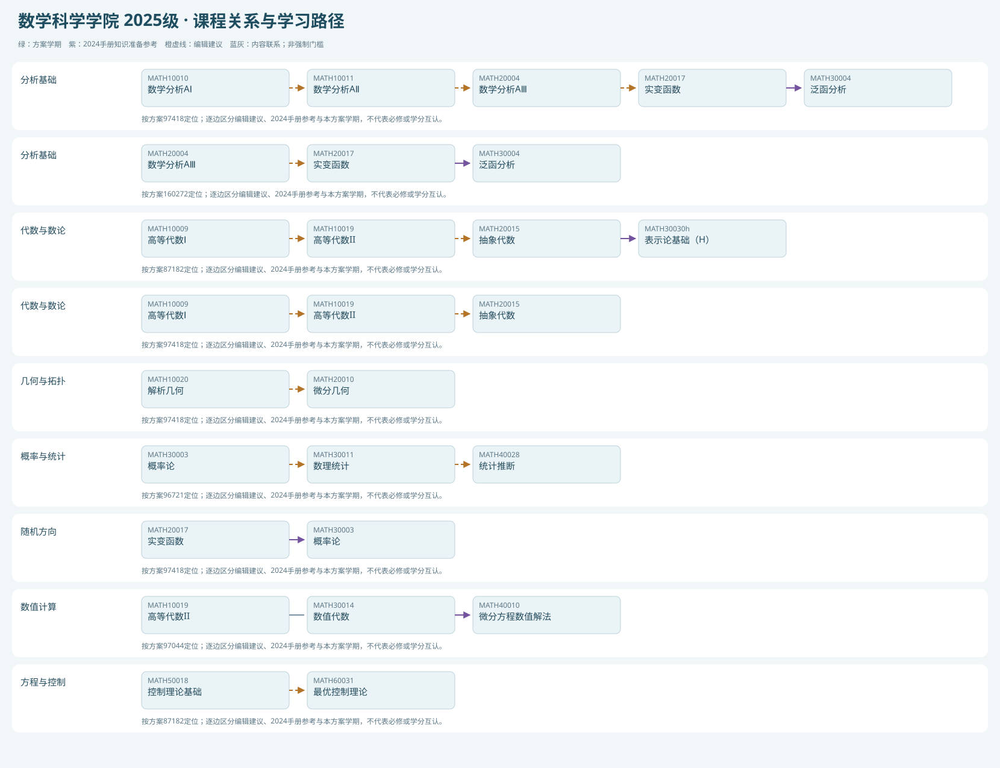

# 数学科学学院2025级培养方案与课程关系

本年级共取得 **18份方案原件**，去重 **377个课程/科研条目**，其中 **261个方案内课程与科研条目（含明列通识）**，另 **116个仅见于公共候选目录**。图谱另设100个方案模块节点；不能把全目录数量读作个人必修课数。

- [交互图谱](course-graph/index.html)：下载后打开，默认显示方案内课程与科研条目，可按方案、主题和公共目录范围筛选。
- [学习路径与课程关系](course-graph/learning-paths.md)、[静态总览](course-graph/overview.svg)
- [完整图谱JSON](course-graph/graph.json)、[节点CSV](course-graph/nodes.csv)、[关系CSV](course-graph/edges.csv)
- [课程逐行清单](official/courses.csv)、[模块与学分规则原字段](official/modules.json)、[来源核查](course-graph/source-audit.json)

## 官方方案原件

| ID | 名称与适用对象 | 原件 | 离线阅读 |
| --- | --- | --- | --- |
| 87182 | 2025级数学与应用数学-数学博士本博融通培养方案（数学英才班）；普通本科生；数学科学学院 | [Word](official/word-originals\plan-87182.docx) | [阅读页](official/programme-87182.html) |
| 97418 | 2025级数学与应用数学专业本科培养方案（港澳台侨生适用）；港澳台侨生；数学科学学院 | [Word](official/word-originals\plan-97418.docx) | [阅读页](official/programme-97418.html) |
| 97083 | 2025级数学与应用数学专业本科培养方案（数学英才班）；普通本科生；数学科学学院 | [Word](official/word-originals\plan-97083.docx) | [阅读页](official/programme-97083.html) |
| 97414 | 2025级数学与应用数学专业本科培养方案（留学生适用）；留学生；数学科学学院 | [Word](official/word-originals\plan-97414.docx) | [阅读页](official/programme-97414.html) |
| 160272 | 2025数学与应用数学-数学本博融通培养方案（数学智能英才班）；普通本科生；数学科学学院 | [Word](official/word-originals\plan-160272.docx) | [阅读页](official/programme-160272.html) |
| 97036 | 2025级数学与应用数学-数学硕士本硕融通培养方案（数学英才班）；普通本科生；数学科学学院 | [Word](official/word-originals\plan-97036.docx) | [阅读页](official/programme-97036.html) |
| 96797 | 2025级数学与应用数学专业本科培养方案；普通本科生；数学科学学院 | [Word](official/word-originals\plan-96797.docx) | [阅读页](official/programme-96797.html) |
| 97101 | 2025级数学与应用数学-数学博士本博融通培养方案（强基计划）；普通本科生；数学科学学院 | [Word](official/word-originals\plan-97101.docx) | [阅读页](official/programme-97101.html) |
| 96721 | 2025级数学与应用数学-人工智能双学士学位项目培养方案；普通本科生；数学科学学院 | [Word](official/word-originals\plan-96721.docx) | [阅读页](official/programme-96721.html) |
| 97106 | 2025级数学与应用数学专业本科培养方案（相辉计划-英才班课程体系）；普通本科生；数学科学学院 | [Word](official/word-originals\plan-97106.docx) | [阅读页](official/programme-97106.html) |
| 97118 | 2025级数学与应用数学专业本科培养方案（相辉计划-普通班课程体系）；普通本科生；数学科学学院 | [Word](official/word-originals\plan-97118.docx) | [阅读页](official/programme-97118.html) |
| 97123 | 2025级数学与应用数学-数学博士本博融通培养方案（相辉计划-普通班课程体系）；普通本科生；数学科学学院 | [Word](official/word-originals\plan-97123.docx) | [阅读页](official/programme-97123.html) |
| 97100 | 2025级数学与应用数学-数学博士本博融通培养方案（相辉计划-英才班课程体系）；普通本科生；数学科学学院 | [Word](official/word-originals\plan-97100.docx) | [阅读页](official/programme-97100.html) |
| 97044 | 2025级信息与计算科学-数学硕士本硕贯通培养方案（数学智能英才班）；普通本科生；数学科学学院 | [Word](official/word-originals\plan-97044.docx) | [阅读页](official/programme-97044.html) |
| 96707 | 2025级信息与计算科学-数学博士本博融通培养方案（数学智能英才班）；普通本科生；数学科学学院 | [Word](official/word-originals\plan-96707.docx) | [阅读页](official/programme-96707.html) |
| 97455 | 2025级信息与计算科学专业本科培养方案（港澳台侨生适用）；港澳台侨生；数学科学学院 | [Word](official/word-originals\plan-97455.docx) | [阅读页](official/programme-97455.html) |
| 97068 | 2025级信息与计算科学专业本科培养方案；普通本科生；数学科学学院 | [Word](official/word-originals\plan-97068.docx) | [阅读页](official/programme-97068.html) |
| 96726 | 2025级信息与计算科学-人工智能双学士学位项目培养方案；普通本科生；数学科学学院 | [Word](official/word-originals\plan-96726.docx) | [阅读页](official/programme-96726.html) |

## 怎样理解先修与版本

本年级方案正文、Word文本及先修字段已检索，相关命中见来源核查；**尚未确认本年级选课系统执行的课程对课程强制门槛**。另附2024版学习手册68份完整大纲的基本要求摘录与逐页定位。紫色关系为手册中的预修/基础或选课指导，当前课号按题名参考，不能将2024版条款直接视为2023/2025级或新课号规则。绿色为同一方案数字学期安排，橙色为编辑建议，蓝灰为内容联系；模块收录只表示候选范围。

按本年级具体方案内的唯一题名建立关系；同名异号、普通/H、英才/强基/相辉和本硕博贯通版本分别保留。原课号完整保留，未将历史MATH课号自动替代为新号，不推断学分互认。本硕博贯通方案可能列入研究生课程，收录不代表本科阶段全部必修。春、秋只表示季节，不参与数字学期先后推导。手册预修中未能唯一定位为具体课程的宽泛知识基础保留在原文摘录，不强行展开成若干必修课程。

原始接口与官方Word均存于official/；目录记录和方案详情为2026-11-26取得的本年级当前公开快照，系统可能后续修订，不能称为入学当年的原始发布版。JSON经格式规范化并gzip压缩，Word保持下载字节不变；哈希见总清单。原件权利归原权利人，未取得单独的再利用许可声明。

## 手册与原图

[2024版手册原件](../sources/math-handbook-2024.pdf) · [大纲基本要求摘录](../sources/handbook-course-requirements.json) · [官方内嵌图](official/source-figures.html)
