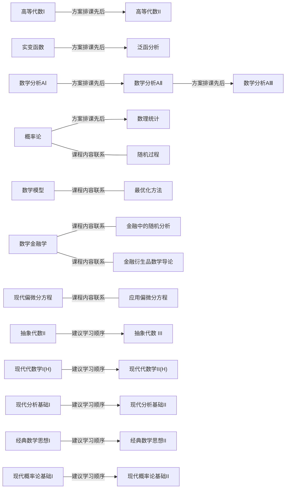

# 2023级数学与应用数学专业“2+X”教学培养方案（留学生适用）

数学科学学院 · 数学与应用数学 · 方案 73582 · 185 个不同课程或科研条目。

[官方 Word](https://github.com/pythonbug225/fudan-course-atlas/blob/research/schoolwide-cohorts-2023-2025/research/contributions/%E5%85%A8%E6%A0%A1%E5%9F%B9%E5%85%BB%E6%96%B9%E6%A1%882023-2025/%E5%B7%B2%E6%9C%89%E9%99%A2%E7%B3%BB%E8%A7%84%E8%8C%83%E6%95%B0%E6%8D%AE/%E6%95%B0%E5%AD%A6%E7%A7%91%E5%AD%A6%E5%AD%A6%E9%99%A2/2023/originals/plan-73582.docx) · [教务详情](https://fdjwgl.fudan.edu.cn/manager/bizType/2/major-program-search/info/73582?skipAuth=1) · [方案快照](https://github.com/pythonbug225/fudan-course-atlas/blob/research/schoolwide-cohorts-2023-2025/research/contributions/%E5%85%A8%E6%A0%A1%E5%9F%B9%E5%85%BB%E6%96%B9%E6%A1%882023-2025/%E5%B7%B2%E6%9C%89%E9%99%A2%E7%B3%BB%E8%A7%84%E8%8C%83%E6%95%B0%E6%8D%AE/%E6%95%B0%E5%AD%A6%E7%A7%91%E5%AD%A6%E5%AD%A6%E9%99%A2/2023/raw/plan-73582.json.gz) · [年级目录](https://github.com/pythonbug225/fudan-course-atlas/blob/research/schoolwide-cohorts-2023-2025/research/contributions/%E5%85%A8%E6%A0%A1%E5%9F%B9%E5%85%BB%E6%96%B9%E6%A1%882023-2025/%E5%B7%B2%E6%9C%89%E9%99%A2%E7%B3%BB%E8%A7%84%E8%8C%83%E6%95%B0%E6%8D%AE/%E6%95%B0%E5%AD%A6%E7%A7%91%E5%AD%A6%E5%AD%A6%E9%99%A2/2023/README.md)

## 修读导读

- **建议先学**　《实变函数》（`MATH130007`） → 《泛函分析》（`MATH30004`）。测度与积分有助于理解函数空间。方案分别列在第4、5学期。

- **可以对照着读**　《数学模型》（`MATH20009`）与《最优化方法》（`MATH30020`）。共同主题为模型目标、决策变量与优化求解。

- **查模块选课**　《解析几何》（`MATH120010`）、《高等代数Ⅰ》（`MATH10009`）列在“必修课程”中。原表见 `/courseModules/11`。

## 课程关系图

图中展示部分关系。下表保留全部已建立的课程对，来源位置使用本方案 JSON Pointer。

## 先修与内容联系

| 类型 | 起点 | 终点 | 依据 | 原表定位 |
| --- | --- | --- | --- | --- |
| 建议学习顺序 | 高等代数Ⅰ (MATH10009) | 高等代数II (MATH10019) | 同方案的课程题名具有连续分册或序号。  | `/courseModules/11/planCourses/2`、`/courseModules/11/planCourses/5` |
| 建议学习顺序 | 数学分析AⅠ (MATH10010) | 数学分析AⅡ (MATH10011) | 同方案的课程题名具有连续分册或序号。  | `/courseModules/6/planCourses/0`、`/courseModules/6/planCourses/1` |
| 建议学习顺序 | 数学分析AⅡ (MATH10011) | 数学分析AⅢ (MATH20004) | 同方案的课程题名具有连续分册或序号。  | `/courseModules/6/planCourses/1`、`/courseModules/11/planCourses/4` |
| 建议学习顺序 | 实变函数 (MATH130007) | 泛函分析 (MATH30004) | 测度与积分有助于理解函数空间。  | `/courseModules/12/planCourses/4`、`/courseModules/12/planCourses/2` |
| 建议学习顺序 | 现代分析基础I (MATH130089) | 现代分析基础II (MATH130090) | 同方案的课程题名具有连续分册或序号。  | `/courseModules/16/planCourses/50`、`/courseModules/16/planCourses/51` |
| 建议学习顺序 | 经典数学思想I (MATH130152) | 经典数学思想II (MATH130156) | 同方案的课程题名具有连续分册或序号。  | `/courseModules/16/planCourses/90`、`/courseModules/16/planCourses/92` |
| 建议学习顺序 | 抽象代数II (MATH20013) | 抽象代数 III (MATH130129) | 同方案的课程题名具有连续分册或序号。  | `/courseModules/12/planCourses/18`、`/courseModules/17/planCourses/65` |
| 建议学习顺序 | 概率论 (MATH30003) | 数理统计 (MATH30011) | 分布和期望为统计估计与检验提供基础。  | `/courseModules/12/planCourses/5`、`/courseModules/16/planCourses/38` |
| 建议学习顺序 | 现代代数学I(H) (MATH30027h) | 现代代数学II(H) (MATH30028h) | 同方案的课程题名具有连续分册或序号。  | `/courseModules/12/planCourses/19`、`/courseModules/16/planCourses/83` |
| 建议学习顺序 | 学术前沿专题Ⅰ (MATH40001) | 学术前沿专题Ⅱ (MATH40002) | 同方案的课程题名具有连续分册或序号。  | `/courseModules/16/planCourses/118`、`/courseModules/16/planCourses/119` |
| 建议学习顺序 | 现代概率论基础I (MATH50027) | 现代概率论基础II (MATH50028) | 同方案的课程题名具有连续分册或序号。  | `/courseModules/16/planCourses/94`、`/courseModules/16/planCourses/95` |
| 建议学习顺序 | 独立学习I (MATH50029) | 独立学习Ⅱ (MATH50030) | 同方案的课程题名具有连续分册或序号。  | `/courseModules/16/planCourses/97`、`/courseModules/16/planCourses/98` |
| 建议学习顺序 | 体育(一) (PEDU110001) | 体育(二) (PEDU110002) | 同方案的课程题名具有连续分册或序号。  | `/courseModules/6/planCourses/2`、`/courseModules/6/planCourses/3` |
| 建议学习顺序 | 大学物理B(上) (PHYS10003) | 大学物理B(下) (PHYS10004) | 同方案的课程题名具有连续分册或序号。  | `/courseModules/8/planCourses/0`、`/courseModules/8/planCourses/1` |
| 方案排课先后 | 高等代数Ⅰ (MATH10009) | 高等代数II (MATH10019) | 同方案该课程全部明确数字学期均早于后者。  | `/courseModules/11/planCourses/2`、`/courseModules/11/planCourses/5` |
| 方案排课先后 | 数学分析AⅠ (MATH10010) | 数学分析AⅡ (MATH10011) | 同方案该课程全部明确数字学期均早于后者。  | `/courseModules/6/planCourses/0`、`/courseModules/6/planCourses/1` |
| 方案排课先后 | 数学分析AⅡ (MATH10011) | 数学分析AⅢ (MATH20004) | 同方案该课程全部明确数字学期均早于后者。  | `/courseModules/6/planCourses/1`、`/courseModules/11/planCourses/4` |
| 方案排课先后 | 实变函数 (MATH130007) | 泛函分析 (MATH30004) | 同方案该课程全部明确数字学期均早于后者。  | `/courseModules/12/planCourses/4`、`/courseModules/12/planCourses/2` |
| 方案排课先后 | 概率论 (MATH30003) | 数理统计 (MATH30011) | 同方案该课程全部明确数字学期均早于后者。  | `/courseModules/12/planCourses/5`、`/courseModules/16/planCourses/38` |
| 方案排课先后 | 大学物理B(上) (PHYS10003) | 大学物理B(下) (PHYS10004) | 同方案该课程全部明确数字学期均早于后者。  | `/courseModules/8/planCourses/0`、`/courseModules/8/planCourses/1` |
| 课程内容联系 | 数据科学的逼近论基础 (AIS631003) | 现代数据科学选讲 (MATH40042) | 本方案两门课程的题名均含“数据科学”，可据此对照这一主题。  | `/courseModules/16/planCourses/1`、`/courseModules/16/planCourses/112` |
| 课程内容联系 | 程序设计 (CS10004) | 程序设计实践 (MATH60038) | 题名显示相同主题的课程与实验、实践或实习。  | `/courseModules/16/planCourses/3`、`/courseModules/16/planCourses/110` |
| 课程内容联系 | 数据科学中的随机方法 (MATH130094) | 现代数据科学选讲 (MATH40042) | 本方案两门课程的题名均含“数据科学”，可据此对照这一主题。  | `/courseModules/17/planCourses/37`、`/courseModules/16/planCourses/112` |
| 课程内容联系 | 物理学与偏微分方程 (MATH130109) | 应用偏微分方程 (MATH50016) | 本方案两门课程的题名均含“偏微分方程”，可据此对照这一主题。  | `/courseModules/17/planCourses/48`、`/courseModules/16/planCourses/15` |
| 课程内容联系 | 数学模型 (MATH20009) | 最优化方法 (MATH30020) | 共同主题为模型目标、决策变量与优化求解。  | `/courseModules/12/planCourses/13`、`/courseModules/16/planCourses/80` |
| 课程内容联系 | 概率论 (MATH30003) | 随机过程 (MATH40017) | 共同主题为随机现象与概率模型。  | `/courseModules/12/planCourses/5`、`/courseModules/16/planCourses/30` |
| 课程内容联系 | 数学金融学 (MATH30006) | 金融中的随机分析 (MATH30021) | 本方案两门课程的题名均含“金融”，可据此对照这一主题。  | `/courseModules/16/planCourses/18`、`/courseModules/16/planCourses/86` |
| 课程内容联系 | 数学金融学 (MATH30006) | 金融衍生品数学导论 (MATH30023) | 本方案两门课程的题名均含“金融”，可据此对照这一主题。  | `/courseModules/16/planCourses/18`、`/courseModules/16/planCourses/113` |
| 课程内容联系 | 应用随机过程 (MATH30016) | 随机过程 (MATH40017) | 本方案两门课程的题名均含“随机过程”，可据此对照这一主题。  | `/courseModules/16/planCourses/61`、`/courseModules/16/planCourses/30` |
| 课程内容联系 | 数据科学中的现代逼近方法 (MATH40025) | 现代数据科学选讲 (MATH40042) | 本方案两门课程的题名均含“数据科学”，可据此对照这一主题。  | `/courseModules/16/planCourses/53`、`/courseModules/16/planCourses/112` |
| 课程内容联系 | 现代偏微分方程 (MATH40030) | 应用偏微分方程 (MATH50016) | 本方案两门课程的题名均含“偏微分方程”，可据此对照这一主题。  | `/courseModules/16/planCourses/70`、`/courseModules/16/planCourses/15` |
| 课程内容联系 | 应用偏微分方程 (MATH50016) | 变分法与偏微分方程 (MATH50023) | 本方案两门课程的题名均含“偏微分方程”，可据此对照这一主题。  | `/courseModules/16/planCourses/15`、`/courseModules/16/planCourses/74` |

本次未从可定位的明确表述中确认课程对课程预修。学期安排、系列分册与编辑建议均保留各自的依据。

## 按原方案模块阅读

同一模块展示原表中的课程归属。模块内课程之间的先后仍须逐项查阅。

- **数学类基础课（大物B）**　大学物理B(上)、大学物理B(下)（原表模块 8）
- **数学类基础课（大物A）**　大学物理A：力学、大学物理A：热学、大学物理A：电磁学（原表模块 9）
- **其他专业**　代数拓扑(H)、微分流形(H)、代数拓扑与微分形式(H)、黎曼几何初步(H)、多复变函数论(H)（原表模块 20）
- **分析**　实分析(H)、复变函数(H)、泛函分析(H)（原表模块 21）
- **其他专业**　实分析(H)、复变函数(H)、泛函分析(H)、代数拓扑(H)、微分流形(H)、代数拓扑与微分形式(H)、黎曼几何初步(H)、多复变函数论(H)（原表模块 23）
- **代数**　现代代数学I(H)、现代代数学II(H)、抽象代数续论(H)（原表模块 24）
- **其他专业**　实分析(H)、复变函数(H)、泛函分析(H)、现代代数学I(H)、现代代数学II(H)、抽象代数续论(H)（原表模块 26）
- **几何/拓扑**　代数拓扑(H)、微分流形(H)、代数拓扑与微分形式(H)、黎曼几何初步(H)、多复变函数论(H)（原表模块 27）

## 课程表

同一课程在不同模块分别出现时，按原表逐行列出。季节字段保留原值。

| 课程 | 代码 | 学分 | 学期 | 模块 |
| --- | --- | ---: | --- | --- |
| 数学分析AⅠ | MATH10010 | 5.0 | 第1学期 | 培养方案 / 专业培养课程 / 大类基础课程 / 必修课程 |
| 数学分析AⅡ | MATH10011 | 5.0 | 第2学期 | 培养方案 / 专业培养课程 / 大类基础课程 / 必修课程 |
| 体育(一) | PEDU110001 | 1.0 | SPRING、AUTUMN | 培养方案 / 专业培养课程 / 大类基础课程 / 必修课程 |
| 体育(二) | PEDU110002 | 1.0 | SPRING、AUTUMN | 培养方案 / 专业培养课程 / 大类基础课程 / 必修课程 |
| 大学物理B(上) | PHYS10003 | 4.0 | 第2学期 | 培养方案 / 专业培养课程 / 大类基础课程 / 数学类基础课（大学物理） / 数学类基础课（大物B） |
| 大学物理B(下) | PHYS10004 | 4.0 | 第3学期 | 培养方案 / 专业培养课程 / 大类基础课程 / 数学类基础课（大学物理） / 数学类基础课（大物B） |
| 大学物理A：力学 | PHYS10006 | 4.0 | 第1学期 | 培养方案 / 专业培养课程 / 大类基础课程 / 数学类基础课（大学物理） / 数学类基础课（大物A） |
| 大学物理A：热学 | PHYS10007 | 2.0 | 第2学期 | 培养方案 / 专业培养课程 / 大类基础课程 / 数学类基础课（大学物理） / 数学类基础课（大物A） |
| 大学物理A：电磁学 | PHYS10008 | 4.0 | 第1学期 | 培养方案 / 专业培养课程 / 大类基础课程 / 数学类基础课（大学物理） / 数学类基础课（大物A） |
| 解析几何 | MATH120010 | 3.0 | 第1学期 | 培养方案 / 专业培养课程 / 专业核心教育课程 / 必修课程 |
| 解析几何 | MATH10020 | 4.0 | 第1学期 | 培养方案 / 专业培养课程 / 专业核心教育课程 / 必修课程 |
| 高等代数Ⅰ | MATH10009 | 5.0 | 第1学期 | 培养方案 / 专业培养课程 / 专业核心教育课程 / 必修课程 |
| 数学分析III | MATH130001 | 5.0 | 第3学期 | 培养方案 / 专业培养课程 / 专业核心教育课程 / 必修课程 |
| 数学分析AⅢ | MATH20004 | 5.0 | 第3学期 | 培养方案 / 专业培养课程 / 专业核心教育课程 / 必修课程 |
| 高等代数II | MATH10019 | 5.0 | 第2学期 | 培养方案 / 专业培养课程 / 专业核心教育课程 / 必修课程 |
| 抽象代数 | MATH20015 | 4.0 | 第3学期 | 培养方案 / 专业培养课程 / 专业核心教育课程 / 必修课程 |
| 抽象代数 | MATH130005 | 3.0 | 第3学期 | 培养方案 / 专业培养课程 / 专业核心教育课程 / 必修课程 |
| 拓扑学 | MATH130010 | 3.0 | 第4学期 | 培养方案 / 专业培养课程 / 专业核心教育课程 / 必修课程 |
| 毕业论文(含专题讨论) | MATH40009 | 6.0 | 第8学期 | 培养方案 / 专业培养课程 / 专业核心教育课程 / 必修课程 |
| 常微分方程 | MATH130004 | 3.0 | 第3学期 | 培养方案 / 专业培养课程 / 专业核心教育课程 / 限定必修课程 |
| 复变函数 | MATH130006 | 3.0 | 第4学期 | 培养方案 / 专业培养课程 / 专业核心教育课程 / 限定必修课程 |
| 泛函分析 | MATH30004 | 3.0 | 第5学期 | 培养方案 / 专业培养课程 / 专业核心教育课程 / 限定必修课程 |
| 数理方程 | MATH30005 | 3.0 | 第6学期 | 培养方案 / 专业培养课程 / 专业核心教育课程 / 限定必修课程 |
| 实变函数 | MATH130007 | 3.0 | 第4学期 | 培养方案 / 专业培养课程 / 专业核心教育课程 / 限定必修课程 |
| 概率论 | MATH30003 | 3.0 | 第5学期 | 培养方案 / 专业培养课程 / 专业核心教育课程 / 限定必修课程 |
| 复变函数(H) | MATH20016h | 4.0 | SPRING、AUTUMN | 培养方案 / 专业培养课程 / 专业核心教育课程 / 限定必修课程 |
| 泛函分析(H) | MATH30004h | 4.0 | AUTUMN | 培养方案 / 专业培养课程 / 专业核心教育课程 / 限定必修课程 |
| 数理方程（H） | MATH30005h | 4.0 | AUTUMN | 培养方案 / 专业培养课程 / 专业核心教育课程 / 限定必修课程 |
| 实分析(H) | MATH130007h | 4.0 | SPRING、AUTUMN | 培养方案 / 专业培养课程 / 专业核心教育课程 / 限定必修课程 |
| 概率论(H) | MATH30003h | 4.0 | AUTUMN | 培养方案 / 专业培养课程 / 专业核心教育课程 / 限定必修课程 |
| 常微分方程 | MATH20014 | 4.0 | 第3学期 | 培养方案 / 专业培养课程 / 专业核心教育课程 / 限定必修课程 |
| 复变函数 | MATH20016 | 4.0 | 第4学期 | 培养方案 / 专业培养课程 / 专业核心教育课程 / 限定必修课程 |
| 数学模型 | MATH20009 | 3.0 | 第4学期 | 培养方案 / 专业培养课程 / 专业核心教育课程 / 限定必修课程 |
| 微分几何 | MATH20010 | 3.0 | 第5学期 | 培养方案 / 专业培养课程 / 专业核心教育课程 / 限定必修课程 |
| 微分方程数值解法 | MATH40010 | 3.0 | 第6学期 | 培养方案 / 专业培养课程 / 专业核心教育课程 / 限定必修课程 |
| 拓扑学Ⅱ | MATH30017 | 3.0 | 第5学期 | 培养方案 / 专业培养课程 / 专业核心教育课程 / 限定必修课程 |
| 代数拓扑(H) | MATH30017h | 4.0 | AUTUMN | 培养方案 / 专业培养课程 / 专业核心教育课程 / 限定必修课程 |
| 抽象代数II | MATH20013 | 3.0 | 第4学期 | 培养方案 / 专业培养课程 / 专业核心教育课程 / 限定必修课程 |
| 现代代数学I(H) | MATH30027h | 4.0 | AUTUMN | 培养方案 / 专业培养课程 / 专业核心教育课程 / 限定必修课程 |
| 基础力学 | MECH30005 | 3.0 | 第6学期 | 培养方案 / 专业培养课程 / 专业核心教育课程 / 限定必修课程 |
| 常微分方程 | MATH130004 | 3.0 | 第3学期 | 培养方案 / 专业进阶模块所有课程 / 12选9 |
| 复变函数 | MATH130006 | 3.0 | 第4学期 | 培养方案 / 专业进阶模块所有课程 / 12选9 |
| 复变函数(H) | MATH20016h | 4.0 | SPRING、AUTUMN | 培养方案 / 专业进阶模块所有课程 / 12选9 |
| 实变函数 | MATH130007 | 3.0 | 第4学期 | 培养方案 / 专业进阶模块所有课程 / 12选9 |
| 实分析(H) | MATH130007h | 4.0 | SPRING、AUTUMN | 培养方案 / 专业进阶模块所有课程 / 12选9 |
| 数学模型 | MATH20009 | 3.0 | 第4学期 | 培养方案 / 专业进阶模块所有课程 / 12选9 |
| 概率论 | MATH30003 | 3.0 | 第5学期 | 培养方案 / 专业进阶模块所有课程 / 12选9 |
| 概率论(H) | MATH30003h | 4.0 | AUTUMN | 培养方案 / 专业进阶模块所有课程 / 12选9 |
| 泛函分析 | MATH30004 | 3.0 | 第5学期 | 培养方案 / 专业进阶模块所有课程 / 12选9 |
| 泛函分析(H) | MATH30004h | 4.0 | AUTUMN | 培养方案 / 专业进阶模块所有课程 / 12选9 |
| 数理方程 | MATH30005 | 3.0 | 第6学期 | 培养方案 / 专业进阶模块所有课程 / 12选9 |
| 数理方程（H） | MATH30005h | 4.0 | AUTUMN | 培养方案 / 专业进阶模块所有课程 / 12选9 |
| 微分几何 | MATH20010 | 3.0 | 第5学期 | 培养方案 / 专业进阶模块所有课程 / 12选9 |
| 微分方程数值解法 | MATH40010 | 3.0 | 第6学期 | 培养方案 / 专业进阶模块所有课程 / 12选9 |
| 拓扑学Ⅱ | MATH30017 | 3.0 | 第5学期 | 培养方案 / 专业进阶模块所有课程 / 12选9 |
| 代数拓扑(H) | MATH30017h | 4.0 | AUTUMN | 培养方案 / 专业进阶模块所有课程 / 12选9 |
| 抽象代数II | MATH20013 | 3.0 | 第4学期 | 培养方案 / 专业进阶模块所有课程 / 12选9 |
| 现代代数学I(H) | MATH30027h | 4.0 | AUTUMN | 培养方案 / 专业进阶模块所有课程 / 12选9 |
| 基础力学 | MECH30005 | 3.0 | 第6学期 | 培养方案 / 专业进阶模块所有课程 / 12选9 |
| 深度学习基础 | AIB310003 | 3.0 | AUTUMN | 培养方案 / 专业进阶模块所有课程 / 专业进阶课程 |
| 数据科学的逼近论基础 | AIS631003 | 3.0 | SPRING、AUTUMN | 培养方案 / 专业进阶模块所有课程 / 专业进阶课程 |
| 新型算法 | AIS631004 | 3.0 | 第1学期 | 培养方案 / 专业进阶模块所有课程 / 专业进阶课程 |
| 程序设计 | CS10004 | 4.0 | AUTUMN | 培养方案 / 专业进阶模块所有课程 / 专业进阶课程 |
| 数据结构 | CS20009 | 4.0 | SPRING | 培养方案 / 专业进阶模块所有课程 / 专业进阶课程 |
| 统计学基础：原理、方法及R应用 (I) | STAT20010 | 3.0 | SPRING | 培养方案 / 专业进阶模块所有课程 / 专业进阶课程 |
| 人工智能 | CS50020 | 3.0 | AUTUMN | 培养方案 / 专业进阶模块所有课程 / 专业进阶课程 |
| 时间序列与空间统计 | STAT50016 | 3.0 | SPRING | 培养方案 / 专业进阶模块所有课程 / 专业进阶课程 |
| 数据结构 | CS20017 | 4.0 | AUTUMN | 培养方案 / 专业进阶模块所有课程 / 专业进阶课程 |
| 统计学习 | IST30007 | 4.0 | AUTUMN | 培养方案 / 专业进阶模块所有课程 / 专业进阶课程 |
| 生产实习 | MATH40008 | 1.0 | 第7学期 | 培养方案 / 专业进阶模块所有课程 / 专业进阶课程 |
| 微分流形 | MATH30033 | 3.0 | SPRING、AUTUMN | 培养方案 / 专业进阶模块所有课程 / 专业进阶课程 |
| 微分流形(H) | MATH30024h | 4.0 | SPRING、AUTUMN | 培养方案 / 专业进阶模块所有课程 / 专业进阶课程 |
| 小波分析 | MATH40011 | 3.0 | SPRING、AUTUMN | 培养方案 / 专业进阶模块所有课程 / 专业进阶课程 |
| 运筹学A | MATH130019 | 3.0 | SPRING、AUTUMN | 培养方案 / 专业进阶模块所有课程 / 专业进阶课程 |
| 应用偏微分方程 | MATH50016 | 3.0 | SPRING、AUTUMN | 培养方案 / 专业进阶模块所有课程 / 专业进阶课程 |
| 计算机辅助几何设计 | MATH40012 | 3.0 | SPRING、AUTUMN | 培养方案 / 专业进阶模块所有课程 / 专业进阶课程 |
| 生物数学 | MATH70010 | 3.0 | SPRING、AUTUMN | 培养方案 / 专业进阶模块所有课程 / 专业进阶课程 |
| 数学金融学 | MATH30006 | 3.0 | SPRING、AUTUMN | 培养方案 / 专业进阶模块所有课程 / 专业进阶课程 |
| 应用几何 | MATH40013 | 3.0 | SPRING、AUTUMN | 培养方案 / 专业进阶模块所有课程 / 专业进阶课程 |
| 专题讨论 | MATH40014 | 2.0 | SPRING、AUTUMN | 培养方案 / 专业进阶模块所有课程 / 专业进阶课程 |
| 动力系统 | MATH40015 | 3.0 | SPRING、AUTUMN | 培养方案 / 专业进阶模块所有课程 / 专业进阶课程 |
| 利息理论 | MATH30007 | 3.0 | SPRING、AUTUMN | 培养方案 / 专业进阶模块所有课程 / 专业进阶课程 |
| 计算方法 | MATH30008 | 3.0 | 第5学期 | 培养方案 / 专业进阶模块所有课程 / 专业进阶课程 |
| 组合优化 | MATH130038 | 3.0 | SPRING、AUTUMN | 培养方案 / 专业进阶模块所有课程 / 专业进阶课程 |
| 最优控制理论 | MATH60031 | 3.0 | SPRING、AUTUMN | 培养方案 / 专业进阶模块所有课程 / 专业进阶课程 |
| 分形几何 | MATH40016 | 3.0 | SPRING、AUTUMN | 培养方案 / 专业进阶模块所有课程 / 专业进阶课程 |
| 多复变函数论 | MATH50017 | 3.0 | SPRING、AUTUMN | 培养方案 / 专业进阶模块所有课程 / 专业进阶课程 |
| 多复变函数论(H) | MATH50017h | 4.0 | SPRING、AUTUMN | 培养方案 / 专业进阶模块所有课程 / 专业进阶课程 |
| 数论基础 | MATH20011 | 3.0 | SPRING、AUTUMN | 培养方案 / 专业进阶模块所有课程 / 专业进阶课程 |
| 随机过程 | MATH40017 | 3.0 | SPRING、AUTUMN | 培养方案 / 专业进阶模块所有课程 / 专业进阶课程 |
| 数理方程续论 | MATH130047 | 3.0 | SPRING、AUTUMN | 培养方案 / 专业进阶模块所有课程 / 专业进阶课程 |
| Fourier分析 | MATH40018 | 3.0 | SPRING、AUTUMN | 培养方案 / 专业进阶模块所有课程 / 专业进阶课程 |
| 非寿险精算数学 | MATH30009 | 3.0 | SPRING、AUTUMN | 培养方案 / 专业进阶模块所有课程 / 专业进阶课程 |
| 复分析 | MATH40019 | 3.0 | SPRING、AUTUMN | 培养方案 / 专业进阶模块所有课程 / 专业进阶课程 |
| 控制理论基础 | MATH50018 | 3.0 | SPRING、AUTUMN | 培养方案 / 专业进阶模块所有课程 / 专业进阶课程 |
| 寿险精算数学 | MATH30010 | 3.0 | SPRING、AUTUMN | 培养方案 / 专业进阶模块所有课程 / 专业进阶课程 |
| 数据结构 | MATH130059 | 3.0 | SPRING、AUTUMN | 培养方案 / 专业进阶模块所有课程 / 专业进阶课程 |
| 数理统计 | MATH30011 | 3.0 | 第6学期 | 培养方案 / 专业进阶模块所有课程 / 专业进阶课程 |
| 数字信号处理 | MATH40020 | 3.0 | SPRING、AUTUMN | 培养方案 / 专业进阶模块所有课程 / 专业进阶课程 |
| 时间序列分析 | MATH40021 | 3.0 | SPRING、AUTUMN | 培养方案 / 专业进阶模块所有课程 / 专业进阶课程 |
| 抽象代数续论 | MATH50019 | 3.0 | SPRING、AUTUMN | 培养方案 / 专业进阶模块所有课程 / 专业进阶课程 |
| 抽象代数续论(H) | MATH50019h | 4.0 | SPRING、AUTUMN | 培养方案 / 专业进阶模块所有课程 / 专业进阶课程 |
| 测度论 | MATH30012 | 3.0 | SPRING、AUTUMN | 培养方案 / 专业进阶模块所有课程 / 专业进阶课程 |
| 数值逼近 | MATH30013 | 3.0 | 第5学期 | 培养方案 / 专业进阶模块所有课程 / 专业进阶课程 |
| 数值代数 | MATH30014 | 3.0 | 第5学期 | 培养方案 / 专业进阶模块所有课程 / 专业进阶课程 |
| 积分方程数值解法 | MATH40022 | 3.0 | AUTUMN | 培养方案 / 专业进阶模块所有课程 / 专业进阶课程 |
| 非线性系统 | MATH40023 | 3.0 | SPRING、AUTUMN | 培养方案 / 专业进阶模块所有课程 / 专业进阶课程 |
| 数学建模与实验(上) | MATH130077 | 3.0 | SPRING、AUTUMN | 培养方案 / 专业进阶模块所有课程 / 专业进阶课程 |
| 科学计算 | MATH40024 | 3.0 | SPRING、AUTUMN | 培养方案 / 专业进阶模块所有课程 / 专业进阶课程 |
| 现代分析基础I | MATH130089 | 3.0 | SPRING、AUTUMN | 培养方案 / 专业进阶模块所有课程 / 专业进阶课程 |
| 现代分析基础II | MATH130090 | 3.0 | SPRING、AUTUMN | 培养方案 / 专业进阶模块所有课程 / 专业进阶课程 |
| 数学分析原理 | MATH20012 | 5.0 | SPRING、AUTUMN | 培养方案 / 专业进阶模块所有课程 / 专业进阶课程 |
| 数据科学中的现代逼近方法 | MATH40025 | 3.0 | SPRING、AUTUMN | 培养方案 / 专业进阶模块所有课程 / 专业进阶课程 |
| 统计中的计算方法 | MATH40026 | 3.0 | SPRING、AUTUMN | 培养方案 / 专业进阶模块所有课程 / 专业进阶课程 |
| 马氏链及其应用 | MATH130101 | 3.0 | SPRING、AUTUMN | 培养方案 / 专业进阶模块所有课程 / 专业进阶课程 |
| 对策论 | MATH30015 | 3.0 | SPRING、AUTUMN | 培养方案 / 专业进阶模块所有课程 / 专业进阶课程 |
| 统计方法选讲 | MATH40027 | 3.0 | SPRING、AUTUMN | 培养方案 / 专业进阶模块所有课程 / 专业进阶课程 |
| 反问题的模型与计算 | MATH130104 | 3.0 | SPRING、AUTUMN | 培养方案 / 专业进阶模块所有课程 / 专业进阶课程 |
| 学术前沿专题 | MATH130107 | 1.0 | SPRING、AUTUMN | 培养方案 / 专业进阶模块所有课程 / 专业进阶课程 |
| 反问题的正则化理论 | MATH60032 | 3.0 | SPRING、AUTUMN | 培养方案 / 专业进阶模块所有课程 / 专业进阶课程 |
| 应用随机过程 | MATH30016 | 3.0 | SPRING、AUTUMN | 培养方案 / 专业进阶模块所有课程 / 专业进阶课程 |
| 流形的拓扑学 | MATH50020 | 3.0 | SPRING、AUTUMN | 培养方案 / 专业进阶模块所有课程 / 专业进阶课程 |
| 几何拓扑选讲 | MATH130113 | 3.0 | SPRING、AUTUMN | 培养方案 / 专业进阶模块所有课程 / 专业进阶课程 |
| 几何拓扑选讲 | MATH20019 | 4.0 | SPRING、AUTUMN | 培养方案 / 专业进阶模块所有课程 / 专业进阶课程 |
| 泛函分析续论 | MATH50021 | 3.0 | SPRING、AUTUMN | 培养方案 / 专业进阶模块所有课程 / 专业进阶课程 |
| 现代概率论基础 | MATH130115 | 3.0 | SPRING、AUTUMN | 培养方案 / 专业进阶模块所有课程 / 专业进阶课程 |
| 随机分析 | MATH60033 | 3.0 | SPRING、AUTUMN | 培养方案 / 专业进阶模块所有课程 / 专业进阶课程 |
| 统计推断 | MATH40028 | 3.0 | SPRING、AUTUMN | 培养方案 / 专业进阶模块所有课程 / 专业进阶课程 |
| 李群和李代数 | MATH40029 | 3.0 | SPRING、AUTUMN | 培养方案 / 专业进阶模块所有课程 / 专业进阶课程 |
| 现代偏微分方程 | MATH40030 | 3.0 | SPRING、AUTUMN | 培养方案 / 专业进阶模块所有课程 / 专业进阶课程 |
| 黎曼曲面 | MATH50022 | 3.0 | SPRING、AUTUMN | 培养方案 / 专业进阶模块所有课程 / 专业进阶课程 |
| 泛函分析续论II | MATH130124 | 3.0 | SPRING、AUTUMN | 培养方案 / 专业进阶模块所有课程 / 专业进阶课程 |
| 遍历论 | MATH60034 | 3.0 | SPRING、AUTUMN | 培养方案 / 专业进阶模块所有课程 / 专业进阶课程 |
| 变分法与偏微分方程 | MATH50023 | 3.0 | SPRING、AUTUMN | 培养方案 / 专业进阶模块所有课程 / 专业进阶课程 |
| 代数几何初步 | MATH130130 | 3.0 | SPRING、AUTUMN | 培养方案 / 专业进阶模块所有课程 / 专业进阶课程 |
| 代数数论初步 | MATH30018 | 3.0 | SPRING、AUTUMN | 培养方案 / 专业进阶模块所有课程 / 专业进阶课程 |
| 解析数论 | MATH40032 | 3.0 | SPRING、AUTUMN | 培养方案 / 专业进阶模块所有课程 / 专业进阶课程 |
| 模形式初步 | MATH50024 | 3.0 | SPRING、AUTUMN | 培养方案 / 专业进阶模块所有课程 / 专业进阶课程 |
| 线性与非线性规划 | MATH30019 | 3.0 | SPRING、AUTUMN | 培养方案 / 专业进阶模块所有课程 / 专业进阶课程 |
| 最优化方法 | MATH30020 | 3.0 | SPRING、AUTUMN | 培养方案 / 专业进阶模块所有课程 / 专业进阶课程 |
| 几何测度论 | MATH60035 | 3.0 | SPRING、AUTUMN | 培养方案 / 专业进阶模块所有课程 / 专业进阶课程 |
| 图论初步 | MATH50025 | 3.0 | SPRING、AUTUMN | 培养方案 / 专业进阶模块所有课程 / 专业进阶课程 |
| 现代代数学II(H) | MATH30028h | 4.0 | SPRING、AUTUMN | 培养方案 / 专业进阶模块所有课程 / 专业进阶课程 |
| 代数拓扑与微分形式(H) | MATH40055h | 4.0 | SPRING、AUTUMN | 培养方案 / 专业进阶模块所有课程 / 专业进阶课程 |
| 黎曼几何初步(H) | MATH40056h | 4.0 | SPRING、AUTUMN | 培养方案 / 专业进阶模块所有课程 / 专业进阶课程 |
| 金融中的随机分析 | MATH30021 | 3.0 | SPRING、AUTUMN | 培养方案 / 专业进阶模块所有课程 / 专业进阶课程 |
| 深度学习 | MATH40034 | 3.0 | SPRING、AUTUMN | 培养方案 / 专业进阶模块所有课程 / 专业进阶课程 |
| 微分几何续论 | MATH30022 | 3.0 | SPRING、AUTUMN | 培养方案 / 专业进阶模块所有课程 / 专业进阶课程 |
| 面向智能制造的数学方法及应用 | MATH130151 | 3.0 | SPRING、AUTUMN | 培养方案 / 专业进阶模块所有课程 / 专业进阶课程 |
| 经典数学思想I | MATH130152 | 2.0 | 第1学期 | 培养方案 / 专业进阶模块所有课程 / 专业进阶课程 |
| 布朗运动 | MATH40035 | 3.0 | SPRING、AUTUMN | 培养方案 / 专业进阶模块所有课程 / 专业进阶课程 |
| 经典数学思想II | MATH130156 | 2.0 | SPRING | 培养方案 / 专业进阶模块所有课程 / 专业进阶课程 |
| 概率模型与随机计算选讲 | MATH40036 | 3.0 | SPRING、AUTUMN | 培养方案 / 专业进阶模块所有课程 / 专业进阶课程 |
| 现代概率论基础I | MATH50027 | 3.0 | SPRING、AUTUMN | 培养方案 / 专业进阶模块所有课程 / 专业进阶课程 |
| 现代概率论基础II | MATH50028 | 3.0 | SPRING、AUTUMN | 培养方案 / 专业进阶模块所有课程 / 专业进阶课程 |
| 概率极限理论及应用 | MATH60036 | 3.0 | SPRING、AUTUMN | 培养方案 / 专业进阶模块所有课程 / 专业进阶课程 |
| 独立学习I | MATH50029 | 4.0 | AUTUMN | 培养方案 / 专业进阶模块所有课程 / 专业进阶课程 |
| 独立学习Ⅱ | MATH50030 | 4.0 | SPRING | 培养方案 / 专业进阶模块所有课程 / 专业进阶课程 |
| 数学控制论(H) | MATH30029h | 4.0 | SPRING、AUTUMN | 培养方案 / 专业进阶模块所有课程 / 专业进阶课程 |
| 数值代数与优化(H) | MATH40057h | 4.0 | SPRING、AUTUMN | 培养方案 / 专业进阶模块所有课程 / 专业进阶课程 |
| Current理论 | MATH40037 | 3.0 | SPRING、AUTUMN | 培养方案 / 专业进阶模块所有课程 / 专业进阶课程 |
| 随机矩阵理论 | MATH50032 | 3.0 | SPRING、AUTUMN | 培养方案 / 专业进阶模块所有课程 / 专业进阶课程 |
| 微局部分析 | MATH40038 | 3.0 | SPRING、AUTUMN | 培养方案 / 专业进阶模块所有课程 / 专业进阶课程 |
| 数学广义相对论 | MATH40039 | 3.0 | AUTUMN | 培养方案 / 专业进阶模块所有课程 / 专业进阶课程 |
| 现代调和分析 | MATH60037 | 3.0 | SPRING、AUTUMN | 培养方案 / 专业进阶模块所有课程 / 专业进阶课程 |
| 计算机代数 | MATH130172 | 3.0 | SPRING、AUTUMN | 培养方案 / 专业进阶模块所有课程 / 专业进阶课程 |
| 高维概率及其应用 | MATH40040 | 3.0 | SPRING、AUTUMN | 培养方案 / 专业进阶模块所有课程 / 专业进阶课程 |
| 规范场 | MATH80005 | 3.0 | SPRING、AUTUMN | 培养方案 / 专业进阶模块所有课程 / 专业进阶课程 |
| 非交换几何入门 | MATH40041 | 3.0 | SPRING、AUTUMN | 培养方案 / 专业进阶模块所有课程 / 专业进阶课程 |
| 程序设计实践 | MATH60038 | 3.0 | SPRING | 培养方案 / 专业进阶模块所有课程 / 专业进阶课程 |
| 数学建模及应用 | MATH50033 | 3.0 | SPRING、AUTUMN | 培养方案 / 专业进阶模块所有课程 / 专业进阶课程 |
| 现代数据科学选讲 | MATH40042 | 3.0 | SPRING、AUTUMN | 培养方案 / 专业进阶模块所有课程 / 专业进阶课程 |
| 金融衍生品数学导论 | MATH30023 | 3.0 | SPRING、AUTUMN | 培养方案 / 专业进阶模块所有课程 / 专业进阶课程 |
| 几何群论 | MATH40043 | 3.0 | SPRING、AUTUMN | 培养方案 / 专业进阶模块所有课程 / 专业进阶课程 |
| 代数数论进阶 | MATH130181 | 3.0 | SPRING、AUTUMN | 培养方案 / 专业进阶模块所有课程 / 专业进阶课程 |
| 现代统计模型 | STAT30013 | 3.0 | SPRING、AUTUMN | 培养方案 / 专业进阶模块所有课程 / 专业进阶课程 |
| 多元统计原理与基础 | STAT30012 | 3.0 | SPRING、AUTUMN | 培养方案 / 专业进阶模块所有课程 / 专业进阶课程 |
| 学术前沿专题Ⅰ | MATH40001 | 1.0 | SPRING、AUTUMN | 培养方案 / 专业进阶模块所有课程 / 专业进阶课程 |
| 学术前沿专题Ⅱ | MATH40002 | 1.0 | SPRING、AUTUMN | 培养方案 / 专业进阶模块所有课程 / 专业进阶课程 |
| 双曲几何 | MATH40006 | 3.0 | SPRING、AUTUMN | 培养方案 / 专业进阶模块所有课程 / 专业进阶课程 |
| 数理方程进阶 | MATH50008 | 3.0 | SPRING、AUTUMN | 培养方案 / 专业进阶模块所有课程 / 专业进阶课程 |
| 独立学习 | MATH50001 | 3.0 | SPRING、AUTUMN | 培养方案 / 专业进阶模块所有课程 / 专业进阶课程 |
| 科研实践 | MATH50002 | 3.0 | SPRING、AUTUMN | 培养方案 / 专业进阶模块所有课程 / 专业进阶课程 |
| 谱理论基础 | MATH50007 | 3.0 | SPRING、AUTUMN | 培养方案 / 专业进阶模块所有课程 / 专业进阶课程 |
| 具身智能引论 | AIB310002 | 3.0 | SPRING、AUTUMN | 培养方案 / 专业进阶模块所有课程 / 专业进阶课程 |
| 复杂系统理论与仿真 | MATH50010 | 3.0 | SPRING、AUTUMN | 培养方案 / 专业进阶模块所有课程 / 专业进阶课程 |
| 强化学习算法与理论基础 | MATH50013 | 3.0 | SPRING、AUTUMN | 培养方案 / 专业进阶模块所有课程 / 专业进阶课程 |
| 现代分析基础 | MATH50004 | 3.0 | SPRING、AUTUMN | 培养方案 / 专业进阶模块所有课程 / 专业进阶课程 |
| 生产实习 | MATH40008 | 1.0 | 第7学期 | 培养方案 / 专业进阶模块-多元发展 |
| 微分流形 | MATH30033 | 3.0 | SPRING、AUTUMN | 培养方案 / 专业进阶模块-多元发展 |
| 运筹学A | MATH130019 | 3.0 | SPRING、AUTUMN | 培养方案 / 专业进阶模块-多元发展 |
| 计算几何 | MATH130021 | 3.0 | SPRING、AUTUMN | 培养方案 / 专业进阶模块-多元发展 |
| 应用偏微分方程 | MATH50016 | 3.0 | SPRING、AUTUMN | 培养方案 / 专业进阶模块-多元发展 |
| 计算机辅助几何设计 | MATH40012 | 3.0 | SPRING、AUTUMN | 培养方案 / 专业进阶模块-多元发展 |
| 生物数学 | MATH70010 | 3.0 | SPRING、AUTUMN | 培养方案 / 专业进阶模块-多元发展 |
| 数学金融学 | MATH30006 | 3.0 | SPRING、AUTUMN | 培养方案 / 专业进阶模块-多元发展 |
| 应用几何 | MATH40013 | 3.0 | SPRING、AUTUMN | 培养方案 / 专业进阶模块-多元发展 |
| 专题讨论 | MATH40014 | 2.0 | SPRING、AUTUMN | 培养方案 / 专业进阶模块-多元发展 |
| 动力系统 | MATH40015 | 3.0 | SPRING、AUTUMN | 培养方案 / 专业进阶模块-多元发展 |
| 利息理论 | MATH30007 | 3.0 | SPRING、AUTUMN | 培养方案 / 专业进阶模块-多元发展 |
| 计算方法 | MATH30008 | 3.0 | 第5学期 | 培养方案 / 专业进阶模块-多元发展 |
| 组合优化 | MATH130038 | 3.0 | SPRING、AUTUMN | 培养方案 / 专业进阶模块-多元发展 |
| 最优控制理论 | MATH60031 | 3.0 | SPRING、AUTUMN | 培养方案 / 专业进阶模块-多元发展 |
| 分形几何 | MATH40016 | 3.0 | SPRING、AUTUMN | 培养方案 / 专业进阶模块-多元发展 |
| 多复变函数论 | MATH50017 | 3.0 | SPRING、AUTUMN | 培养方案 / 专业进阶模块-多元发展 |
| 数论基础 | MATH20011 | 3.0 | SPRING、AUTUMN | 培养方案 / 专业进阶模块-多元发展 |
| 随机过程 | MATH40017 | 3.0 | SPRING、AUTUMN | 培养方案 / 专业进阶模块-多元发展 |
| 数理方程续论 | MATH130047 | 3.0 | SPRING、AUTUMN | 培养方案 / 专业进阶模块-多元发展 |
| Fourier分析 | MATH40018 | 3.0 | SPRING、AUTUMN | 培养方案 / 专业进阶模块-多元发展 |
| 非寿险精算数学 | MATH30009 | 3.0 | SPRING、AUTUMN | 培养方案 / 专业进阶模块-多元发展 |
| 复分析 | MATH40019 | 3.0 | SPRING、AUTUMN | 培养方案 / 专业进阶模块-多元发展 |
| 控制理论基础 | MATH50018 | 3.0 | SPRING、AUTUMN | 培养方案 / 专业进阶模块-多元发展 |
| 寿险精算数学 | MATH30010 | 3.0 | SPRING、AUTUMN | 培养方案 / 专业进阶模块-多元发展 |
| 数据结构 | MATH130059 | 3.0 | SPRING、AUTUMN | 培养方案 / 专业进阶模块-多元发展 |
| 数理统计 | MATH30011 | 3.0 | 第6学期 | 培养方案 / 专业进阶模块-多元发展 |
| 数字信号处理 | MATH40020 | 3.0 | SPRING、AUTUMN | 培养方案 / 专业进阶模块-多元发展 |
| 时间序列分析 | MATH40021 | 3.0 | SPRING、AUTUMN | 培养方案 / 专业进阶模块-多元发展 |
| 抽象代数续论 | MATH50019 | 3.0 | SPRING、AUTUMN | 培养方案 / 专业进阶模块-多元发展 |
| 测度论 | MATH30012 | 3.0 | SPRING、AUTUMN | 培养方案 / 专业进阶模块-多元发展 |
| 数学建模与实验(上) | MATH130077 | 3.0 | SPRING、AUTUMN | 培养方案 / 专业进阶模块-多元发展 |
| 科学计算 | MATH40024 | 3.0 | SPRING、AUTUMN | 培养方案 / 专业进阶模块-多元发展 |
| 特殊函数论 | MATH130088 | 3.0 | SPRING、AUTUMN | 培养方案 / 专业进阶模块-多元发展 |
| 现代分析基础I | MATH130089 | 3.0 | SPRING、AUTUMN | 培养方案 / 专业进阶模块-多元发展 |
| 现代分析基础II | MATH130090 | 3.0 | SPRING、AUTUMN | 培养方案 / 专业进阶模块-多元发展 |
| 数学分析原理 | MATH20012 | 5.0 | SPRING、AUTUMN | 培养方案 / 专业进阶模块-多元发展 |
| 数据科学中的随机方法 | MATH130094 | 3.0 | SPRING、AUTUMN | 培养方案 / 专业进阶模块-多元发展 |
| 数据科学中的现代逼近方法 | MATH40025 | 3.0 | SPRING、AUTUMN | 培养方案 / 专业进阶模块-多元发展 |
| 李群在微分方程中的应用 | MATH130098 | 3.0 | SPRING、AUTUMN | 培养方案 / 专业进阶模块-多元发展 |
| 统计中的计算方法 | MATH40026 | 3.0 | SPRING、AUTUMN | 培养方案 / 专业进阶模块-多元发展 |
| 马氏链及其应用 | MATH130101 | 3.0 | SPRING、AUTUMN | 培养方案 / 专业进阶模块-多元发展 |
| 对策论 | MATH30015 | 3.0 | SPRING、AUTUMN | 培养方案 / 专业进阶模块-多元发展 |
| 统计方法选讲 | MATH40027 | 3.0 | SPRING、AUTUMN | 培养方案 / 专业进阶模块-多元发展 |
| 反问题的模型与计算 | MATH130104 | 3.0 | SPRING、AUTUMN | 培养方案 / 专业进阶模块-多元发展 |
| 有限元方法 | MATH130105 | 3.0 | SPRING、AUTUMN | 培养方案 / 专业进阶模块-多元发展 |
| 学术前沿专题 | MATH130107 | 1.0 | SPRING、AUTUMN | 培养方案 / 专业进阶模块-多元发展 |
| 反问题的正则化理论 | MATH60032 | 3.0 | SPRING、AUTUMN | 培养方案 / 专业进阶模块-多元发展 |
| 物理学与偏微分方程 | MATH130109 | 3.0 | SPRING、AUTUMN | 培养方案 / 专业进阶模块-多元发展 |
| 流形的拓扑学 | MATH50020 | 3.0 | SPRING、AUTUMN | 培养方案 / 专业进阶模块-多元发展 |
| 几何拓扑选讲 | MATH130113 | 3.0 | SPRING、AUTUMN | 培养方案 / 专业进阶模块-多元发展 |
| 泛函分析续论 | MATH50021 | 3.0 | SPRING、AUTUMN | 培养方案 / 专业进阶模块-多元发展 |
| 现代概率论基础 | MATH130115 | 3.0 | SPRING、AUTUMN | 培养方案 / 专业进阶模块-多元发展 |
| 随机分析 | MATH60033 | 3.0 | SPRING、AUTUMN | 培养方案 / 专业进阶模块-多元发展 |
| 代数几何 | MATH130117 | 3.0 | SPRING、AUTUMN | 培养方案 / 专业进阶模块-多元发展 |
| Sobolev空间 | MATH130118 | 3.0 | SPRING、AUTUMN | 培养方案 / 专业进阶模块-多元发展 |
| 统计推断 | MATH40028 | 3.0 | SPRING、AUTUMN | 培养方案 / 专业进阶模块-多元发展 |
| 李群和李代数 | MATH40029 | 3.0 | SPRING、AUTUMN | 培养方案 / 专业进阶模块-多元发展 |
| 现代偏微分方程 | MATH40030 | 3.0 | SPRING、AUTUMN | 培养方案 / 专业进阶模块-多元发展 |
| 复流形 | MATH130122 | 3.0 | SPRING、AUTUMN | 培养方案 / 专业进阶模块-多元发展 |
| 黎曼曲面 | MATH50022 | 3.0 | SPRING、AUTUMN | 培养方案 / 专业进阶模块-多元发展 |
| 泛函分析续论II | MATH130124 | 3.0 | SPRING、AUTUMN | 培养方案 / 专业进阶模块-多元发展 |
| 椭圆曲线入门 | MATH130125 | 3.0 | SPRING、AUTUMN | 培养方案 / 专业进阶模块-多元发展 |
| 遍历论 | MATH60034 | 3.0 | SPRING、AUTUMN | 培养方案 / 专业进阶模块-多元发展 |
| 变分法与偏微分方程 | MATH50023 | 3.0 | SPRING、AUTUMN | 培养方案 / 专业进阶模块-多元发展 |
| 抽象代数 III | MATH130129 | 3.0 | SPRING、AUTUMN | 培养方案 / 专业进阶模块-多元发展 |
| 代数几何初步 | MATH130130 | 3.0 | SPRING、AUTUMN | 培养方案 / 专业进阶模块-多元发展 |
| 代数数论初步 | MATH30018 | 3.0 | SPRING、AUTUMN | 培养方案 / 专业进阶模块-多元发展 |
| 拓扑群 | MATH40031 | 3.0 | SPRING、AUTUMN | 培养方案 / 专业进阶模块-多元发展 |
| 解析数论 | MATH40032 | 3.0 | SPRING、AUTUMN | 培养方案 / 专业进阶模块-多元发展 |
| 局部紧群上的调和分析基础 | MATH130134 | 3.0 | SPRING、AUTUMN | 培养方案 / 专业进阶模块-多元发展 |
| 模形式初步 | MATH50024 | 3.0 | SPRING、AUTUMN | 培养方案 / 专业进阶模块-多元发展 |
| 线性与非线性规划 | MATH30019 | 3.0 | SPRING、AUTUMN | 培养方案 / 专业进阶模块-多元发展 |
| 最优化方法 | MATH30020 | 3.0 | SPRING、AUTUMN | 培养方案 / 专业进阶模块-多元发展 |
| 几何测度论 | MATH60035 | 3.0 | SPRING、AUTUMN | 培养方案 / 专业进阶模块-多元发展 |
| 图论初步 | MATH50025 | 3.0 | SPRING、AUTUMN | 培养方案 / 专业进阶模块-多元发展 |
| 统计学习 | MATH130142 | 3.0 | SPRING、AUTUMN | 培养方案 / 专业进阶模块-多元发展 |
| 统计建模实践 | MATH130146 | 3.0 | SPRING、AUTUMN | 培养方案 / 专业进阶模块-多元发展 |
| 混沌动力系统的统计性质 | MATH130147 | 3.0 | SPRING、AUTUMN | 培养方案 / 专业进阶模块-多元发展 |
| 金融中的随机分析 | MATH30021 | 3.0 | SPRING、AUTUMN | 培养方案 / 专业进阶模块-多元发展 |
| 深度学习 | MATH40034 | 3.0 | SPRING、AUTUMN | 培养方案 / 专业进阶模块-多元发展 |
| 微分几何续论 | MATH30022 | 3.0 | SPRING、AUTUMN | 培养方案 / 专业进阶模块-多元发展 |
| 布朗运动 | MATH40035 | 3.0 | SPRING、AUTUMN | 培养方案 / 专业进阶模块-多元发展 |
| 概率模型与随机计算选讲 | MATH40036 | 3.0 | SPRING、AUTUMN | 培养方案 / 专业进阶模块-多元发展 |
| 现代概率论基础I | MATH50027 | 3.0 | SPRING、AUTUMN | 培养方案 / 专业进阶模块-多元发展 |
| 现代概率论基础II | MATH50028 | 3.0 | SPRING、AUTUMN | 培养方案 / 专业进阶模块-多元发展 |
| 概率极限理论及应用 | MATH60036 | 3.0 | SPRING、AUTUMN | 培养方案 / 专业进阶模块-多元发展 |
| Current理论 | MATH40037 | 3.0 | SPRING、AUTUMN | 培养方案 / 专业进阶模块-多元发展 |
| 随机矩阵理论 | MATH50032 | 3.0 | SPRING、AUTUMN | 培养方案 / 专业进阶模块-多元发展 |
| 微局部分析 | MATH40038 | 3.0 | SPRING、AUTUMN | 培养方案 / 专业进阶模块-多元发展 |
| 深度学习基础 | AIB310003 | 3.0 | AUTUMN | 培养方案 / 专业进阶模块-多元发展 |
| 数据科学的逼近论基础 | AIS631003 | 3.0 | SPRING、AUTUMN | 培养方案 / 专业进阶模块-多元发展 |
| 新型算法 | AIS631004 | 3.0 | 第1学期 | 培养方案 / 专业进阶模块-多元发展 |
| 统计学基础：原理、方法及R应用 (I) | STAT20010 | 3.0 | SPRING | 培养方案 / 专业进阶模块-多元发展 |
| 人工智能 | CS50020 | 3.0 | AUTUMN | 培养方案 / 专业进阶模块-多元发展 |
| 时间序列与空间统计 | STAT50016 | 3.0 | SPRING | 培养方案 / 专业进阶模块-多元发展 |
| 数据结构 | CS20017 | 4.0 | AUTUMN | 培养方案 / 专业进阶模块-多元发展 |
| 统计学习 | IST30007 | 4.0 | AUTUMN | 培养方案 / 专业进阶模块-多元发展 |
| 现代统计模型 | STAT30013 | 3.0 | SPRING、AUTUMN | 培养方案 / 专业进阶模块-多元发展 |
| 多元统计原理与基础 | STAT30012 | 3.0 | SPRING、AUTUMN | 培养方案 / 专业进阶模块-多元发展 |
| 学术前沿专题Ⅰ | MATH40001 | 1.0 | SPRING、AUTUMN | 培养方案 / 专业进阶模块-多元发展 |
| 学术前沿专题Ⅱ | MATH40002 | 1.0 | SPRING、AUTUMN | 培养方案 / 专业进阶模块-多元发展 |
| 双曲几何 | MATH40006 | 3.0 | SPRING、AUTUMN | 培养方案 / 专业进阶模块-多元发展 |
| 数理方程进阶 | MATH50008 | 3.0 | SPRING、AUTUMN | 培养方案 / 专业进阶模块-多元发展 |
| 独立学习 | MATH50001 | 3.0 | SPRING、AUTUMN | 培养方案 / 专业进阶模块-多元发展 |
| 科研实践 | MATH50002 | 3.0 | SPRING、AUTUMN | 培养方案 / 专业进阶模块-多元发展 |
| 谱理论基础 | MATH50007 | 3.0 | SPRING、AUTUMN | 培养方案 / 专业进阶模块-多元发展 |
| 具身智能引论 | AIB310002 | 3.0 | SPRING、AUTUMN | 培养方案 / 专业进阶模块-多元发展 |
| 复杂系统理论与仿真 | MATH50010 | 3.0 | SPRING、AUTUMN | 培养方案 / 专业进阶模块-多元发展 |
| 强化学习算法与理论基础 | MATH50013 | 3.0 | SPRING、AUTUMN | 培养方案 / 专业进阶模块-多元发展 |
| 生产实习 | MATH40008 | 1.0 | 第7学期 | 培养方案 / 专业进阶路径 |
| 微分流形 | MATH30033 | 3.0 | SPRING、AUTUMN | 培养方案 / 专业进阶路径 |
| 小波分析 | MATH40011 | 3.0 | SPRING、AUTUMN | 培养方案 / 专业进阶路径 |
| 运筹学A | MATH130019 | 3.0 | SPRING、AUTUMN | 培养方案 / 专业进阶路径 |
| 计算几何 | MATH130021 | 3.0 | SPRING、AUTUMN | 培养方案 / 专业进阶路径 |
| 应用偏微分方程 | MATH50016 | 3.0 | SPRING、AUTUMN | 培养方案 / 专业进阶路径 |
| 计算机辅助几何设计 | MATH40012 | 3.0 | SPRING、AUTUMN | 培养方案 / 专业进阶路径 |
| 生物数学 | MATH70010 | 3.0 | SPRING、AUTUMN | 培养方案 / 专业进阶路径 |
| 数学金融学 | MATH30006 | 3.0 | SPRING、AUTUMN | 培养方案 / 专业进阶路径 |
| 应用几何 | MATH40013 | 3.0 | SPRING、AUTUMN | 培养方案 / 专业进阶路径 |
| 专题讨论 | MATH40014 | 2.0 | SPRING、AUTUMN | 培养方案 / 专业进阶路径 |
| 动力系统 | MATH40015 | 3.0 | SPRING、AUTUMN | 培养方案 / 专业进阶路径 |
| 利息理论 | MATH30007 | 3.0 | SPRING、AUTUMN | 培养方案 / 专业进阶路径 |
| 计算方法 | MATH30008 | 3.0 | 第5学期 | 培养方案 / 专业进阶路径 |
| 组合优化 | MATH130038 | 3.0 | SPRING、AUTUMN | 培养方案 / 专业进阶路径 |
| 最优控制理论 | MATH60031 | 3.0 | SPRING、AUTUMN | 培养方案 / 专业进阶路径 |
| 分形几何 | MATH40016 | 3.0 | SPRING、AUTUMN | 培养方案 / 专业进阶路径 |
| 多复变函数论 | MATH50017 | 3.0 | SPRING、AUTUMN | 培养方案 / 专业进阶路径 |
| 数论基础 | MATH20011 | 3.0 | SPRING、AUTUMN | 培养方案 / 专业进阶路径 |
| 随机过程 | MATH40017 | 3.0 | SPRING、AUTUMN | 培养方案 / 专业进阶路径 |
| 数理方程续论 | MATH130047 | 3.0 | SPRING、AUTUMN | 培养方案 / 专业进阶路径 |
| Fourier分析 | MATH40018 | 3.0 | SPRING、AUTUMN | 培养方案 / 专业进阶路径 |
| 非寿险精算数学 | MATH30009 | 3.0 | SPRING、AUTUMN | 培养方案 / 专业进阶路径 |
| 复分析 | MATH40019 | 3.0 | SPRING、AUTUMN | 培养方案 / 专业进阶路径 |
| 控制理论基础 | MATH50018 | 3.0 | SPRING、AUTUMN | 培养方案 / 专业进阶路径 |
| 寿险精算数学 | MATH30010 | 3.0 | SPRING、AUTUMN | 培养方案 / 专业进阶路径 |
| 数据结构 | MATH130059 | 3.0 | SPRING、AUTUMN | 培养方案 / 专业进阶路径 |
| 数理统计 | MATH30011 | 3.0 | 第6学期 | 培养方案 / 专业进阶路径 |
| 数字信号处理 | MATH40020 | 3.0 | SPRING、AUTUMN | 培养方案 / 专业进阶路径 |
| 时间序列分析 | MATH40021 | 3.0 | SPRING、AUTUMN | 培养方案 / 专业进阶路径 |
| 抽象代数续论 | MATH50019 | 3.0 | SPRING、AUTUMN | 培养方案 / 专业进阶路径 |
| 测度论 | MATH30012 | 3.0 | SPRING、AUTUMN | 培养方案 / 专业进阶路径 |
| 数学建模与实验(上) | MATH130077 | 3.0 | SPRING、AUTUMN | 培养方案 / 专业进阶路径 |
| 科学计算 | MATH40024 | 3.0 | SPRING、AUTUMN | 培养方案 / 专业进阶路径 |
| 特殊函数论 | MATH130088 | 3.0 | SPRING、AUTUMN | 培养方案 / 专业进阶路径 |
| 现代分析基础I | MATH130089 | 3.0 | SPRING、AUTUMN | 培养方案 / 专业进阶路径 |
| 现代分析基础II | MATH130090 | 3.0 | SPRING、AUTUMN | 培养方案 / 专业进阶路径 |
| 数学分析原理 | MATH20012 | 5.0 | SPRING、AUTUMN | 培养方案 / 专业进阶路径 |
| 数据科学中的随机方法 | MATH130094 | 3.0 | SPRING、AUTUMN | 培养方案 / 专业进阶路径 |
| 数据科学中的现代逼近方法 | MATH40025 | 3.0 | SPRING、AUTUMN | 培养方案 / 专业进阶路径 |
| 李群在微分方程中的应用 | MATH130098 | 3.0 | SPRING、AUTUMN | 培养方案 / 专业进阶路径 |
| 统计中的计算方法 | MATH40026 | 3.0 | SPRING、AUTUMN | 培养方案 / 专业进阶路径 |
| 马氏链及其应用 | MATH130101 | 3.0 | SPRING、AUTUMN | 培养方案 / 专业进阶路径 |
| 对策论 | MATH30015 | 3.0 | SPRING、AUTUMN | 培养方案 / 专业进阶路径 |
| 统计方法选讲 | MATH40027 | 3.0 | SPRING、AUTUMN | 培养方案 / 专业进阶路径 |
| 反问题的模型与计算 | MATH130104 | 3.0 | SPRING、AUTUMN | 培养方案 / 专业进阶路径 |
| 有限元方法 | MATH130105 | 3.0 | SPRING、AUTUMN | 培养方案 / 专业进阶路径 |
| 学术前沿专题 | MATH130107 | 1.0 | SPRING、AUTUMN | 培养方案 / 专业进阶路径 |
| 反问题的正则化理论 | MATH60032 | 3.0 | SPRING、AUTUMN | 培养方案 / 专业进阶路径 |
| 物理学与偏微分方程 | MATH130109 | 3.0 | SPRING、AUTUMN | 培养方案 / 专业进阶路径 |
| 流形的拓扑学 | MATH50020 | 3.0 | SPRING、AUTUMN | 培养方案 / 专业进阶路径 |
| 几何拓扑选讲 | MATH130113 | 3.0 | SPRING、AUTUMN | 培养方案 / 专业进阶路径 |
| 泛函分析续论 | MATH50021 | 3.0 | SPRING、AUTUMN | 培养方案 / 专业进阶路径 |
| 现代概率论基础 | MATH130115 | 3.0 | SPRING、AUTUMN | 培养方案 / 专业进阶路径 |
| 随机分析 | MATH60033 | 3.0 | SPRING、AUTUMN | 培养方案 / 专业进阶路径 |
| 代数几何 | MATH130117 | 3.0 | SPRING、AUTUMN | 培养方案 / 专业进阶路径 |
| Sobolev空间 | MATH130118 | 3.0 | SPRING、AUTUMN | 培养方案 / 专业进阶路径 |
| 统计推断 | MATH40028 | 3.0 | SPRING、AUTUMN | 培养方案 / 专业进阶路径 |
| 李群和李代数 | MATH40029 | 3.0 | SPRING、AUTUMN | 培养方案 / 专业进阶路径 |
| 现代偏微分方程 | MATH40030 | 3.0 | SPRING、AUTUMN | 培养方案 / 专业进阶路径 |
| 复流形 | MATH130122 | 3.0 | SPRING、AUTUMN | 培养方案 / 专业进阶路径 |
| 黎曼曲面 | MATH50022 | 3.0 | SPRING、AUTUMN | 培养方案 / 专业进阶路径 |
| 泛函分析续论II | MATH130124 | 3.0 | SPRING、AUTUMN | 培养方案 / 专业进阶路径 |
| 椭圆曲线入门 | MATH130125 | 3.0 | SPRING、AUTUMN | 培养方案 / 专业进阶路径 |
| 遍历论 | MATH60034 | 3.0 | SPRING、AUTUMN | 培养方案 / 专业进阶路径 |
| 变分法与偏微分方程 | MATH50023 | 3.0 | SPRING、AUTUMN | 培养方案 / 专业进阶路径 |
| 抽象代数 III | MATH130129 | 3.0 | SPRING、AUTUMN | 培养方案 / 专业进阶路径 |
| 代数几何初步 | MATH130130 | 3.0 | SPRING、AUTUMN | 培养方案 / 专业进阶路径 |
| 代数数论初步 | MATH30018 | 3.0 | SPRING、AUTUMN | 培养方案 / 专业进阶路径 |
| 拓扑群 | MATH40031 | 3.0 | SPRING、AUTUMN | 培养方案 / 专业进阶路径 |
| 解析数论 | MATH40032 | 3.0 | SPRING、AUTUMN | 培养方案 / 专业进阶路径 |
| 局部紧群上的调和分析基础 | MATH130134 | 3.0 | SPRING、AUTUMN | 培养方案 / 专业进阶路径 |
| 模形式初步 | MATH50024 | 3.0 | SPRING、AUTUMN | 培养方案 / 专业进阶路径 |
| 线性与非线性规划 | MATH30019 | 3.0 | SPRING、AUTUMN | 培养方案 / 专业进阶路径 |
| 最优化方法 | MATH30020 | 3.0 | SPRING、AUTUMN | 培养方案 / 专业进阶路径 |
| 几何测度论 | MATH60035 | 3.0 | SPRING、AUTUMN | 培养方案 / 专业进阶路径 |
| 图论初步 | MATH50025 | 3.0 | SPRING、AUTUMN | 培养方案 / 专业进阶路径 |
| 统计学习 | MATH130142 | 3.0 | SPRING、AUTUMN | 培养方案 / 专业进阶路径 |
| 统计建模实践 | MATH130146 | 3.0 | SPRING、AUTUMN | 培养方案 / 专业进阶路径 |
| 混沌动力系统的统计性质 | MATH130147 | 3.0 | SPRING、AUTUMN | 培养方案 / 专业进阶路径 |
| 金融中的随机分析 | MATH30021 | 3.0 | SPRING、AUTUMN | 培养方案 / 专业进阶路径 |
| 深度学习 | MATH40034 | 3.0 | SPRING、AUTUMN | 培养方案 / 专业进阶路径 |
| 微分几何续论 | MATH30022 | 3.0 | SPRING、AUTUMN | 培养方案 / 专业进阶路径 |
| 布朗运动 | MATH40035 | 3.0 | SPRING、AUTUMN | 培养方案 / 专业进阶路径 |
| 概率模型与随机计算选讲 | MATH40036 | 3.0 | SPRING、AUTUMN | 培养方案 / 专业进阶路径 |
| 现代概率论基础I | MATH50027 | 3.0 | SPRING、AUTUMN | 培养方案 / 专业进阶路径 |
| 现代概率论基础II | MATH50028 | 3.0 | SPRING、AUTUMN | 培养方案 / 专业进阶路径 |
| 概率极限理论及应用 | MATH60036 | 3.0 | SPRING、AUTUMN | 培养方案 / 专业进阶路径 |
| Current理论 | MATH40037 | 3.0 | SPRING、AUTUMN | 培养方案 / 专业进阶路径 |
| 随机矩阵理论 | MATH50032 | 3.0 | SPRING、AUTUMN | 培养方案 / 专业进阶路径 |
| 微局部分析 | MATH40038 | 3.0 | SPRING、AUTUMN | 培养方案 / 专业进阶路径 |
| 深度学习基础 | AIB310003 | 3.0 | AUTUMN | 培养方案 / 专业进阶路径 |
| 数据科学的逼近论基础 | AIS631003 | 3.0 | SPRING、AUTUMN | 培养方案 / 专业进阶路径 |
| 新型算法 | AIS631004 | 3.0 | 第1学期 | 培养方案 / 专业进阶路径 |
| 统计学基础：原理、方法及R应用 (I) | STAT20010 | 3.0 | SPRING | 培养方案 / 专业进阶路径 |
| 人工智能 | CS50020 | 3.0 | AUTUMN | 培养方案 / 专业进阶路径 |
| 时间序列与空间统计 | STAT50016 | 3.0 | SPRING | 培养方案 / 专业进阶路径 |
| 数据结构 | CS20017 | 4.0 | AUTUMN | 培养方案 / 专业进阶路径 |
| 统计学习 | IST30007 | 4.0 | AUTUMN | 培养方案 / 专业进阶路径 |
| 现代统计模型 | STAT30013 | 3.0 | SPRING、AUTUMN | 培养方案 / 专业进阶路径 |
| 多元统计原理与基础 | STAT30012 | 3.0 | SPRING、AUTUMN | 培养方案 / 专业进阶路径 |
| 学术前沿专题Ⅰ | MATH40001 | 1.0 | SPRING、AUTUMN | 培养方案 / 专业进阶路径 |
| 学术前沿专题Ⅱ | MATH40002 | 1.0 | SPRING、AUTUMN | 培养方案 / 专业进阶路径 |
| 双曲几何 | MATH40006 | 3.0 | SPRING、AUTUMN | 培养方案 / 专业进阶路径 |
| 数理方程进阶 | MATH50008 | 3.0 | SPRING、AUTUMN | 培养方案 / 专业进阶路径 |
| 独立学习 | MATH50001 | 3.0 | SPRING、AUTUMN | 培养方案 / 专业进阶路径 |
| 科研实践 | MATH50002 | 3.0 | SPRING、AUTUMN | 培养方案 / 专业进阶路径 |
| 谱理论基础 | MATH50007 | 3.0 | SPRING、AUTUMN | 培养方案 / 专业进阶路径 |
| 具身智能引论 | AIB310002 | 3.0 | SPRING、AUTUMN | 培养方案 / 专业进阶路径 |
| 复杂系统理论与仿真 | MATH50010 | 3.0 | SPRING、AUTUMN | 培养方案 / 专业进阶路径 |
| 强化学习算法与理论基础 | MATH50013 | 3.0 | SPRING、AUTUMN | 培养方案 / 专业进阶路径 |
| 微分流形(H) | MATH30024h | 4.0 | 第5学期 | 培养方案 / 分析专业 / 其他专业 |
| 多复变函数论(H) | MATH50017h | 4.0 | 第6学期 | 培养方案 / 分析专业 / 其他专业 |
| 代数拓扑(H) | MATH30017h | 4.0 | 第5学期 | 培养方案 / 分析专业 / 其他专业 |
| 代数拓扑与微分形式(H) | MATH40055h | 4.0 | 第6学期 | 培养方案 / 分析专业 / 其他专业 |
| 黎曼几何初步(H) | MATH40056h | 4.0 | 第6学期 | 培养方案 / 分析专业 / 其他专业 |
| 复变函数(H) | MATH20016h | 4.0 | 第4学期 | 培养方案 / 分析专业 / 分析 |
| 实分析(H) | MATH130007h | 4.0 | 第4学期 | 培养方案 / 分析专业 / 分析 |
| 泛函分析(H) | MATH30004h | 4.0 | 第5学期 | 培养方案 / 分析专业 / 分析 |
| 复变函数(H) | MATH20016h | 4.0 | 第4学期 | 培养方案 / 代数专业 / 其他专业 |
| 实分析(H) | MATH130007h | 4.0 | 第4学期 | 培养方案 / 代数专业 / 其他专业 |
| 泛函分析(H) | MATH30004h | 4.0 | 第5学期 | 培养方案 / 代数专业 / 其他专业 |
| 微分流形(H) | MATH30024h | 4.0 | 第6学期 | 培养方案 / 代数专业 / 其他专业 |
| 多复变函数论(H) | MATH50017h | 4.0 | 第6学期 | 培养方案 / 代数专业 / 其他专业 |
| 代数拓扑(H) | MATH30017h | 4.0 | 第5学期 | 培养方案 / 代数专业 / 其他专业 |
| 代数拓扑与微分形式(H) | MATH40055h | 4.0 | 第6学期 | 培养方案 / 代数专业 / 其他专业 |
| 黎曼几何初步(H) | MATH40056h | 4.0 | 第5学期 | 培养方案 / 代数专业 / 其他专业 |
| 抽象代数续论(H) | MATH50019h | 4.0 | 第6学期 | 培养方案 / 代数专业 / 代数 |
| 现代代数学I(H) | MATH30027h | 4.0 | 第4学期 | 培养方案 / 代数专业 / 代数 |
| 现代代数学II(H) | MATH30028h | 4.0 | 第5学期 | 培养方案 / 代数专业 / 代数 |
| 复变函数(H) | MATH20016h | 4.0 | 第4学期 | 培养方案 / 几何专业 / 其他专业 |
| 实分析(H) | MATH130007h | 4.0 | 第4学期 | 培养方案 / 几何专业 / 其他专业 |
| 泛函分析(H) | MATH30004h | 4.0 | 第5学期 | 培养方案 / 几何专业 / 其他专业 |
| 抽象代数续论(H) | MATH50019h | 4.0 | 第6学期 | 培养方案 / 几何专业 / 其他专业 |
| 现代代数学I(H) | MATH30027h | 4.0 | 第4学期 | 培养方案 / 几何专业 / 其他专业 |
| 现代代数学II(H) | MATH30028h | 4.0 | 第5学期 | 培养方案 / 几何专业 / 其他专业 |
| 微分流形(H) | MATH30024h | 4.0 | 第5学期 | 培养方案 / 几何专业 / 几何/拓扑 |
| 多复变函数论(H) | MATH50017h | 4.0 | 第6学期 | 培养方案 / 几何专业 / 几何/拓扑 |
| 代数拓扑(H) | MATH30017h | 4.0 | 第5学期 | 培养方案 / 几何专业 / 几何/拓扑 |
| 代数拓扑与微分形式(H) | MATH40055h | 4.0 | 第6学期 | 培养方案 / 几何专业 / 几何/拓扑 |
| 黎曼几何初步(H) | MATH40056h | 4.0 | 第6学期 | 培养方案 / 几何专业 / 几何/拓扑 |
