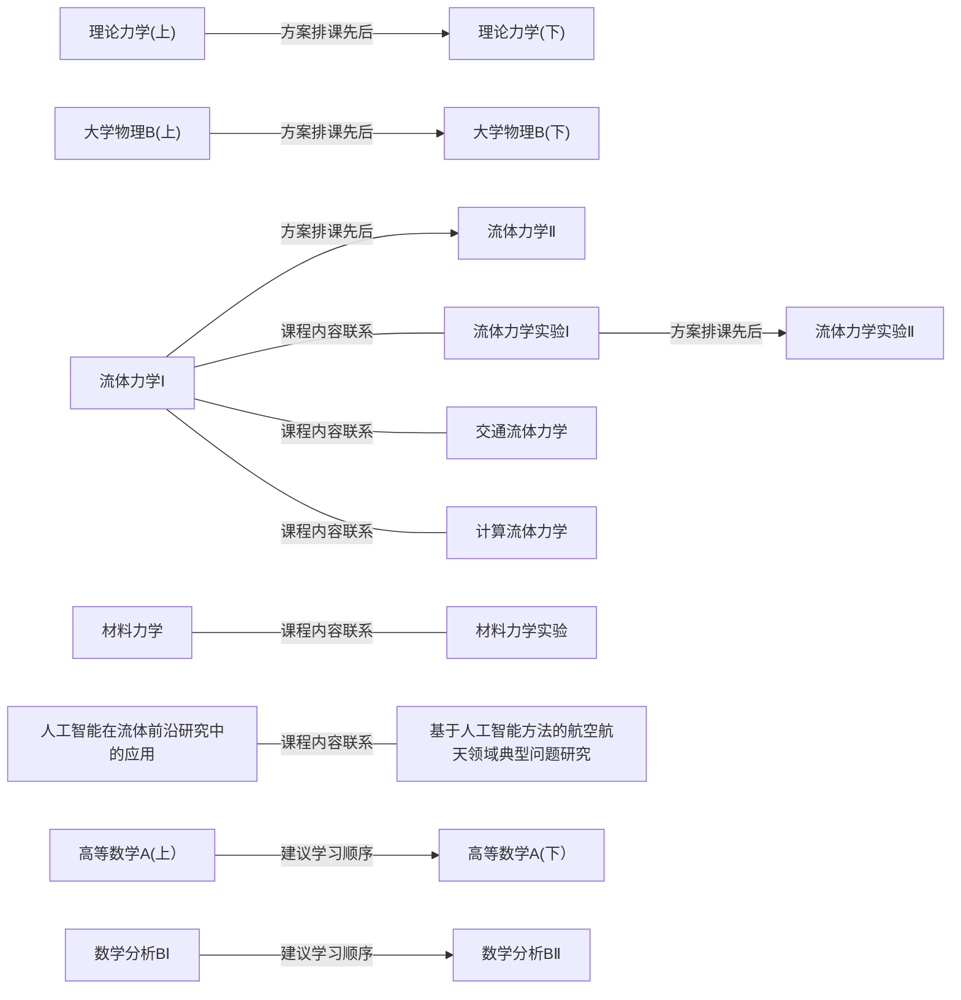

# 2023级 理论与应用力学专业“2+X”教学培养方案（自然科学试验班学生适用）

智能机器人与先进制造创新学院 · 理论与应用力学 · 方案 67399 · 66 个不同课程或科研条目。

[官方 Word](../originals/plan-67399.docx) · [教务详情](https://fdjwgl.fudan.edu.cn/manager/bizType/2/major-program-search/info/67399?skipAuth=1) · [方案快照](../raw/plan-67399.json.gz) · [年级目录](../README.md)

## 修读导读

- **建议先学**　《理论力学(上)》（`MECH130005`） → 《理论力学(下)》（`MECH130006`）。题名列出连续册次或级别。可把前一册用过的物理量和建模假设列在一起，后续遇到相似问题时再比较。方案分别列在第3、4学期。

- **可以对照着读**　《材料力学》（`AAST20009`）与《材料力学实验》（`AAST30007`）。可在实验或实践课中记录用到了哪些课堂概念，再回到相应章节复习。

- **查模块选课**　《工程数学》（`AAST20001`）、《数理方程》（`AAST20002`）列在“专业核心教育课程”中。原表见 `/courseModules/8`。

## 课程关系图

图中展示部分关系。下表保留全部已建立的课程对，来源位置使用本方案 JSON Pointer。

## 先修与内容联系

| 类型 | 起点 | 终点 | 依据 | 原表定位 |
| --- | --- | --- | --- | --- |
| 建议学习顺序 | 流体力学Ⅰ (AAST30005) | 流体力学Ⅱ (AAST30016) | 同方案的课程题名具有连续分册或序号。  | `/courseModules/8/planCourses/5`、`/courseModules/12/planCourses/0` |
| 建议学习顺序 | 流体力学实验Ⅰ (AAST30008) | 流体力学实验Ⅱ (AAST30017) | 同方案的课程题名具有连续分册或序号。  | `/courseModules/8/planCourses/8`、`/courseModules/13/planCourses/0` |
| 建议学习顺序 | 数学分析BⅠ (MATH10012) | 数学分析BⅡ (MATH10013) | 同方案的课程题名具有连续分册或序号。  | `/courseModules/7/planCourses/0`、`/courseModules/7/planCourses/1` |
| 建议学习顺序 | 高等数学A(上） (MATH10015) | 高等数学A(下） (MATH10016) | 同方案的课程题名具有连续分册或序号。  | `/courseModules/6/planCourses/0`、`/courseModules/6/planCourses/1` |
| 建议学习顺序 | 理论力学(上) (MECH130005) | 理论力学(下) (MECH130006) | 同方案的课程题名具有连续分册或序号。  | `/courseModules/8/planCourses/2`、`/courseModules/8/planCourses/3` |
| 建议学习顺序 | 大学物理B(上) (PHYS10003) | 大学物理B(下) (PHYS10004) | 同方案的课程题名具有连续分册或序号。  | `/courseModules/5/planCourses/1`、`/courseModules/5/planCourses/2` |
| 方案排课先后 | 流体力学Ⅰ (AAST30005) | 流体力学Ⅱ (AAST30016) | 同方案该课程全部明确数字学期均早于后者。  | `/courseModules/8/planCourses/5`、`/courseModules/12/planCourses/0` |
| 方案排课先后 | 流体力学实验Ⅰ (AAST30008) | 流体力学实验Ⅱ (AAST30017) | 同方案该课程全部明确数字学期均早于后者。  | `/courseModules/8/planCourses/8`、`/courseModules/13/planCourses/0` |
| 方案排课先后 | 理论力学(上) (MECH130005) | 理论力学(下) (MECH130006) | 同方案该课程全部明确数字学期均早于后者。  | `/courseModules/8/planCourses/2`、`/courseModules/8/planCourses/3` |
| 方案排课先后 | 大学物理B(上) (PHYS10003) | 大学物理B(下) (PHYS10004) | 同方案该课程全部明确数字学期均早于后者。  | `/courseModules/5/planCourses/1`、`/courseModules/5/planCourses/2` |
| 课程内容联系 | 材料力学 (AAST20009) | 材料力学实验 (AAST30007) | 题名显示相同主题的课程与实验、实践或实习。  | `/courseModules/8/planCourses/14`、`/courseModules/8/planCourses/7` |
| 课程内容联系 | 流体力学Ⅰ (AAST30005) | 流体力学实验Ⅰ (AAST30008) | 本方案两门课程的题名均含“流体力学”，可据此对照这一主题。  | `/courseModules/8/planCourses/5`、`/courseModules/8/planCourses/8` |
| 课程内容联系 | 流体力学Ⅰ (AAST30005) | 流体力学Ⅱ (AAST30016) | 本方案两门课程的题名均含“流体力学”，可据此对照这一主题。  | `/courseModules/8/planCourses/5`、`/courseModules/12/planCourses/0` |
| 课程内容联系 | 流体力学Ⅰ (AAST30005) | 交通流体力学 (AAST30020) | 本方案两门课程的题名均含“流体力学”，可据此对照这一主题。  | `/courseModules/8/planCourses/5`、`/courseModules/14/planCourses/2` |
| 课程内容联系 | 流体力学Ⅰ (AAST30005) | 计算流体力学 (AAST30027) | 本方案两门课程的题名均含“流体力学”，可据此对照这一主题。  | `/courseModules/8/planCourses/5`、`/courseModules/14/planCourses/10` |
| 课程内容联系 | 人工智能在流体前沿研究中的应用 (AAST50001) | 基于人工智能方法的航空航天领域典型问题研究 (AIT310028) | 本方案两门课程的题名均含“人工智能”，可据此对照这一主题。  | `/courseModules/14/planCourses/27`、`/courseModules/14/planCourses/25` |

本次未从可定位的明确表述中确认课程对课程预修。学期安排、系列分册与编辑建议均保留各自的依据。

## 按原方案模块阅读

同一模块展示原表中的课程归属。模块内课程之间的先后仍须逐项查阅。

- **高等数学A**　高等数学A(上）、高等数学A(下）（原表模块 6）
- **数学分析B**　数学分析BⅠ、数学分析BⅡ（原表模块 7）
- **必修三门**　自动控制原理、计算力学、设计与制造（原表模块 11）
- **至少选修2门**　流体力学Ⅱ、固体力学基础、动力学与控制（原表模块 12）
- **至少选修2门**　流体力学实验Ⅱ、固体力学实验、结构动力学实验（原表模块 13）

## 课程表

同一课程在不同模块分别出现时，按原表逐行列出。季节字段保留原值。

| 课程 | 代码 | 学分 | 学期 | 模块 |
| --- | --- | ---: | --- | --- |
| 线性代数（理工类） | MATH10014 | 3.0 | 第2学期 | 培养方案 / 专业培养课程 / 大类基础课程 |
| 大学物理B(上) | PHYS10003 | 4.0 | 第1学期 | 培养方案 / 专业培养课程 / 大类基础课程 |
| 大学物理B(下) | PHYS10004 | 4.0 | 第2学期 | 培养方案 / 专业培养课程 / 大类基础课程 |
| 基础物理实验 | PHYS10005 | 2.0 | 第1学期 | 培养方案 / 专业培养课程 / 大类基础课程 |
| 高等数学A(上） | MATH10015 | 5.0 | AUTUMN | 培养方案 / 专业培养课程 / 大类基础课程 / 高等数学A |
| 高等数学A(下） | MATH10016 | 5.0 | SPRING | 培养方案 / 专业培养课程 / 大类基础课程 / 高等数学A |
| 数学分析BⅠ | MATH10012 | 5.0 | AUTUMN | 培养方案 / 专业培养课程 / 大类基础课程 / 数学分析B |
| 数学分析BⅡ | MATH10013 | 5.0 | SPRING | 培养方案 / 专业培养课程 / 大类基础课程 / 数学分析B |
| 工程数学 | AAST20001 | 3.0 | 第3学期 | 培养方案 / 专业培养课程 / 专业核心教育课程 |
| 数理方程 | AAST20002 | 3.0 | 第4学期 | 培养方案 / 专业培养课程 / 专业核心教育课程 |
| 理论力学(上) | MECH130005 | 3.0 | 第3学期 | 培养方案 / 专业培养课程 / 专业核心教育课程 |
| 理论力学(下) | MECH130006 | 3.0 | 第4学期 | 培养方案 / 专业培养课程 / 专业核心教育课程 |
| 弹性力学 | AAST30004 | 4.0 | 第5学期 | 培养方案 / 专业培养课程 / 专业核心教育课程 |
| 流体力学Ⅰ | AAST30005 | 4.0 | 第5学期 | 培养方案 / 专业培养课程 / 专业核心教育课程 |
| 振动基础 | AAST30006 | 4.0 | 第5学期 | 培养方案 / 专业培养课程 / 专业核心教育课程 |
| 材料力学实验 | AAST30007 | 1.0 | 第5学期 | 培养方案 / 专业培养课程 / 专业核心教育课程 |
| 流体力学实验Ⅰ | AAST30008 | 1.0 | 第6学期 | 培养方案 / 专业培养课程 / 专业核心教育课程 |
| 振动实验 | AAST30009 | 1.0 | 第6学期 | 培养方案 / 专业培养课程 / 专业核心教育课程 |
| 计算方法与软件 | AAST20003 | 3.0 | 第4学期 | 培养方案 / 专业培养课程 / 专业核心教育课程 |
| 生产实习、实践 | AAST40006 | 1.0 | 第7学期 | 培养方案 / 专业培养课程 / 专业核心教育课程 |
| 毕业论文 | AAST40007 | 6.0 | 第8学期 | 培养方案 / 专业培养课程 / 专业核心教育课程 |
| CAD与工程图学基础A | AAST20007 | 3.0 | 第3学期 | 培养方案 / 专业培养课程 / 专业核心教育课程 |
| 材料力学 | AAST20009 | 3.0 | 第4学期 | 培养方案 / 专业培养课程 / 专业核心教育课程 |
| 常微分方程 | AAST20011 | 3.0 | 第3学期 | 培养方案 / 专业培养课程 / 专业核心教育课程 |
| 程序设计 | AAST10001 | 4.0 | 第3学期 | 培养方案 / 专业培养课程 / 专业核心教育课程 |
| 高等代数与解析几何 | MECH130114 | 4.0 | 第3学期 | 培养方案 / 专业培养课程 / 专业核心教育课程 |
| 解析几何 | MATH10020 | 4.0 | SPRING、AUTUMN | 培养方案 / 专业培养课程 / 专业核心教育课程 |
| 概率论与数理统计 | AAST20012 | 3.0 | 第4学期 | 培养方案 / 专业培养课程 / 专业核心教育课程 |
| 航空航天与力学导论 | AAST10002 | 1.0 | 第3学期 | 培养方案 / 专业培养课程 / 专业核心教育课程 |
| 设计与制造 | GEEC30008 | 2.0 | 第5学期 | 培养方案 / 专业进阶模块I / 必修三门 |
| 计算力学 | AAST40005 | 3.0 | 第6学期 | 培养方案 / 专业进阶模块I / 必修三门 |
| 自动控制原理 | AAST30014 | 2.0 | 第5学期 | 培养方案 / 专业进阶模块I / 必修三门 |
| 流体力学Ⅱ | AAST30016 | 3.0 | 第6学期 | 培养方案 / 专业进阶模块I / 至少选修2门 |
| 固体力学基础 | AAST30019 | 2.0 | 第6学期 | 培养方案 / 专业进阶模块I / 至少选修2门 |
| 动力学与控制 | AAST30032 | 2.0 | 第6学期 | 培养方案 / 专业进阶模块I / 至少选修2门 |
| 流体力学实验Ⅱ | AAST30017 | 2.0 | 第7学期 | 培养方案 / 专业进阶模块I / 至少选修2门 |
| 固体力学实验 | AAST30018 | 2.0 | 第7学期 | 培养方案 / 专业进阶模块I / 至少选修2门 |
| 结构动力学实验 | AAST40008 | 2.0 | 第7学期 | 培养方案 / 专业进阶模块I / 至少选修2门 |
| 生物医学工程概论 | AAST40009 | 2.0 | SPRING、AUTUMN | 培养方案 / 专业进阶模块II |
| 优化设计 | AAST20008 | 2.0 | SPRING、AUTUMN | 培养方案 / 专业进阶模块II |
| 交通流体力学 | AAST30020 | 2.0 | SPRING、AUTUMN | 培养方案 / 专业进阶模块II |
| 数字信号处理 | AAST30021 | 2.0 | SPRING、AUTUMN | 培养方案 / 专业进阶模块II |
| 水动力学 | MECH130061 | 2.0 | SPRING、AUTUMN | 培养方案 / 专业进阶模块II |
| 粘弹性力学 | AAST40010 | 2.0 | SPRING、AUTUMN | 培养方案 / 专业进阶模块II |
| 经典力学数学名著选讲 | MECH130087 | 2.0 | SPRING、AUTUMN | 培养方案 / 专业进阶模块II |
| 工程系统建模与控制 | AAST30025 | 2.0 | SPRING、AUTUMN | 培养方案 / 专业进阶模块II |
| 工程热力学 | AAST30026 | 2.0 | SPRING、AUTUMN | 培养方案 / 专业进阶模块II |
| 张量分析与微分几何基础 | AAST40011 | 2.0 | SPRING、AUTUMN | 培养方案 / 专业进阶模块II |
| 计算流体力学 | AAST30027 | 2.0 | SPRING、AUTUMN | 培养方案 / 专业进阶模块II |
| 基于Matlab的工程分析 | AAST30028 | 2.0 | SPRING、AUTUMN | 培养方案 / 专业进阶模块II |
| 工程中的数学方法 | AAST30033 | 3.0 | SPRING、AUTUMN | 培养方案 / 专业进阶模块II |
| 连续介质力学基础 | AAST40012 | 3.0 | SPRING、AUTUMN | 培养方案 / 专业进阶模块II |
| 应用实变函数与泛函分析基础 | AAST50010 | 3.0 | SPRING、AUTUMN | 培养方案 / 专业进阶模块II |
| 飞行器空气动力学 | MECH130109 | 3.0 | SPRING、AUTUMN | 培养方案 / 专业进阶模块II |
| 流形上的微积分 | AAST50011 | 2.0 | SPRING、AUTUMN | 培养方案 / 专业进阶模块II |
| 板壳理论 | AAST40013 | 2.0 | SPRING、AUTUMN | 培养方案 / 专业进阶模块II |
| 现代飞机先进空气动力设计技术 | AAST30037 | 2.0 | SPRING、AUTUMN | 培养方案 / 专业进阶模块II |
| 复杂动力学系统建模与仿真 | AAST30038 | 3.0 | SPRING、AUTUMN | 培养方案 / 专业进阶模块II |
| 机电系统原理及实践 | AAST30039 | 3.0 | SPRING、AUTUMN | 培养方案 / 专业进阶模块II |
| 几何力学 | AAST50014 | 3.0 | SPRING、AUTUMN | 培养方案 / 专业进阶模块II |
| 光流控技术概论 | AAST40016 | 2.0 | SPRING、AUTUMN | 培养方案 / 专业进阶模块II |
| 医疗器械建模仿真与应用 | AAST40017 | 2.0 | SPRING、AUTUMN | 培养方案 / 专业进阶模块II |
| 增材制造导论 | AAST40018 | 2.0 | SPRING、AUTUMN | 培养方案 / 专业进阶模块II |
| 基于人工智能方法的航空航天领域典型问题研究 | AIT310028 | 2.0 | AUTUMN | 培养方案 / 专业进阶模块II |
| 智柔体导论 | AAST40015 | 2.0 | SPRING | 培养方案 / 专业进阶模块II |
| 人工智能在流体前沿研究中的应用 | AAST50001 | 2.0 | AUTUMN | 培养方案 / 专业进阶模块II |
