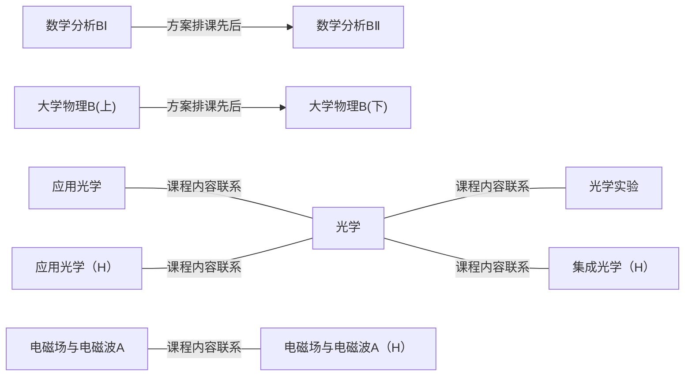

# 2023智能科学与技术专业“2+X”教学培养方案 （智能光电方向适用）

智能机器人与先进制造创新学院 · 智能科学与技术(智能光电方向) · 方案 96922 · 199 个不同课程或科研条目。

[官方 Word](../originals/plan-96922.docx) · [教务详情](https://fdjwgl.fudan.edu.cn/manager/bizType/2/major-program-search/info/96922?skipAuth=1) · [方案快照](../raw/plan-96922.json.gz) · [年级目录](../README.md)

## 修读导读

- **建议先学**　《数学分析BⅠ》（`MATH10012`） → 《数学分析BⅡ》（`MATH10013`）。题名列出连续册次或级别。可把定义、定理的条件和典型例题保留下来，读后续分册时继续沿用。方案分别列在第1、2学期。

- **可以对照着读**　《光学》（`OPTI30001`）与《光学实验》（`OPTI30003`）。可在实验或实践课中记录用到了哪些课堂概念，再回到相应章节复习。

- **查模块选课**　《数字逻辑基础》（`EST20009`）、《工程数学》（`EST20003`）列在“专业核心教育课程”中。原表见 `/courseModules/9`。

## 课程关系图

图中展示部分关系。下表保留全部已建立的课程对，来源位置使用本方案 JSON Pointer。

## 先修与内容联系

| 类型 | 起点 | 终点 | 依据 | 原表定位 |
| --- | --- | --- | --- | --- |
| 建议学习顺序 | 数学分析BⅠ (MATH10012) | 数学分析BⅡ (MATH10013) | 同方案的课程题名具有连续分册或序号。  | `/courseModules/8/planCourses/0`、`/courseModules/8/planCourses/1` |
| 建议学习顺序 | 大学物理B(上) (PHYS10003) | 大学物理B(下) (PHYS10004) | 同方案的课程题名具有连续分册或序号。  | `/courseModules/8/planCourses/3`、`/courseModules/8/planCourses/4` |
| 方案排课先后 | 数学分析BⅠ (MATH10012) | 数学分析BⅡ (MATH10013) | 同方案该课程全部明确数字学期均早于后者。  | `/courseModules/8/planCourses/0`、`/courseModules/8/planCourses/1` |
| 方案排课先后 | 大学物理B(上) (PHYS10003) | 大学物理B(下) (PHYS10004) | 同方案该课程全部明确数字学期均早于后者。  | `/courseModules/8/planCourses/3`、`/courseModules/8/planCourses/4` |
| 课程内容联系 | 应用光学 (OPTI20001) | 光学 (OPTI30001) | 本方案两门课程的题名均含“光学”，可据此对照这一主题。  | `/courseModules/9/planCourses/6`、`/courseModules/9/planCourses/3` |
| 课程内容联系 | 应用光学（H） (OPTI20001h) | 光学 (OPTI30001) | 本方案两门课程的题名均含“光学”，可据此对照这一主题。  | `/courseModules/15/planCourses/4`、`/courseModules/9/planCourses/3` |
| 课程内容联系 | 光学 (OPTI30001) | 光学实验 (OPTI30003) | 题名显示相同主题的课程与实验、实践或实习。  | `/courseModules/9/planCourses/3`、`/courseModules/9/planCourses/10` |
| 课程内容联系 | 光学 (OPTI30001) | 集成光学（H） (OPTI50003h) | 本方案两门课程的题名均含“光学”，可据此对照这一主题。  | `/courseModules/9/planCourses/3`、`/courseModules/15/planCourses/2` |
| 课程内容联系 | 电磁场与电磁波A (OPTI30004) | 电磁场与电磁波A（H） (OPTI30004h) | 本方案两门课程的题名均含“电磁”，可据此对照这一主题。  | `/courseModules/9/planCourses/7`、`/courseModules/15/planCourses/9` |
| 课程内容联系 | 半导体器件物理 (OPTI50019) | 半导体器件物理（H） (OPTI50019h) | 本方案两门课程的题名均含“半导体”，可据此对照这一主题。  | `/courseModules/12/planCourses/0`、`/courseModules/15/planCourses/7` |
| 课程内容联系 | 半导体器件物理 (OPTI50019) | 半导体材料测试分析方法 (OPTI50028) | 本方案两门课程的题名均含“半导体”，可据此对照这一主题。  | `/courseModules/12/planCourses/0`、`/courseModules/13/planCourses/9` |

本次未从可定位的明确表述中确认课程对课程预修。学期安排、系列分册与编辑建议均保留各自的依据。

## 按原方案模块阅读

同一模块展示原表中的课程归属。模块内课程之间的先后仍须逐项查阅。

- **荣誉项目课程**　应用光学（H）、光电测试技术（H）、电磁场与电磁波A（H）、激光原理与技术（H）、光纤通信原理与技术（H）、集成光学（H）、光源原理（H）、现代光子学（H）、半导体器件物理（H）、光电显示技术基础（H）（原表模块 15）

## 课程表

同一课程在不同模块分别出现时，按原表逐行列出。季节字段保留原值。

| 课程 | 代码 | 学分 | 学期 | 模块 |
| --- | --- | ---: | --- | --- |
| 复旦大学英语水平测试 | GEEF30031 | 2.0 | AUTUMN | 培养方案 / 通识教育课程 / 通识教育专项教育课程 / 复旦大学英语水平测试 |
| 哲学视野下的价值关怀与创业实践 | GEIN10045 | 1.0 | SPRING、AUTUMN | 培养方案 / 通识教育课程 / 通识教育专项教育课程 / 创新创意创业 |
| 物理学的新启示 | GEIN20012 | 1.0 | SPRING、AUTUMN | 培养方案 / 通识教育课程 / 通识教育专项教育课程 / 创新创意创业 |
| 外语专业创新创业理论与实践 | GEIN10021 | 1.0 | SPRING、AUTUMN | 培养方案 / 通识教育课程 / 通识教育专项教育课程 / 创新创意创业 |
| 核事业与行业发展 | GEIN10054 | 1.0 | SPRING、AUTUMN | 培养方案 / 通识教育课程 / 通识教育专项教育课程 / 创新创意创业 |
| 大学生创新创意创业实践B(二) | GEIN30003 | 2.0 | SPRING、AUTUMN | 培养方案 / 通识教育课程 / 通识教育专项教育课程 / 创新创意创业 |
| 航空航天技术发展导论 | MECH115001 | 1.0 | SPRING、AUTUMN | 培养方案 / 通识教育课程 / 通识教育专项教育课程 / 创新创意创业 |
| 大学生创新创意创业实践B(三) | GEIN30004 | 2.0 | SPRING、AUTUMN | 培养方案 / 通识教育课程 / 通识教育专项教育课程 / 创新创意创业 |
| 人本视角下的创业实践 | NURS115001 | 1.0 | SPRING、AUTUMN | 培养方案 / 通识教育课程 / 通识教育专项教育课程 / 创新创意创业 |
| 人工智能在企业中的应用与创新A | DATA115003 | 2.0 | SPRING、AUTUMN | 培养方案 / 通识教育课程 / 通识教育专项教育课程 / 创新创意创业 |
| 大学生创业:思维、能力与方法 | GEIN10051 | 2.0 | SPRING、AUTUMN | 培养方案 / 通识教育课程 / 通识教育专项教育课程 / 创新创意创业 |
| 文物艺术品保护与修复 | GEIN10039 | 1.0 | SPRING、AUTUMN | 培养方案 / 通识教育课程 / 通识教育专项教育课程 / 创新创意创业 |
| 旅游创新创业理论与实践 | GEIN10055 | 1.0 | SPRING、AUTUMN | 培养方案 / 通识教育课程 / 通识教育专项教育课程 / 创新创意创业 |
| 大数据在健康产业中的应用 | GEIN10046 | 1.0 | SPRING、AUTUMN | 培养方案 / 通识教育课程 / 通识教育专项教育课程 / 创新创意创业 |
| 生物技术产业与大学生生涯发展 | GEIN20003 | 1.0 | SPRING、AUTUMN | 培养方案 / 通识教育课程 / 通识教育专项教育课程 / 创新创意创业 |
| 数字影视动画 | GEIN10018 | 2.0 | SPRING、AUTUMN | 培养方案 / 通识教育课程 / 通识教育专项教育课程 / 创新创意创业 |
| 大气与海洋科学的行业创新与创业 | GEIN20002 | 1.0 | SPRING、AUTUMN | 培养方案 / 通识教育课程 / 通识教育专项教育课程 / 创新创意创业 |
| 医学科学的前沿创新和实践 | GEIN10036 | 1.0 | SPRING、AUTUMN | 培养方案 / 通识教育课程 / 通识教育专项教育课程 / 创新创意创业 |
| 创意网络视频策划、制作与营销A | GEIN10019 | 2.0 | SPRING、AUTUMN | 培养方案 / 通识教育课程 / 通识教育专项教育课程 / 创新创意创业 |
| 工程创新思维与方法 | GEIN10014 | 1.0 | SPRING、AUTUMN | 培养方案 / 通识教育课程 / 通识教育专项教育课程 / 创新创意创业 |
| 设计色彩与创意思维 | GEIN10017 | 2.0 | SPRING、AUTUMN | 培养方案 / 通识教育课程 / 通识教育专项教育课程 / 创新创意创业 |
| 会计学原理 | GEIN10011 | 2.0 | SPRING、AUTUMN | 培养方案 / 通识教育课程 / 通识教育专项教育课程 / 创新创意创业 |
| 扩展现实艺术与数字人文 | GEIN10020 | 2.0 | SPRING、AUTUMN | 培养方案 / 通识教育课程 / 通识教育专项教育课程 / 创新创意创业 |
| 智能硬件创新与创业 | GEIN10037 | 1.0 | SPRING、AUTUMN | 培养方案 / 通识教育课程 / 通识教育专项教育课程 / 创新创意创业 |
| 创新创业大讲堂 | GEIN20007 | 2.0 | SPRING、AUTUMN | 培养方案 / 通识教育课程 / 通识教育专项教育课程 / 创新创意创业 |
| 设计思维 I | INFO115002 | 2.0 | SPRING、AUTUMN | 培养方案 / 通识教育课程 / 通识教育专项教育课程 / 创新创意创业 |
| 环境空间健康与生活安全 | CHEM115003 | 1.0 | SPRING、AUTUMN | 培养方案 / 通识教育课程 / 通识教育专项教育课程 / 创新创意创业 |
| 创业企业金融与会计 | GEIN10029 | 2.0 | SPRING、AUTUMN | 培养方案 / 通识教育课程 / 通识教育专项教育课程 / 创新创意创业 |
| 互联网公共服务创新创意 | POLI115002 | 1.0 | SPRING、AUTUMN | 培养方案 / 通识教育课程 / 通识教育专项教育课程 / 创新创意创业 |
| 心理健康教育行业创业与发展A | SOCI115006 | 2.0 | SPRING、AUTUMN | 培养方案 / 通识教育课程 / 通识教育专项教育课程 / 创新创意创业 |
| 生物医学信息技术的变革与展望 | MED115001 | 1.0 | SPRING、AUTUMN | 培养方案 / 通识教育课程 / 通识教育专项教育课程 / 创新创意创业 |
| 保险科技 | GEIN10009 | 2.0 | SPRING、AUTUMN | 培养方案 / 通识教育课程 / 通识教育专项教育课程 / 创新创意创业 |
| 像经济学家那样思考：信息、激励与政策 | GEIN10010 | 2.0 | SPRING、AUTUMN | 培养方案 / 通识教育课程 / 通识教育专项教育课程 / 创新创意创业 |
| 智慧医疗概论与案例解析 | MED115003 | 1.0 | SPRING、AUTUMN | 培养方案 / 通识教育课程 / 通识教育专项教育课程 / 创新创意创业 |
| 大数据在健康产业中的应用A | GEIN10047 | 2.0 | SPRING、AUTUMN | 培养方案 / 通识教育课程 / 通识教育专项教育课程 / 创新创意创业 |
| 社会问题和社会创新A | GEIN10052 | 2.0 | SPRING、AUTUMN | 培养方案 / 通识教育课程 / 通识教育专项教育课程 / 创新创意创业 |
| 社会问题和社会创新 | GEIN10049 | 1.0 | SPRING、AUTUMN | 培养方案 / 通识教育课程 / 通识教育专项教育课程 / 创新创意创业 |
| 传统文化资源的保护与利用 | GEIN10003 | 1.0 | SPRING、AUTUMN | 培养方案 / 通识教育课程 / 通识教育专项教育课程 / 创新创意创业 |
| 心理健康教育行业创业与发展 | GEIN10050 | 1.0 | SPRING、AUTUMN | 培养方案 / 通识教育课程 / 通识教育专项教育课程 / 创新创意创业 |
| 社会组织公益创新与创业设计 | GEIN40004 | 1.0 | SPRING、AUTUMN | 培养方案 / 通识教育课程 / 通识教育专项教育课程 / 创新创意创业 |
| 创意网络视频策划、制作与营销 | FINE115002 | 1.0 | SPRING、AUTUMN | 培养方案 / 通识教育课程 / 通识教育专项教育课程 / 创新创意创业 |
| 智慧医疗概论与案例解析A | GEIN20011 | 2.0 | SPRING | 培养方案 / 通识教育课程 / 通识教育专项教育课程 / 创新创意创业 |
| 科普创作 | GEIN10048 | 2.0 | SPRING、AUTUMN | 培养方案 / 通识教育课程 / 通识教育专项教育课程 / 创新创意创业 |
| 科技创新创业 | GEIN10012 | 2.0 | SPRING、AUTUMN | 培养方案 / 通识教育课程 / 通识教育专项教育课程 / 创新创意创业 |
| 智能硬件创新与创业A | GEIN10038 | 2.0 | SPRING | 培养方案 / 通识教育课程 / 通识教育专项教育课程 / 创新创意创业 |
| 电子信息与材料创新 | GEIN20010 | 2.0 | SPRING、AUTUMN | 培养方案 / 通识教育课程 / 通识教育专项教育课程 / 创新创意创业 |
| 留学生创新与创业 | GEIN30001 | 1.0 | SPRING、AUTUMN | 培养方案 / 通识教育课程 / 通识教育专项教育课程 / 创新创意创业 |
| 大学生创新创意创业实践A | GEIN20004 | 1.0 | SPRING、AUTUMN | 培养方案 / 通识教育课程 / 通识教育专项教育课程 / 创新创意创业 |
| 创新创业与职业伦理A | PTSS115002 | 2.0 | SPRING、AUTUMN | 培养方案 / 通识教育课程 / 通识教育专项教育课程 / 创新创意创业 |
| 计算机与互联网的未来 | GEIN10004 | 1.0 | SPRING、AUTUMN | 培养方案 / 通识教育课程 / 通识教育专项教育课程 / 创新创意创业 |
| 智能可穿戴材料导论 | GEIN10032 | 2.0 | SPRING、AUTUMN | 培养方案 / 通识教育课程 / 通识教育专项教育课程 / 创新创意创业 |
| 技术进步与专利制度发展 | GEIN10033 | 2.0 | SPRING、AUTUMN | 培养方案 / 通识教育课程 / 通识教育专项教育课程 / 创新创意创业 |
| 纳米艺术的思维、审美与创造 | FINE115004 | 1.0 | SPRING、AUTUMN | 培养方案 / 通识教育课程 / 通识教育专项教育课程 / 创新创意创业 |
| 大学生创业实训 | GEIN20005 | 2.0 | SPRING、AUTUMN | 培养方案 / 通识教育课程 / 通识教育专项教育课程 / 创新创意创业 |
| 行业大数据的应用与创新 | GEIN10005 | 1.0 | SPRING、AUTUMN | 培养方案 / 通识教育课程 / 通识教育专项教育课程 / 创新创意创业 |
| 思辨与创新 | GEIN10025 | 1.0 | SPRING、AUTUMN | 培养方案 / 通识教育课程 / 通识教育专项教育课程 / 创新创意创业 |
| 创业企业战略与机会选择 | GEIN10028 | 2.0 | SPRING、AUTUMN | 培养方案 / 通识教育课程 / 通识教育专项教育课程 / 创新创意创业 |
| 设计创新思维下的精益创业A | GEIN10027 | 2.0 | SPRING、AUTUMN | 培养方案 / 通识教育课程 / 通识教育专项教育课程 / 创新创意创业 |
| 营销创新 | GEIN10026 | 2.0 | SPRING、AUTUMN | 培养方案 / 通识教育课程 / 通识教育专项教育课程 / 创新创意创业 |
| 微电影编剧的方法与实践 | FINE115003 | 1.0 | SPRING、AUTUMN | 培养方案 / 通识教育课程 / 通识教育专项教育课程 / 创新创意创业 |
| 材料科学前沿与商业应用 | GEIN10030 | 1.0 | SPRING、AUTUMN | 培养方案 / 通识教育课程 / 通识教育专项教育课程 / 创新创意创业 |
| 信息科学技术的创新创业与发展 | GEIN10022 | 1.0 | SPRING、AUTUMN | 培养方案 / 通识教育课程 / 通识教育专项教育课程 / 创新创意创业 |
| 创意设计前沿 | GEIN10016 | 2.0 | SPRING、AUTUMN | 培养方案 / 通识教育课程 / 通识教育专项教育课程 / 创新创意创业 |
| 石墨烯：神奇材料的新机遇 | GEIN20009 | 1.0 | SPRING、AUTUMN | 培养方案 / 通识教育课程 / 通识教育专项教育课程 / 创新创意创业 |
| 大学生创业概论与实践 | MANA115002 | 2.0 | SPRING、AUTUMN | 培养方案 / 通识教育课程 / 通识教育专项教育课程 / 创新创意创业 |
| 保险企业经营管理 | GEIN10008 | 2.0 | SPRING、AUTUMN | 培养方案 / 通识教育课程 / 通识教育专项教育课程 / 创新创意创业 |
| 设计驱动创新与创业 | GEIN10013 | 2.0 | SPRING、AUTUMN | 培养方案 / 通识教育课程 / 通识教育专项教育课程 / 创新创意创业 |
| 互联网医药与大健康 | GEIN10043 | 2.0 | SPRING、AUTUMN | 培养方案 / 通识教育课程 / 通识教育专项教育课程 / 创新创意创业 |
| 人本视角下的创业实践A | GEIN10041 | 2.0 | SPRING、AUTUMN | 培养方案 / 通识教育课程 / 通识教育专项教育课程 / 创新创意创业 |
| 企业商战创新 | GEIN20006 | 2.0 | SPRING、AUTUMN | 培养方案 / 通识教育课程 / 通识教育专项教育课程 / 创新创意创业 |
| 基于数学建模的创新实践 | GEIN10035 | 2.0 | SPRING、AUTUMN | 培养方案 / 通识教育课程 / 通识教育专项教育课程 / 创新创意创业 |
| 设计创新思维下的精益创业 | MANA115001 | 1.0 | SPRING、AUTUMN | 培养方案 / 通识教育课程 / 通识教育专项教育课程 / 创新创意创业 |
| 文化创意产业 | GEIN10024 | 1.0 | SPRING、AUTUMN | 培养方案 / 通识教育课程 / 通识教育专项教育课程 / 创新创意创业 |
| 大学生创新创意创业实践B(一) | GEIN30002 | 2.0 | SPRING、AUTUMN | 培养方案 / 通识教育课程 / 通识教育专项教育课程 / 创新创意创业 |
| 产品设计与开发 | GEIN10031 | 2.0 | SPRING、AUTUMN | 培养方案 / 通识教育课程 / 通识教育专项教育课程 / 创新创意创业 |
| 天才引导的历程——数学史上的重大发现 | GEIN10034 | 1.0 | SPRING、AUTUMN | 培养方案 / 通识教育课程 / 通识教育专项教育课程 / 创新创意创业 |
| 生物医药的创新、转化与创业 | GEIN10042 | 1.0 | SPRING、AUTUMN | 培养方案 / 通识教育课程 / 通识教育专项教育课程 / 创新创意创业 |
| 批判性思维和有效沟通 | SOCI115004 | 2.0 | SPRING、AUTUMN | 培养方案 / 通识教育课程 / 通识教育专项教育课程 / 创新创意创业 |
| 微流控芯片实验室 | GEIN10002 | 2.0 | SPRING、AUTUMN | 培养方案 / 通识教育课程 / 通识教育专项教育课程 / 创新创意创业 |
| 个人基因组检测创业实践 | GEIN10040 | 2.0 | SPRING、AUTUMN | 培养方案 / 通识教育课程 / 通识教育专项教育课程 / 创新创意创业 |
| 金融创新 | GEIN10006 | 2.0 | SPRING、AUTUMN | 培养方案 / 通识教育课程 / 通识教育专项教育课程 / 创新创意创业 |
| 创意可视化设计 | GEIN10015 | 1.0 | SPRING、AUTUMN | 培养方案 / 通识教育课程 / 通识教育专项教育课程 / 创新创意创业 |
| 软件技术创新 | GEIN10053 | 1.0 | SPRING、AUTUMN | 培养方案 / 通识教育课程 / 通识教育专项教育课程 / 创新创意创业 |
| 创新与经济学 | GEIN10007 | 1.0 | SPRING、AUTUMN | 培养方案 / 通识教育课程 / 通识教育专项教育课程 / 创新创意创业 |
| 合同法的理论与实践 | GEEC10213 | 2.0 | SPRING、AUTUMN | 培养方案 / 通识教育课程 / 通识教育专项教育课程 / 创新创意创业 |
| 管理沟通 | GEEC10239 | 2.0 | SPRING、AUTUMN | 培养方案 / 通识教育课程 / 通识教育专项教育课程 / 创新创意创业 |
| 政策调研与写作 | GEXZ10024 | 2.0 | SPRING、AUTUMN | 培养方案 / 通识教育课程 / 通识教育专项教育课程 / 创新创意创业 |
| 外国经济思潮 | GEEC10081 | 2.0 | SPRING、AUTUMN | 培养方案 / 通识教育课程 / 通识教育专项教育课程 / 创新创意创业 |
| 博物教育与生态文明 | GEXZ10008 | 3.0 | SUMMER | 培养方案 / 通识教育课程 / 通识教育专项教育课程 / 创新创意创业 |
| 虚拟空间设计与表现 | GEEC10138 | 2.0 | SPRING、AUTUMN | 培养方案 / 通识教育课程 / 通识教育专项教育课程 / 创新创意创业 |
| 计算思维与信息素养 | GEXZ10032 | 3.0 | SPRING、AUTUMN | 培养方案 / 通识教育课程 / 通识教育专项教育课程 / 创新创意创业 |
| 国际财务 | GEEC10233 | 2.0 | SPRING、AUTUMN | 培养方案 / 通识教育课程 / 通识教育专项教育课程 / 创新创意创业 |
| 常见疾病与健康促进 | GEXZ30001 | 3.0 | SUMMER | 培养方案 / 通识教育课程 / 通识教育专项教育课程 / 创新创意创业 |
| 医疗救治与人文关怀 | GEXZ20002 | 3.0 | SPRING、AUTUMN | 培养方案 / 通识教育课程 / 通识教育专项教育课程 / 创新创意创业 |
| 中国传统书籍装帧艺术与实践 | GEXZ10021 | 3.0 | SPRING、AUTUMN | 培养方案 / 通识教育课程 / 通识教育专项教育课程 / 创新创意创业 |
| 人口、资源、环境与经济发展 | GEEC10080 | 2.0 | SPRING、AUTUMN | 培养方案 / 通识教育课程 / 通识教育专项教育课程 / 创新创意创业 |
| 质量管理 | GEEC10232 | 2.0 | SPRING、AUTUMN | 培养方案 / 通识教育课程 / 通识教育专项教育课程 / 创新创意创业 |
| 现代投资学 | GEEC10229 | 2.0 | SPRING、AUTUMN | 培养方案 / 通识教育课程 / 通识教育专项教育课程 / 创新创意创业 |
| 国际金融与贸易 | GEEC10084 | 2.0 | SPRING、AUTUMN | 培养方案 / 通识教育课程 / 通识教育专项教育课程 / 创新创意创业 |
| 产业经济学概论 | GEEC10226 | 2.0 | SPRING、AUTUMN | 培养方案 / 通识教育课程 / 通识教育专项教育课程 / 创新创意创业 |
| 艺术与心灵 | GEXZ10028 | 3.0 | SPRING、AUTUMN | 培养方案 / 通识教育课程 / 通识教育专项教育课程 / 创新创意创业 |
| 科技与伦理的追问 | GEXZ10020 | 2.0 | SPRING、AUTUMN | 培养方案 / 通识教育课程 / 通识教育专项教育课程 / 创新创意创业 |
| 智能芯片与社会 | GEXZ10019 | 3.0 | SPRING、AUTUMN | 培养方案 / 通识教育课程 / 通识教育专项教育课程 / 创新创意创业 |
| 成功心理素质训练 | GEMH10007 | 2.0 | SPRING、AUTUMN | 培养方案 / 通识教育课程 / 通识教育专项教育课程 / 创新创意创业 |
| 会计学原理 | GEIS10005 | 2.0 | SUMMER | 培养方案 / 通识教育课程 / 通识教育专项教育课程 / 创新创意创业 |
| 生态文明的理论与实践 | GEXZ10007 | 3.0 | SPRING、AUTUMN | 培养方案 / 通识教育课程 / 通识教育专项教育课程 / 创新创意创业 |
| 知识经济与知识产权管理 | GEEC10214 | 2.0 | SPRING、AUTUMN | 培养方案 / 通识教育课程 / 通识教育专项教育课程 / 创新创意创业 |
| 有效沟通和团队协作 | PHAR110034 | 3.0 | SPRING、AUTUMN | 培养方案 / 通识教育课程 / 通识教育专项教育课程 / 创新创意创业 |
| 交易法律制度 | GEEC10215 | 2.0 | SPRING、AUTUMN | 培养方案 / 通识教育课程 / 通识教育专项教育课程 / 创新创意创业 |
| 信息化与网络金融 | ECON110016 | 2.0 | SPRING、AUTUMN | 培养方案 / 通识教育课程 / 通识教育专项教育课程 / 创新创意创业 |
| 中国经济改革及社会政治变化 | ECON110030 | 3.0 | SPRING、AUTUMN | 培养方案 / 通识教育课程 / 通识教育专项教育课程 / 创新创意创业 |
| 市场营销导论 | GEEC10228 | 2.0 | SPRING、AUTUMN | 培养方案 / 通识教育课程 / 通识教育专项教育课程 / 创新创意创业 |
| 科技服务创新与智慧养老 | GEXZ10029 | 3.0 | SPRING、AUTUMN | 培养方案 / 通识教育课程 / 通识教育专项教育课程 / 创新创意创业 |
| 心理、决策与公共管理 | SOCI110045 | 2.0 | SPRING、AUTUMN | 培养方案 / 通识教育课程 / 通识教育专项教育课程 / 创新创意创业 |
| 人类骨骼考古前沿与实践 | GEEC10280 | 3.0 | SUMMER | 培养方案 / 通识教育课程 / 通识教育专项教育课程 / 创新创意创业 |
| 当代中国教育与社会发展 | GEXZ10025 | 2.0 | SPRING、AUTUMN | 培养方案 / 通识教育课程 / 通识教育专项教育课程 / 创新创意创业 |
| 大学生创业导论 | GEEC10391 | 2.0 | SPRING、AUTUMN | 培养方案 / 通识教育课程 / 通识教育专项教育课程 / 创新创意创业 |
| 国际经济学 | GEEC10087 | 2.0 | SPRING、AUTUMN | 培养方案 / 通识教育课程 / 通识教育专项教育课程 / 创新创意创业 |
| 现代物流管理 | GEEC10224 | 2.0 | SPRING、AUTUMN | 培养方案 / 通识教育课程 / 通识教育专项教育课程 / 创新创意创业 |
| 信息技术管理 | GEEC10230 | 2.0 | SPRING、AUTUMN | 培养方案 / 通识教育课程 / 通识教育专项教育课程 / 创新创意创业 |
| 知识产权法 | GEEC10211 | 2.0 | SPRING、AUTUMN | 培养方案 / 通识教育课程 / 通识教育专项教育课程 / 创新创意创业 |
| 志愿精神与社会服务 | SOCI110071 | 3.0 | SPRING、AUTUMN | 培养方案 / 通识教育课程 / 通识教育专项教育课程 / 创新创意创业 |
| 大学生就业指导 | GEEC10389 | 2.0 | SPRING、AUTUMN | 培养方案 / 通识教育课程 / 通识教育专项教育课程 / 创新创意创业 |
| 走进非物质文化遗产 | GEXZ10006 | 3.0 | SUMMER | 培养方案 / 通识教育课程 / 通识教育专项教育课程 / 创新创意创业 |
| 乡村振兴的教育赋能 | GEXZ10031 | 3.0 | SUMMER | 培养方案 / 通识教育课程 / 通识教育专项教育课程 / 创新创意创业 |
| 大学生生涯规划与发展 | GEEC10388 | 2.0 | SPRING、AUTUMN | 培养方案 / 通识教育课程 / 通识教育专项教育课程 / 创新创意创业 |
| 社会创新与设计思维 | GEXZ10027 | 3.0 | SPRING、AUTUMN | 培养方案 / 通识教育课程 / 通识教育专项教育课程 / 创新创意创业 |
| 货币与金融市场 | GEEC10085 | 2.0 | SPRING、AUTUMN | 培养方案 / 通识教育课程 / 通识教育专项教育课程 / 创新创意创业 |
| 走近红树林 | GEXZ10004 | 3.0 | SUMMER | 培养方案 / 通识教育课程 / 通识教育专项教育课程 / 创新创意创业 |
| 乡村振兴战略的理论与实践 | GEXZ10030 | 3.0 | SUMMER | 培养方案 / 通识教育课程 / 通识教育专项教育课程 / 创新创意创业 |
| 创新与创业 | GEEC10235 | 2.0 | SPRING、AUTUMN | 培养方案 / 通识教育课程 / 通识教育专项教育课程 / 创新创意创业 |
| 证券投资与技术分析 | GEEC10082 | 2.0 | SPRING、AUTUMN | 培养方案 / 通识教育课程 / 通识教育专项教育课程 / 创新创意创业 |
| 市场调研 | MANA110055 | 2.0 | SPRING、AUTUMN | 培养方案 / 通识教育课程 / 通识教育专项教育课程 / 创新创意创业 |
| 药学生涯规划与创新实践 | GEIN10044 | 2.0 | SPRING、AUTUMN | 培养方案 / 通识教育课程 / 通识教育专项教育课程 / 创新创意创业 |
| 科创法学 | GEIN30005 | 2.0 | SPRING、AUTUMN | 培养方案 / 通识教育课程 / 通识教育专项教育课程 / 创新创意创业 |
| 大学生创新实践A | GEIN40002 | 8.0 | SPRING、AUTUMN | 培养方案 / 通识教育课程 / 通识教育专项教育课程 / 创新创意创业 |
| 大学生创新实践B | GEIN40003 | 6.0 | SPRING、AUTUMN | 培养方案 / 通识教育课程 / 通识教育专项教育课程 / 创新创意创业 |
| 大学生创新实践C | GEIN20008 | 1.0 | SPRING、AUTUMN | 培养方案 / 通识教育课程 / 通识教育专项教育课程 / 创新创意创业 |
| 大学生创新实践D | GEIN10023 | 4.0 | SPRING、AUTUMN | 培养方案 / 通识教育课程 / 通识教育专项教育课程 / 创新创意创业 |
| 学术创新实践A | GEIN40006 | 8.0 |  | 培养方案 / 通识教育课程 / 通识教育专项教育课程 / 创新创意创业 |
| 学术创新实践B | GEIN40007 | 6.0 |  | 培养方案 / 通识教育课程 / 通识教育专项教育课程 / 创新创意创业 |
| 学术创新实践C | GEIN20013 | 1.0 |  | 培养方案 / 通识教育课程 / 通识教育专项教育课程 / 创新创意创业 |
| 数学分析BⅠ | MATH10012 | 5.0 | 第1学期 | 培养方案 / 专业培养课程 / 大类基础课程 |
| 数学分析BⅡ | MATH10013 | 5.0 | 第2学期 | 培养方案 / 专业培养课程 / 大类基础课程 |
| 线性代数 | CS10003 | 3.0 | 第1学期 | 培养方案 / 专业培养课程 / 大类基础课程 |
| 大学物理B(上) | PHYS10003 | 4.0 | 第1学期 | 培养方案 / 专业培养课程 / 大类基础课程 |
| 大学物理B(下) | PHYS10004 | 4.0 | 第2学期 | 培养方案 / 专业培养课程 / 大类基础课程 |
| 基础物理实验 | PHYS10005 | 2.0 | 第2学期 | 培养方案 / 专业培养课程 / 大类基础课程 |
| 程序设计 | CS10004 | 4.0 | 第1学期 | 培养方案 / 专业培养课程 / 大类基础课程 |
| 电子系统导论 | EST10003 | 3.0 | 第2学期 | 培养方案 / 专业培养课程 / 大类基础课程 |
| 数字逻辑基础 | EST20009 | 4.0 | 第3学期 | 培养方案 / 专业培养课程 / 专业核心教育课程 |
| 工程数学 | EST20003 | 4.0 | 第3学期 | 培养方案 / 专业培养课程 / 专业核心教育课程 |
| 模拟电子学基础 | EST20010 | 4.0 | 第3学期 | 培养方案 / 专业培养课程 / 专业核心教育课程 |
| 光学 | OPTI30001 | 4.0 | 第3学期 | 培养方案 / 专业培养课程 / 专业核心教育课程 |
| 模拟与数字电路实验 | EST40012 | 3.0 | 第4学期 | 培养方案 / 专业培养课程 / 专业核心教育课程 |
| 固体物理导论 | OPTI20003 | 3.0 | 第4学期 | 培养方案 / 专业培养课程 / 专业核心教育课程 |
| 应用光学 | OPTI20001 | 3.0 | 第4学期 | 培养方案 / 专业培养课程 / 专业核心教育课程 |
| 电磁场与电磁波A | OPTI30004 | 3.0 | 第4学期 | 培养方案 / 专业培养课程 / 专业核心教育课程 |
| 微机原理与接口实验 | EST40017 | 3.0 | 第5学期 | 培养方案 / 专业培养课程 / 专业核心教育课程 |
| 光电测试技术 | OPTI30002 | 3.0 | 第5学期 | 培养方案 / 专业培养课程 / 专业核心教育课程 |
| 光学实验 | OPTI30003 | 3.0 | 第5学期 | 培养方案 / 专业培养课程 / 专业核心教育课程 |
| 毕业论文 | EST40005 | 6.0 | 第8学期 | 培养方案 / 专业培养课程 / 专业核心教育课程 |
| 半导体器件物理 | OPTI50019 | 3.0 | 第5学期 | 培养方案 / 专业进阶模块I |
| 光源原理 | OPTI50013 | 3.0 | 第5学期 | 培养方案 / 专业进阶模块I |
| 颜色信息科学 | OPTI50023 | 2.0 | 第5学期 | 培养方案 / 专业进阶模块I |
| 光电显示技术基础 | OPTI50024 | 3.0 | 第6学期 | 培养方案 / 专业进阶模块I |
| 智能光电驱动技术 | OPTI50025 | 3.0 | 第6学期 | 培养方案 / 专业进阶模块I |
| 专业实验 | OPTI40003 | 3.0 | 第7学期 | 培养方案 / 专业进阶模块I |
| 生产实习 | EST40004 | 1.0 | 第7学期 | 培养方案 / 专业进阶模块I |
| 现代光子学 | OPTI50017 | 2.0 | SPRING、AUTUMN | 培养方案 / 专业进阶模块II |
| LED器件及应用技术 | OPTI50016 | 2.0 | SPRING、AUTUMN | 培养方案 / 专业进阶模块II |
| 激光雷达技术及应用 | OPTI50030 | 3.0 | SPRING、AUTUMN | 培养方案 / 专业进阶模块II |
| 机器人学导论 | AIS410007 | 4.0 | 第6学期 | 培养方案 / 专业进阶模块II |
| 智能传感与认知 | EST50005 | 2.0 | 第6学期 | 培养方案 / 专业进阶模块II |
| 微纳制造理论和技术 | EST50007 | 2.0 | 第7学期 | 培养方案 / 专业进阶模块II |
| AI增强仿真学：理论与实践 | AIT310027 | 3.0 | AUTUMN | 培养方案 / 专业进阶模块II |
| 自动驾驶人工智能原理与实践 | AIT410017 | 2.0 | SPRING | 培养方案 / 专业进阶模块II |
| 发光材料及其应用 | OPTI50006 | 2.0 | SPRING、AUTUMN | 培养方案 / 专业进阶模块II |
| 半导体材料测试分析方法 | OPTI50028 | 2.0 | SPRING、AUTUMN | 培养方案 / 专业进阶模块II |
| 传感器与信号处理 | OPTI50014 | 3.0 | SPRING、AUTUMN | 培养方案 / 专业进阶模块II |
| 数字图像处理B | ICE40003 | 2.0 | SPRING、AUTUMN | 培养方案 / 专业进阶模块II |
| 数字控制理论与应用 | OPTI50012 | 3.0 | SPRING、AUTUMN | 培养方案 / 专业进阶模块II |
| 照明设计 | OPTI50015 | 3.0 | SPRING、AUTUMN | 培养方案 / 专业进阶模块II |
| 应用光学系统设计 | OPTI50029 | 2.0 | SPRING、AUTUMN | 培养方案 / 专业进阶模块II |
| 照明人体工效学 | OPTI50007 | 2.0 | SPRING、AUTUMN | 培养方案 / 专业进阶模块II |
| 电力电子学 | OPTI50005 | 3.0 | SPRING、AUTUMN | 培养方案 / 专业进阶模块II |
| 专业英语 | OPTI40009 | 2.0 | SPRING、AUTUMN | 培养方案 / 专业进阶模块II |
| 真空与薄膜技术基础 | OPTI50008 | 2.0 | SPRING、AUTUMN | 培养方案 / 专业进阶模块II |
| 偏振器件原理与应用 | OPTI50020 | 2.0 | SPRING、AUTUMN | 培养方案 / 专业进阶模块II |
| 激光原理与技术（H） | OPTI50001h | 4.0 | 第5学期 | 培养方案 / 荣誉项目课程 |
| 光纤通信原理与技术（H） | OPTI50002h | 4.0 | 第6学期 | 培养方案 / 荣誉项目课程 |
| 集成光学（H） | OPTI50003h | 3.0 | 第7学期 | 培养方案 / 荣誉项目课程 |
| 光电测试技术（H） | OPTI30002h | 4.0 | 第5学期 | 培养方案 / 荣誉项目课程 |
| 应用光学（H） | OPTI20001h | 4.0 | 第4学期 | 培养方案 / 荣誉项目课程 |
| 光源原理（H） | OPTI50013h | 4.0 | 第5学期 | 培养方案 / 荣誉项目课程 |
| 现代光子学（H） | OPTI50017h | 3.0 | 第6学期 | 培养方案 / 荣誉项目课程 |
| 半导体器件物理（H） | OPTI50019h | 4.0 | 第5学期 | 培养方案 / 荣誉项目课程 |
| 光电显示技术基础（H） | OPTI50024h | 4.0 | 第6学期 | 培养方案 / 荣誉项目课程 |
| 电磁场与电磁波A（H） | OPTI30004h | 4.0 | 第4学期 | 培养方案 / 荣誉项目课程 |
